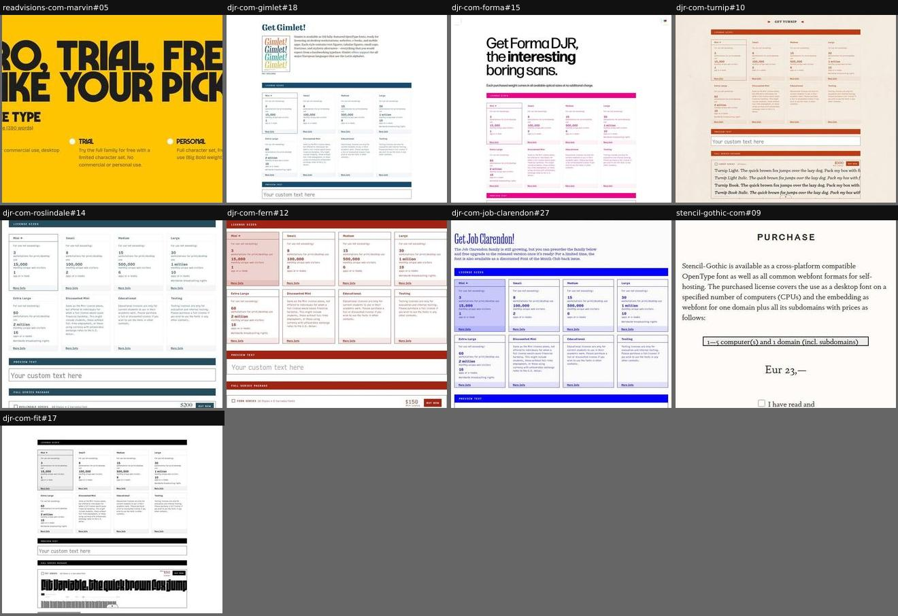
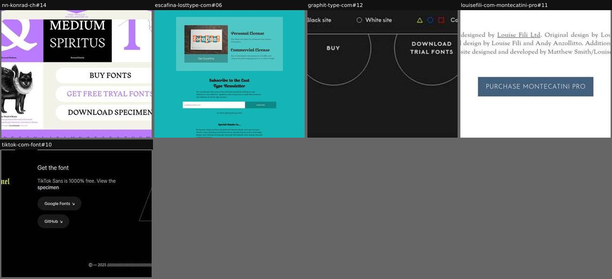
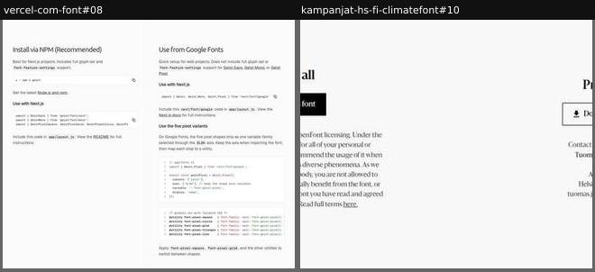
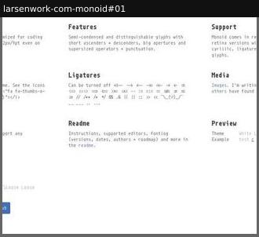

# checkout

_Section: Checkout_

How the visitor acquires the font: purchase, trial or free download.

Sample: 17 blocks from 17 sites.

| variant | n | definition | recognise by |
|---|---|---|---|
| [on-page-cart](#on-page-cart) | 9 | Buying happens on the page: licence picker, packages and prices, preview, add to cart. | prices, licence sizes, cart |
| [link-out-cta](#link-out-cta) | 5 | Prominent buy, trial or download buttons linking to an external shop or repository. | 1–2 big buttons, no prices |
| [free-download](#free-download) | 2 | A free download with a plain-language licence summary and/or developer install instructions. | OFL, npm or brew commands, press kit |
| [build-configurator](#build-configurator) | 1 | Options (alternates, spacing, ligatures) select which pre-built files you download. | option toggles plus a download button |
| [package-price-sheet](#package-price-sheet) | 0 | The licence packages (family, subfamily, single style) laid out with contents and ‘from’ prices, illustrated with style samples; the purchase itself happens in an external shop. | package cards with prices, buy links out |
| [supporter-tier-wall](#supporter-tier-wall) | 0 | For a free font: donation tiers shown as medals with amounts, each followed by the names of supporters at that level; the thank-you wall is also the ask. | tiers, amounts, supporter names |

## Rubric

Recorded for every instance in Phase 3, in addition to the cross-cutting attributes in `rubric.json`:

- **destination**: on-page | foundry-shop | distributor | repository | app-store
- **pricesOnPage**: true | false
- **licenceOptions**: true | false
- **trial**: true | false
- **free**: true | false

## on-page-cart

Buying happens on the page: licence picker, packages and prices, preview, add to cart.

**Recognise by:** prices, licence sizes, cart

| example | look | feel | ux | learn |
|---|---|---|---|---|
| [readvisions-com-marvin#05](../../archive/readvisions-com-marvin/blocks/05.jpg) | Saffron field, huge black headline 'Pro, Trial, Free: take your pick', three radio options with one-line licence summaries | Friendly, plain-spoken, confident | Choose licence type, tick weights or bundles with live prices (£19 per weight, family discounts), enter email | Put trial and free personal use as equal options next to Pro, and state the licence length ('390 words') to lower the barrier |
| [djr-com-gimlet#18](../../archive/djr-com-gimlet/blocks/18.jpg) | White, navy section bars: licence-size cards (Mini to Extra Large, Discounted, Educational, Testing), preview text field, package cards with prices and live sample lines | Thorough, transparent, independent-foundry | Choose licence size, type preview text, tick packages or single styles, Buy now per package | Render every package as live sample lines in the visitor's own text: buyers compare what they get, not just names |
| [djr-com-forma#15](../../archive/djr-com-forma/blocks/15.jpg) | White, black headline 'the interesting boring sans', magenta-ruled licence-size cards (Mini…Testing), preview text field | Clear, friendly, self-serve | Pick licence size, type preview text, choose weights/packages, add to cart | Name licence tiers by real usage limits (pageviews, apps) so buyers choose without reading a EULA |
| [djr-com-turnip#10](../../archive/djr-com-turnip/blocks/10.jpg) | Cream paper texture, rust-red section bars, licence-size cards, package list with prices | Old-fashioned shopfront, transparent | Pick licence size; type preview text that renders across packages; add to cart | Let the preview text flow into every package line, so you see what you are buying |
| [djr-com-roslindale#14](../../archive/djr-com-roslindale/blocks/14.jpg) | White, navy-ruled licence-size cards (Mini…Testing), preview text field, full-series package row with $200 Buy Now | Clear, transparent, self-serve | Pick licence size, type preview text, select packages, buy | Let buyers preview their own text right inside the cart so they confirm the choice before paying |
| [djr-com-fern#12](../../archive/djr-com-fern/blocks/12.jpg) | White with dark red rules, licence-size cards (Mini…Testing), preview text field, full series package $150 Buy Now | Clear, consistent, self-serve | Pick licence size, type preview text, choose package, buy | Recolour one checkout template per family so the shop stays familiar but on-brand for each release |
| [djr-com-job-clarendon#27](../../archive/djr-com-job-clarendon/blocks/27.jpg) | White, blue condensed 'Get Job Clarendon!', preorder note, blue-ruled licence-size cards, preview text field | Upbeat, transparent | Preorder with free upgrade; pick licence size, preview text, choose package | Sell an unfinished family as a preorder with a free upgrade to fund and test it in public |
| [stencil-gothic-com#09](../../archive/stencil-gothic-com/blocks/09.jpg) | Cream page, centred serif text, licence-tier dropdown, large price 'Eur 23,-', EULA checkbox | Plain, honest, self-published | Pick licence size, price updates, tick EULA to reveal a PayPal checkout link | Gating the pay link behind an EULA tick keeps a one-person shop legally tidy with zero infrastructure |
| [djr-com-fit#17](../../archive/djr-com-fit/blocks/17.jpg) | White, black section bars, 8 licence-size cards (Mini to Testing) with limits, preview text field, full-series package with price | Utilitarian, transparent, shop-like | Pick licence size, type preview text, tick packages/styles, add to cart | Spell out each licence tier in concrete limits (workstations, monthly visitors, apps) so buyers self-select |

## link-out-cta

Prominent buy, trial or download buttons linking to an external shop or repository.

**Recognise by:** 1–2 big buttons, no prices

| example | look | feel | ux | learn |
|---|---|---|---|---|
| [nn-konrad-ch#14](../../archive/nn-konrad-ch/blocks/14.jpg) | Bento of purple/black/cream tiles (ampersand, 'MEDIUM SPIRITUS', angle diagram, winged-wolf etching) beside three pill buttons | Eccentric, bookish, mythological | Buy fonts, get free trial, download specimen buttons, all link out | Set the CTA pills themselves in the typeface at large size: the buttons double as a specimen |
| [escafina-losttype-com#06](../../archive/escafina-losttype-com/blocks/06.jpg) | Teal page, card with risograph print photo, script-heading 'Personal License' / 'Commercial License', then newsletter form and thanks | Indie, generous, warm | One 'Get Escafina' card links to the foundry shop; newsletter signup below | Pay-what-you-want personal licence plus a physical print bonus on the commercial one makes buying feel like patronage |
| [graphit-type-com#12](../../archive/graphit-type-com/blocks/12.jpg) | Charcoal, two large outlined circles 'BUY' and 'DOWNLOAD TRIAL FONTS'; black/white site toggle | Minimal, graphic | Two CTAs; site theme toggle (black site / white site) | Giving trial equal weight to buy lowers the barrier |
| [louisefili-com-montecatini-pro#11](../../archive/louisefili-com-montecatini-pro/blocks/11.jpg) | White, small serif credits, one slate-blue 'PURCHASE MONTECATINI PRO' button | Refined, quiet | One purchase button | Credits right above the button add provenance at the moment of decision |
| [tiktok-com-font#10](../../archive/tiktok-com-font/blocks/10.jpg) | Black, 'Get the font', pill buttons for Google Fonts and GitHub | Corporate-cool, generous | Two download destinations | For free fonts the 'checkout' is choosing a distribution channel |

## free-download

A free download with a plain-language licence summary and/or developer install instructions.

**Recognise by:** OFL, npm or brew commands, press kit

| example | look | feel | ux | learn |
|---|---|---|---|---|
| [vercel-com-font#08](../../archive/vercel-com-font/blocks/08.jpg) | White two-column docs layout, npm and Next.js code blocks with copy icons, feature-by-method table with check icons, .zip download | Product-docs, precise, frictionless | Copy commands and snippets; download .zip; links to README and licence | Compare install methods by what each one loses (features, glyphs): it saves support questions later |
| [kampanjat-hs-fi-climatefont#10](../../archive/kampanjat-hs-fi-climatefont/blocks/10.jpg) | White, two centred columns: 'Free for all' black Download font button with OFL summary; 'Press kit' outline button and media contact | Civic, trustworthy, straightforward | Download font zip; download PR kit; read full terms | Summarise the OFL in two human sentences next to the button, and give press a separate kit and named contact |

## build-configurator

Options (alternates, spacing, ligatures) select which pre-built files you download.

**Recognise by:** option toggles plus a download button

| example | look | feel | ux | learn |
|---|---|---|---|---|
| [larsenwork-com-monoid#01](../../archive/larsenwork-com-monoid/blocks/01.jpg) | White, monospace README-style grid of labelled paragraphs (Concept, Features, Support, Readme) above 'v0.61' option rows and blue buttons | Developer-plain, open-source, utilitarian | Pick alternates, line height, tracking and ligatures on/off, then Download; GitHub and readme links | Let people choose spacing and alternates before download, so they get a ready build instead of tweaking editor settings |

## package-price-sheet

The licence packages (family, subfamily, single style) laid out with contents and ‘from’ prices, illustrated with style samples; the purchase itself happens in an external shop.

**Recognise by:** package cards with prices, buy links out

_No instance in the sample yet._

## supporter-tier-wall

For a free font: donation tiers shown as medals with amounts, each followed by the names of supporters at that level; the thank-you wall is also the ask.

**Recognise by:** tiers, amounts, supporter names

_No instance in the sample yet._
