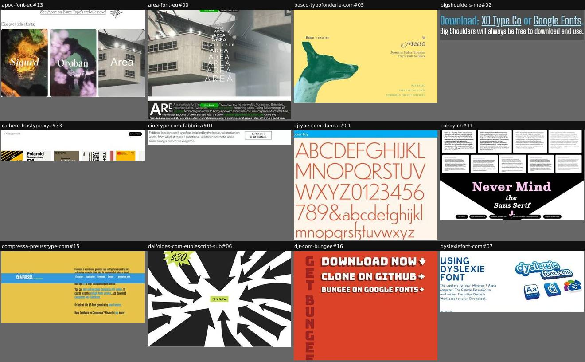
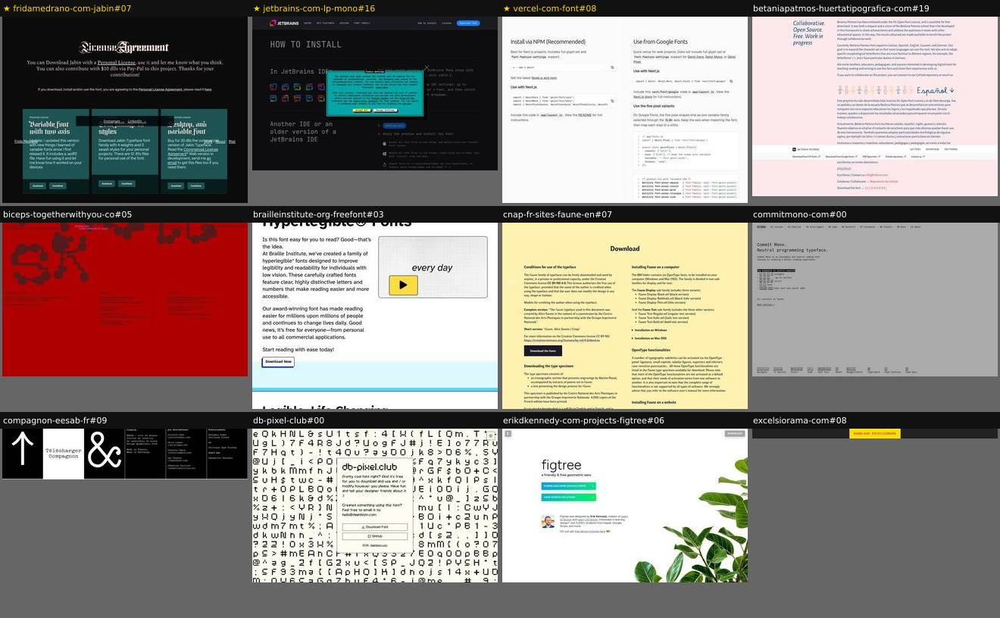
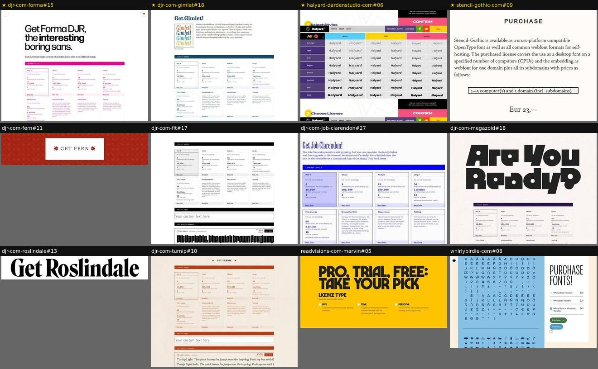
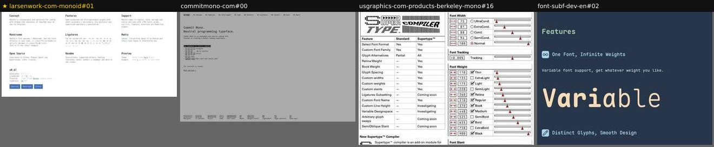
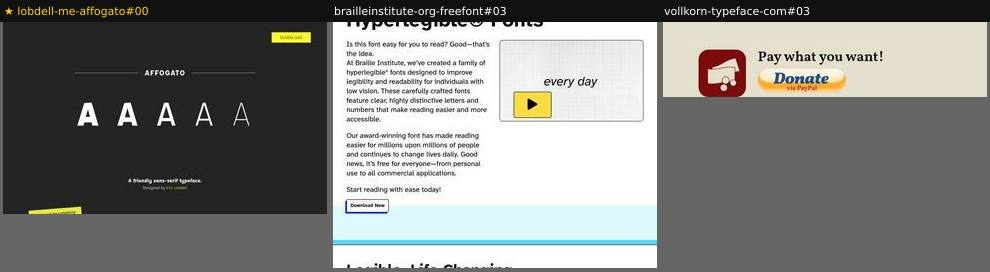
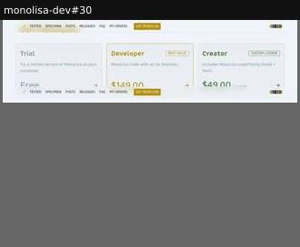
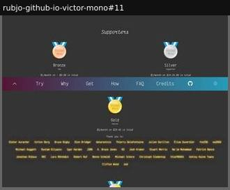
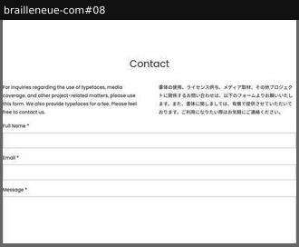

# checkout

_Section: Checkout_

How the visitor acquires the font: purchase, trial or free download.

170 instances on 148 sites (the Phase 3 extraction of 181 sites).

| variant | sites | definition | recognise by |
|---|---|---|---|
| [link-out-cta](#link-out-cta) | 89 | Prominent buy, trial or download buttons linking to an external shop or repository. | 1–2 big buttons, no prices |
| [free-download](#free-download) | 47 | A free download with a plain-language licence summary and/or developer install instructions. | OFL, npm or brew commands, press kit |
| [on-page-cart](#on-page-cart) | 14 | Buying happens on the page: licence picker, packages and prices, preview, add to cart. | prices, licence sizes, cart |
| [build-configurator](#build-configurator) | 4 | Options (alternates, spacing, ligatures) select which pre-built files you download. | option toggles plus a download button |
| [donation-widget](#donation-widget) | 3 | For a free font: a short appeal beside an embedded donation form (one-time/monthly frequency tabs, preset amounts, other amount, designation) so visitors can pay what they want for what they download | embedded donation form with preset amounts |
| [package-price-sheet](#package-price-sheet) | 2 | The licence packages (family, subfamily, single style) laid out with contents and ‘from’ prices, illustrated with style samples; the purchase itself happens in an external shop. | package cards with prices, buy links out |
| [supporter-tier-wall](#supporter-tier-wall) | 1 | For a free font: donation tiers shown as medals with amounts, each followed by the names of supporters at that level; the thank-you wall is also the ask. | tiers, amounts, supporter names |
| [inquiry-form](#inquiry-form) | 1 | No shop or price list: licensing (and other requests) go through an on-page contact form (name, e-mail, message, privacy consent, send), with a line saying the fonts are provided for a fee on request. | contact form instead of a shop |

## Rubric

Recorded for every instance in Phase 3, in addition to the cross-cutting attributes in `rubric.json`:

- **destination**: on-page | foundry-shop | distributor | repository | app-store
- **pricesOnPage**: true | false
- **licenceOptions**: true | false
- **trial**: true | false
- **free**: true | false

## link-out-cta

Prominent buy, trial or download buttons linking to an external shop or repository.

**Recognise by:** 1–2 big buttons, no prices

| example | look | feel | ux | learn |
|---|---|---|---|---|
| [apoc-font-eu#13](../../archive/apoc-font-eu/blocks/13.jpg) | An underlined centred link 'See Apoc on Blaze Type's website now!' with a woodcut pointing-hand manicule, plus the fixed bar's 'Buy Apoc' and 'Download Trial' links | Understated, old-print charm | All links open the Blaze Type shop or trials page in a new tab | A woodcut manicule next to the shop link keeps the period voice even in the CTA |
| [area-font-eu#00](../../archive/area-font-eu/blocks/00.jpg) | Two pills fixed at the top centre over everything (never cut as their own block): green 'Buy **Area**' and black 'Download Trial'; at the end a full-width green bar 'See **Area** on Blaze Type's website now! →' | Always-available, light-touch | Buy and the end bar go to blazetype.eu/typefaces/area; Trial to blazetype.eu/trials | Two small fixed pills keep buying one click away without a full nav bar |
| [basco-typofonderie-com#05](../../archive/basco-typofonderie-com/blocks/05.jpg) | 'Cashier': yellow screen with a teal duotone dog in profile, a right-aligned credit in swash italic and three small tracked mint text links | A closing joke rather than a sales pitch | Three links to Typofonderie: buy, try-out fonts, PDF specimen | Mirror the hero layout for the buy section: same palette, new animal, and links small enough to stay elegant |
| [bigshoulders-me#02](../../archive/bigshoulders-me/blocks/02.jpg) | A two-line fitted sentence: 'Download: XO Type Co or Google Fonts.' in blue with underlined links, then 'Big Shoulders will always be free to download and use.' in white | Direct | Two inline text links, placed directly under the hero | A free family can place 'always free' as a display line in place of a button |
| [calhern-frostype-xyz#33](../../archive/calhern-frostype-xyz/blocks/33.jpg) | The fixed 'BUY CALHERN' pill on every screen plus, in the sticky technical sidebar, 'From £50.00 GBP' with a 'Buy' button | Discreet but constant | Both link to the Calhern Condensed page on frostype.xyz | Show a 'from' price next to the spec card so buyers see cost where they check the technical details |
| [cinetype-com-fabbrica#01](../../archive/cinetype-com-fabbrica/blocks/01.jpg) | Small heading 'Fabbrica' and a three-line description, with a thin outlined box button 'Buy Fabbrica / or Get Trial fonts' on the right; the same button returns after 'Why Fabbrica?' near the end (seen on mobile, not cut as a desktop block) | Understated, editorial | Links to the distributor C-A-S-T, where purchase and trials happen | One two-line outlined button near the title and again after the conclusion is enough for an essay-style page |
| [cjtype-com-dunbar#01](../../archive/cjtype-com-dunbar/blocks/01.jpg) | Full-column outlined 'Get Dunbar' buttons (dark-blue rounded border, bold blue label) after the editable words and after the designer's essay, plus '↓ Buy' in the fixed nav | Plain, unobtrusive | Links to the CJ Type typefaces page (one copy still points at the old Type Network shop) | A full-width outlined button closing each long section is enough when the nav also carries Buy |
| [colroy-ch#11](../../archive/colroy-ch/blocks/11.jpg) | A black funnel shape with 'Never Mind / the / Sans Serif' in pink and white italic and a pink arrow pointing down into three pills (green 'SPECIMEN PDF', yellow 'BUY' that flips to 'COLROY' and was captured upside down mid-turn, violet 'FREE TRIALS') above a huge pink rounded button 'GOOD BUY' | Cheeky, irresistible | Buttons link to nouvellenoire.ch/product/colroy, the specimen PDF and trials; the middle pill rotates between BUY and COLROY | Lead into the buy buttons with a slogan and a funnel arrow, and make the main button a pun ('GOOD BUY') |
| [compressa-preusstype-com#15](../../archive/compressa-preusstype-com/blocks/15.jpg) | On mustard, 'Download Compressa' at left and a right-hand text column: the family description, then inline blue links 'test and purchase Compressa OTF online', 'variable fonts version', 'Compressa PDF-Specimen', a VF gimmick by Juan Fuentes, and 'let me know' | Informal, link-in-prose | Text links out to the PreussType shop, the PDF specimen, a CodePen experiment and a contact page | Low-key checkout: links woven into a short paragraph, including a PDF specimen and a community experiment |
| [daifoldes-com-eubiescript-sub#06](../../archive/daifoldes-com-eubiescript-sub/blocks/06.jpg) | Closing panel of ~20 heavy black arrows converging from every edge onto a small accent BUY NOW button in a white centre, with a 'Just $30' starburst at top-left; it is also the end of the page (no footer) | Comic, emphatic, a wink at hard-sell ads | One BUY NOW link to the site's own checkout page (checkout.html) | Let the illustration do the pointing: a field of arrows converging on one small button makes the final CTA impossible to miss without making it big |
| [djr-com-bungee#16](../../archive/djr-com-bungee/blocks/16.jpg) | Final red panel: vertical dark-red 'GET BUNGEE' at left, three descending-size links in white Bungee with shade and arrows: Download now ↓, Clone on GitHub →, Bungee on Google Fonts → | Big, closing, free | Zip from GitHub Releases, GitHub repository, Google Fonts. Page ends here at the right edge | Set the download links in the display face at falling sizes: the type itself ranks the options, and no button styling is needed |
| [dyslexiefont-com#07](../../archive/dyslexiefont-com/blocks/07.jpg) | 'USING DYSLEXIE FONT' intro with a glossy logo and icons, then three pastel columns (Chrome Extension, Dyslexie Font, Dyslexia Workspace), each with subhead, screenshot, device icons, and Read More and Get Started buttons | Product line-up, clear options | Each column has an outlined and a filled button; devices show where it runs | Sell by context rather than by licence: columns answer 'where do you want to read?', with device icons doing the comparison |
| [editorialnew-com#11](../../archive/editorialnew-com/blocks/11.jpg) | On near-black: an ↑ back-to-top arrow, then two big white pills 'Buy Editorial New' and 'Try it for Free' with a tan 'GET IT' starburst overlapping the second | Uncluttered, light-hearted | Both pills open the Pangram Pangram product page (#license and #free-to-try anchors); the arrow scrolls back to the newspaper; header 'Get the font' jumps here | Offer 'Try it for Free' at equal weight to 'Buy': a free trial is the softer conversion for a display-heavy face |
| [escafina-losttype-com#00](../../archive/escafina-losttype-com/blocks/00.jpg) | A lighter-teal rounded card: photo of the 'Escafina!' riso print on a wooden table with a darker 'Get Escafina' bar under it, and at right the script headings 'Personal License' (pay what you want) and 'Commercial License' ($55 plus the print) | Generous, crafty | The whole card links to the Lost Type shop; the identical card closes the page above the newsletter | Attach the button to the bottom of the bonus-print photo: the print is visually the thing you get when you click |
| [exat-hottype-co#10](../../archive/exat-hottype-co/blocks/10.jpg) | Closing orange screen with 'Get Exat →' at ~140px in off-white across the top under a hairline; the fixed header carries the same 'Get Font →' | Bookend to the hero | Links to hottype.co/fonts/exat; PDF specimens (Exat, Condensed, Wide) are linked in a Specimen block seen on mobile | Close with the hero's colour and type size so the buy line feels like the last poster |

_…and 83 more in the gallery (`npm run app`)._

## free-download

A free download with a plain-language licence summary and/or developer install instructions.

**Recognise by:** OFL, npm or brew commands, press kit

| example | look | feel | ux | learn |
|---|---|---|---|---|
| [★ fridamedrano-com-jabin#07](../../archive/fridamedrano-com-jabin/blocks/07.jpg) | 'License Agreement' title, a chatty note in serif, then three dark-teal cards: Variable font with two axis (personal), Font family: 12 styles (personal), Desktop and variable font (commercial, 20 dlls), each with Download and Contribute buttons | A friend sharing files, with clear rules | Download gets the zip; Contribute goes to PayPal ($10 suggested); licence links open agreement pages | Pair each download with a small voluntary 'Contribute' button: the pay-what-you-want ask stays at each moment of choice |
| [★ jetbrains-com-lp-mono#16](../../archive/jetbrains-com-lp-mono/blocks/16.jpg) | 'HOW TO INSTALL': 'In JetBrains IDEs' with a grid of 12 IDE icons and instructions (ships with v2019.3; Settings → Editor → Font); 'Another IDE or an older version' with numbered steps (1. Download font button, 2. unzip and install, with macOS / Windows / Linux icons and per-OS commands incl. fc-cache -f -v); 'RECOMMENDED SETTINGS FOR THE FONT' (Size 13, Line spacing 1.2); 'LICENSE' (SIL Open Font License, free for commercial use, credit appreciated); 'FAQ' as question / '→ YES.' pairs (install, website, poster, logotype…) | Generous and frank | Direct zip download; OFL link; FAQ answers are always visible (no accordion) | Answer licence questions as 'May I…? → YES.' pairs: shorter and friendlier than any licence summary |
| [★ vercel-com-font#08](../../archive/vercel-com-font/blocks/08.jpg) | Two-column install guide on the grid: 'Install via NPM (Recommended)' with a copyable 'npm i geist' line and Next.js import snippet; 'Use from Google Fonts' with next/font/google code and Tailwind utilities for the five pixel variants; below, a 'Features by installation method' comparison table (NPM / Google Fonts / .zip with check, cross and warning icons) and 'Get the .zip' with a 'Download ⊕' pill and 'Licensed under OFL… Read the license' | Practical, documentation-grade | Copy buttons on each snippet; Download goes to the latest GitHub release; licence link to LICENSE.txt | For a free developer font, compare the install routes in a small feature table so people choose before they copy code |
| [betaniapatmos-huertatipografica-com#19](../../archive/betaniapatmos-huertatipografica-com/blocks/19.jpg) | Italic lead 'Collaborative. Open Source. Free. Work in progress' beside four paragraphs (SIL OFL, request of the Betània Patmos school, supported languages Catalan/Spanish/English/Guaraní/German, invitation to teachers), repeated in Spanish under the 'Español ↓' figures heading, ending with 'Escribinos / Contact us info@htfonts.com', 'Colaborar → Repositorio de GitHub' and 'Download the font → [ C L I C K H E R E ]' | Generous, community-minded | Download link to htfonts.com; GitHub and email for contributors; the nav also offers HT Fonts and Google Fonts downloads | Frame a free font as an open, collaborative project and ask its users (teachers) for feedback right where they download |
| [biceps-togetherwithyou-co#05](../../archive/biceps-togetherwithyou-co/blocks/05.jpg) | 'DOWNLOAD BICEPS' at the head of the info columns and 'DOWNLOAD' in the fixed header, with 'want to suggest an edit or share Biceps in use? follow and tag us on Instagram @togetherwithyou_digital' | Casual, no-strings | Links to a Google Drive file; free for commercial and personal use | For a free font, ask for a tag in return: the download line doubles as the community call |
| [brailleinstitute-org-freefont#03](../../archive/brailleinstitute-org-freefont/blocks/03.jpg) | 'Download the Atkinson Hyperlegible® Font': a light-grey rounded form panel (email field, required EULA agreement checkbox, optional news checkbox, 'Submit'), followed by 'Installation Instructions' in two columns of ruled steps (One Typeface—Three Styles, Seven Weights and Italics, Step 1 Download, Step 2 Finding the Right Fonts, Step 3A Windows, Step 3B Mac) | Careful, step-by-step | The ZIP is released after submitting an email and ticking the licence agreement; install steps explain which folder to open on each OS | Write install steps for non-designers (where the OTFs are inside the ZIP, what to double-click on Windows vs Mac): an accessibility font reaches people who have never installed a font |
| [cnap-fr-sites-faune-en#07](../../archive/cnap-fr-sites-faune-en/blocks/07.jpg) | 'Download' on pale yellow in two columns: left 'Conditions for use of the typeface' (CC BY-ND 4.0, how to credit: complete and short versions), a navy 'Download the fonts' button, and 'Downloading the type specimen' (print and screen PDF buttons, 4,000 printed copies); right 'Installing Faune on a computer' (Display: Thin, Bold Italic, Black; Text: Regular, Italic, Bold; collapsible Windows/Mac steps), 'OpenType functionalities' and 'Installing Faune on a website' with <link> and font-family code boxes | Thorough, civic | Direct download buttons; disclosure triangles for OS instructions; copyable CSS snippets | For a public, free font, the download section should answer licence, credit line, install and web embed in one place |
| [commitmono-com#00](../../archive/commitmono-com/blocks/00.jpg) | Section 08 'Install', HTML only: numbered guide with 'Download (default settings)' and 'Customize download', four style-linked files, per-OS install steps, editor activation and VS Code settings.json lines | Thorough, friendly documentation | Download buttons; step list covering Windows, Mac, Linux and editors | Explain why four files make a 'Style Group' and give the exact settings.json lines: install friction is the real checkout barrier for a free coding font |
| [compagnon-eesab-fr#09](../../archive/compagnon-eesab-fr/blocks/09.jpg) | In the last grid row: a big ↑ (back to top) cell, then a white cell 'Télécharger Compagnon', then a big '&' | Casual, inviting | The white cell downloads Compagnon_Family.zip directly; the free-use licence is stated in the intro cells; the hero's ↙ arrow links here | Make the download one inverted cell of the specimen grid: it stands out without breaking the system |
| [db-pixel-club#00](../../archive/db-pixel-club/blocks/00.jpg) | Two full-width outlined buttons stacked inside the hero card: '⤓ Download Font' and 'GitHub' with feather icons | Simple, no friction | Download Font fetches db-pixel.zip directly from the site; GitHub links to the repository; the licence is stated in plain words in the card ('use and / or modify however you please') | When the font is free, the pitch sentence can double as the licence summary and the download sits right under it |
| [erikdkennedy-com-projects-figtree#06](../../archive/erikdkennedy-com-projects-figtree/blocks/06.jpg) | 'figtree' in Light ~80px, 'a friendly & free geometric sans', then two gradient buttons (blue→green): 'DOWNLOAD FROM GOOGLE FONTS →' and 'VIEW SOURCE ON GITHUB →'; a fig plant photo fills the right | Clean, inviting | Links out to Google Fonts and the GitHub repo; the fixed DOWNLOAD button anywhere on the page scrolls here | For an open-source font, offer both the consumer route (Google Fonts) and the source (GitHub) side by side |
| [excelsiorama-com#08](../../archive/excelsiorama-com/blocks/08.jpg) | Yellow 'DOWNLOAD EXCELSIORAMA' button in 18px monospace red-orange on charcoal, linking to the Github zip |  |  |  |
| [floriankarsten-github-io-space-grotesk#11](../../archive/floriankarsten-github-io-space-grotesk/blocks/11.jpg) | 'Use, Modify, Contribute' in white at ~200px over two lines (animated weight), then three small white pills: 'Google Fonts', 'GitHub', 'Florian Karsten' | Inviting, community-minded | Pills link to the Google Fonts specimen, the GitHub repository and the designer's font page | Summarise the open licence as three verbs at display size: the download section explains the OFL before anyone clicks |
| [github-com-mona-sans#12](../../archive/github-com-mona-sans/blocks/12.jpg) | Centred on near-black: a macOS-style file icon 'Ag' labelled 'Mona-Sans.woff2' (selected, blue label), 'Open-source / and free to use' (second line grey), a one-line OFL summary '(basically, you can use it on your sites and in your projects—read the full license)', a strip of GitHub-contribution-graph green squares, and 'Every contribution counts. Help us make Mona Sans and Hubot Sans better by creating a pull request on GitHub.' | Inclusive, open-source pride | Links to the LICENSE file and the repository; the contribution squares light up (animated) | Summarise the licence in one parenthetical and turn 'contribute' into the closing CTA, using the platform's own contribution graph as the visual |
| [indestructibletype-com-jost#14](../../archive/indestructibletype-com-jost/blocks/14.jpg) | Justified sections 'Variable font technology' ($10 minimum for the variable version, static fonts free, source free on GitHub) and 'Easy web use' with a copyable <link> tag in monospace | Open-source, candid | Copy the snippet (it is user-select styled); GitHub link in red | Explain in plain words why one version costs $10 and the others don't, and offer free hosted CSS |

_…and 32 more in the gallery (`npm run app`)._

## on-page-cart

Buying happens on the page: licence picker, packages and prices, preview, add to cart.

**Recognise by:** prices, licence sizes, cart

| example | look | feel | ux | learn |
|---|---|---|---|---|
| [★ djr-com-forma#15](../../archive/djr-com-forma/blocks/15.jpg) | 'Get Forma DJR, the interesting boring sans.' then magenta section bars: LICENSE SIZES (8 cards: Mini, Small, Medium, Large, Extra Large, Discounted Mini, Educational, Testing, with workstation/visitor/app limits), PREVIEW TEXT (one input), FULL SERIES PACKAGE and OTHER PACKAGES (cards with checkbox, price $350/$275/$150, BUY NOW, a big sample line and inline axis sliders), INDIVIDUAL WEIGHTS ($50/style, a checkbox per weight with samples at Deck/Display/Banner or Micro→Banner sizes) | Generous, catalogue-like, very complete | Pick a licence size card; type preview text that replaces every sample; tick packages or single weights; package cards expand (▼) and their sliders vary Weight, Width, Optical Size, Slant; add to cart without leaving the page | Make the price list itself the specimen: every purchasable style shows its own sample at its optical sizes, driven by one preview-text field |
| [★ djr-com-gimlet#18](../../archive/djr-com-gimlet/blocks/18.jpg) | 'Get Gimlet!' with a PDF-specimen thumbnail and a paragraph (112 OpenType fonts); navy section bars 'LICENSE SIZES' (8 cards: Mini, Small, Medium, Large, Extra Large, Discounted Mini, Educational, Testing, each with workstation / web-visitor / app limits), 'PREVIEW TEXT' input, 'FULL SERIES PACKAGE' ($350), 'OTHER PACKAGES' (Starter $150, Display Normal / Narrow / Condensed / Compressed $150 each, Display all widths $350, Text $250, Micro $250) and 'INDIVIDUAL STYLES' ($50/style, 25% off roman/italic pairs), every row a checkbox with live pangram samples. The crop is cut at ~2400px of ~10,900px | Comprehensive, honest | Choose a licence tier (radio, price multipliers 1–8, 0.5 for discounted, 0 for educational/testing), tick packages or styles, prices update, 'Buy Now' per package; each package card expands (▾) to list all its styles; the preview field rewrites every sample | Make the price list the specimen: each package card shows its styles as live, editable sample lines, so choosing what to buy is also comparing styles |
| [★ halyard-dardenstudio-com#06](../../archive/halyard-dardenstudio-com/blocks/06.jpg) | '① Select Styles': a matrix with purple weight labels (Extralight → Black) down the left, colour-coded column headers MICRO (cyan) / TEXT (yellow) / DISPLAY (pink), each with roman and italic columns, every cell the word 'Halyard' in that style on grey; an 'All + VAR' toggle top-left. '② Choose License': four licence columns (Basic License: CPUs + Perpetual; Web Embedding: AMPVs + term; App Embedding: AMAUs; Fluid Interface: AMRUs) with dropdowns; a black bar 'Please select a style/license' in yellow at the bottom | Methodical, transparent | Click cells (or whole rows/columns, or 'All + VAR' for the variable fonts) to add styles; set usage tiers per licence type; the black bar shows the total or the prompt | Let the buyer pick styles from a matrix that is also the family overview, then size the licence by usage metrics; the price bar updates in place |
| [★ stencil-gothic-com#09](../../archive/stencil-gothic-com/blocks/09.jpg) | Paragraph on licensing, then a single native select of licence scope, a large 'Eur 23,—' and a EULA checkbox; the 'Checkout via Pay-pal' link is hidden until it's ticked | Shop counter simplicity | Select changes the price (23, 41, 59); ticking the EULA reveals the PayPal link to FetchApp | One select, one price, one tick: a one-product checkout needs no cart. Gating the pay link on the EULA makes the licence the last thing read |
| [djr-com-fern#11](../../archive/djr-com-fern/blocks/11.jpg) | A red damask 'GET FERN' band (11), then DJR's cart in red: LICENSE SIZES as 8 cards (Mini selected in pink; Small, Medium, Large, Extra Large, Discounted Mini, Educational, Testing), a PREVIEW TEXT field, FULL SERIES PACKAGE (Fern Series, 10 styles + 2 variable, $150), OTHER PACKAGES (Fern Text, Fern Micro, $100 each), INDIVIDUAL STYLES ($50/style, '25% off Roman/Italic Pairs!') with a checkbox per style, a 'BUY SELECTED PACKAGES AND STYLES' button and ADDITIONAL INFORMATION (PDF, formats) | Clear, honest pricing, tinted to the page's red | Pick a licence card (radio) and prices rescale by its multiplier; type in Preview text to restyle every pangram row; tick packages or styles and buy in one submit; package cards expand with a ▼ tab | Make the licence tiers the first thing in the cart and price everything by a multiplier, so one radio choice reprices the whole list |
| [djr-com-fit#17](../../archive/djr-com-fit/blocks/17.jpg) | Black-ruled sections on white: 'LICENSE SIZES' as 8 cards (Mini, Small, Medium, Large, Extra Large, Discounted Mini, Educational, Testing) with workstation/visitor/app limits; 'PREVIEW TEXT' input; 'FULL SERIES PACKAGE' card with a checkbox, '10 Styles + 1 Variable Font', '$50 Mini License', BUY NOW, a full-width sample line and a Width slider; 'Buy selected packages and styles' button | Transparent, utilitarian | Pick a licence card (radio; price × multiplier 0–8), type preview text, tick packages or click BUY NOW; the variable sample has a wdth slider 100–3600 | Show licence limits as numbers on cards and multiply one base price: the buyer sees exactly what each tier allows |
| [djr-com-job-clarendon#27](../../archive/djr-com-job-clarendon/blocks/27.jpg) | 'Get Job Clarendon!' in blue condensed, a lead paragraph (pre-order with free upgrade; also a discounted Font of the Month Club back issue), then DJR's cart with royal-blue section bars: LICENSE SIZES (8 cards, Mini selected in lavender), PREVIEW TEXT, FULL SERIES PACKAGE (Job Clarendon, 40 styles + 1 variable, $150), OTHER PACKAGES (Condensed, Extra Condensed, Compressed, Skyline, 10 styles each, $100), INDIVIDUAL STYLES ($50/style); the crop stops mid-list, the DOM continues with 'Additional information' (formats, language support, list of stylistic alternates, variable axes) | Thorough and honest; the pre-order note sets expectations | Licence radio rescales prices by multiplier; Preview text rewrites every pangram row; tick packages or styles and buy; package cards expand with a ▼ tab | Group packages by width (one package per width, 10 weights each) so the cart itself teaches the family structure |
| [djr-com-megazoid#18](../../archive/djr-com-megazoid/blocks/18.jpg) | 'Are You Ready?' in huge black Megazoid, then DJR's standard cart: purple-labelled bars LICENSE SIZES (eight cards: Mini, Small, Medium, Large, Extra Large, Discounted Mini, Educational, Testing, each with workstation / web-visitor / app limits), PREVIEW TEXT input ('Your custom text here'), FULL SERIES PACKAGE row (checkbox, 'MEGAZOID 5 Styles', $25 Mini License, BUY NOW, scrolling style samples), 'Buy selected packages and styles', MEGAZOID ELSEWHERE (Type Network, Fontstand, Adobe Fonts) and ADDITIONAL INFORMATION | Honest, thorough | Pick a licence size card (Mini selected), type preview text into the package samples, tick packages and add to cart; trial via the hero's Try link | Spell out licence sizes in plain numbers (3 workstations, 15,000 visitors, 1 app) and offer discounted and educational tiers on the same grid |
| [djr-com-roslindale#13](../../archive/djr-com-roslindale/blocks/13.jpg) | 'Get Roslindale' in heavy black Display Condensed (block 13), then on white with dark-teal section bars: LICENSE SIZES (8 cards: Mini … Testing), PREVIEW TEXT (one input), FULL SERIES PACKAGE ($200, 64 styles + variable, with Optical Size/Width/Weight/Slant sliders), OTHER PACKAGES (Starter Pack $100, Display Series $150, Text, Deck…), INDIVIDUAL STYLES ($50), then 'Roslindale Elsewhere' (Fontstand rentals) and 'Additional information' (formats, language support) | Complete, shop-like but typographic | Choose a licence size; preview text replaces every sample; tick packages or styles; package cards expand (▼) and their sliders drive the variable preview; BUY NOW adds to cart; Fontstand offered for rentals | The same cart template as other DJR pages, recoloured to the family's palette and introduced by a display-size 'Get …' heading |
| [djr-com-turnip#10](../../archive/djr-com-turnip/blocks/10.jpg) | 'GET TURNIP' between florets, then the cart with rust-red section bars: LICENSE SIZES (8 cards), PREVIEW TEXT, FULL SERIES PACKAGE (Turnip Series, 16 styles, $300), OTHER PACKAGES (Starter Pack $100, Book Starter Pack $100, Standard 12 styles $250, Reading Edge 4 styles $100), INDIVIDUAL STYLES ($50/style, 25% off roman/italic pairs), a disabled buy button, TURNIP ELSEWHERE (Type Network, Fontstand, Adobe Fonts with logos) and ADDITIONAL INFORMATION (formats, language support, cases, figures, stylistic alternates) | Plain and complete; the paper texture continues under the cart | Licence radio reprices; Preview text replaces every pangram; tick packages or styles and buy; or go to a distributor for webfonts, rentals or Creative Cloud | List the third-party channels (rental, subscription, hosted webfonts) inside the cart with one line on what each is for: buyers who can't buy direct still convert |
| [readvisions-com-marvin#05](../../archive/readvisions-com-marvin/blocks/05.jpg) | Yellow field: 'PRO, TRIAL, FREE: TAKE YOUR PICK' in huge black Marvin Bold, then 'LICENCE TYPE' with a 'Read the licence (390 words)' link and three radio options (PRO – commercial use, desktop and web; TRIAL – full family, limited character set; PERSONAL – full set, Big Bold only). The rest of the form is collapsed in the capture | Straightforward, generous | Pick a licence and the next steps unfold (from the HTML): 'Weight selection' checkboxes per style for Big (Bold → Extra Light) and Small (Bold → Light) with family shortcuts (Big & Small £95 50% off, Big £76, Small £38; £19 per weight), 'Your details' (email, cardholder name, Stripe card field, country), currency radios £/$/€, two newsletter opt-ins, and a Download button; links are e-mailed | One form for paid, trial and free: the licence choice drives which steps appear, and the word count of the licence ('390 words') invites people to read it |
| [whirlybirdie-com#08](../../archive/whirlybirdie-com/blocks/08.jpg) | A white card beside the glyph panel: 'PURCHASE FONTS!' in tall narrow light caps, three radio rows with prices (Whirly Birdie Variable $25, Whirlybats Variable $25, Whirly Birdie + Whirlybats Variable $45), a green pill 'Purchase →', a blue pill 'Licensing' and a tiny '?' disclosure | Small-shop, honest | Choose one radio package, submit to a PayPal hosted button; 'Licensing' opens licence info; the '?' details element says payments go through PayPal | Three radio rows with prices and a bundle discount are all an indie two-font release needs; PayPal hosted buttons avoid a shop |
| [universalsans-com#00](../../archive/universalsans-com/blocks/00.jpg) | Step 7 'Download your family' in the side panel and a checkout section (HTML only): a Trial option with 'I agree to the EULA', licence selects (Desktop by personnel 1 → >640, Web by visitors <2.5k → >2m, Social by followers…), then Billing details, Licence holder, Payment (Stripe) and a 'Review order' table: Licence 450 Weights £75.00, Italics +50%, Text & Display +50%, Custom Name +25%, Total | Self-serve, like buying software | Trial downloads the visitor's build with a reduced character set; licensing prices scale with tiers and with each option added in earlier steps; payment and order confirmation ('ORDER #0000 Thanks for your order!') happen without leaving the app; the BuildID is shown as the receipt reference | Price the custom build as a base licence plus percentage surcharges for each extra (italics, Text+Display, custom name) so the cost visibly follows the visitor's choices |
| [nmtype-com-movement#02](../../archive/nmtype-com-movement/blocks/02.jpg) | 'Buy Poster' row at the end: a round checkbox, 'Poster Movement 50×70 cm' and '€29' right-aligned between hairlines | Minimal | Tick the poster and continue to NM type's payment page ('Buy now') | Reuse the font cart's row pattern for merchandise |

## build-configurator

Options (alternates, spacing, ligatures) select which pre-built files you download.

**Recognise by:** option toggles plus a download button

| example | look | feel | ux | learn |
|---|---|---|---|---|
| [★ larsenwork-com-monoid#01](../../archive/larsenwork-com-monoid/blocks/01.jpg) | The 'v0.61' form (version number as heading) with tiny option rows and three small blue buttons: Download, Monoisome, GitHub; after Download, a full-screen modal (captured offscreen) shows a thank-you written as code: 'if (tweeted || facebooked) { gratitude += 1; } if (githubStarred) { karmaBalance = true; } else { $('we').say('ok'); }' | Friendly, in-joke for developers | The chosen alternates, line height, tracking and ligature setting select which pre-built variant zip Download fetches; Monoisome downloads the Font Awesome-merged TTF from GitHub; the post-download overlay links 'tweeted', 'facebooked', 'githubStarred' to share intents and the repo, × closes it | Ask for the share after the download, and phrase it in the audience's language (a code snippet): it reads as a wink rather than a nag |
| [commitmono-com#00](../../archive/commitmono-com/blocks/00.jpg) | Section 07 continued, HTML only: 16 two-state radio rows labelled with their tag and effect (ss01 Ligatures, ss02 Arrows, ss03 Smart case, ss04 Symbol spacing, ss05 Smart kerning; cv01–cv11 alternates, each DEF/ALT), a font-name field, and 'Download custom for dev' and 'Download custom for design' | Compiler flags for a typeface | Set options, name the font, then download; the font is generated client-side with your defaults baked in, so it needs no editor settings | Bake chosen features into static files in the browser with opentype.js: users of weak tools get the alternates, and no server is needed |
| [usgraphics-com-products-berkeley-mono#16](../../archive/usgraphics-com-products-berkeley-mono/blocks/16.jpg) | 'New Supertype™ Compiler': a retro dot-matrix logo, a feature table (Standard vs Supertype™: font format, custom family name, glyph alternatives, retina and book weights, spacing, custom widths/weights/slants, line height 'Investigating', SemiOblique 'Coming soon') beside a screenshot of the compiler UI with Font Width, Tracking, Weight and Slant pickers: numeric values, checkboxes and red triangle markers on sliders | Pro-tool, hardware-panel | Explains an add-on compiler used after purchase to build custom fonts; no live controls on this page | Show the configurator UI as a screenshot plus a Standard vs Pro comparison table to upsell a build option without building it into the page |
| [font-subf-dev-en#02](../../archive/font-subf-dev-en/blocks/02.jpg) | 'Your favor, Your Font' (hammer icon): a JSON config snippet (family_name, use_hinted, pool_size, ligature, feature_freeze) beside 'Configure or freeze OpenType features as you want, create your own perfect font.' and a 'See Guide' button; then an emoji dialogue (😡 'Why these glyphs are SOOOOO WEIRD ???' / 🤗 'this one is for you: Maple Mono Normal…') with the preset's enabled features (cv01, cv02, cv33… ss08), a 'Test In Playground Page' link and a code preview in that preset (HTML only; cut from the truncated crop) | Self-aware, accommodating | Guide links to the custom-build docs on GitHub; the Normal preset is a direct download and can be previewed in the playground | Anticipate the objection to quirky glyphs with a ready-made 'normal' preset: the configurable font stays opinionated without losing sceptics |

## donation-widget

For a free font: a short appeal beside an embedded donation form (one-time/monthly frequency tabs, preset amounts, other amount, designation) so visitors can pay what they want for what they download

**Recognise by:** embedded donation form with preset amounts

| example | look | feel | ux | learn |
|---|---|---|---|---|
| [★ lobdell-me-affogato#00](../../archive/lobdell-me-affogato/blocks/00.jpg) | Modal, captured in HTML only: 'PAY WHAT YOU WANT / Fonts are hard to make, you know.', an e-mail field, five price chips ($50, $25, $10, $5, Free) and a submit button. Its fixed yellow Download trigger appears on every screen and repeats across the stitched capture (attached here to the hero block) | Honest, personal | Fixed Download button opens the modal. Choosing a paid amount reveals the Stripe card fields and 'Donate & Download'; Free keeps the plain 'Download Now'. Terms of Use link, tooltip explaining e-mail use | Put the free option in the same row as the paid amounts and reveal card fields only after a paid choice: the ask stays light and Free stays honest |
| [brailleinstitute-org-freefont#03](../../archive/brailleinstitute-org-freefont/blocks/03.jpg) | 'Easy to Read. Easy to Support.': left a short appeal ('We offer this font for free… help others by making a donation') and 'Download Now'; right an embedded white donation card with the logo, One Time / Monthly / Quarterly tabs, $25 / $50 / $100 / $250 buttons, '$ or other amount', 'Donate To' select, 'Donation Options' and a navy 'Continue' button | Polite, low-pressure | Visitors can donate on the page through a third-party (Funraise) iframe; downloading stays free | Put the donation ask next to the download, not instead of it: the free font stays free while supporters can pay on the spot |
| [vollkorn-typeface-com#03](../../archive/vollkorn-typeface-com/blocks/03.jpg) | Same row as Download: a red tile with cash and coins beside 'Pay what you want!' and the classic yellow PayPal Donate pill. The 'Share' heading below is empty | Dated but sincere | Plain PayPal form with no amounts on the button; suggested sums (10 €, 50 €, 250 €) are in the FAQ | Place the appeal in the same format right below the download, so paying feels like the next step |

## package-price-sheet

The licence packages (family, subfamily, single style) laid out with contents and ‘from’ prices, illustrated with style samples; the purchase itself happens in an external shop.

**Recognise by:** package cards with prices, buy links out

| example | look | feel | ux | learn |
|---|---|---|---|---|
| ★ gt-standard-com#11 | Forest-green bottom drawer opened by 'buy': 'GT Standard fonts licensing is exclusively available through Grilli Type. Buy now.', then three tiers: Full Family (336 styles, 12 subfamilies, 3 optical sizes, from $1008) with a grid of 12 'Aa'/'Mo' squares for every width in proportional and mono; Subfamily (42 styles, from $280 / $560) with 7 weight squares marked S M L; Single Styles (6 fonts, from $50 / $100) with S/M/L and oblique squares | Honest, easy to compare | Read and compare; 'Buy now' links to grillitype.com/typeface/gt-standard | Show what each licence tier contains as a grid of sample squares next to its price: buyers see the scope before the shop |
| [monolisa-dev#30](../../archive/monolisa-dev/blocks/30.jpg) | 'Get MonoLisa' and three cards: Trial ('Try a limited version… Free →'), Developer with a 'BEST VALUE' tag and gold border ('MonoLisa Code with all its features. $149.00 →'), Creator with a 'CUSTOM LICENSE' tag ('Includes MonoLisa superfamily (Code + Text). $49.00 / weight →'); below, two small notes: License (EULA, refund policy) and For students (email proof for a discount) | Simple, honest pricing | Each card links to its /buy/<plan> page where the purchase and customisation happen | Three cards (free trial, best-value developer bundle, per-weight creator licence) map to three kinds of buyer; a student note handles the edge case |

## supporter-tier-wall

For a free font: donation tiers shown as medals with amounts, each followed by the names of supporters at that level; the thank-you wall is also the ask.

**Recognise by:** tiers, amounts, supporter names

| example | look | feel | ux | learn |
|---|---|---|---|---|
| [rubjo-github-io-victor-mono#11](../../archive/rubjo-github-io-victor-mono/blocks/11.jpg) | 'Supporters': four medal images on ribbons (Bronze Fan, Silver Supporter, Gold Patron, Rainbow 'Champion Guardian Unicorn') with tier prices '$1/month or - $9.99 in total' … '$10/month or $45+ in total', and below Gold and Rainbow centred rows of supporter names in glowing yellow | Warm, community-run, a little game-like | static; the donate buttons are in 'Get it' above | Name every donor under a tier medal: the credit list is both a thank-you and a price list for support |

## inquiry-form

No shop or price list: licensing (and other requests) go through an on-page contact form (name, e-mail, message, privacy consent, send), with a line saying the fonts are provided for a fee on request.

**Recognise by:** contact form instead of a shop

| example | look | feel | ux | learn |
|---|---|---|---|---|
| [brailleneue-com#08](../../archive/brailleneue-com/blocks/08.jpg) | 'Contact': bilingual note ('For inquiries regarding the use of typefaces… We also provide typefaces for a fee'), then full-width bordered fields Full Name*, Email*, Message*, a privacy-policy checkbox and a full-width black 'Send' button | Personal, gated | Required fields and consent checkbox; submit sends the inquiry | For a project typeface licensed case by case, a contact form is the honest checkout: say plainly that use is available for a fee |
