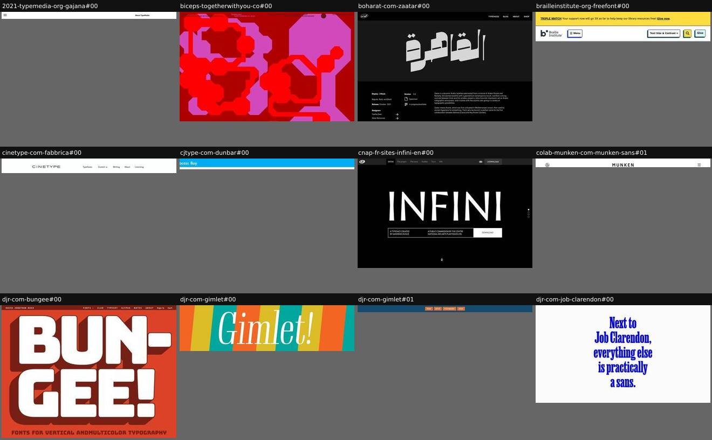
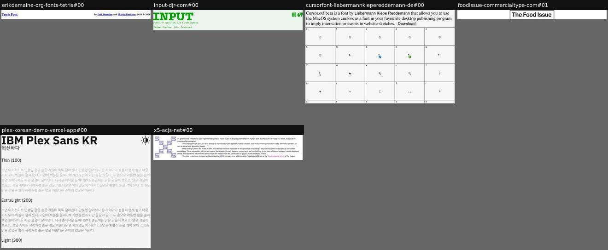
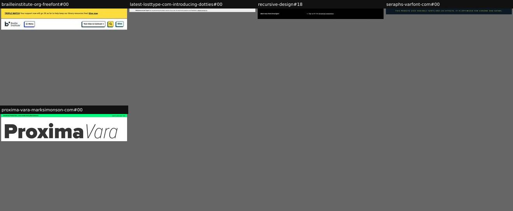
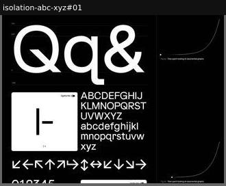

# chrome

_Section: Footer (discovered type, alongside footer)_

Site furniture that is not specimen content (banners, nav).

123 instances on 108 sites (the Phase 3 extraction of 181 sites).

| variant | sites | definition | recognise by |
|---|---|---|---|
| [nav-bar](#nav-bar) | 102 | A persistent site bar (top or bottom, fixed or static): name or logo, section links or view tabs, a buy/get button, sometimes toggles such as colour themes. | thin bar, repeated across stitched screens when fixed |
| [masthead-nav](#masthead-nav) | 6 | A slim header with name, tagline and section tabs, standing in for a hero. | header only |
| [announcement-banner](#announcement-banner) | 5 | A thin site-wide banner (donation, launch, sale). | strip above everything |
| [scroll-progress-indicator](#scroll-progress-indicator) | 2 | A sticky element showing scroll progress (bar, dot on a chart, counter). | sticky progress marker |

## nav-bar

A persistent site bar (top or bottom, fixed or static): name or logo, section links or view tabs, a buy/get button, sometimes toggles such as colour themes.

**Recognise by:** thin bar, repeated across stitched screens when fixed

| example | look | feel | ux | learn |
|---|---|---|---|---|
| 2020-typefacedesign-org-simon#15 | Fixed white 72px bar: 'MATD二零二零' logo at the left, 'Menu' at the right opening an overlay of all 13 student projects (thumbnail, font name, designer); a fragment of the logo ('零二零') is stamped over several crops |  |  |  |
| [2021-typemedia-org-gajana#00](../../archive/2021-typemedia-org-gajana/blocks/00.jpg) | Sticky slim bar: hamburger at the left (opens an overlay menu), ← ↑ → arrows to the previous student, the index and the next student, 'About TypeMedia' at the right (opens a sidebar); it turns black over the dark part of the page and is stamped across many crops |  |  |  |
| andada-huertatipografica-com#29 | Sticky white header: 'ht Andada' logo left; OVERVIEW, ABOUT THE FONT ↓, CHARACTER SET ↓, FONT IN USE, CONTACT US right; '[ SCROLL DOWN OR CLICK ]' under a heavy black rule; small '[ GO TO TOP ↑ ]' links end sections (blocks 02, 04); stitched into many crops | Book-like running head | Dropdowns list sub-anchors (About Guaraní; each OpenType feature: liga, calt, case, frac, sups, ss…); jumps by anchor | A running head with dropdown anchors turns a very long specimen into a navigable manual |
| apoc-font-eu#14 | Fixed white 54px top bar: 'Buy Apoc' left, 'APOC' logo centred in Revelations caps, 'Download Trial' right; it shows in every stitched screen |  |  |  |
| arteria-typofonderie-com#08 | Fixed off-white 60px top bar: 'Arteria' in Bold at left, a capsule checkbox 'Shop Signs' (shows/hides the stickers) and a cart icon at right |  |  |  |
| [biceps-togetherwithyou-co#00](../../archive/biceps-togetherwithyou-co/blocks/00.jpg) | Not cut as a block: a fixed strip of tiny uppercase text across the top of every screen: 'BICEPS GROTESK / 100% FREE DISPLAY FONT BY TOGETHER WITH YOU', a magenta 'DOWNLOAD / FONT VERSION 1.0 / 2024', 'VISUALS MADE TOGETHER WITH BENGT TIBERT / FOLLOW US & BENGT EVERYWHERE', a dark round logo dot and 'TOGETHERWITHYOU.CO' | Understated against the loud page | Fixed; Download links to a Google Drive zip | Keep the chrome microscopic so the giant glyphs own the screen |
| [boharat-com-zaatar#00](../../archive/boharat-com-zaatar/blocks/00.jpg) | Fixed 70px black bar on every screen: Boharat calligraphic logo in an outlined oval top-left, 'TYPEFACES BLOG ABOUT SHOP' in ~11px white caps top-right (doubled in screen 10 where the stitched captures overlap) |  |  |  |
| [brailleinstitute-org-freefont#00](../../archive/brailleinstitute-org-freefont/blocks/00.jpg) | White header ~100px with a 6px cyan rule below: Braille Institute 'b•' logo, outlined '☰ Menu' button left; right a 'Text Size & Contrast ⌄' dropdown (Large Text, Light Mode, Dark Mode checkboxes), yellow search square and pale-blue 'Give' button, all with chunky navy offset shadows |  |  |  |
| calhern-frostype-xyz#34 | Fixed transparent top bar: 'A TYPEFACE BY FROST' in small caps at the left and a white rounded 'BUY CALHERN' pill at the right (black pill on white sections) |  |  |  |
| [cinetype-com-fabbrica#00](../../archive/cinetype-com-fabbrica/blocks/00.jpg) | White foundry header: 'CINETYPE' in widely tracked caps at the left, small links 'Typefaces · Custom ▾ · Writing · About · Licensing' at the right; a fixed slate cookie banner ('This website uses cookies… Got it!') covers the bottom of every screen in the capture |  |  |  |
| [cjtype-com-dunbar#00](../../archive/cjtype-com-dunbar/blocks/00.jpg) | Fixed cyan bar across the top: 'DUNBAR' in dark blue, then Features, Research, Process and '↓ Buy' in white; it is painted into many crops of this capture as a cyan stripe |  |  |  |
| [cnap-fr-sites-infini-en#00](../../archive/cnap-fr-sites-infini-en/blocks/00.jpg) | Dark grey 50px top bar on the hero: round 'GF' (Graphisme en France) logo at left, tabs INFINI (active, black) / The project / The story / Studies / Try it / Info linking to separate pages, an 'FR' badge and a grey DOWNLOAD block at right |  |  |  |
| [colab-munken-com-munken-sans#01](../../archive/colab-munken-com-munken-sans/blocks/01.jpg) | White top bar: round logo left, tracked MUNKEN centre, hamburger right. On scroll only the hamburger stays fixed at the right edge, so it repeats across the stitched crops; a white cookie bar also repeats |  |  |  |
| colroy-ch#14 | A fixed row of five small black pills floating at the bottom of every screen: 'NN Colroy', 'Buy at nouvellenoire.ch', 'Download Specimen PDF', 'Get Free Trial Fonts at nouvellenoire.ch', 'Request Variable Fonts' (on mobile a single 'Buy at nouvellenoire.ch' pill, plus Readymag 'VOTE' badges) | Always there, unobtrusive | Links to shop, PDF, trials and a mailto for the variable fonts | Float the utility links as a bottom pill dock so the colourful page needs no header |
| commitmono-com#01 | Fixed footer legend of keycap groups with labels: Navigate, To section, Scroll, Zoom, Edit text, Reset, Weight/italic, Light/dark, High contrast, Hide keys; keys light up when pressed (.key[data-key-code]) and can be clicked except where data-noclick is set |  |  |  |

_…and 95 more in the gallery (`npm run app`)._

## masthead-nav

A slim header with name, tagline and section tabs, standing in for a hero.

**Recognise by:** header only

| example | look | feel | ux | learn |
|---|---|---|---|---|
| [erikdemaine-org-fonts-tetris#00](../../archive/erikdemaine-org-fonts-tetris/blocks/00.jpg) | Plain HTML table header: 'Tetris Font' as a blue underlined h1 link at left, 'by Erik Demaine and Martin Demaine, 2020 & 2026' as an h2 at right, browser-default Times |  |  |  |
| [input-djr-com#00](../../archive/input-djr-com/blocks/00.jpg) | Pale green page; 'INPUT™' in heavy green slab-like caps top-left, the italic tagline 'Fonts for code from DJR & Font Bureau' under it, a tab row 'Intro Preview Info Download' (current tab bold), and the DJR and Font Bureau logos in green at the far right | Plain, confident, a developer's tool page | Tabs go to the Preview tool, Info article and Download configurator subpages | For a utility font a masthead with four tabs can replace the hero: the samples below do the persuading |
| [cursorfont-liebermannkiepereddemann-de#00](../../archive/cursorfont-liebermannkiepereddemann-de/blocks/00.jpg) | No hero: one paragraph across the top in a large system-like serif/sans mix ('Cursor.otf beta is a font by Liebermann Kiepe Reddemann that allows you to use the MacOS system cursors as a font…') ending in a grey rounded 'Download' pill | Dry, tool-like, in on the joke | Studio name links to the studio; the pill downloads the OTF | For a utility font, a single explanatory sentence can replace hero, story and CTA at once |
| [foodissue-commercialtype-com#01](../../archive/foodissue-commercialtype-com/blocks/01.jpg) | Centred nameplate 'The Food Issue' in a black-outlined box (SVG, ~214×45px) on white, standing in for a hero above the contents |  |  |  |
| [plex-korean-demo-vercel-app#00](../../archive/plex-korean-demo-vercel-app/blocks/00.jpg) | Top of the column stands in for a hero: 'IBM Plex Sans KR' in 54px Bold, the Korean word '혁신하다' (to innovate) in grey Bold below, and a 48px sun icon button at the right that toggles dark mode |  |  |  |
| [x5-acjs-net#00](../../archive/x5-acjs-net/blocks/00.jpg) | A small blue fractal ×5 logo beside four short paragraphs of default-looking text, with no display treatment: the block stands in for a hero and intro | Old-web, personal, unfussy | Logo links home; inline links to ACJ and the Royal Academy of Arts | Let a tiny self-similar logo image do the display work beside a README-style lead when the type itself is the page's only design |

## announcement-banner

A thin site-wide banner (donation, launch, sale).

**Recognise by:** strip above everything

| example | look | feel | ux | learn |
|---|---|---|---|---|
| [brailleinstitute-org-freefont#00](../../archive/brailleinstitute-org-freefont/blocks/00.jpg) | Full-width yellow (#fddc3e) strip, ~70px: underlined bold 'TRIPLE MATCH' + 'Your support now will go 3X as far to help keep our library resources free!' + underlined 'Give now.' at ~16px |  |  |  |
| [latest-losttype-com-introducing-dotties#00](../../archive/latest-losttype-com-introducing-dotties/blocks/00.jpg) | Thin light-grey status bar: 'Welcome to Lost Type! You're previewing the latest version of our site. For technical questions and feedback, please contact us.' |  |  |  |
| [recursive-design#18](../../archive/recursive-design/blocks/18.jpg) | Thin black strip: 'Want news from ArrowType? →' and 'Sign up for the ArrowType newsletter!' linking to arrowtype.com (a link, no email field) |  |  |  |
| [seraphs-varfont-com#00](../../archive/seraphs-varfont-com/blocks/00.jpg) | Tiny tracked caps note on navy above a hairline: 'This website uses variable fonts and CSS effects. It is optimized for Chrome and Safari.' |  |  |  |
| [proxima-vara-marksimonson-com#00](../../archive/proxima-vara-marksimonson-com/blocks/00.jpg) | Fixed ~25px neon-green (#00ff7c) strip across the top of every screen: 'Introducing Proxima Vara, a new variable font by Mark Simonson' in small condensed bold at the left, 'Switch to dark mode | Auto' links at the right (never cut as a block, attached to 00) |  |  |  |

## scroll-progress-indicator

A sticky element showing scroll progress (bar, dot on a chart, counter).

**Recognise by:** sticky progress marker

| example | look | feel | ux | learn |
|---|---|---|---|---|
| gidole-github-io#11 | Fixed bottom-right slide counter '1/6' … '6/6' at ~26px; each number cross-fades at its slide's scroll offsets, the last one in dark on the white end slide |  |  |  |
| [isolation-abc-xyz#01](../../archive/isolation-abc-xyz/blocks/01.jpg) | Sticky in the right gutter for the whole specimen sheet: a white hairline exponential curve with a dot that climbs it as you scroll, captioned 'Fig (a) · Time spent looking at exponential graphs' (a 2020 pandemic joke); hidden on mobile |  |  |  |
