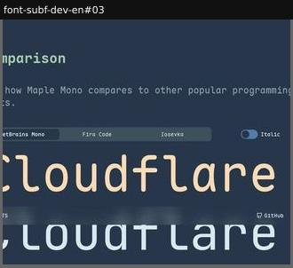

# comparison

_Section: Design details (discovered type, alongside design-details)_

This font set against others or against previous versions.

Sample: 1 blocks from 1 sites.

| variant | n | definition | recognise by |
|---|---|---|---|
| [versus-tabs](#versus-tabs) | 1 | Tabs pick a rival typeface; the same text is set in both, stacked. | rival names as tabs |
| [pointer-wipe](#pointer-wipe) | 0 | Two typefaces or versions on the same sample, compared by a divider that follows the pointer (clip-path wipe) or by one pointer pad driving both. | draggable split line |
| [reference-morph](#reference-morph) | 0 | A custom variable font interpolates a reference typeface (generic or historical model) into this one; scroll or a loop scrubs the morph between two labelled ends. | two labels at the ends, shapes morphing |
| [source-reset](#source-reset) | 0 | A scan of a historical source (ad, specimen, cover) followed by the same text reset in the new typeface at the same scale. | scan, then the same layout set fresh |
| [lineage-lineup](#lineage-lineup) | 0 | One letter from each historical model leading to the new typeface, lined up on a timeline with source, date and role: a typographic family tree. | row of the same letter across eras |

## versus-tabs

Tabs pick a rival typeface; the same text is set in both, stacked.

**Recognise by:** rival names as tabs

| example | look | feel | ux | learn |
|---|---|---|---|---|
| [font-subf-dev-en#03](../../archive/font-subf-dev-en/blocks/03.jpg) | Navy, mint mono heading, segmented tabs (JetBrains Mono, Fira Code, Iosevka), 'Cloudflare' in peach above the rival in pale blue | Confident, developer-to-developer | Switch rival via tabs; Italic toggle | Name the competitors and set them on the same word: an honest A/B sells better than adjectives |

## pointer-wipe

Two typefaces or versions on the same sample, compared by a divider that follows the pointer (clip-path wipe) or by one pointer pad driving both.

**Recognise by:** draggable split line

_No instance in the sample yet._

## reference-morph

A custom variable font interpolates a reference typeface (generic or historical model) into this one; scroll or a loop scrubs the morph between two labelled ends.

**Recognise by:** two labels at the ends, shapes morphing

_No instance in the sample yet._

## source-reset

A scan of a historical source (ad, specimen, cover) followed by the same text reset in the new typeface at the same scale.

**Recognise by:** scan, then the same layout set fresh

_No instance in the sample yet._

## lineage-lineup

One letter from each historical model leading to the new typeface, lined up on a timeline with source, date and role: a typographic family tree.

**Recognise by:** row of the same letter across eras

_No instance in the sample yet._
