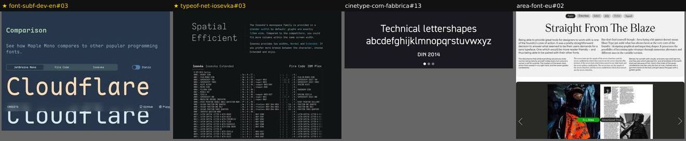
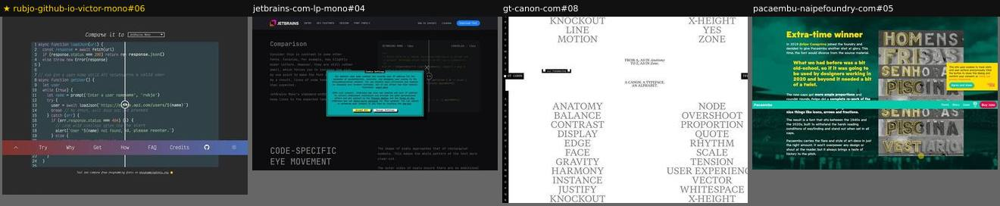
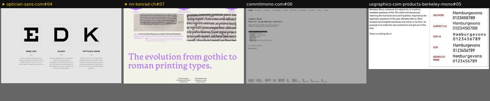
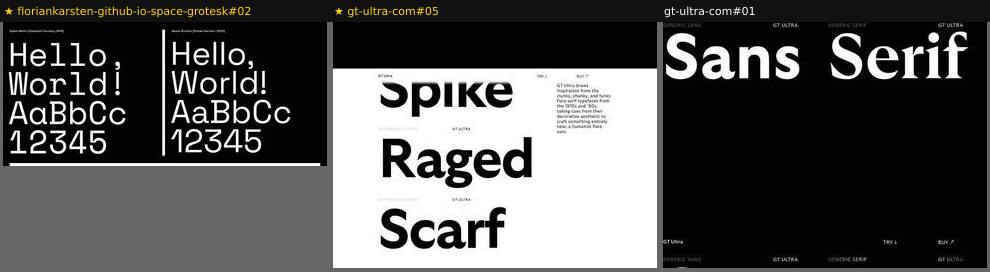
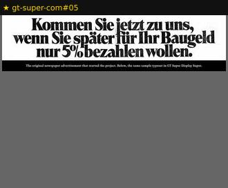
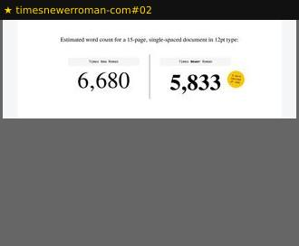
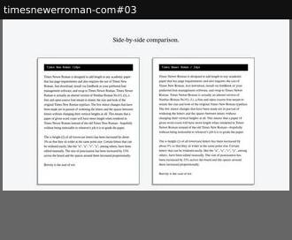

# comparison

_Section: Design details (discovered type, alongside design-details)_

This font set against others or against previous versions.

18 instances on 16 sites (the Phase 3 extraction of 181 sites).

| variant | sites | definition | recognise by |
|---|---|---|---|
| [versus-tabs](#versus-tabs) | 4 | Tabs pick a rival typeface; the same text is set in both, stacked. | rival names as tabs |
| [pointer-wipe](#pointer-wipe) | 4 | Two typefaces or versions on the same sample, compared by a divider that follows the pointer (clip-path wipe) or by one pointer pad driving both. | draggable split line |
| [lineage-lineup](#lineage-lineup) | 4 | One letter from each historical model leading to the new typeface, lined up on a timeline with source, date and role: a typographic family tree. | row of the same letter across eras |
| [reference-morph](#reference-morph) | 2 | A custom variable font interpolates a reference typeface (generic or historical model) into this one; scroll or a loop scrubs the morph between two labelled ends. | two labels at the ends, shapes morphing |
| [source-reset](#source-reset) | 1 | A scan of a historical source (ad, specimen, cover) followed by the same text reset in the new typeface at the same scale. | scan, then the same layout set fresh |
| [metric-face-off](#metric-face-off) | 1 | Two big figures side by side, each set in its own typeface under a label, stating one measured result of the comparison (word count, pages, file size), with a small badge giving the gain | two huge figures with a gain badge |
| [parallel-pages](#parallel-pages) | 1 | The same running text set in both typefaces on two side-by-side sheets at the same size, with no controls; the difference is read from where the text ends on each page | same text on two sheets, different end points |

## versus-tabs

Tabs pick a rival typeface; the same text is set in both, stacked.

**Recognise by:** rival names as tabs

| example | look | feel | ux | learn |
|---|---|---|---|---|
| [★ font-subf-dev-en#03](../../archive/font-subf-dev-en/blocks/03.jpg) | 'Comparison — See how Maple Mono compares to other popular programming fonts.' with a segmented tab bar (JetBrains Mono | Fira Code | Iosevka) and an 'Italic' switch; below, 'Cloudflare' at ~128px in peach Maple Mono stacked over 'Cloudflare' in pale blue in the chosen rival | Direct, visual | Pick a rival tab to swap the lower word's font; the Italic switch sets both in italic, contrasting Maple's cursive with the rival's italic | Choose a test word full of telling letters (C l o u d f l a r e) and stack it in both fonts at display size: differences in terminals and the f/l/r shapes are instant |
| [★ typeof-net-iosevka#03](../../archive/typeof-net-iosevka/blocks/03.jpg) | 'Spatial Efficient' title with a short note, then a window of Unicode database text with tabs above it: Iosevka and Iosevka Extended at left, rivals Fira Code and IBM Plex at right | Terminal-native, empirical | Clicking a tab resets the same fixed-width sample in that font: rival fonts run wider and clip more columns at the window's right edge | Use a data file with very long lines as the sample: width is what's compared, so the right-hand clipping point becomes the score |
| [cinetype-com-fabbrica#13](../../archive/cinetype-com-fabbrica/blocks/13.jpg) | A dark slider panel: 'Technical lettershapes / abcdefghijklmnopqrstuvwxyz' set in white with the typeface name under it ('DIN 2014' in the capture); three dots switch between DIN 1451, DIN 2014 and Fabbrica; mono caption 'Fabbrica has more generous proportions, looser spacing and higher contrast than DIN…' | Fair, matter-of-fact | Dots or arrows change the slide; the same text and position are kept so the shapes can be compared by flipping | Set the rival and your font on identical slides and let visitors flip between them: differences in spacing and contrast jump out in the flicker |
| [area-font-eu#02](../../archive/area-font-eu/blocks/02.jpg) | Pill tabs at the top, each set in its own font (Apoc, Emeritus, Inferi, Joly, Oroban, Sigurd), above a mock editorial spread: headline 'Straight From The Blaze' in the selected display face, two Area body columns about the foundry, and three small columns of text in the partner face | Magazine-like | Choosing a tab resets the headline and accent text in that typeface, with per-font size, leading and offset compensation; Area stays the body | Show the house sans as the body under each of the foundry's display faces: a pairing tab sells the catalogue as a system (same tab mechanism as a rival comparison, used for harmony) |

## pointer-wipe

Two typefaces or versions on the same sample, compared by a divider that follows the pointer (clip-path wipe) or by one pointer pad driving both.

**Recognise by:** draggable split line

| example | look | feel | ux | learn |
|---|---|---|---|---|
| [★ rubjo-github-io-victor-mono#06](../../archive/rubjo-github-io-victor-mono/blocks/06.jpg) | 'Compare it to [JetBrains Mono ▾]' with a select of 23 coding fonts; below, a code screenshot split by a white vertical line with a round ◂▸ handle: Victor Mono on the left, the chosen rival on the right | Fair, direct | Drag the handle to wipe between the two renderings of the same 25-line snippet; the select swaps the rival screenshot; caption links to programmingfonts.org | Use one code snippet and a wipe handle: differences in width, italics and ligatures line up character by character |
| [jetbrains-com-lp-mono#04](../../archive/jetbrains-com-lp-mono/blocks/04.jpg) | 'Comparison' text at left (Consolas has wider but smaller letters, so lines run longer); at right a code panel headed 'JETBRAINS MONO – 13px' and 'CONSOLAS – 13px', split by a vertical line with a round white drag handle | Fair, evidence-based | Drag the handle left or right to wipe between the same Kotlin code rendered in JetBrains Mono and in Consolas at 13px | Compare at the real working size (13px) on real code, not at display size: the rival's line length and legibility differences show up immediately |
| [gt-canon-com#08](../../archive/gt-canon-com/blocks/08.jpg) | Panel 'Platform' (HTML only): the GT Standard pairing shown three ways: an overlaid drawing split by a vertical line that follows the cursor; a 2D field with GT Standard on the left and GT Canon on the right setting the same 5-line quote, axis labels LIGHT/HEAVY (vertical) and CONDENSED/EXPANDED (horizontal) and crosshair lines; then a sticky row of L / M / S frames with the same essay paragraph in serif and sans at matching optical sizes | Systematic, reassuring | Move the pointer: horizontally it wipes between the two drawings (cursor ew-resize); in the 2D field x sets wdth 37→150 and y sets wght 300→900 on both texts at once | Drive both families from one pointer so the visitor sees they share widths, weights and metrics: the pairing argument becomes a gesture |
| [pacaembu-naipefoundry-com#05](../../archive/pacaembu-naipefoundry-com/blocks/05.jpg) | Photo of the stadium's engraved signs (HOMENS, FRISAS, SENHORAS, PISCINA, VESTIARIO) with the same words in yellow outline Pacaembu laid over them; a yellow knob at the bottom edge marks the divider | Evidential, satisfying | A range slider moves a vertical split: one side shows the original engraved letters, the other the font set at the same scale over them (the font layer is positioned with right: 50% by default) | Overlay the new font on the photographed source at identical scale and give it a wipe: the visitor checks the revival against the original themselves |

## lineage-lineup

One letter from each historical model leading to the new typeface, lined up on a timeline with source, date and role: a typographic family tree.

**Recognise by:** row of the same letter across eras

| example | look | feel | ux | learn |
|---|---|---|---|---|
| [★ optician-sans-com#04](../../archive/optician-sans-com/blocks/04.jpg) | On light grey, three letters side by side on faint construction grids: a slab-serif 'E' (SNELLEN – 1862 –), a sans 'D' (SLOAN – 1959 –) and a 'K' (OPTICIAN SANS – 2018 –) with two grey dots marking the optical corrections, each with a title, italic date and a short centred caption | Calm, historical, didactic | static | Draw one letter from each ancestor on the same grid: the lineage reads left to right without a timeline graphic |
| [★ nn-konrad-ch#07](../../archive/nn-konrad-ch/blocks/07.jpg) | 'The evolution from gothic to roman printing types.' in purple, then five large 'n's on a thin arrow line (Textura, Gotico-Antiqua, Proto-Roman, NN Konrad in purple, Roman), each above a cross mark, a bold label and a short paragraph with the source type and date; a rotating 'TIME LAPSE' text badge below | Museum label, crystal clear | Static; links credit the ANRT Nancy gotico-antiqua revival | Put your letter in its family tree, one 'n' per stage: the reader sees exactly which step the new design takes |
| [commitmono-com#00](../../archive/commitmono-com/blocks/00.jpg) | Section 03 'Familiar', HTML only: a timeline of five years (1896, 1956, 2013, 2017, 2023) with an SVG letter sample for each, and a note on what was taken from each model | Short, logical argument | Arrow keys or clicks choose a year; the lineage note changes: Franklin Gothic, Letter Gothic, Fira Mono, Untitled Sans, Commit Mono | Give each ancestor a verdict and a borrowed trait ('Clear, simple and monospaced, but too quirky'): the lineage becomes an argument for the new font |
| [usgraphics-com-products-berkeley-mono#05](../../archive/usgraphics-com-products-berkeley-mono/blocks/05.jpg) | Prose on combining 70s machine-readable type with humanist sans ('There is nothing like it.') beside a card listing UNIVERS, EUROSTILE, OCR-B, DIN and BERKELEY MONO in red mono labels, each with 'Hamburgevons 0123456789' set in that typeface | Educated, comparative | static | Set the same 'Hamburgevons 0123456789' in each ancestor and end with your own: readers see what was borrowed from each in one glance |

## reference-morph

A custom variable font interpolates a reference typeface (generic or historical model) into this one; scroll or a loop scrubs the morph between two labelled ends.

**Recognise by:** two labels at the ends, shapes morphing

| example | look | feel | ux | learn |
|---|---|---|---|---|
| [★ floriankarsten-github-io-space-grotesk#02](../../archive/floriankarsten-github-io-space-grotesk/blocks/02.jpg) | First a static pair split by a white vertical rule: 'Hello, World! AaBbCc 12345' in Space Mono (Colophon Foundry, 2016) on the left and in Space Grotesk (Florian Karsten, 2020) on the right; then 'Mm1—Ww / Mono Fixed / G®otësk' at ~200px with a switch 'Space Mono' (orange pill) | 'Space Grotesk' | Honest about lineage | The switch morphs the display text between the monospaced parent and the proportional child: a custom 'Space Grotesk Transition' variable font interpolates widths and shapes, so letters slide into their new widths | When a family derives from another, build a transition font between them and let one toggle animate the derivation: the M, 1 and W visibly lose their fixed widths |
| [★ gt-ultra-com#05](../../archive/gt-ultra-com/blocks/05.jpg) | On white (the page flips from black), three huge black words 'Spike', 'Raged', 'Scarf', each captioned 'HISTORICAL EXAMPLE · GT ULTRA', a narrow text column on the right; below, an animated 'Design Craft' and a narrow text column on the left | Playful, scholarly | Each word ping-pongs every 2s between a 1970s–80s flare serif and GT Ultra; the active caption highlights. Animations start when the section scrolls into view | Morph from each historical model into your design on a loop: visitors see what was kept and what was dropped without a single annotation |
| [gt-ultra-com#01](../../archive/gt-ultra-com/blocks/01.jpg) | Two huge white words side by side, 'Sans' and 'Serif', each with a caption pair above ('GENERIC SANS · GT ULTRA', 'GENERIC SERIF · GT ULTRA'); in the capture 'Serif' has dropped lower than 'Sans' | A visual argument | In a tall sticky wrapper, scrolling moves the words and morphs each from a generic sans or serif into GT Ultra; the caption pair fills like a progress bar from the left label to the right | Build a throwaway variable font whose axis runs from 'what you expect' to 'this typeface', and let scroll do the morph: the thesis (neither sans nor serif) is proved, not told |

## source-reset

A scan of a historical source (ad, specimen, cover) followed by the same text reset in the new typeface at the same scale.

**Recognise by:** scan, then the same layout set fresh

| example | look | feel | ux | learn |
|---|---|---|---|---|
| [★ gt-super-com#05](../../archive/gt-super-com/blocks/05.jpg) | Three pairs: the scanned 'Kommen Sie jetzt zu uns, wenn Sie später für Ihr Baugeld nur 5% bezahlen wollen.' ad then the same three lines in white Display Super on black; the 'GRAPHIC DESIGN / Graphic Designers need a wide Variety in Characters' specimen then its reset; the Suhrkamp cover titles reset as five rainbow lines (red, orange, yellow, green, blue) pairing roman and italic | Homage with a wink: the old ad, but crisp | The reset lines are editable via the style bar; the scan sits above with a caption that says what follows ('Below, the same sample typeset in GT Super Display Super') | Reset the source's own words, line breaks and size: the viewer compares shapes, not content |

## metric-face-off

Two big figures side by side, each set in its own typeface under a label, stating one measured result of the comparison (word count, pages, file size), with a small badge giving the gain

**Recognise by:** two huge figures with a gain badge

| example | look | feel | ux | learn |
|---|---|---|---|---|
| [★ timesnewerroman-com#02](../../archive/timesnewerroman-com/blocks/02.jpg) | White panel: 'Estimated word count for a 15-page, single-spaced document in 12pt type:' over 6,680 in light Times New Roman and 5,833 in bold Times Newer Roman, divided by a vertical rule, with a yellow circular sticker 'A word savings of 13%!' | Parody of a marketing claim | static | Reduce the claim to one measured number per font: set each number in its own font so the digits are also the sample |

## parallel-pages

The same running text set in both typefaces on two side-by-side sheets at the same size, with no controls; the difference is read from where the text ends on each page

**Recognise by:** same text on two sheets, different end points

| example | look | feel | ux | learn |
|---|---|---|---|---|
| [timesnewerroman-com#03](../../archive/timesnewerroman-com/blocks/03.jpg) | 'Side-by-side comparison.' over two white paper sheets with black label bars ('Times New Roman / 14px', 'Times Newer Roman / 14px'); the right text runs a line or so longer | Term-paper, evidence exhibit | Static; the copy itself explains the method, and the punchline 'Brevity is the soul of wit.' closes both pages. Hidden on mobile, where the sheets are removed | Make the comparison copy the actual design notes: reading the sample teaches the changes (x-height +5%, punctuation +15%), and the end of the text marks the result |
