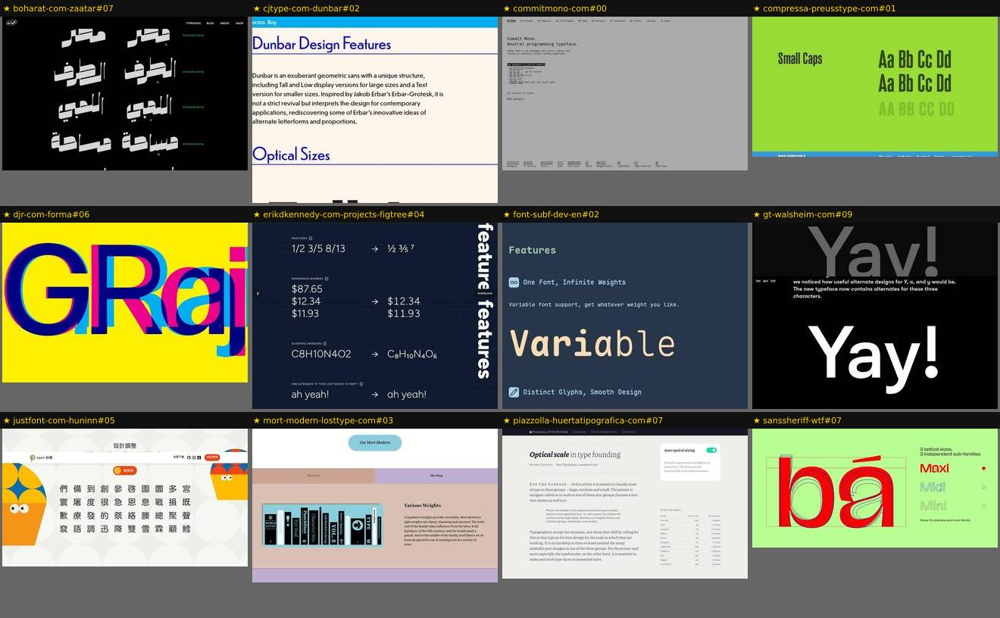
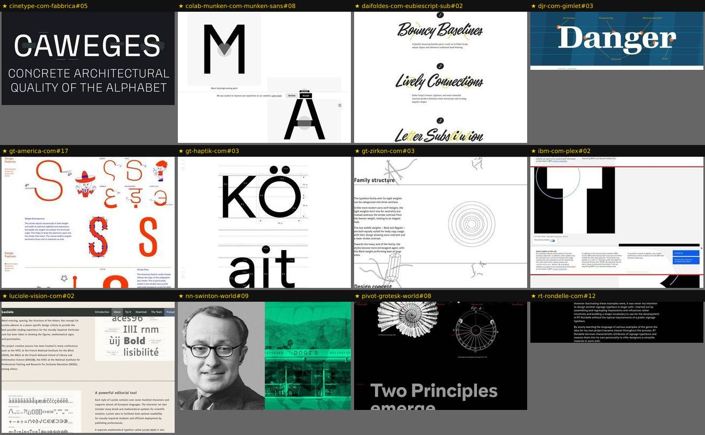
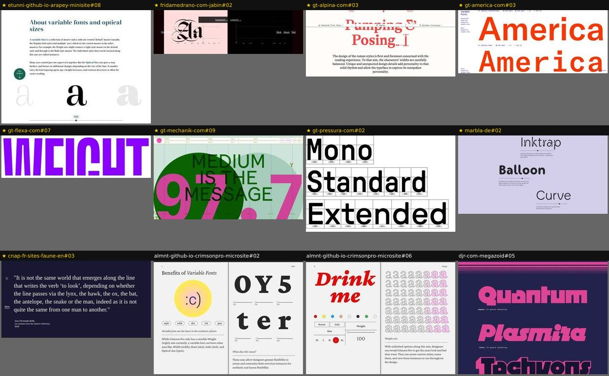
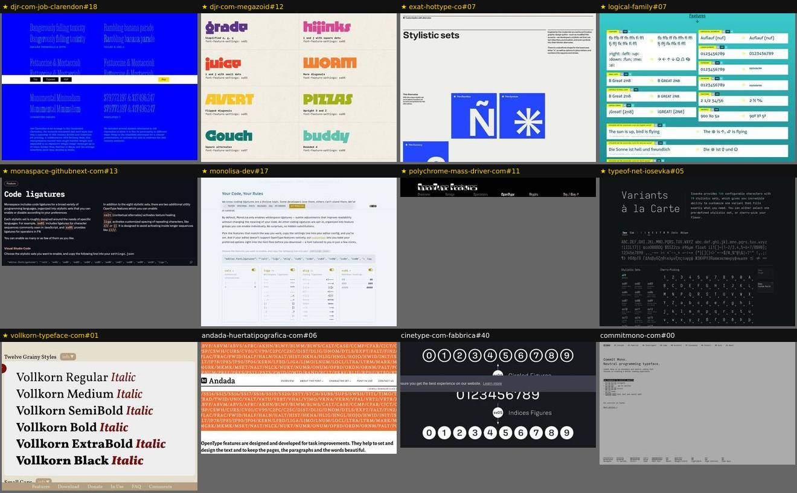
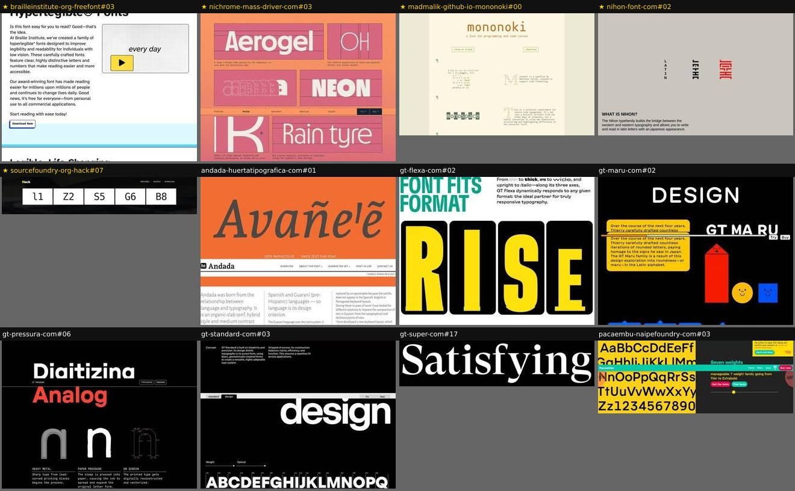
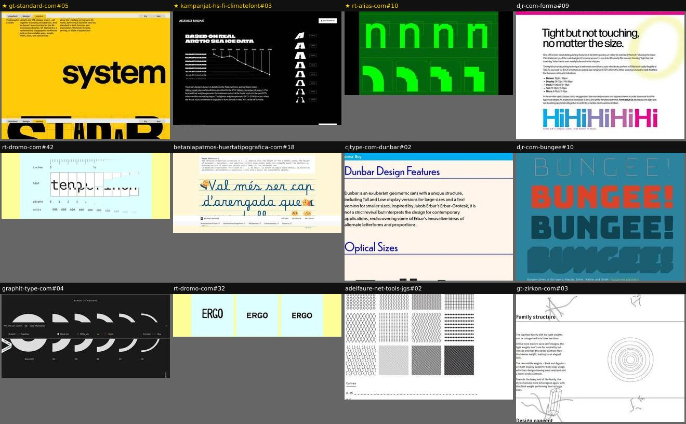
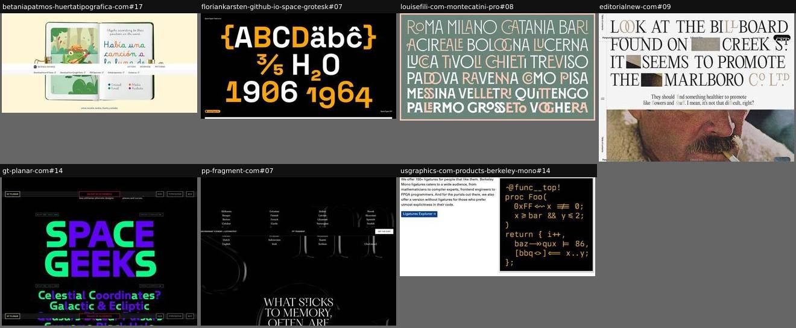
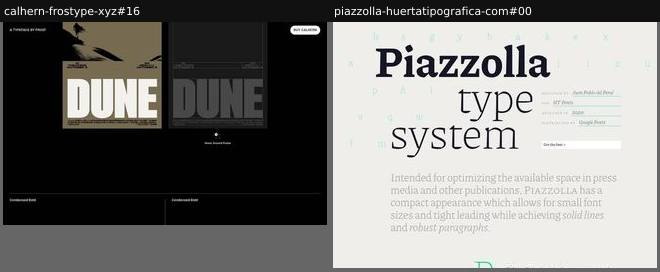
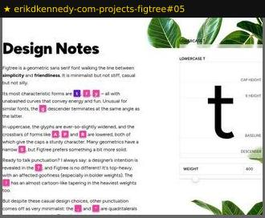
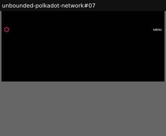

# design-details

_Section: Design details_

The micro-decisions: features, alternates, axes, spacing, construction.

249 instances on 115 sites (the Phase 3 extraction of 181 sites).

| variant | sites | definition | recognise by |
|---|---|---|---|
| [feature-before-after](#feature-before-after) | 51 | A feature or alternate shown off vs on (side by side, overlaid, toggled or typed in a loop) with a short explanation. | pairs, toggles, feature tags |
| [annotated-specimen](#annotated-specimen) | 43 | Letterforms with technical annotations or numbered figures (measurements, ink traps, angles), one decision per row. | callouts, dimension lines, 'Fig. 1' |
| [axis-explainer](#axis-explainer) | 40 | Each variable axis demonstrated on its own: a word plus slider, labelled steps, or animation fitting frames. | axis names, steps, one axis at a time |
| [feature-index](#feature-index) | 27 | Every stylistic set or ligature group catalogued as cards or tiles (input → output), often toggleable or exportable as settings. | exhaustive grid of feature cards |
| [design-notes](#design-notes) | 22 | A sequence of design decisions, each with a visual and a short caption, as a carousel or video tiles. | slides or looping tiles per topic |
| [system-diagrams](#system-diagrams) | 11 | The family's logic (weight curve, optical sizes, widths) explained with charts, like a design-system manual. | graphs, axes, curves |
| [highlighted-in-context](#highlighted-in-context) | 7 | Ligatures, alternates or special glyphs set inside a display sentence and picked out in an accent colour, discovered in context rather than in a catalogue. | accent-coloured glyphs inside a headline |
| [hover-css-inspector](#hover-css-inspector) | 2 | A page-wide inspector: hovering any sample shows a crosshair and a tooltip with that text's CSS (size, leading, weight, features). | crosshair cursor, CSS tooltip |
| [prose-glyph-inspector](#prose-glyph-inspector) | 1 | Design notes written as running prose in which every letter mentioned is an inline clickable chip; clicking a chip loads that glyph large on its metric lines in a sticky side panel (often with a weight slider), so reading the rationale and inspecting the letter happen together. | inline letter chips in prose, sticky glyph panel |
| [copyable-animation-cards](#copyable-animation-cards) | 1 | Cards that each play a variable-font animation on a UI-like sample (a button label, a headline) on hover or in a loop, each with a 'Copy CSS code' button that copies the keyframes so visitors can reuse the effect | animated samples with a Copy CSS button |

## Rubric

Recorded for every instance in Phase 3, in addition to the cross-cutting attributes in `rubric.json`:

- **subject**: any of features, alternates, axes, spacing, construction, optical-size, italics, scripts, history-of-revision
- **presentation**: pairs | overlay | toggle | animation | diagram | annotation | catalogue
- **explanation**: none | caption | prose

## feature-before-after

A feature or alternate shown off vs on (side by side, overlaid, toggled or typed in a loop) with a short explanation.

**Recognise by:** pairs, toggles, feature tags

| example | look | feel | ux | learn |
|---|---|---|---|---|
| [★ boharat-com-zaatar#07](../../archive/boharat-com-zaatar/blocks/07.jpg) | Five rows, each a word twice side by side (default left, with the stylistic set right: 'مصر', 'الطرف', 'اللعبي', 'مساحة', …), a small green dot under the changed letter of the right-hand word and a green label 'STYLISTEC SET 01…05' at the right edge | Quiet, precise | static | Mark the one changed glyph with a small coloured dot under the 'after' word: the eye finds the alternate instantly without arrows or outlines |
| [★ cjtype-com-dunbar#02](../../archive/cjtype-com-dunbar/blocks/02.jpg) | A long run of feature sections, each a blue heading, a paragraph and SVG pairs: default text with the affected glyphs in grey → coral arrow tagged with the feature (SS03, SS05, SS02, SS04, SS18, SS19, SS01, ZERO) → the result in black. Topics: Terminals (Soccer Cats), Optically Adjusted Caps (Top Pup Rap Kid), Case Sensitive Forms («HELLO», a–z A–Z(X)), Fractions (7 3/4" C2 H2O), Stylistic Alternates (DÖNER, BIERWÜRSTE, SPÄTZLE, blåbärssoppa, KRÄFTIG), Discretionary Ligatures (Drucksache), Italic Forms (Macbeth) | Clear, rigorous, a little playful | static; nav anchors (#salts, #salt-terminals, #italic-forms) let other pages link to a feature | Grey out exactly the glyphs a feature will change, then put the feature tag on the arrow: one line teaches what, where and how to switch it on |
| [★ commitmono-com#00](../../archive/commitmono-com/blocks/00.jpg) | Section 04 'Intelligent', HTML only: 'Commit Mono: Normal programming typeface' set twice, with four radios (Smart kerning OFF/ON, How it works OFF/ON). The 'How it works' view zooms into the letters m o i and shows the o slid 44 units | A neat trick explained clearly | Keyboard or click toggles the sample between plain and kerned; a second pair shows the mechanism on three letters | Two toggles for one feature: first show the effect, then the mechanism on the smallest example possible |
| [★ compressa-preusstype-com#01](../../archive/compressa-preusstype-com/blocks/01.jpg) | A run of one-screen bands, each in its own flat colour (lime, pale yellow, mint, salmon, olive, mustard), with a feature name on one side ('Small Caps', 'Case-Sensitive Forms', '6 Stylistic Sets', 'Ligatures', 'Localized Forms') and a large looping GIF on the other: 'Aa Bb Cc Dd' turning into small caps, '139' cycling through the figure sets (with a list of the 9 numeral styles), 'Hg' case forms, 'Ugly Babies' swapping stylistic sets, 'ffl' ligature, Polish weekday names in a 3-slide carousel | Poster-like, one idea per screen | Nothing to click except the carousel dots on Localized Forms; every feature demonstrates itself on a loop | One feature per full-colour band with a self-playing before/after loop: the visitor learns the OpenType feature set just by scrolling, no toggles needed |
| [★ djr-com-forma#06](../../archive/djr-com-forma/blocks/06.jpg) | On yellow, 'GRaj' at ~750px cropped on the right, printed three times on top of itself: default letters in dark navy, Swiss alternates (bearded G, curved-leg R, two-storey a, j) in magenta and cyan, slightly offset like a misregistered print | Graphic, punchy | Decorative; the alternate layers pulse in optical size so the offsets keep shifting | Overlay default and alternate glyphs in different process colours: the differences jump out as coloured fringes, no labels needed |
| [★ erikdkennedy-com-projects-figtree#04](../../archive/erikdkennedy-com-projects-figtree/blocks/04.jpg) | On navy with a faint grid, four rows 'default → featured': FRACTIONS '1/2 3/5 8/13 → ½ ⅗ 8⁄13', MONOSPACE NUMBERS '$87.65 $12.34 $11.93' aligned, SCIENTIFIC INFERIORS 'C8H10N4O2 → C₈H₁₀N₄O₂', and 'ONE ALTERNATE "A" THAT JUST WANTS TO PARTY' 'ah yeah!'; a giant vertical 'features' word runs down the right edge | Confident, a bit cheeky | The right-hand column types itself out character by character when the row scrolls in; small (i) buttons show the CSS (font-feature-settings: 'frac') in a tooltip | Type the 'after' version live next to the static 'before', and give every feature an (i) tooltip with the exact CSS to copy |
| [★ font-subf-dev-en#02](../../archive/font-subf-dev-en/blocks/02.jpg) | Two feature groups as a 2-column grid of cards: 'Distinct Glyphs, Smooth Design' (@ $ & % → with a 'cv01' switch; cursive f i l k x y with a 'plain style' switch; I 1 l with 'cv04'; O 0 o with 'zero'), and 'Smart Ligatures, Large Variety' (a 'Ligature ON | Ligature OFF' segmented tab above three rows of mint ligatures interleaved with dim letters: <>a??b≢c…d↦), then 'Special Ligatures' cards: pill-shaped DEBUG INFO WARN ERROR TODO FIXME tags (calt), connected italic 'all class / ultra suffix' (calt), smart spacing '1>>4 / Vec<R<T>>' (calt); each card has a one-line grey note | Tinkerer-friendly, delightful | Every switch toggles that card's real OpenType feature(s) (e.g. 'plain style' flips cv32–cv37 on the italic; [DEBUG] turns into a pill only with calt on); the ligature tabs toggle calt on the three rows | Put a labelled switch with the feature tag under each sample: visitors learn the tag names they'll need in their editor config while playing |
| [★ gt-walsheim-com#09](../../archive/gt-walsheim-com/blocks/09.jpg) | 'STYLISTIC ALTERNATES': 'Yay!' at 432px (the alternate Y, a and y in one word), three posters with tall umlauts, then 'ZÜRICH HÖLL WÄHLT' showing the alternate umlauts | Joyful, clear | Pointer on the left half shows 'Alternate', right half 'Standard'; a small label and dot show the state. The posters sit between the two samples as evidence for the umlauts | Pick one word that contains every alternate ('Yay!') and set it as big as the screen allows; put the source posters next to the feature they inspired |
| [★ justfont-com-huninn#05](../../archive/justfont-com-huninn/blocks/05.jpg) | Two sections, each with a centred heading and caption and a red-orange pill switch labelled '調整前' (before adjustment) / '調整後' (after): '設計調整' shows a 10×4 grid of hanzi (們備到創參啓園圜多宮…) and '排版調整' a paragraph of mixed Chinese and Latin text; the switch flips them between the source font Kosugi Maru and jf open 粉圓 | Honest, hands-on | Click the switch to swap the sample between the original Japanese font and the Taiwan-optimised version: stroke weights and Japanese forms (design), punctuation placement and the Latin font (typesetting) | A single before/after switch on the same sample is the clearest way to show the value of a derivative font; choose characters where the changes are most visible |
| [★ mort-modern-losttype-com#03](../../archive/mort-modern-losttype-com/blocks/03.jpg) | A stack of ~500px pastel bands (brown, lilac, yellow, blue, green) bordered by 2px rules; each band has a demo on the left and a heading plus paragraph on the right: Various Weights (illustrated bookshelf of spines in every weight), Contextual Alternates 'Relevant Specifics', Fractions '½ of the time', Lining and Non-Lining Figures '235', Small Caps 'Vancouver, BC', Optical Sizes (an '&&&' card, Large → Subhead → Text), Romans and italics (green card 'Mort Modern / Mort Modern'), Stylistic alternates 'sample'. Black-and-white pill switches sit above the toggleable samples | Clear, cheerful, magazine-sidebar | Each switch toggles one OpenType feature (calt, frac, onum, c2sc, salt) on its sample, which is also editable; the illustrated rows (weights, optical sizes, italics) are static | Pair every feature with a word that shows it (repeated letters for calt, '½' for frac, 'Vancouver, BC' for small caps) and an on/off switch right above it: no tags or codes needed |
| [★ piazzolla-huertatipografica-com#07](../../archive/piazzolla-huertatipografica-com/blocks/07.jpg) | An excerpt of Harry Carter's 1937 essay 'Optical scale in type founding' set as a book page (bold-italic + roman heading, small-caps byline and lead-in, indented small-print quote), beside a white card 'Auto optical sizing' with a teal switch and a tiny table of historical point-size names (Diamond 4.5pt … Great Primer 18pt) | Erudite, self-referential | The switch is on by default; turning it off disables automatic optical sizing and pins opsz to wrong values so the heading and text visibly degrade | Demonstrate optical size on a text about optical size, at several real sizes (heading, body, small print, 11px table), with a single on/off switch |
| [★ sanssheriff-wtf#07](../../archive/sanssheriff-wtf/blocks/07.jpg) | On lime, a giant 'bá': the selected sub-family filled red with the other two optical sizes drawn as thin blue and grey outlines on top, inside red metric lines; at right '3 optical sizes, 3 independent sub-families' and a list Maxi ● / Midi ○ / Mini ○ | Precise, diagrammatic | Hover a name in the list to fill that sub-family and outline the others ('Hover to preview each sub-family') | Overlay all optical sizes at one size and fill only the chosen one: the differences in x-height, apertures and stroke read instantly |
| [★ tofino-losttype-com#12](../../archive/tofino-losttype-com/blocks/12.jpg) | 'An Ocean of Features': a tall gradient of sea blues descending in layered wave bands, each band one OpenType demo under a pill toggle: FRACTIONS ON → 'SURF HEIGHT 13 5/16"', TABULAR NUMBERS OFF → a tide table, SUPERSCRIPTS ON + CASE-SENSITIVE FORMS ON → 'SEAWATER COMPOSITION (SALINITY ≈ 3.5%)¹', SUBSCRIPTS ON → 'H₂O + NaCl + SO₄', OLD-STYLE NUMBERS ON → latitude sentence; line-drawn fish swim at the sides | Serene, educational, playful | Each pill is a hidden checkbox that flips its feature on the sample below and relabels itself ON/OFF (coral when off) | Give every feature a themed real-world sample (surf height, tide table, salinity) and let the depth of the colour bands carry you down the list |
| [★ 2020-typefacedesign-org-simon#08](../../archive/2020-typefacedesign-org-simon/blocks/08.jpg) | '* innen?' (the gender asterisk as a separate glyph) above 'innen!' where ss01 puts the asterisk on the i as its dot; then a poster of German gender-inclusive nouns ('gewerkschafter*in', 'fahrradkurier*in', 'sozialdemokrat*in', 'klimaaktivist*in') with the star-dot, interleaved with rows of asterisks in rainbow colours | Political, cheerful | The pair has a weight slider; the poster is a static SVG | Show a socially meaningful alternate as a question/answer pair, then celebrate it in real words with a colourful pattern built from the same glyph |
| [★ finaltype-de-en-projects-monoflow#04](../../archive/finaltype-de-en-projects-monoflow/blocks/04.jpg) | Two short prose sections ('Harmonic spacing despite monospace?', 'Better spacing through contextual repositioning') around a navy figure: 'main' in big cream letters, each inside its own ruled monospace cell, the 'a' shown twice (a grey ghost at its default position and the cream letter shifted towards its neighbour) | Clear, quietly clever | The SVG animates the 'a' sliding inside its fixed cell as the context changes; static prose on beige around it | Draw the fixed-width cells and let one letter move inside its box: the animation shows 'words stay monospace while letters shift in context' faster than the paragraph does |

_…and 45 more in the gallery (`npm run app`)._

## annotated-specimen

Letterforms with technical annotations or numbered figures (measurements, ink traps, angles), one decision per row.

**Recognise by:** callouts, dimension lines, 'Fig. 1'

| example | look | feel | ux | learn |
|---|---|---|---|---|
| [★ cinetype-com-fabbrica#05](../../archive/cinetype-com-fabbrica/blocks/05.jpg) | Two figures: on near-black, 'CAWEGES' in white with hatched bars and short rules marking where each letter's mass sits (high or low barycentre), above 'CONCRETE ARCHITECTURAL QUALITY OF THE ALPHABET' in thin caps; then on white, 'B K N' in black with their counters filled light blue and white arrows showing the direction of the 'forces' inside each letter (top of the figure hidden by the cookie banner) | Diagrammatic, precise | static images with a mono caption ('The masses of white within the letters (marked in Blue…) act like forces…') | Shade the counters and draw force arrows inside them: the abstract idea of 'internal dynamism' becomes visible in three letters |
| [★ colab-munken-com-munken-sans#08](../../archive/colab-munken-com-munken-sans/blocks/08.jpg) | Staggered grey tiles each holding one large black glyph (M, A, a) with translucent grey discs laid over the details, and a one-line centred caption under each | Museum label, unhurried | static | A translucent disc is the gentlest possible callout: no lines or numbers, just a soft lens on the exact spot the caption names |
| [★ daifoldes-com-eubiescript-sub#02](../../archive/daifoldes-com-eubiescript-sub/blocks/02.jpg) | Four numbered rows (black oval badges 1–4), each a phrase that names its feature set in the script, with the feature marked in the accent colour: arrows at rising and dropping letters in 'Bouncy Baselines', rings around joins in 'Lively Connections', tinted letters in 'Letter Substitution', tinted accents in 'Cultured & Traveled', and a two-line caption | Clear, cheerful teaching | static | Make each feature's name its own demonstration: the phrase 'Letter Substitution' shows letter substitution, and one accent colour points out where it happens |
| [★ djr-com-gimlet#03](../../archive/djr-com-gimlet/blocks/03.jpg) | 'Danger' in heavy white Gimlet Display on navy with faint diagonal stripes and thin teal metric lines; orange dots on quirky details joined by thin mustard leader lines to italic labels 'Doohickey', 'Thingamajig', 'Whatchamacallit', 'Whatsits', 'Huh?'; caption 'FIGURE I. ANATOMY' in small teal caps below | Funny, knowing | static | Parody the type-anatomy diagram with nonsense labels: it points at the quirky details and sets the tone of a 'friendly quirkhorse' |
| [★ gt-america-com#17](../../archive/gt-america-com/blocks/17.jpg) | Sequence of design topics (terminal angles, weight development, stroke flow, inward curving, inktraps, stroke contrast), each a huge orange glyph with degree callouts or Bézier points, the same detail shown across scripts, a short text column, and a cartoon mascot | Expert but light-hearted | A sticky left index (Width & Weight, Stroke Flow, Adjustments, Details) highlights the current topic as you scroll | Show each design decision on the Latin glyph and then on the same feature in Greek, Thai, Arabic and Devanagari: the 'family resemblance' across scripts becomes visible |
| [★ gt-haptik-com#03](../../archive/gt-haptik-com/blocks/03.jpg) | On white, a huge black 'KÖ' and 'ait' on dotted metric lines, every stroke labelled with its thickness in points (90 pt, 136 pt dots, 77–86 pt lowercase strokes) and 350/700 pt dimension arrows; one-line caption below | Engineering drawing, exact | static | Label stroke thicknesses directly on the letters: the uppercase's constant 90 pt next to the lowercase's 77–86 pt proves 'monolinear vs optically corrected' without prose |
| [★ gt-zirkon-com#03](../../archive/gt-zirkon-com/blocks/03.jpg) | 'Design concept': six ruled rows, each a short text column beside an animated measured diagram: 'Heat' with a weight scale (U-Light…Black) and readouts 'Caps Stems [47|30] Lowercase [45|28] Aperture [125|160] Curves [50]'; 'MAX' Contrasted vs Linear with stroke values; 'Raw' ink traps; 'Quag?J2' with boxed terminal close-ups; 'Refitment' advance widths vs a traditional design (628 519 396…); 'Safe' italic on a protractor showing 13° | Lab report, elegant | Each diagram is a looping video; no interaction | Animate the measurement itself (a slider sweeping weights while stem values tick, a protractor swinging to 13°): numbers in motion explain more than a static figure |
| [★ ibm-com-plex#02](../../archive/ibm-com-plex/blocks/02.jpg) | On light grey, three huge cropped black-and-white letter squares in a zig-zag (I left, B right, M left), each with a thin pale-blue circle drawn around one detail (the slab serif of I, the right-angled inner counter of B, the point where M's strokes meet) and a small monospace caption '[↑] The first (and most obvious) detail borrowed was the slab serif.' | Focused, gallery-like | static; read top to bottom | Crop each letter so tight the detail fills the frame, circle it with a hairline, and caption it in mono with an arrow pointing up: three details, three screens |
| [★ luciole-vision-com#02](../../archive/luciole-vision-com/blocks/02.jpg) | White panel with four rows of large grey specimen words on hairlines ('aces96', 'IlI1 rnm', 'ùij Bold', 'lisibilité'), each tied to a small arrow caption: open counters, important differentiation, high weight contrast, clear word shape | Didactic, chart-like | Static image | State each legibility criterion once, on the exact letters where it matters: confusable pairs (Il1, rn/m) make the argument without prose |
| [★ nn-swinton-world#09](../../archive/nn-swinton-world/blocks/09.jpg) | On light grey, numbered design points, each a row of huge black glyphs with their Bézier points and handles drawn in white and the detail marked by mint discs: ① 'Aar' with a mint scissors icon ('Deep cuts assist legibility…'), ② 'Qke' ('Unexpected play with contrast reduces dark spots…'), ③ 'DRg' with a mint phone icon ('A standardized look combined with charming forms'), ④ 'Aa Bb Cc' upright with the mint italic overlaid ('Uprights and Italics share the same width') | Expert yet fun, like an annotated proof | static | Draw the outline points on the big glyphs and mark the one detail with a coloured disc plus a tiny pictogram (scissors for ink cuts): the explanation fits in one line |
| [★ pivot-grotesk-world#08](../../archive/pivot-grotesk-world/blocks/08.jpg) | 'Synthesis — Two Principles emerge.' then two diagrams on black: a giant white 'R' with red radial lines fanning from a point above its stem ('Radial Lines') beside 'AKR MN / VWX YZ / *“47%!”', and 'abc ftr & 1269' beside a giant 'a' with a red logarithmic spiral drawn in its bowl ('The Logarithmic Spiral') | Clear, revelatory | static; the red construction lines may draw on (Lottie) | Reduce the concept to two drawn principles and overlay each on the one glyph that shows it best, with the glyphs that share it set alongside |
| [★ rt-rondelle-com#12](../../archive/rt-rondelle-com/blocks/12.jpg) | Chapter 'DESIGN', then three topics ('Vertical Proportions', 'Horizontal Proportions', the geometry note), each a station name in big white letters ('Hamburg', 'Oerlikon', 'Victoria') above the same word drawn in thin outline on grey metric lines with coloured annotations (x-height red, ascender green, descender blue; mathematical circles red over the o's; narrow letters boxed blue, wide letters green) and a small colour legend, followed by a paragraph | Technical drawing, but elegant | static images | Show the solid word and its annotated outline stacked: the eye matches the measurement to the real shape, and a two-line colour legend replaces callouts |
| [★ system-mass-driver-com#02](../../archive/system-mass-driver-com/blocks/02.jpg) | Four animated SVG figures on the grid, black letters with thin orange-red guides: 'ROME' with width boxes per letter (proportions), a big 'n' with stem markers and a '148' readout (stroke weights across widths), grey 'Thoug' with a tilted contrast axis through the 'o', and a 'c' with angled terminal markers; each with a two-line caption | Engineered, explanatory | Self-running SVG animations (anim_*.svg); no interaction | Annotate one decision per figure with a single accent colour and let the SVG animate the measurement: readers see the rule being applied |
| [★ typearture-com-schijn-specimen#06](../../archive/typearture-com-schijn-specimen/blocks/06.jpg) | Two callout posters: on coral, 'Glitteringer / Facet&Facet' in yellow faceted caps on a faint construction grid, with leader lines to small labels ('Capital height below ascender', 'Alternate shapes for various characters', 'Small capitals blend seamlessly with lower and uppercase', 'Optimal angles for maximum light reflection', 'Windows in the gemstones without losing brilliance', 'Choice of capital and small capital ampersand'); on navy, 'Gloss / Facet' with a pointing-hand dingbat in multicolour layered styles (pink, cyan, yellow facets) and labels ('Weights add detail to dingbats', 'Different weight combinations create depth', 'Five facet styles allow endless chromatic possibilities'…) | Expert, glitzy | static images | Annotate a display face like an engineering drawing (grid, dotted baselines, leader lines) to make its decorative logic look rigorous |
| [★ urbangrotesk-suitcasetype-com#03](../../archive/urbangrotesk-suitcasetype-com/blocks/03.jpg) | 'Regi24' in big white Bold on black, the final '4' smaller, with six short yellow callouts around it ('The uppercase R has a straight tail with a fluid connection', 'The basic g has double loops for better legibility', 'Dots are rounded', 'The diagonal of the numeral 4 is slightly curved'…); a yellow band of explanatory text follows | Didactic, tidy | static image | Pick one word that contains every characteristic letter and hang one-line notes around it: a whole anatomy lesson in one panel |

_…and 37 more in the gallery (`npm run app`)._

## axis-explainer

Each variable axis demonstrated on its own: a word plus slider, labelled steps, or animation fitting frames.

**Recognise by:** axis names, steps, one axis at a time

| example | look | feel | ux | learn |
|---|---|---|---|---|
| [★ etunni-github-io-arapey-minisite#08](../../archive/etunni-github-io-arapey-minisite/blocks/08.jpg) | 'About variable fonts and optical sizes' in navy, two explanatory paragraphs, then a big black 'a' flanked by ghosted Thin and Black 'a's, a weight tick slider (500) and an Optical Size slider (100), and a grey code block '.arapey { font-family; font-weight: 500; font-size: 320px; font-optical-sizing: auto; }' with comments | Didactic, clear | Drag weight or optical size; the 'a' and the numbers inside the CSS snippet update together | Pair the slider with the live CSS it produces: designers see the shape change, developers see the property to copy |
| [★ fridamedrano-com-jabin#02](../../archive/fridamedrano-com-jabin/blocks/02.jpg) | Two panels: pink with huge 'Aa' on metric lines and numeric readouts along the bottom; black with symbols on the same frame (captured nearly empty mid-loop) | A type editor's window as art | GIFs loop: letters sweep the axes while the metric lines and values update | Keep the font editor's metric lines and numbers in the GIF: they turn a morph into an explanation |
| [★ gt-alpina-com#03](../../archive/gt-alpina-com/blocks/03.jpg) | Red roman chapter: three punning headlines at 144px ('Pumping & Posing' with a bicycle pump, 'Flexing & Stretching' with a bow and arrow, 'Business and Pleasure' with a coffee cup), each under 'THIN ● BOLD', 'CONDENSED ● EXTENDED', 'NORMAL ● FINE' | Witty, gym-like, then elegant | Each headline loops along one axis (weight, width, contrast) while the matching emoji icon acts it out (pump pumps, bow draws); the dot slides between the endpoint labels | Pair each axis with a pun and an icon that performs the same motion, so the axis is explained by wordplay before the prose |
| [★ gt-america-com#03](../../archive/gt-america-com/blocks/03.jpg) | 'America' set huge in red-orange twice (Intl and Mono), each line topped by a Mono readout '● 100 WDTH ● 500 WGHT ○ 0° ○ 287 PX' | Mechanical, precise | The words animate along their axes while the readout labels show the live values (CSS keyframes on font-variation-settings) | Pair an animated axis sweep with a live inspector-style readout so visitors read the numbers while they watch the shape change |
| [★ gt-flexa-com#07](../../archive/gt-flexa-com/blocks/07.jpg) | Four collapsible axis sections, each headed by its name set so wide and tall it fills the page ('WEIGHT' purple, 'WIDTH AXIS' yellow, 'ITALIC AXIS' green, 'MONO' blue); open, they show animated samples: 'GT Flexa' pairs flexing between Standard and X Compressed … X Expanded, 'DIP' leaning in and out of italic, and words in each weight or the Mono acting out their meaning | Animated, funny, generous | Clicking a header opens or closes its section (Width and Italic were open in the capture; Weight and Mono showed only the top of the giant label). Inside, every sample loops its own keyframe animation: 'Space' (Lazer) spreads, 'Rattle' (Thin) shakes, 'Squat', 'Pinch', 'Dance', 'Bend', 'Push'; italics 'Dip', 'Drift', 'Plunge', 'Slouch' (letter by letter), 'Settle', 'Tilt'; Mono 'ZAG', 'WICKED', 'WILLY-NILLY? MUMBO-JUMBO!' | Pick a verb for each style and animate the axis so the word does what it says: the motion explains the axis better than a slider |
| [★ gt-mechanik-com#09](../../archive/gt-mechanik-com/blocks/09.jpg) | Mint 16:9 panel with seven thin blue column lines and a bottom label strip THIN · LIGHT · REGULAR · MEDIUM · BOLD · HEAVY · BLACK; centred 'MEDIUM / IS THE / MESSAGE' in Poly caps | Clever, immediate | The cursor (a magenta dot) picks a column; the text jumps to that weight and the first word changes to the weight's name ('BOLD IS THE MESSAGE') | Let the sample sentence name its own weight: the word changes with the axis, so the label and the specimen are the same thing |
| [★ gt-pressura-com#02](../../archive/gt-pressura-com/blocks/02.jpg) | 'Mono', 'Standard', 'Extended' set huge with every letter in a ruled box, an x-height line across, and each box labelled with its advance width ('←550→', '←394→', '←635→') | Engineering, metronomic | The weight animates 300↔900 while boxes resize and the width readouts count live; Mono boxes stay at 550, Standard and Extended grow; the x-height rule slides slightly (39.1% → 37.7%) | Box each letter and print its advance width as it animates: the difference between monospaced and proportional becomes a number you can watch |
| [★ marbla-de#02](../../archive/marbla-de/blocks/02.jpg) | Three axis names in a stepped diagonal, each set in its own axis: 'Inktrap', 'Balloon', 'Curve' at ~115px, each above a thin slider line with a dot handle and a 3-line caption | Airy, explanatory | Each word animates along its own axis while the (disabled) slider handle moves in sync, so the slider acts as a progress readout | Use a non-interactive slider as an animated gauge under each axis word: visitors read the axis position without having to touch anything |
| ★ scenik-frostype-xyz#06 | 'Four Axes': four columns (Width, Weight, Slant, Scenders) separated by rules, each with a cartoon character acting out the axis (two waiters stretched sideways, a man lifting a heavy weight, a skateboarder leaning, a family next to a 'TOO TALL / TOO SMALL — you must be this tall to ride' sign) and a short paragraph | Charming, explanatory | static; illustrations drift slightly with scroll | Explain each axis with a character performing it (stretching, lifting, leaning, measuring height): the metaphor sticks better than a slider |
| [★ cnap-fr-sites-faune-en#03](../../archive/cnap-fr-sites-faune-en/blocks/03.jpg) | Two full-width epigraphs, one white on navy (Jean-Christophe Bailly, Les animaux sont des maîtres silencieux, 2010) and one navy on white (Buffon, Premier discours, 1749), set at ~28px with an attribution below and a small settings icon (three circles on sliders) at the left; in the capture the quotes fell back to Times because the generated font did not load | Quiet, thoughtful | Clicking the icon reveals 'Thin [slider] Black'; dragging it re-interpolates the quote's font between the Thin and Black masters in real time | Before variable fonts, interpolation could still be live: a web worker blends two master fonts (subset to the quote's characters) and swaps in the result |
| [almnt-github-io-crimsonpro-microsite#02](../../archive/almnt-github-io-crimsonpro-microsite/blocks/02.jpg) | Spread 'Benefits of Variable Fonts': left page with a yellow-to-pink radial-gradient disc containing ':c)', five outlined axis pills (wght, wdth, slnt, ital, opsz) and short prose; right page with six large glyphs '0 Y 5 / t e r' in a 2-col grid, each over its own thin slider with a '100' readout | Gentle, hands-on primer | Each glyph has its own weight slider (100–900); the readout label shows the value in the matching weight | Give each glyph its own small weight slider so visitors discover that every instance can sit anywhere on the axis |
| [almnt-github-io-crimsonpro-microsite#06](../../archive/almnt-github-io-crimsonpro-microsite/blocks/06.jpg) | Right page 'Weight axis': a 9×7 grid of outlined 'a's, each column a step heavier, the right three columns filled pink, above a paragraph on custom instances | Systematic, soft | static | Show the axis as a grid of the same glyph in outline, stepping in weight, with the named instances filled: the in-between space becomes visible |
| [djr-com-megazoid#05](../../archive/djr-com-megazoid/blocks/05.jpg) | Under 'Tachyons' and 'Hardburn', a compact control block: Depth slider (-300) and Stroke slider (40) with mono readouts and a 'Link layer depth' checkbox | Precise, tool-like | Depth (-600 to 600) moves the extruded shade in or out; Stroke (0–75) thickens the shade's outline; 'Link layer depth' keeps fill and shade aligned | Expose the shade font's custom axes (DPTH, STRK) on the word itself, with a link toggle explaining that fill and shade are two layered fonts |
| [djr-com-roslindale#06](../../archive/djr-com-roslindale/blocks/06.jpg) | Four blue sub-sections, each an editable heading and a short paragraph on the left with a demonstration on the right: Optical Sizes (three panels of the same De Vinne biography at small, medium and large sizes on teal-to-blue fields), Italics ('Refrigerator' ×4 at slnt 0, −2, −5, −8, labelled), Widths ('PRESTIGE / Longitudes' at Normal, Narrow, Condensed), Weights (a huge R with a paler R ghosted behind it) | Patient, teacherly | Headings and sample words are editable; the italic heading has an animated background copy; the weight R appears to animate between weights | Give each axis its own mini-chapter with the same layout (text left, labelled steps right): the reader learns the system one dimension at a time |
| [font-subf-dev-en#02](../../archive/font-subf-dev-en/blocks/02.jpg) | 'One Font, Infinite Weights' (infinity icon chip) with 'Variable font support, get whatever weight you like.' above the word 'Variable' at ~128px in peach, each letter at a different weight as a wave passes through it | Smooth, rhythmic | Continuous CSS animation; no controls | A staggered weight wave across one word shows a variable axis in motion with zero UI |

_…and 40 more in the gallery (`npm run app`)._

## feature-index

Every stylistic set or ligature group catalogued as cards or tiles (input → output), often toggleable or exportable as settings.

**Recognise by:** exhaustive grid of feature cards

| example | look | feel | ux | learn |
|---|---|---|---|---|
| [★ djr-com-job-clarendon#18](../../archive/djr-com-job-clarendon/blocks/18.jpg) | On electric blue, a two-column grid of six stylistic sets, each a pair of lines in light condensed: the default line in pale blue, then the same words with the alternate glyphs picked out in mint green ('Dangerously falling toxicity' – Square Terminals & Dots; 'Rambling banana parade' – Tailed R and a; 'Fettuccine & Mostaccioli' – Simplified C / T; 'Monumental Minimalism' – Connected Serifs; '$79,772,197 & $17,496,247' – Simplified 7); two paragraphs of background below | Playful word choice, very clear | static | Colour only the glyphs a stylistic set changes in the 'after' line, and write a silly phrase dense in those letters for each set |
| [★ djr-com-megazoid#12](../../archive/djr-com-megazoid/blocks/12.jpg) | A two-column card grid on cream with hairline dividers: each card a coloured word that triggers one stylistic set (grade, hijinks, juice, WORM, AVERT, PIZZAS, Couch, buddy, EERIE, Sweet, Potato, Game), a bold one-line description ('Flipped diagonals') and the CSS line 'font-feature-settings: ss05' | Clear, collectible | static; CSS lines ready to copy | One word per stylistic set, each in a different palette colour, plus the exact CSS: the catalogue is both specimen and documentation |
| [★ exat-hottype-co#07](../../archive/exat-hottype-co/blocks/07.jpg) | 'Stylistic sets' and a staircase of square colour cards, one per set, each with a dot label and one big glyph: Thin Diacritics 'Ñ', Thin Symbols '✻', Thin Currency '₤' (blue); Circled, Black Circled, Squared, Black Squared Numbers '1 2 3 4' (orange); Circled/Squared Letters 'A B C D' (amber); Alternative a 'a' and 'ă' (green); group notes in the left margin | Joyful, catalogued, Bauhaus | static | Colour-code the sets by family (thin forms, numbers, letters, alternate a) and step the cards diagonally so the catalogue reads like a poster |
| [★ logical-family#07](../../archive/logical-family/blocks/07.jpg) | 'Features ↓': white cards, each with a yellow tag (LIGATURES, SMALL CAPS, CAPITALS TO SMALL CAPS, CAPITAL FORMS, CONTEXTUAL ALTERNATES, LINING NUMBERS, SUPERIORS, INFERIORS, FRACTIONS, ORDINALS, STYLISTIC SET 01–10, 19, 20) followed by small 'ID', 'CSS', 'W' chips, and an input → output pair with a yellow arrow ('The sun is up, bird is flying' → 'The ☀ is ↑, 🐦 is flying') | Practical, thorough | Hovering ID, CSS or W shows a dark tooltip with how to switch the feature on in InDesign, in CSS (font-feature-settings block with a copy icon) or in Word | Attach per-app how-to tooltips (InDesign, CSS, Word) to each feature card: the catalogue becomes documentation |
| [★ monaspace-githubnext-com#13](../../archive/monaspace-githubnext-com/blocks/13.jpg) | 'Code ligatures' heading and two prose columns, a 'Visual Studio Code' snippet bar with a copy button ('"editor.fontLigatures": "'calt', 'ss01', …, 'liga'"'), then a grid of 11 dark cards (ss01–ss10, liga) each with a checkbox and a list of operator sequences, raw on the left and ligated on the right joined by dot leaders | Thorough, configurable | Each card's checkbox toggles that set; the settings.json line updates to the chosen sets and the copy button copies it | Turn the feature catalogue into a config builder: checkboxes per set that write the exact settings line developers paste into their editor |
| [★ monolisa-dev#17](../../archive/monolisa-dev/blocks/17.jpg) | 'Your Code, Your Rules': three paragraphs on opt-in ligatures, then 'Choose the features you want to enable, and copy the following line into your settings.json' with a grey code box '"editor.fontLigatures": "'calt', 'liga', 'dlig', 'cv01', …"' and a Copy button; below, a 4-column grid of cards per group (calt 2 Contextual alternatives, liga 73 Whitespace ligatures, dlig 72 Coding ligatures, cv01 3 Markdown headings, cv02 Less/slash/greater, cv08 8 Arrows, cv09 11 Equal combinations, cv11 9 Tilde combinations, cv12 6 Ampersand combinations…), each with a gold toggle and a list of input sequences with dotted leaders to their ligated result | Generous, in-control | Toggling a group card adds or removes its tag from the settings line live; Copy puts the line on the clipboard; the copy points to the customizer for editors without OpenType support | Turn the feature catalogue into a config generator: the visitor leaves with a ready settings.json line, not just an impression |
| [★ polychrome-mass-driver-com#11](../../archive/polychrome-mass-driver-com/blocks/11.jpg) | Under 'OpenType Features', a 3-column grid of thin-bordered black tiles, each with one sample word in grey ('Android', 'Northern', 'More →', 'HEAVEN', '123/456', 'Şţ L·L íj', '1ª 1º', '01.28.49', 'AVARICE', case forms) and a caption row: tag in small caps, bold feature name, and a dim 'On' at the right | Neat, interface-like | Hovering (or touching, via ontouchstart) a tile switches its feature, with the 'On' label marking the state; footnotes mark features on by default | Pick one sample word per feature that contains the affected glyphs and let hover flip it: a feature catalogue with no extra controls |
| [★ typeof-net-iosevka#05](../../archive/typeof-net-iosevka/blocks/05.jpg) | 'Variants à la Carte': a style toolbar and a dimmed live character sample, then 'Stylistic Sets' (ss01–ss20 named after famous code fonts: Andale Mono Style, Consolas Style, Menlo Style…) and a 'Cherry-Picking' grid of 63 characters each with a dropdown caret | Like a settings panel for a font | Pick a set or open a character's dropdown to choose its variant, and the sample above updates. Each option has a tooltip with its CSS (cv01 2) and TOML config; right click resets. 'Show Usage' and 'Bake Custom Build' side tiles export the choice | Naming stylistic sets after the fonts people already love ('Menlo Style') makes alternates instantly understandable; cherry-picking per glyph with CSS and TOML in the tooltip turns the specimen into a configuration tool |
| [★ vollkorn-typeface-com#01](../../archive/vollkorn-typeface-com/blocks/01.jpg) | A long stack of grey cards, one per OpenType feature: Small Caps, Localization, Figures, Combining Accents, Ligatures, Contextual Alternates, Superscripts, Titling, Historical Forms, Alternative Glyph Forms, Ordinals, Case Sensitive Forms, each showing default in black and the feature's result in red, often with '→' | Patient, like a friendly manual | Static samples in live type, with an 'info ▼' pill per card that reveals how to access the feature (e.g. 'ss02 Polish' or 'locl'). Green italic labels name the rows in Figures and Localization | One colour rule across the whole catalogue (black = default, red = feature on) replaces all per-card explanation; the info pills keep the technical notes out of the way |
| [andada-huertatipografica-com#06](../../archive/andada-huertatipografica-com/blocks/06.jpg) | An orange banner of every OpenType tag ('/ABVF/ABVS/AFRC/…') and a one-line intro, then one entry per feature: a grey 'off' sample and, below a thin orange rule, the black 'on' sample with an orange switch (labelled DEFAULT or the tag), then the feature name with its tag in code style ('Ligatures [liga]') and a short explanation; 17 entries from liga, dlig, calt, smcp/c2sc, case, figures, tnum, sups/subs, frac, ordn to ss01 Guaraní, ss02 Roman numerals, ss03 cedilla, ss04 arrows, ss05 geometry, ss06 maths | Clear, catalogue-like | Each sample is an animated GIF whose switch flips off → on; the sticky header's 'Character set ↓' menu links to each feature anchor | Show every feature as the same off/on pair with a drawn switch and real multilingual sample text: readers learn what to toggle in their app |
| [cinetype-com-fabbrica#40](../../archive/cinetype-com-fabbrica/blocks/40.jpg) | Dark feature catalogue: circled figures ⓪–⑨ and indices figures (white discs) around the default '0123456789', each linked by an arrow to a white tag bubble (ss04-like, 'ss05') with its name; then rows 'Stacking Fractions' (8 1/2 → 8½, 'frac'), 'Horizontal Fractions' (5 1/10 → 5⅒, 'frac + ss20'), 'Subscripts' (CO₂ H₂SO₄, 'subs'), 'Superscripts' (2⁵ 10² 38⁴, 'sups') separated by hairlines | Orderly, reference-like | static; mono caption lists the extra figure sets | Pair each input → output with its feature tag in a round badge: the catalogue doubles as usage instructions |
| [commitmono-com#00](../../archive/commitmono-com/blocks/00.jpg) | Docs Features and Alternates tabs, HTML only: every ss and cv feature with a description, default state, tag and sample text in three states | Spec sheet | 'Hold O to view feature ON' and 'Hold O to view ALT': one held key flips every sample at once | A single held key flips all samples: fast, comparative, and a better fit for a keyboard audience than one toggle per row |
| [djr-com-fern#08](../../archive/djr-com-fern/blocks/08.jpg) | On near-black, 'OPENTYPE FEATURES' between red fleurons, then eight rows: a white sample right-aligned to the centre line ('With halting steps I paced', 'The 24 sailors for Bean & Co.', 'Cite this source² and that one³', 'Combine H₂O and Na₂Cr₂O₇', '½ cup butter, ⅔ tsp. salt', 'Connecticut Casting Raspberries') and, left-aligned after it, the feature name and its CSS declaration in pinkish-red mono | A reference card for web designers | static | Caption each feature sample with the exact CSS that triggers it (font-variant-caps: all-small-caps; font-variant-numeric: diagonal-fractions): the catalogue doubles as copy-paste documentation |
| [floriankarsten-github-io-space-grotesk#08](../../archive/floriankarsten-github-io-space-grotesk/blocks/08.jpg) | A two-column grid of ten cards separated by hairlines: each shows a word in default form at left and with the feature on at right, the changed letters in orange, and a small label (Stylistic Set 1 'Space', Set 2 'Dragon', Set 3 'Skylab', Set 4 'DISCOVERY', Case Sensitive Forms '{H–O}N/M', Superscript/Subscript '32 m2 H2O', Tabular Figures '11. 4. 1970', Oldstyle Figures '7. 12. 1972', Fractions '1/3 2/5 4/7', Slashed Zero '1906') | Tidy, reference | static | Pick space-race words and dates for the feature samples (Skylab, Discovery, 1970): the catalogue stays on theme |
| [graphit-type-com#09](../../archive/graphit-type-com/blocks/09.jpg) | 'FEATURES & SIGNS': 5×3 grid of icon-like tiles, one sample each (aa, 11, ⅞, O₂, m³, №, ¿H, flame, Åã, →→, $£, ∫µ, ordinal, ligature, @) with a small caption | An icon set of OpenType features | Static | One 65px tile per feature, with no boxes, makes a dense feature list scannable |

_…and 14 more in the gallery (`npm run app`)._

## design-notes

A sequence of design decisions, each with a visual and a short caption, as a carousel or video tiles.

**Recognise by:** slides or looping tiles per topic

| example | look | feel | ux | learn |
|---|---|---|---|---|
| [★ brailleinstitute-org-freefont#03](../../archive/brailleinstitute-org-freefont/blocks/03.jpg) | 'Unique Design Features': a 2×3 grid of light-grey rounded cards, each holding a few large characters ('B8 O0', '1Iil', 'EF pq', 'ebgs', 'gmnr', 'Å9%.'), with a bold title (Unambiguous Letterforms, Clear Uprights, Distinct Pairs, Open Counters, Spurs and Tails, Special Circles) and a one-line caption under each; 'Learn More' button | Calm, didactic, accessible | Static cards; 'Learn More' links to a longer article | Pick the confusable character groups (B/8, 0/O, 1/I/l, mirrored pairs) and show only those, large, one principle per card: the legibility argument is made in six glances |
| [★ nichrome-mass-driver-com#03](../../archive/nichrome-mass-driver-com/blocks/03.jpg) | Six bordered pink video tiles on an orange-to-pink gradient, each a looping animation with guide lines (Aerogel x-height, OH proportions, 'a' weights fanning out as outlines, NEON tight spacing, a K ink trap with an arrow, 'Rain tyre' alternates switching), captioned in mono underneath | Precise, engineered, gently animated | Autoplaying muted looping videos; no controls | Render each design note as a short looping animation made with code (Coldtype): the point is demonstrated, not just stated |
| [★ madmalik-github-io-mononoki#00](../../archive/madmalik-github-io-mononoki/blocks/00.jpg) | Four rows separated by a grey '¶': left a small specimen (highlighted Python FizzBuzz 'mono'/'noki', the word 'monospace' with each letter in its own dark cell, 'high' / 'low' with italic 'works well on … resolution displays', and '|1lI B8 CD0O' under 'differentiation of characters'), right a short paragraph whose first letter is a 4-line ASCII-art drop cap (M, T, R, E) drawn with | \ / _ in orange | Considered, quietly witty | static; pilcrows act as section anchors (top links) | Give each design principle its own tiny proof (cells for monospace, look-alike glyphs for differentiation) and keep the explanation to one paragraph beside it |
| [★ nihon-font-com#02](../../archive/nihon-font-com/blocks/02.jpg) | Full-screen slides, each one centred diagram and a bold caption bottom-left: 'WHAT IS NIHON?' (the word LATIN in plain vertical caps → black Nihon → red Nihon), 'LIGATURE SYSTEM' (red ligatures above the black letters they are built from, labelled KI / NOU / SHE), 'BORDER ADAPTABILITY' (the same word in red framed seals and a hairline box of a different length) | Patient, gallery-like, one idea per screen | Static; scrolling steps one slide at a time | Give each design mechanism its own full screen: one input → output diagram and one caption, so an unusual ligature system is learned step by step |
| [★ sourcefoundry-org-hack#07](../../archive/sourcefoundry-org-hack/blocks/07.jpg) | Over a dark blurred parallax image, a drag carousel of five white tiles at a time, each with one confusable pair: l1, Z2, S5, G6, B8 (nine tiles including O0, from the image set); one caption line below in block 08 | Clear, flash-card-like | Grab and drag the tiles left or right to reach other pairs (owl-carousel); the caption tells you to drag | Confusable pairs as flash cards: the only test that matters for a code font, one tile per pair, with no explanation needed |
| [andada-huertatipografica-com#01](../../archive/andada-huertatipografica-com/blocks/01.jpg) | Three rows, each a bulleted note left and a slideshow right: '"Beautification" of the language' (vel'kosťami twice on dark brown, 'CONTEXTUAL ALTERNATE', 6 slides), 'New weight program' ('Hola' in Bold/Extra bold, 2 slides), 'And more…' (orange field of asterisk ornaments, 5 slides) | Methodical changelog | Each slideshow has numbered pagination and Play / Next / Previous | Pair each revision topic with its own small slideshow of before/after GIFs: a changelog you can watch |
| [gt-flexa-com#02](../../archive/gt-flexa-com/blocks/02.jpg) | Four design-aspect tiles, each a compressed bold heading in its own colour ('FONT FITS FORMAT' turquoise, 'RAW POWER' coral, 'DETAILS MATTER' blue, 'FLEXIBLE FLUIDITY' purple), a short paragraph and a looping video: 'RISE' letters stretching to fill black rounded boxes, two coral 'o' rings with arrows, a blue 'at' with Bézier points and inktrap arrows, a pendulum ball labelled 'WEIGHT' in a framed designspace | Fresh, poster-like, explanatory | Videos play when in the viewport; the 'Font Fits Format' paragraph sets each keyword in the style it names (thin in Lazer, thick in Black, narrow in X Compressed, wide in X Expanded, italic) | Typeset descriptive words in the styles they describe ('narrow' in X Compressed): the paragraph explains the axes and demonstrates them at once |
| [gt-maru-com#02](../../archive/gt-maru-com/blocks/02.jpg) | Black 'DESIGN' chapter: yellow sticky text boxes beside looping animations: 'GT MA RU' letters bouncing over smiling red, yellow and blue shapes; a huge blue '東京Tokyo' showing how Latin and Japanese share vertical proportions; a surprised face; two brush characters ('human hand and machine'); and a blue 'ga' morphing between double- and single-storey forms | Lively lecture with puppets | Hovering '東京Tokyo' swaps in an x-ray version with metric lines; animations loop as you scroll | Set Japanese and Latin side by side in one word ('東京Tokyo') to explain borrowed vertical metrics, with a hover x-ray showing the lines |
| [gt-pressura-com#06](../../archive/gt-pressura-com/blocks/06.jpg) | Four sticky text/visual pairs on black: 'Design Principle' (white S with red dots in a frame, readout 'PRESSURE: 041%'), 'Shape Shifting' (red d assembled from quarter circles), 'Weights & Families' (red rounded blocks with circle markers), 'Refreshed Design' ('Press Rigid' in red with Weight / Width / Italic mock sliders) | Calm motion graphics | Lottie animations loop (pressure rising as ink spreads, pieces arranging into a d, corners rounding); 'Press Rigid' cycles weight, width and italic while the mock slider knobs move; text column sticky | Animate the metaphor with a numeric gauge (PRESSURE 0–100%) so the ink-spread idea reads as a parameter of the design |
| [gt-standard-com#03](../../archive/gt-standard-com/blocks/03.jpg) | A run of topics, each a lowercase label left and a big paragraph right, then a large animation: 'anatomy' (a square, circle and triangle that become 'HOA' as you scroll), 'efficiency' (x-height and descender diagram on a grid), 'minimalism' (green panel, 'Qy'), 'dynamic' (blue/green/red tiles with 'J' and 'i'), and 'modern' (a size waterfall 'modern / Km Dpi / Pica Rem / Sq Ft Block' labelled 'GT Standard L 380px … S 14px') | Clear, Bauhaus-like | The 'anatomy' Lottie is scrubbed by scroll (square → H, circle → O, triangle → A over three screens); the others play in view | Morph the three primitive shapes into H, O and A as you scroll: the geometric premise is shown, not stated |
| [gt-super-com#17](../../archive/gt-super-com/blocks/17.jpg) | 'The Design' chapter: short centred-column paragraphs alternating with looping white-on-black type films: 'Satisfying', 'Maple' on metric lines, a broad-nib 'feder' stroke building a letter, 'Cycle Soft' Display vs Text, and a zoom from x into a | Calm, cinematic, studio-like | Videos autoplay muted on loop; paragraphs editable via the style bar | Give each design claim its own short loop (the stroke, the metrics, Text vs Display) right under the sentence that makes it |
| [pacaembu-naipefoundry-com#03](../../archive/pacaembu-naipefoundry-com/blocks/03.jpg) | A split panel: left half yellow with the alphabet and numerals 'AaBbCcDdEeFf…Zz1234567890' in black at ~90px; right half charcoal with 'Seven weights' in teal, a short yellow caption, red 'Get the fonts' and teal 'Trial fonts' pills and a weight slider; round red manicule buttons 👈 👉 at the edges page through 9 slides (only the first is in the crop) | Playful, explanatory | Prev/next manicule buttons step through slides: Seven weights (slider 100–999 sets the alphabet's weight), Going for the tittle, Counter attack (TOO GROT / TOO DECO), Build up play, Hand ball (20 manicules), Subbing in (alternate a and ?), World Cup icons, Half-time (fractions and arrows), Try it on (price 400€) | Write each design-detail caption as a football pun (tittle, counter attack, subbing in) so a dry feature list becomes a themed carousel |
| [rt-dromo-com#29](../../archive/rt-dromo-com/blocks/29.jpg) | 'DESIGN' chapter opens on yellow: two square-ish video tiles, cyan 'HO' and pink 'Oo', with outlines sweeping across letters, captioned '1. Uniform Proportions, 2. Straight Segments' | Slide from a good lecture | Autoplay muted loops; no scrubbing or controls | Introduce the whole design with two labelled loops that double as a table of contents |
| [rt-dromo-com#44](../../archive/rt-dromo-com/blocks/44.jpg) | 'Straight Segments': pink video tiles where each letter's flats light up as white outlines (chord; O © Ω 0 D; stratocaster / jazz-infused / beautiful riff), NOW RECORDING versus FF Din, and an aerial stadium beside an O that gave the name | A close-up on a single idea | Autoplay muted loops; one static comparison | Keep the sample words in the theme (music) and run the same highlighting device through the whole chapter |
| [rt-dromo-com#57](../../archive/rt-dromo-com/blocks/57.jpg) | 'What's New': six lavender tiles with white outline glyphs (Mo, Aa, Gg, Tw, Q?, Ęę), each captioned with the change: Additional Monospace, New alternate a, Refined Drawing, Improved Spacing + Kerning, Reworked Punctuation, Updated Diacritics | Compact release notes | Muted autoplay loops | A six-tile changelog with one animated glyph per change explains a remaster better than a list |

_…and 15 more in the gallery (`npm run app`)._

## system-diagrams

The family's logic (weight curve, optical sizes, widths) explained with charts, like a design-system manual.

**Recognise by:** graphs, axes, curves

| example | look | feel | ux | learn |
|---|---|---|---|---|
| [★ gt-standard-com#05](../../archive/gt-standard-com/blocks/05.jpg) | Yellow 'system' opener with 'STANDARD' built from letters of different widths and weights on a red grid; then 'weight axis': a grey/black 'Aa' against a ruler of weight lines (300 Light … 900 Black), seven coloured outline numerals 1–7 under weight names, a chart of stem thickness against weight with coloured points over an 'a', and an 'onion' of seven stacked coloured discs; then 'optical axis': S/M/L 'a', an 'automatic optical size' toggle beside a 'standard' waterfall 10–120px, and L/M/S sample lines; beyond the crop (mobile): width axis bars, distinction | Rigorous, colourful, nerdy in a good way | The weight 'Aa' sweeps along the ruler with scroll; hovering a weight on the graph shows it on the 'a' and highlights its disc; the toggle switches the waterfall between automatic and fixed optical size so you see the difference | Draw the weight axis as a curve and as a stack: two diagrams of the same seven weights explain the interpolation better than any slider |
| [★ kampanjat-hs-fi-climatefont#03](../../archive/kampanjat-hs-fi-climatefont/blocks/03.jpg) | On black: 'BASED ON REAL ARCTIC SEA ICE DATA', a line chart of ice extent at 1979, 1990, 2000, 2010, 2019, 2030, 2040, 2050 whose rows of 'CLIMATE CHANGE' get thinner and more broken at each year, a source paragraph, and a looping video of a big 'A' stepping through the eight year-instances with year tags; then on light graph paper the word 'CLIMATE CRISIS' with each letter one year further along a ruled timeline, grey ice-floe silhouettes shrinking above it | Factual, sobering | The 'A' video loops; source links to NSIDC and IPCC; the timeline is a static image (vertical on mobile) | Plot the axis against its data source: the chart, the stepped glyph and the timeline all say 'weight = sea ice', so the variable axis becomes a data visualisation |
| [★ rt-alias-com#10](../../archive/rt-alias-com/blocks/10.jpg) | Three diagram images: the same 'n' in Grotesk, Fine, Medium and Rough on grid boxes with a magnified shoulder curve below each, stepping from smooth to coarse pixels; a 'GROTESK / FINE GRID / MEDIUM GRID / ROUGH GRID' comparison of grid densities above callouts for FINE PIXEL, MEDIUM PIXEL and ROUGH PIXEL squares; and a barcode-like strip of stem widths labelled L R B for each subfamily | Engineering manual, CRT | static images | Show one curve at four grid resolutions side by side: the system's logic (same shape, coarser pixel) is understood at a glance |
| [djr-com-forma#09](../../archive/djr-com-forma/blocks/09.jpg) | 'Tight but not touching, no matter the size.' then prose on spacing, a bullet list of the five optical sizes with point and pixel ranges (Banner 72pt+, Display 36–72pt, Deck 14–36pt, Text 11–14pt, Micro 8–11pt) and a gradient strip 'HiHiHiHiHi' from cyan Banner to magenta Micro | Expert, measured | static | Show all optical sizes scaled to the same height side by side: spacing and stroke changes become comparable at a glance |
| [rt-dromo-com#42](../../archive/rt-dromo-com/blocks/42.jpg) | Cyan tile: a ruler and four labelled rows (inches, 12pt, glyphs, units) where 'tenperinch' types letter by letter into 600-unit boxes | A typewriter's maths, animated | Autoplay loop | Animate a technical fact (ten characters per inch at 12pt) with a typed word on a ruler |
| [betaniapatmos-huertatipografica-com#18](../../archive/betaniapatmos-huertatipografica-com/blocks/18.jpg) | A white note box in monospace 'Pauta Montessori — The vertical proportion guideline is 1 : 1…' (English and Spanish), then the Catalan proverb 'Val més ser cap d'arengada que cua de lluç' in dark-blue cursive on four-line Montessori ruling, with cat mascots perched on the lines | Methodical yet sweet | static; note is live text, sample is an image | Explain the vertical system (x-height = ascender = descender zone) in one sentence and show it on the actual ruling children write on |
| [cjtype-com-dunbar#02](../../archive/cjtype-com-dunbar/blocks/02.jpg) | 'Dunbar Design Features' intro paragraph, then 'Optical Sizes': a diagram of the words 'Tall' and 'Low' in black with arrows converging on 'Text' below, followed by a paragraph on when to use each | Simple, explanatory | static | Explain a three-member optical-size system with three words and two arrows: the two display extremes feed the text cut |
| [djr-com-bungee#10](../../archive/djr-com-bungee/blocks/10.jpg) | 'BUNGEE!' four times on teal, one layer each: Outline in thin pink, Regular in red, Inline in dark blue, Shade as a heavy extruded block, with a paragraph on combining them | Print separations pulled apart | An animated GIF (bungee-layers.gif) shows the layers; the capture holds one frame. Link to the mix-and-match tester; ::before, ::after and bungee.js set as inline code | Pull a chromatic font apart like print separations: one word per layer explains the system better than any description, and links straight to where to try it |
| [graphit-type-com#04](../../archive/graphit-type-com/blocks/04.jpg) | One round letter sliced into six segments side by side, thinning left to right, each captioned with stem value: Black 200, Bold 162, Medium 126, Regular 92, Light 60, Thin 28 | A sculptural weight scale | Static | Stack a slice of each weight in a row and print stem units: the weight curve becomes a graphic |
| [rt-dromo-com#32](../../archive/rt-dromo-com/blocks/32.jpg) | 'Uniform Proportions': ERGO three ways (ticket large, ticket small, RT Dromo), a mono-to-proportional video, then HO/HO/no with overlaid outlines showing how similar every letter width is against RT Rondelle | An argument in three figures | Static and looped tiles alternate with text | Overlay a letter's outline on its neighbours to prove a proportion claim at a glance |
| [adelfaure-net-tools-jgs#02](../../archive/adelfaure-net-tools-jgs/blocks/02.jpg) | 'Curves': sine waves drawn with . - ~ ' characters at amplitudes labelled 0.25, 0.5, 1, 1.25, 2.25, 4.25; 'Lines': a fan of straight lines drawn with characters at slopes labelled 0/1, 1/6, 1/4, 2/5 … 4/1, 9/2 | Like a plotter test sheet | static | Label each drawn curve or slope with its ratio: the specimen becomes a reference for which character combinations give which angle |
| [gt-zirkon-com#03](../../archive/gt-zirkon-com/blocks/03.jpg) | 'Family structure': four short paragraphs on the three weight groups (contrasted lights, restrained Book/Regular, extravagant heavy end) beside a looping animation of thin concentric circles | Quiet, abstract | Video loops; the circles presumably thicken/thin to illustrate the weight progression | An abstract ring diagram can stand in for a weight chart when the copy carries the detail |

## highlighted-in-context

Ligatures, alternates or special glyphs set inside a display sentence and picked out in an accent colour, discovered in context rather than in a catalogue.

**Recognise by:** accent-coloured glyphs inside a headline

| example | look | feel | ux | learn |
|---|---|---|---|---|
| [betaniapatmos-huertatipografica-com#17](../../archive/betaniapatmos-huertatipografica-com/blocks/17.jpg) | Notebook spread: left page a frog playing guitar by a pond, right page 'Glyphs according to their position in the word.' over 'Había una canción a la luna de…' with every letter coloured by its contextual form, keyed below (● Inicial blue, ● Media orange, ● Final green, ● Aislada purple) | Storybook, joyful | static image | Colour each letter by its contextual form (initial, medial, final, isolated) inside a real sentence and add a four-dot key: the calt logic becomes visible at a glance |
| [floriankarsten-github-io-space-grotesk#07](../../archive/floriankarsten-github-io-space-grotesk/blocks/07.jpg) | 'OpenType Features' label, then three huge lines '{ABCDäbĉ} / ⅗ H₂O / 1906 1964' with every glyph changed by a feature (case brackets, ss04 B and D, fraction, subscript, tabular 1, slashed zero, oldstyle 1964) in orange and the rest white; switch 'OpenType On' (orange pill) | 'OpenType Off' | Show-off, clear | The switch removes all features at once, so the orange glyphs revert to their defaults in place | Colour only the feature-affected glyphs and give one global On/Off: the visitor sees exactly which characters change |
| [louisefili-com-montecatini-pro#08](../../archive/louisefili-com-montecatini-pro/blocks/08.jpg) | Sage-green panel framed by a pink border: six justified lines of Italian city names in white caps (ROMA MILANO CATANIA BARI / ACIREALE BOLOGNA LUCERNA / … / PALERMO GROSSETO VOGHERA), every ligature pair (RO, LA, CA, CC, TI, NN, SS…) picked out in pink; each line one weight heavier, Light to Ultra | Joyful, rhythmic | static | Choose real place names that contain the ligature pairs, colour only the ligatures, and step the weight per line: one panel shows the feature set and the weight range together |
| [editorialnew-com#09](../../archive/editorialnew-com/blocks/09.jpg) | A full-width caps lockup 'LOOK AT THE BILLBOARD FOUND ON CREEK ST. IT SEEMS TO PROMOTE THE MARLBORO Co. LTD' with small photo chips inset between words; the OO, LL, ST and Co. Ltd ligatures are tan, as are the fi, ff, st ligatures in a two-line aside below. Under it, a full-bleed 80s Marlboro-man photo | Cheeky, ad-agency | Background photo moves with negative parallax; the lockup is a static SVG (swapped for a dark version when colours are inverted) | Write a sentence that needs the ligatures (Creek St., Co. Ltd, difficult) and colour only those glyphs: the feature tour becomes a joke you read |
| [gt-planar-com#14](../../archive/gt-planar-com/blocks/14.jpg) | 'STYLISTIC ALTERNATES': a run of space-themed specimen items in neon green and purple ('SPACE GEEKS', 'Celestial Coordinates? Galactic & Ecliptic…', 'galactic guardian', 'Pulsar is a magnetized rotating neutron star…', three columns on Kepler and Newton, '2.6907 1,3514?'), letters with alternates picked out in the other colour, each item tagged 'WEIGHT 900 · ANGLE +00' and 'STRAIGHT / SINGLE STORY / CURVED ALTERNATES ON' | Space-nerd poster wall | Each item's On/Off indicator flips (hover or loop) to swap the highlighted letters between default and alternate forms; message centre reads 'Galaxy of alternates' | Colour only the letters that have alternates and label the set and its state above the sample: the reader sees exactly what the feature changes |
| [pp-fragment-com#07](../../archive/pp-fragment-com/blocks/07.jpg) | 'Special Characters': a centred caps quote 'WHAT STICKS TO MEMORY, OFTEN, ARE THOSE ODD 【LITTLE FRAGMENTS】 THAT HAVE NO BEGINNING AND NO END. †', lines going from thin Serif at the top to bold at the bottom, with the font's lenticular brackets, a dotted 'i' and a dagger | Literary, dramatic | The weight steps up line by line as the quote scrolls through (s-variable) | Show special characters (brackets, dagger) inside a line worth reading instead of in a glyph catalogue |
| [usgraphics-com-products-berkeley-mono#14](../../archive/usgraphics-com-products-berkeley-mono/blocks/14.jpg) | 'Ligatures, we have them!': prose about 150+ ligatures (and a no-ligature version for purists) with a blue 'Ligatures Explorer →' button, beside an amber-on-black code card where arrows, ≡, ≥, ≤, ⊨, <=> and .. render as ligatures | Generous, playful | Button links to a separate Ligatures Explorer subpage | Show ligatures inside believable code rather than in a catalogue, and offer the opt-out up front to reassure purists |

## hover-css-inspector

A page-wide inspector: hovering any sample shows a crosshair and a tooltip with that text's CSS (size, leading, weight, features).

**Recognise by:** crosshair cursor, CSS tooltip

| example | look | feel | ux | learn |
|---|---|---|---|---|
| [calhern-frostype-xyz#16](../../archive/calhern-frostype-xyz/blocks/16.jpg) | The Dune poster twice: the finished tan poster on the left and a grey wireframe copy on the right with a 'Hover Around Poster' prompt; below, ruled detail boxes labelled 'Condensed Bold' ('WINNER BEST PICTURE 1994 / CANNES FILM FESTIVAL' with laurels, 'PULP FICTION') and 'Condensed Light' (a full film billing block with 'MIRAMAX') | Forensic, design-tool | Hovering text on the wireframe poster lights it up and the cursor becomes a small preview showing an 'A' in that style plus the style name ('Hover over some text'); on mobile 'Tap Poster' | Let visitors hover the parts of a real layout to learn which style set each line: the poster becomes a style inspector |
| [piazzolla-huertatipografica-com#00](../../archive/piazzolla-huertatipografica-com/blocks/00.jpg) | Not visible in the capture (fixed overlay, display:none until hover): a 32px '+' crosshair cursor and a white shadowed card headed 'CSS style' listing property/value pairs in grey/dark | Like a browser dev-tool for typographers | Hover any element with class .inspectable (hero, quote, timeline rows, opsz article, highlights…) to read the CSS that styles it; attached here to block 00 because the overlay was never cut as a block | Expose the exact CSS of each sample on hover so designers can copy the settings they like straight from the specimen |

## prose-glyph-inspector

Design notes written as running prose in which every letter mentioned is an inline clickable chip; clicking a chip loads that glyph large on its metric lines in a sticky side panel (often with a weight slider), so reading the rationale and inspecting the letter happen together.

**Recognise by:** inline letter chips in prose, sticky glyph panel

| example | look | feel | ux | learn |
|---|---|---|---|---|
| [★ erikdkennedy-com-projects-figtree#05](../../archive/erikdkennedy-com-projects-figtree/blocks/05.jpg) | 'Design Notes' in Black, then a first-person essay whose mentioned glyphs (t, f, y, g, A, P, R, S, ?, !, comma, quotes, é, û, #, ‡, r, 1, 2, 5) are small pink rounded chips (the active one purple); to the right a sticky white panel 'LOWERCASE T' with a big t on Cap height / X height / Baseline / Descender lines and a WEIGHT 400 box with slider; fig-leaf photos frame the column | Generous, conversational | Click any chip → the panel shows that glyph and its name; the weight slider re-renders it from 300 to 900; on mobile the panel becomes an overlay with a close button | Turn every letter you write about into a button: the essay becomes the glyph browser |

## copyable-animation-cards

Cards that each play a variable-font animation on a UI-like sample (a button label, a headline) on hover or in a loop, each with a 'Copy CSS code' button that copies the keyframes so visitors can reuse the effect

**Recognise by:** animated samples with a Copy CSS button

| example | look | feel | ux | learn |
|---|---|---|---|---|
| [unbounded-polkadot-network#07](../../archive/unbounded-polkadot-network/blocks/07.jpg) | Two white outlined cards side by side: a purple pill button reading 'Truly decentralized' (letters as separate spans) and 'Future-proof' in big black type, each with a 'COPY CSS CODE' pill under it | Practical, slick | Hovering a card plays its animation (per-letter weight wave on the button, wdth/wght keyframes on the headline, captured at wdth 85 wght 100); the button copies the CSS | Ship the animation, not just the demo: a copy button next to each variable-font effect turns the specimen into a snippet library |
