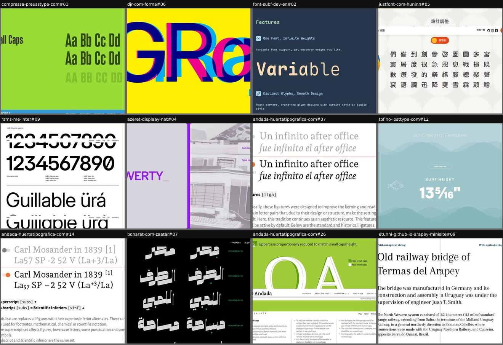
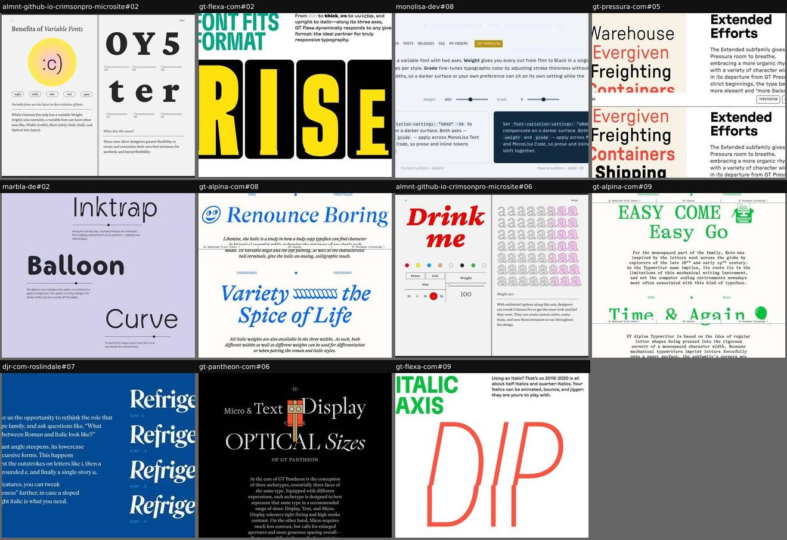
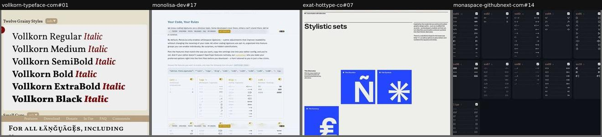
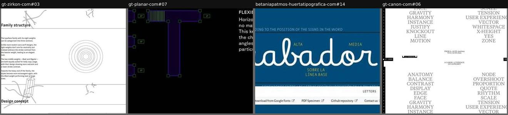
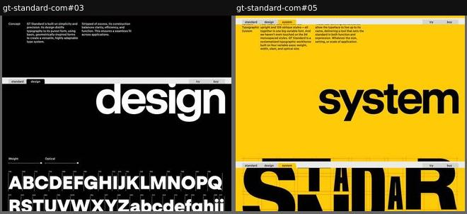
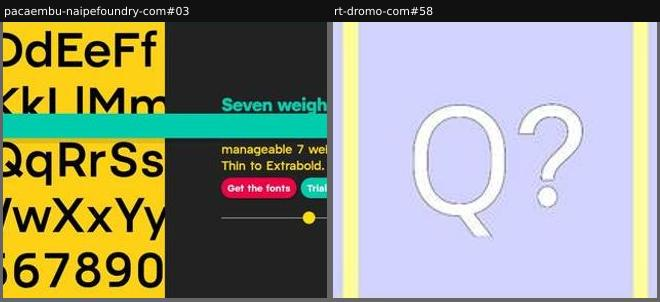

# design-details

_Section: Design details_

The micro-decisions: features, alternates, axes, spacing, construction.

Sample: 36 blocks from 29 sites.

| variant | n | definition | recognise by |
|---|---|---|---|
| [feature-before-after](#feature-before-after) | 13 | A feature or alternate shown off vs on (side by side, overlaid, toggled or typed in a loop) with a short explanation. | pairs, toggles, feature tags |
| [axis-explainer](#axis-explainer) | 11 | Each variable axis demonstrated on its own: a word plus slider, labelled steps, or animation fitting frames. | axis names, steps, one axis at a time |
| [feature-index](#feature-index) | 4 | Every stylistic set or ligature group catalogued as cards or tiles (input → output), often toggleable or exportable as settings. | exhaustive grid of feature cards |
| [annotated-specimen](#annotated-specimen) | 4 | Letterforms with technical annotations or numbered figures (measurements, ink traps, angles), one decision per row. | callouts, dimension lines, 'Fig. 1' |
| [system-diagrams](#system-diagrams) | 2 | The family's logic (weight curve, optical sizes, widths) explained with charts, like a design-system manual. | graphs, axes, curves |
| [design-notes](#design-notes) | 2 | A sequence of design decisions, each with a visual and a short caption, as a carousel or video tiles. | slides or looping tiles per topic |

## Rubric

Recorded for every instance in Phase 3, in addition to the cross-cutting attributes in `rubric.json`:

- **subject**: any of features, alternates, axes, spacing, construction, optical-size, italics, scripts, history-of-revision
- **presentation**: pairs | overlay | toggle | animation | diagram | annotation | catalogue
- **explanation**: none | caption | prose

## feature-before-after

A feature or alternate shown off vs on (side by side, overlaid, toggled or typed in a loop) with a short explanation.

**Recognise by:** pairs, toggles, feature tags

| example | look | feel | ux | learn |
|---|---|---|---|---|
| [compressa-preusstype-com#01](../../archive/compressa-preusstype-com/blocks/01.jpg) | Lime green band, 'Small Caps' title left, condensed 'Aa Bb Cc Dd' turning to 'AA BB CC DD' right | Simple, direct | Looping GIF of the feature switching; static otherwise | A looping GIF of off→on is the cheapest possible feature demo and still reads instantly |
| [djr-com-forma#06](../../archive/djr-com-forma/blocks/06.jpg) | Yellow field, giant 'GRaj' in navy, magenta and cyan layers overprinted slightly out of register | Punchy, risograph-like, playful | Animated: alternate layers move along the optical-size axis (opsz 21-72) over the default glyphs | Overprint default and alternate glyphs in transparent colours: the difference itself becomes the graphic |
| [font-subf-dev-en#02](../../archive/font-subf-dev-en/blocks/02.jpg) | Dark navy, monospace feature list: 'Variable', cv01/cv04/zero glyph trios, ligature grid, DEBUG/TODO tag ligatures, each with a toggle | Developer-friendly, tidy, product-docs | Per-feature toggles (cv01, cv04, zero, calt, ligatures on/off) switch the samples live | Name each option with its exact feature tag plus a one-line reason, so developers know what to put in their editor config |
| [justfont-com-huninn#05](../../archive/justfont-com-huninn/blocks/05.jpg) | Cream with pale circles, rounded CJK characters in a 10-column grid, orange before/after pill toggle, mascot illustrations at edges | Friendly, cute, community-made | Toggle 調整前/調整後 (before/after adjustment) swaps the glyphs | Show the revision itself: a before/after toggle on the corrected characters makes invisible craft visible |
| [rsms-me-inter#09](../../archive/rsms-me-inter/blocks/09.jpg) | White, pairs of large sample lines (default vs feature on) with tiny feature tags (cv01, ss02, tnum, zero), closing table of all features | Systematic, documentation-grade, neutral | static comparisons; sticky nav (Features, Glyphs, FAQ, Lab, Download) | Pair each sample with the exact feature codes that produce it, then end with the complete feature index for reference |
| [azeret-displaay-net#04](../../archive/azeret-displaay-net/blocks/04.jpg) | Two lilac panels on purple: 'QWERTY_' typed with a caret on the left, grey canvas photo of a computer lab with Get / Type tester links on the right | Retro-tech, minimal, lively | Auto-typing word cycle with stylistic sets on; canvas image reacts to the pointer; links to buy and tester | Typing the words out letter by letter makes the eye catch each alternate as it appears |
| [andada-huertatipografica-com#07](../../archive/andada-huertatipografica-com/blocks/07.jpg) | Grey 'off' line above black 'on' line, orange toggle marked DEFAULT, '[liga]' tag and short history note | Didactic, gentle | Toggle ligatures on and off on a Spanish sample | Mark which state is the default, so readers know what they get without touching anything |
| [tofino-losttype-com#12](../../archive/tofino-losttype-com/blocks/12.jpg) | Sea-teal gradient waves, line-drawn fish, pill toggles (FRACTIONS ON, TABULAR NUMBERS OFF…) above themed samples | Calm, coastal, light-hearted | Toggle each feature (frac, tnum, sups, case, subs, onum) on its own sample | Give every OpenType feature a themed real-world sample (surf height, tide table, salinity) so its purpose is obvious |
| [andada-huertatipografica-com#14](../../archive/andada-huertatipografica-com/blocks/14.jpg) | White, grey 'off' line above the active line, feature tags [sups] [subs] [sinf], orange toggle dots | Precise, documentary | Toggle per feature | Show the same string with and without the feature, plus the tag, for every feature: a manual that is also a specimen |
| [boharat-com-zaatar#07](../../archive/boharat-com-zaatar/blocks/07.jpg) | Black, Arabic words in pairs (default vs stylistic set), green dots, 'STYLISTIC SET 01–04' labels | Calligraphic, graphic | static pairs | Pairs, one per stylistic set, make subtle alternates visible in non-Latin scripts |
| [andada-huertatipografica-com#26](../../archive/andada-huertatipografica-com/blocks/26.jpg) | Lime green field, giant outlined 'OA', 'Fake small caps / Real small caps' checkboxes, three-column usage notes below; sticky nav overlaps | Didactic, textbook | Toggle fake vs real small caps; slide carousel (1-8, play, prev/next) through features | Show the wrong way (scaled-down caps) against the right one so the feature's value is self-evident |
| [etunni-github-io-arapey-minisite#09](../../archive/etunni-github-io-arapey-minisite/blocks/09.jpg) | White, headline/lead/body text set twice, a vertical wipe line splitting 'Without' vs 'With optical sizing' | Quiet, precise, editorial | Drag the split line to compare the same text with and without opsz | A wipe slider over identical text exposes a subtle axis (optical size) that side-by-side columns would hide |
| [cinetype-com-fabbrica#40](../../archive/cinetype-com-fabbrica/blocks/40.jpg) | Charcoal, default numerals row, arrow with round 'ss04'/'ss05' badge to circled and index-figure rows; cookie banner covers one label | Diagrammatic, clean, technical | static | Draw the feature tag as a node on an arrow from default to alternate: reads like a transformation diagram |

## axis-explainer

Each variable axis demonstrated on its own: a word plus slider, labelled steps, or animation fitting frames.

**Recognise by:** axis names, steps, one axis at a time

| example | look | feel | ux | learn |
|---|---|---|---|---|
| [almnt-github-io-crimsonpro-microsite#02](../../archive/almnt-github-io-crimsonpro-microsite/blocks/02.jpg) | Open-book spread: left page with ':c)' in a yellow-pink gradient disc, axis pills (wght, wdth, slnt, ital, opsz), prose; right page 'O Y 5 / t e r' each over its own slider | Gentle, didactic, bookish | One weight slider per glyph; axis pills switch the explanation | Give each glyph its own weight slider so the visitor builds a word with mixed weights and grasps 'instances' |
| [gt-flexa-com#02](../../archive/gt-flexa-com/blocks/02.jpg) | White, teal condensed 'FONT FITS FORMAT', intro with 'thin', 'thick', 'narrow', 'wide', 'italic' each in its own style; yellow 'RISE' in black rounded tiles | Punchy, editorial, mechanical | Looping video plays in viewport: letters stretch to fill their tiles | Show width and weight as a layout tool: letters squeezing to fit boxes sells the variable font to designers |
| [monolisa-dev#08](../../archive/monolisa-dev/blocks/08.jpg) | Pale blue, prose on Weight and Grade axes, two sliders, twin cards on a light and a dark surface (GRAD 0 vs -50) | Calm, documentation-like | Weight and Grade sliders update the sample cards live | Show grade on a light and an inverse surface side by side: it explains why the axis exists, not only what it does |
| [gt-pressura-com#05](../../archive/gt-pressura-com/blocks/05.jpg) | Split: cream panel of themed words (Warehouse, Evergiven, Freighting, Containers) alternating red and black, bold 'Extended Efforts' heading and prose right | Industrial, matter-of-fact, witty | Word stack animates from standard to extended width (wdth) through weights, with a slider gauge; sticky Typetester/Purchase bar | Introduce a subfamily by morphing themed words (shipping vocabulary) from the base width into it, next to the why |
| [marbla-de#02](../../archive/marbla-de/blocks/02.jpg) | Lavender, words 'Inktrap', 'Balloon', 'Curve' each in its axis extreme, thin sliders, captions | Didactic, gentle | One slider per axis, live | Name each axis after what it does, and show it on a word that names itself |
| [gt-alpina-com#08](../../archive/gt-alpina-com/blocks/08.jpg) | Cream, blue italic headlines 'Renounce Boring' and 'Variety the Spice of Life' with emoji-like glyphs, pole labels FINE / FINE ITALIC and CONDENSED / EXTENDED | Witty, warm, literary | Headlines animate roman to italic and across widths; a dot travels between the labelled poles; sticky trial/licensing bar | Label the two extremes on either side and let a dot travel between them: a slider-like reading of an animation, no controls needed |
| [almnt-github-io-crimsonpro-microsite#06](../../archive/almnt-github-io-crimsonpro-microsite/blocks/06.jpg) | Book-spread layout: red bold italic 'Drink me' with colour dots and controls left, grid of 'a' interpolating outline to pink right, 'Weight axis' caption | Literary, Alice-in-Wonderland, gentle | Weight slider, Roman/Italic, size XS-XL and colour swatches restyle 'Drink me' live | Frame the page as a book spread: the tester sits on the left page, the explanation on the right |
| [gt-alpina-com#09](../../archive/gt-alpina-com/blocks/09.jpg) | Cream, green monospace headlines 'EASY COME Easy Go', 'Time & Again' with typewriter and balloon icons, pole labels PROPORTIONAL / TYPEWRITER and THIN / BOLD, centred prose | Literary, nostalgic, witty | Headlines animate between proportional and typewriter, thin and bold; dot moves between the labels; sticky trial/licensing bar | Write headlines whose meaning matches the change ('Easy come, easy go' while the width morphs): copy and animation tell one joke |
| [djr-com-roslindale#07](../../archive/djr-com-roslindale/blocks/07.jpg) | Royal blue, white serif 'Refrigerator' four times at SLNT 0, -2, -5, -8 with tiny value labels, prose column left | Thoughtful, editorial, calm | Sample words are editable; static stops | Pick a word that contains every letter that changes (f, e, a, i) and show it at fixed stops: progressive cursivity becomes legible |
| [gt-pantheon-com#06](../../archive/gt-pantheon-com/blocks/06.jpg) | Black, gold 'a' in Display, Text and Micro with px labels, matching paragraphs in each cut, ornate title 'Micro & Text & Display: Optical Sizes' | Classical, luxurious, scholarly | Scroll animation appears to rescale the three 'a's from their intended sizes to one size so differences show | First show each optical size at its intended size, then scale them equal: the visitor sees why they differ |
| [gt-flexa-com#09](../../archive/gt-flexa-com/blocks/09.jpg) | White, green bold 'ITALIC AXIS', huge red thin 'DIP' caught mid-slant, short witty paragraph | Cheeky, kinetic | Animated words (Dip, Drift, Plunge, Slouch, Tilt) cycle through slant values; collapsible section | Animate verbs that describe the motion (dip, slouch, tilt): the word acts out what the axis does |

## feature-index

Every stylistic set or ligature group catalogued as cards or tiles (input → output), often toggleable or exportable as settings.

**Recognise by:** exhaustive grid of feature cards

| example | look | feel | ux | learn |
|---|---|---|---|---|
| [vollkorn-typeface-com#01](../../archive/vollkorn-typeface-com/blocks/01.jpg) | Beige, light panels per feature (styles, small caps, Cyrillic, Greek, localisation, figures…) with green labels and dark red highlighted glyphs | Thorough, generous, bookish | Each panel has an 'info ▼' expander explaining how to access the feature | Pair every feature panel with a hidden how-to note: the catalogue stays visual and still answers 'how do I use it?' |
| [monolisa-dev#17](../../archive/monolisa-dev/blocks/17.jpg) | Pale blue-grey docs page, intro prose, monospace settings bar with Copy, 4-column cards (calt, liga, dlig, cv01…) listing sequence→glyph pairs | Developer-friendly, transparent, no-nonsense | Toggle each feature group; the editor.fontLigatures line updates; copy to clipboard | End the feature tour with a copy-paste config: the visitor leaves with their exact setup, not just an impression |
| [exat-hottype-co#07](../../archive/exat-hottype-co/blocks/07.jpg) | Light grey, staggered blue/orange/yellow/green squares (thin Ñ, circled 1, squared C, alternate a), then black video band and blue OpenType list | Swiss-modernist, orderly, bright | Mostly static; a looping video band; OpenType feature list below | One glyph per tile, colour-coded by set, makes a long list of alternates scannable in seconds |
| [monaspace-githubnext-com#14](../../archive/monaspace-githubnext-com/blocks/14.jpg) | Dark grid of cards ss01-ss10 + liga, each with count badge, checkbox and 'input ...... output' rows with dotted leaders | Technical, reference-manual, tidy | Checkbox per card toggles that set; scan input vs output | Dotted leaders between typed sequence and rendered ligature make coding ligatures legible as a lookup table |

## annotated-specimen

Letterforms with technical annotations or numbered figures (measurements, ink traps, angles), one decision per row.

**Recognise by:** callouts, dimension lines, 'Fig. 1'

| example | look | feel | ux | learn |
|---|---|---|---|---|
| [gt-zirkon-com#03](../../archive/gt-zirkon-com/blocks/03.jpg) | White, thin rules, words 'Heat', 'MAX', 'Raw', 'Refitment', 'Safe' with measurements, zoomed ink-trap tiles and a protractor; scribbled line drawings | Technical, precise, quietly playful | static (some figures animate, e.g. width comparison) | One decision per row, each proved on a word with real numbers (stems 47/30, widths 628/519): explains craft without jargon walls |
| [gt-planar-com#07](../../archive/gt-planar-com/blocks/07.jpg) | Black, purple outline 'ET' with green Bézier nodes and '0°' angle tags, white caption 'Flexible persistence' right | Technical, digital, precise | static (likely animates across italic angles) | Tag the terminals with their angle (0°) to prove a construction rule holds across every slant |
| [betaniapatmos-huertatipografica-com#14](../../archive/betaniapatmos-huertatipografica-com/blocks/14.jpg) | Navy panel, white connected script 'abador' with labels ALTA, MEDIA, SOBRE LA LÍNEA BASE marking connection heights; sticky footer links | Didactic, calligraphic, school-book | static image with caption | Label where each joining stroke attaches (high, middle, baseline): explains the connection system of a script in one word |
| [gt-canon-com#06](../../archive/gt-canon-com/blocks/06.jpg) | Capture shows an overlapping sticky A–Z word list (ANATOMY…ZONE) in grey serif caps; the Fig. 7/8 Lottie diagrams did not render | Scholarly, precise | Scroll-driven sticky Lottie figures with captions on slant angle and italic design | Number design decisions as figures: it frames type design as considered engineering and makes each point citable |

## system-diagrams

The family's logic (weight curve, optical sizes, widths) explained with charts, like a design-system manual.

**Recognise by:** graphs, axes, curves

| example | look | feel | ux | learn |
|---|---|---|---|---|
| [gt-standard-com#03](../../archive/gt-standard-com/blocks/03.jpg) | Black then white chapters: concept prose, huge 'design' with weight/optical sliders over A–Z with advance widths, then square/circle/triangle turning into H O A | Swiss, rational, systematic | Weight and optical-size sliders on the alphabet; scroll steps through chapters (design, anatomy…) | Morph square, circle and triangle into H, O, A to show a geometric sans literally grows from primitives |
| [gt-standard-com#05](../../archive/gt-standard-com/blocks/05.jpg) | Yellow and white chapters, huge 'system' and collaged 'STANDARD', weight-ladder 'A', numbered colour weights 1-7, line chart and stacked-disc diagram | Systematic, Swiss, engineering manual with colour | Long scroll with sticky axis headings, one optical-size toggle, sticky try/buy bar | Plot the weight axis as a real curve and give each weight a number and colour: the system becomes legible as data |

## design-notes

A sequence of design decisions, each with a visual and a short caption, as a carousel or video tiles.

**Recognise by:** slides or looping tiles per topic

| example | look | feel | ux | learn |
|---|---|---|---|---|
| [pacaembu-naipefoundry-com#03](../../archive/pacaembu-naipefoundry-com/blocks/03.jpg) | Yellow alphabet panel left, dark panel right with teal heading 'Seven weights', red and teal buttons; cookie notice and sticky nav overlap | Sporty, cheeky, warm | Prev/next through slides ('Going for the tittle', 'Counter attack'); weight slider on the first slide | Title each design note with a football phrase: a running theme makes glyph trivia memorable |
| [rt-dromo-com#58](../../archive/rt-dromo-com/blocks/58.jpg) | Three lavender squares on yellow, white outlined 'Tw', 'Q?', 'Ęę' (still frames of looping videos) | Calm, systematic, explanatory | Autoplay muted looping videos; static otherwise | One micro-animation per topic (kerning, diacritics) lets a visitor grasp each decision in a few seconds |
