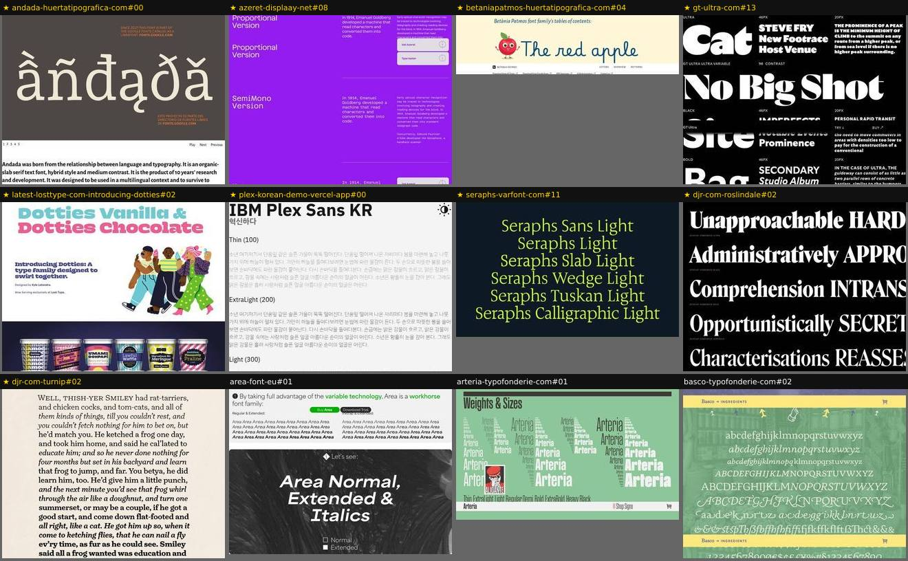
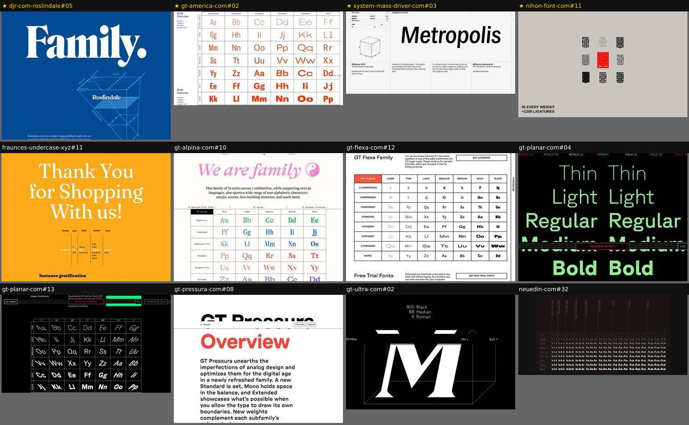
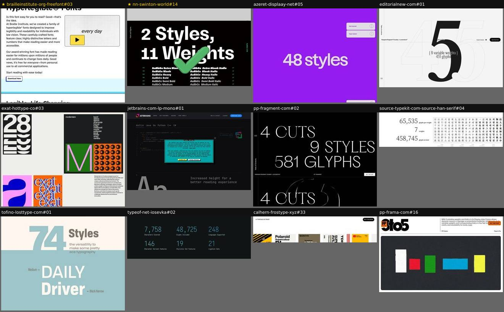

# family-overview

_Section: Specimen showcase (discovered type, alongside specimen-showcase)_

The family's styles and structure at a glance.

130 instances on 95 sites (the Phase 3 extraction of 181 sites).

| variant | sites | definition | recognise by |
|---|---|---|---|
| [style-word-grid](#style-word-grid) | 81 | Every style named and shown on a sample word or the same paragraph. | style labels plus samples in a grid or stack |
| [designspace-map](#designspace-map) | 20 | The family laid out along its axes: a matrix, a cube, or clickable stops that set the sample. | width × weight table, axis cube, stop pickers |
| [big-number-stats](#big-number-stats) | 15 | The family's size stated as huge figures (glyphs, weights, styles). | giant numerals with small labels |

## Rubric

Recorded for every instance in Phase 3, in addition to the cross-cutting attributes in `rubric.json`:

- **structure**: list | grid | matrix | map | stats
- **samples**: word | paragraph | glyph | name-only
- **interactive**: true | false

## style-word-grid

Every style named and shown on a sample word or the same paragraph.

**Recognise by:** style labels plus samples in a grid or stack

| example | look | feel | ux | learn |
|---|---|---|---|---|
| [★ andada-huertatipografica-com#00](../../archive/andada-huertatipografica-com/blocks/00.jpg) | One panel per style, each labelled small ('Andada - Regular', '- Italic', '- Medium', '- Medium Italic', '- Bold'…) and showing the word 'butterfly' in another language at display size with a pangram in that language underneath: '{LA} mariposa' + 'El veloz murciélago hindú come un kiwi enmarañado', '[DER] Schmetterling' + 'Ma la volpe col suo balzo…', '✳ borboleta ✳' + '„Fix, Schwyz!“ quäkt Jürgen blöd vom Paß', 'motyl' beside a Basque pangram (the crop is cut at Bold) | Delicate, travelling, warm | static images (GIFs), separated by dotted rules | Give every style the same word in a different language plus that language's pangram: the style list doubles as a language-support showcase |
| [★ azeret-displaay-net#08](../../archive/azeret-displaay-net/blocks/08.jpg) | Three ruled rows on violet: 'Proportional Version', 'SemiMono Version', 'Mono Version', each heading and its two sample paragraphs (a large lead and a small body about the history of OCR) set in that sub-family | Clear comparison | Each row ends with a link: 'Starting at €75' (proportional, semi-mono) or 'For free!' (mono) to the Displaay shop (links faded in, not visible in the desktop capture) | Set the same text in each sub-family side by side so the mono axis is felt in real paragraphs, then put the price at the end of each row |
| [★ betaniapatmos-huertatipografica-com#04](../../archive/betaniapatmos-huertatipografica-com/blocks/04.jpg) | 'Betània Patmos font family's tables of contents:' six cream strips, each a fruit word with a grinning fruit mascot and a caption naming the font: 1 Regular ('The red apple'), 2 Regular with Montessori guideline overlaid ('2 Zitronen'), 3 Super ligada with entry strokes ('Mandarina'), 4 Super ligada + guideline ('La taronja'), 5 the guideline alone (fruits standing on the lines), 6 guideline with start and end caps ('només ratlles') | Playful, kindergarten-friendly | static images | When the 'styles' are functional variants (guideline overlays, connected forms), show each on one word with a one-line caption that says what it adds |
| [★ gt-ultra-com#13](../../archive/gt-ultra-com/blocks/13.jpg) | One row per weight (ULTRA, BLACK, BOLD, REGULAR, LIGHT, THIN), each with a huge word ('Cat', 'Site', 'Bag', 'Qui', 'Not', 'Rips'), a three-line 46px column (caps / italic / roman headlines) and a 20px paragraph; between them, two variable rows 'No Big Shot' and 'DISTANCE Little Shots' with live readouts ('98 CONTRAST', '400 WEIGHT 10 ITALIC 16 CONTRAST') | Newspaper type specimen, lively | Moving the pointer left to right across the section changes the contrast axis of all rows; the two variable rows animate on their own while their caption numbers count | Map pointer x to one axis across a whole specimen sheet, and print the live axis values in the captions of the animated rows |
| [★ latest-losttype-com-introducing-dotties#02](../../archive/latest-losttype-com-introducing-dotties/blocks/02.jpg) | Repeated for each subfamily: a navy heading and short description beside 'a b c' set on three line-drawn hands holding cones; then a giant teal (or pink) 'a' with an illustrated woman leaning in its counter, beside a list of 20 style names each set in itself (Thin → Ultra, then Ultra Italic → Thin Italic) and an orange 'TRY DOTTIES' button; a sprinkles divider separates Vanilla from Chocolate | Playful but complete | static images; 'Try Dotties' links to the font page | Run the style list down and back up (romans getting heavier, italics getting lighter) so the column swells and thins like a scoop |
| [★ plex-korean-demo-vercel-app#00](../../archive/plex-korean-demo-vercel-app/blocks/00.jpg) | A 700px column of eight sections, each a weight label ('Thin (100)', 'ExtraLight (200)' … 'Text (450)' … 'Bold (700)') above the same five-line Korean poem paragraph in that weight, from barely-there grey to dense black | Quiet, bookish, honest | Scroll to compare colour of text across weights; the sun button switches the page to dark mode | Repeat one real text (a known poem) in every weight, labelled with name and numeric weight, so the visitor judges texture rather than letter shapes; a dark-mode toggle doubles the test |
| [★ seraphs-varfont-com#11](../../archive/seraphs-varfont-com/blocks/11.jpg) | Three alternating bands (Light on navy, Regular on lime, Bold on navy), each a centred stack of six style names set in themselves: Sans, Seraphs, Slab, Wedge, Tuskan, Calligraphic | A roll-call: the same voice in six costumes | Static | A family made of 6 serif styles × 3 weights reads clearly as three bands of six self-naming lines |
| [★ djr-com-roslindale#02](../../archive/djr-com-roslindale/blocks/02.jpg) | Three black interludes (Display Condensed, Display Narrow, Display) of eight white rows each, from Ultra down to Extra Light, every row a run of long words alternating Title-case and CAPS ('Unapproachable HARDPRESSED…') bleeding off the right edge, with a tiny grey label under it ('DISPLAY CONDENSED ULTRA') | Kinetic, luxurious, like a moving type wall | Rows shift sideways as the page scrolls (momentumcss with each row's --top/--height); slant is a CSS variable (--slnt) that the script drives, probably from scroll speed; each row is editable | Turn the weight list into scroll-driven ticker rows: the styles parade past instead of sitting in a table, and three repeats (one per width) pace the long page |
| [★ djr-com-turnip#02](../../archive/djr-com-turnip/blocks/02.jpg) | One big paragraph from Twain's 'Jumping Frog' in near-black, whose lines step heavier every two lines while alternating roman and italic: Light small-caps opening 'WELL, THISH-YER SMILEY', Light Italic, Book, Book Italic, Regular, Italic, Medium … down to Black Italic at the end; a tiny italic credit line below | A tall-tale reading that slowly gains weight, like the frog | static (an SVG image, not live text) | Run one continuous text through every style in weight order, pairing each roman with its italic: the family overview reads as a passage instead of a list, and the jump between steps is visible line to line |
| [area-font-eu#01](../../archive/area-font-eu/blocks/01.jpg) | '❶ By taking full advantage of the variable technology, Area is a workhorse font family:' over two blocks of the word 'Area' repeated (Regular & Extended / Inktrap & Extended), stepping through every weight with alternating upright and italic, normal and extended, in four dense lines each | Comprehensive, rhythmic | static | Repeat one short word through all instances in reading order: 88 styles fit in eight lines |
| [arteria-typofonderie-com#01](../../archive/arteria-typofonderie-com/blocks/01.jpg) | On sage green, 'Weights & Sizes' then five columns of the word 'Arteria' cascading from tiny to large in each weight, alternating charcoal and white, so each column forms a diagonal wedge; the nine weight names in a row underneath | Musical, cascading | Columns slide down and fade in one by one when the section enters | Combine weight and size in one figure: a size cascade per weight makes the family read as a pattern of wedges |
| [basco-typofonderie-com#02](../../archive/basco-typofonderie-com/blocks/02.jpg) | End of the Ingredients section on flat mint: ROMANS and ITALICS columns of style names in themselves, light in yellow-white, bold in butter | A short ingredients list | Static | Split nine weights into a light and a bold column so a two-axis list fits in one row of four columns |
| [bigshoulders-me#05](../../archive/bigshoulders-me/blocks/05.jpg) | White 'BIG SHOULDERS HAS 8 WEIGHTS', then two fitted blue lines with each style name set in itself: 'Thin Light Regular Medium' and 'SemiBold Bold ExtraBold Black' | Compact, shouted | static | Fit all style names into two justified lines: size becomes a side effect and the family reads as one object |
| [calhern-frostype-xyz#33](../../archive/calhern-frostype-xyz/blocks/33.jpg) | Beyond the capture (seen in the video): three blocks 'Calhern Wide', 'Calhern', 'Calhern Condensed', each two columns of 13 weight names from Black to Skeleton, set in themselves, with 'Italic' set in the matching italic beside each | Complete, typographic | static | Pair each weight name with the word 'Italic' in its italic: a 26-style ramp in two tidy columns |
| [colab-munken-com-munken-sans#05](../../archive/colab-munken-com-munken-sans/blocks/05.jpg) | Three giant M's in Regular, Medium and Bold, each with a small three-line label 'This is Munken Sans [weight]' | Spare, sign-like | A Lottie animation runs in view (the text layers include r, m and 1, so letters seem to cycle; the capture shows only M) | With only three weights, one large glyph per weight is the whole overview; a short animated glyph swap adds interest with no extra layout |

_…and 76 more in the gallery (`npm run app`)._

## designspace-map

The family laid out along its axes: a matrix, a cube, or clickable stops that set the sample.

**Recognise by:** width × weight table, axis cube, stop pickers

| example | look | feel | ux | learn |
|---|---|---|---|---|
| [★ djr-com-roslindale#05](../../archive/djr-com-roslindale/blocks/05.jpg) | On royal blue, 'Family.' at ~360px, then the 3D horn in cyan hairlines: a tapering box whose edges are labelled WEIGHT (Extra Light → Ultra), WIDTH (Condensed, Narrow, Normal) and OPTICAL SIZE (Display → Deck → Text), dotted with instance points, with a translucent plane carrying the word 'Roslindale' set at that location; a short history paragraph below left | Clear, architectural | The plane and the word 'Roslindale' move through the horn (x/y plane wrappers + Typetura --opsz), so the sample changes weight, width and size as it moves; exact trigger (scroll or pointer) not visible in the capture | Draw the designspace as the conical shape it really is (wide range at display sizes, narrow at text sizes) and put a live word at a point inside it |
| [★ gt-america-com#02](../../archive/gt-america-com/blocks/02.jpg) | Hairline-ruled table: five width columns (Compressed → Expanded), rows of 'Aa Bb Cc…' pairs stepping through the weights, light rows blue and bold rows orange | Rigorous, reference-like | static | A width × weight matrix of letter pairs shows the whole design space in one screen, with no style names to read |
| [★ system-mass-driver-com#03](../../archive/system-mass-driver-com/blocks/03.jpg) | Left: a readout panel (WEIGHT (WGHT) 600, WIDTH (WDTH) 75, SLANT (SLNT) −5), Size and tracking (↔) sliders, and a wireframe 3D cube with orange-red nodes on its edges; right: 'Metropolis' at 200px in Semibold Condensed oblique; below, file facts for the variable TTF (302 KB) and the static OTFs | Like a lab instrument | Drag the nodes/sliders on the cube's edges (width 50–100, slant −10–0, weight 400–800) and the sample and readouts update; Size slider 25–250px and tracking −0.05–0.05em; 'Aa' instance chips jump to named styles; the sample is editable | Put the axis sliders on the edges of a 3D cube: the designspace becomes something you can hold, and the readouts teach the axis tags |
| [★ nihon-font-com#11](../../archive/nihon-font-com/blocks/11.jpg) | 'IN EVERY WEIGHT +1200 LIGATURES' shows the name ligature in a 3×3 mix of styles and weights; then '4 STYLES WITH 6 WEIGHTS EACH' lays the same ligature out as a 4×6 matrix: rows Standard (black), Rustica (red), Linear (black outline), Border (red framed), weights getting lighter to the right | Methodical, like a stamp sample card | Static | One glyph repeated in a styles × weights matrix, with style names running vertically at the row starts, shows the whole family in one screen |
| [fraunces-undercase-xyz#11](../../archive/fraunces-undercase-xyz/blocks/11.jpg) | On orange, the editable 'Thank You / for Shopping / With us!' in white, above a five-column picker separated by thin black rules (Family · opsz 9/72/144 · SOFT Sharp/Soft/SuperSoft · WGHT Thin…Black · Style Roman/Italic), the active value of each column aligned on one white row; then 'Instance gratification' prose | Neat, slot-machine-like | Click a value in any column to set that axis; the column slides so the active value sits on the shared row (like a combination lock) and the sample updates | Lay the named instances out as aligned columns per axis and slide the chosen value onto one reading row: the current instance name reads straight across |
| [gt-alpina-com#10](../../archive/gt-alpina-com/blocks/10.jpg) | Pink 'We are family ☯' (italic, animating all axes) and a short paragraph, then a ruled table: 7 subfamily rows (Typewriter, Condensed, Condensed Fine, Standard, Standard Fine, Extended, Extended Fine) × 5 weight columns (Thin–Bold), cells 'Aa', 'Bb'… coloured by subfamily | Tidy, catalogue-like | static table; the headline loops through weight, width and contrast together | Colour each row by its chapter colour so the overview table doubles as a legend for the whole page |
| [gt-flexa-com#12](../../archive/gt-flexa-com/blocks/12.jpg) | 'GT Flexa Family' table: 8 rows of widths (X Compressed → X Expanded, plus Mono) × 7 weight columns (Lazer → Black), each cell a letter pair (Aa, Bb… continuing through the alphabet) in that style; the corner cell 'GT FLEXA' in white on red | Reference chart | static; 'BUY LICENSING' button beside the heading | Continue the alphabet across a width × weight table so every cell is different but the whole still reads as one set |
| [gt-planar-com#04](../../archive/gt-planar-com/blocks/04.jpg) | A top row of seven angle labels (RETALIC 45/30/15 in red, orange, yellow, UPRIGHT in green, ITALIC 15/30/45) above two columns of weight names 'Thin … Black' in pale green, each in its weight | Instrument panel, colour-coded | The pointer's horizontal position selects one of the seven angles: the weight names slant to it and take that angle's colour; on touch, tilt mode drives it | Colour-code the angle steps (red at the extremes, green upright) so slant reads as a temperature scale |
| [gt-planar-com#13](../../archive/gt-planar-com/blocks/13.jpg) | A ruled white-on-black matrix: columns −45° … +45° (labels red, orange, yellow, green, yellow, orange, red) × rows THIN … BLACK (rotated labels), each cell a letter pair ('Aa', 'Bb' …) at that slant and weight | Complete, chart-like | Hovering a cell tints it with its angle colour (data-color); message centre reads 'Explore quadrants' | Lay out a slant axis left-to-right with upright in the middle: the table itself looks like the letters are leaning |
| [gt-pressura-com#08](../../archive/gt-pressura-com/blocks/08.jpg) | 'GT Pressura Overview' (black/red) with a summary paragraph, then a ruled matrix: rows Mono, Standard, Extended (labels rotated 90°) × columns Light, Text, Regular, Medium, Bold, Black, cells 'Aa' … 'Rr' | Clean, tabular | static | Rotate the row labels to keep the matrix cells square and large |
| [gt-ultra-com#02](../../archive/gt-ultra-com/blocks/02.jpg) | A single white 'M' standing inside a thin wireframe cube, with a readout above it: '900 Black / 88 Median / 0 Roman' | Diagrammatic, precise | The M morphs through the three axes while the readout counts the values (weight name, contrast subfamily, roman/italic) | Draw the three axes as a cube and put one letter inside it: the readout tells you where in the cube you are |
| [neuedin-com#32](../../archive/neuedin-com/blocks/32.jpg) | A dark-brown table: nine width columns with rotated headers (XXCondensed … Normal Width … XXWide) and nine weight rows (Thin … Black), each cell holding 'Aa Aa Aa' in upright, italic and retalic | Exhaustive, like an engineering chart | static image | Add a third sample per cell (upright, italic, retalic) to fit three slant styles into the width × weight table |
| [recursive-design#14](../../archive/recursive-design/blocks/14.jpg) | '## Powerful, yet simple to use.' on named instances, then a matrix: column headers Mono / Sans → Casual / Linear → Normal / Italic (8 columns), rows Light (300) to ExtraBlack (1000), each cell the pair 'rw' in blue (italics lighter blue) | Comprehensive, neat | Static table | Use a two-letter sample ('rw') whose shapes change with every axis: 64 named instances fit in one readable table |
| [exat-hottype-co#06](../../archive/exat-hottype-co/blocks/06.jpg) | 'Design Space' heading, then a left column listing all 21 styles in three groups (Condensed, normal, Wide), each name in its own style and pale grey except the active 'Extra Light Condensed', beside a huge 'Rẽ' in the active style | Calm, like a style inspector | Hover or scroll through the list: the big 'Rẽ' switches to that style and the name darkens | One big pair of letters with an accent next to a list of every style is enough to compare weights and widths |
| [gt-flaire-com#02](../../archive/gt-flaire-com/blocks/02.jpg) | An OS-window frame with a 'Flaire' slider along the top, a vertical 'Weight' slider on the left and a vertical 'Italic' slider on the right around orange office jargon ('Outstanding work on achieving this milestone!', 'Let's circle back on that'); then two stacks of card labels Light → Extra, purple (Basic) and orange (Extra), each card a step heavier, and a 'FAMILY SETUP' caption (7 weights × Basic/Extra + italics = 28 styles, 3 axes) | Toy-like, explanatory | The three sliders move by themselves with scroll (keyframes) and can be dragged; the windows themselves are draggable | Put one slider on each edge of the sample, each labelled with its axis: the frame itself is the explanation of the design space |

_…and 9 more in the gallery (`npm run app`)._

## big-number-stats

The family's size stated as huge figures (glyphs, weights, styles).

**Recognise by:** giant numerals with small labels

| example | look | feel | ux | learn |
|---|---|---|---|---|
| [★ brailleinstitute-org-freefont#03](../../archive/brailleinstitute-org-freefont/blocks/03.jpg) | 'One Family. Three Versions.': for each of Atkinson Hyperlegible, Hyperlegible Next and Hyperlegible Mono, a heading, a short paragraph and a 2×2 grid of big figures with captions: 'Âçēřß' (accents for 27 / 150+ languages), '335+' / '370' / '373' (glyphs per style), 'II' or 'IIIIIII' stepping from Extrabold to Light (weights), 'Free' (licence) | Simple comparison chart | static; 'support over 150 languages' links to a language list | Show the weight count as a row of capital I's stepping from heavy to light: the number of weights is visible, not just stated |
| [★ nn-swinton-world#14](../../archive/nn-swinton-world/blocks/14.jpg) | 'Facts and Figures' on black: '2 Styles, 11 Weights' over a two-column weight table (wght values 999…1 in mint, 'AaBbCc Extra Black' / 'AaBbCc Extra Black Italic', '14"' sizes), '94 Latin Languages', '.otf .woff2 .ttf' with mint captions, a giant '739' and 'Glyphs in the Character set*', and finally '1 Variable Font' in black on mint; a glossy green 3D checkmark floats over each figure | Celebratory, checklist-like | The 3D checkmark stays in place (sticky canvas) while each statistic scrolls under it | Turn the spec sheet into a checklist: giant numbers plus one persistent 3D tick makes every fact feel like a feature ticked off |
| [azeret-displaay-net#05](../../archive/azeret-displaay-net/blocks/05.jpg) | On violet, three short stats appear one per screen in the centre, '48 styles', '3 sub-families', '1 for free', each fading and slanting into the next (the outgoing line turns faint and italic) | Smooth, presentation-like | Pinned while scrolling; each stat transitions to the next; a black circular 'Test them all!' button sits under each (mobile) | Animate between stats with the font's own italic: the transition itself shows a style |
| [editorialnew-com#01](../../archive/editorialnew-com/blocks/01.jpg) | Off-white field, a giant '455' in hairline outline with only the middle '5' solid black, and a small centred caption '{ 8 variable weights } 455 glyphs' over it | Elegant, quietly boastful | Caption moves at a different scroll speed (parallax 1.5); a paper-fold strip slides horizontally into the next (dark) section | Set the key number in the font's own numerals and fill just one digit: the statistic becomes a display specimen |
| [exat-hottype-co#03](../../archive/exat-hottype-co/blocks/03.jpg) | Charcoal card 'Font overview' with four lines at ~80px: '21 weights', 'Latin & Cyrillic', '1715 glyphs', '431 languages' (the last in pink), each with a big round bullet; the pink bullet marks the current line | Punchy fact sheet | The highlight probably steps from line to line | Four numbers in display size with bullets that light up in turn say 'big family' faster than any paragraph |
| [jetbrains-com-lp-mono#01](../../archive/jetbrains-com-lp-mono/blocks/01.jpg) | 'Key features' as a ruled grid of six numbered cells: 1. giant 'Ap' + 'Increased height for a better reading experience', 2. giant 'Src:' + 'Adapted to reading code', 3. '142/85 code-specific ligatures', 4. '148 languages', 5. giant '8' + 'weights with matching italics', 6. 'JetBrains Mono is free & open source' with Download font, Read license, See project on GitHub; small caps 'EXPLORE …↓' links in each corner | Confident, poster-like | Each cell's link jumps to its detailed section | Lead the feature list with the numbers and specimens set huge: the figure is the headline, the sentence is the caption |
| [pp-fragment-com#02](../../archive/pp-fragment-com/blocks/02.jpg) | '4 CUTS / 9 STYLES / 581 GLYPHS' in huge thin white caps on three staggered lines, while a large glass 3D 'a' rotates in behind them | Dramatic, airy | The section is pinned (~3600px of scroll): glass letter renders swing in (translate + rotate) behind the stats; the figures and words roll through the four cuts | Keep the stats ultra-thin and huge and put a slowly turning 3D letter behind them: the numbers read as a title card |
| [source-typekit-com-source-han-serif#04](../../archive/source-typekit-com-source-han-serif/blocks/04.jpg) | Left: three big light numerals with small labels, '65,535 glyphs per weight', '7 weights', '458,745 glyphs in total'; right: a framed wall of 13 rows of characters cycling through TC, KR, SC and JP, with columns getting heavier from ExtraLight to Heavy, labelled '24px ExtraLight … Heavy' underneath | Monumental yet tidy | static | Pair the headline numbers with a dense wall that shows them: the weights run across, the locales run down |
| [tofino-losttype-com#01](../../archive/tofino-losttype-com/blocks/01.jpg) | A blue '74' straddling a cream/blue colour split, 'Styles' in heavy narrow grey beside it with 'the versatility to make some pretty ace typography' in Wide; below, two cream lines 'DAILY' / 'Driver' tagged with arrow labels 'Medium →' and '← Black Narrow' | Breezy, bragging with a wink | The two big lines fade and cycle through other word pairs and styles ('Tidal …', 'Noodle Arms' on mobile), the arrow labels updating to the style shown | After the style count, prove it by cycling a two-word pair through styles with an arrow label naming each: the number becomes tangible |
| [typeof-net-iosevka#02](../../archive/typeof-net-iosevka/blocks/02.jpg) | A 3×2 grid of thin cyan figures with small captions: 7,758 Characters, 48,725 Glyphs, 248 Languages, 146 Character Variant Features, 19 Stylistic Sets, 21 Ligation Sets | Technical bragging, calm | static | Counting features, not just glyphs, shifts the claim to what developers care about |
| [calhern-frostype-xyz#33](../../archive/calhern-frostype-xyz/blocks/33.jpg) | Beyond the capture (HTML, mobile): a sticky giant counter (captured at '632', '000' on mobile) counting up beside '825 GLYPHS PER STYLE' in tall condensed caps, a paragraph (150 languages, 64,350 glyphs across 78 styles) and floating VHS boxes | Emphatic, ticking | The number counts up while the section scrolls past | Animate the glyph count as a sticky counter so the size of the character set is felt, not just read |
| [pp-frama-com#16](../../archive/pp-frama-com/blocks/16.jpg) | White header: a heavy black '9to5' at top-left and a paragraph at right explaining 9 Display weights + italics vs 5 Text weights + italics, 'PP Frama' and 'Free to Try' under a rule; below, a rounded dark video panel where white, red, green, blue and yellow paper rectangles sit in a row | Workmanlike, witty | Muted autoplay looping Vimeo video below (paper shapes, probably assembling into forms); 'Free to Try' link | Turn the family's counts into a phrase ('9 to 5' = nine display, five text weights): the stat becomes a pitch for an everyday workhorse |
| [sourcefoundry-org-hack#02](../../archive/sourcefoundry-org-hack/blocks/02.jpg) | A parallax band with two count-up figures, '1573 GLYPHS' and '129 CONTRIBUTORS'. It sits at y≈2170–2377 between blocks 01 and 02, was never cut as a block, and shows only in the video and mobile strip | Compact, open-source pride | Counters run up from low values when scrolled into view (t=4.5s shows 15 and 1); background parallaxes | A contributor count beside the glyph count makes community a feature of the typeface |
| [vercel-com-font#02](../../archive/vercel-com-font/blocks/02.jpg) | A four-row spec table centred on the grid: icon, label, number: Weights 9, Glyphs 652, Stylistic sets 9, Languages 32 | Calm, factual | static | Four numbers with small pictograms are enough to size up a family before any specimen |
| [lexend-com#06](../../archive/lexend-com/blocks/06.jpg) | A bento grid of thin red-outlined cells, each a huge numeral with a tiny uppercase caption: '15/16 had better scores with Lexend over Times New Roman', '1 could not be measured', '6 had the best score with Lexend Giga', '110 / 115 avg WCPM', '+16.5% avg improvement in WCPM' | Conclusive, data-forward | Numbers count up from 0 when the grid scrolls into view | Report results as big counted-up numerals in a bento grid; here the figures are study results rather than the family's size, but the mechanism is the same |
