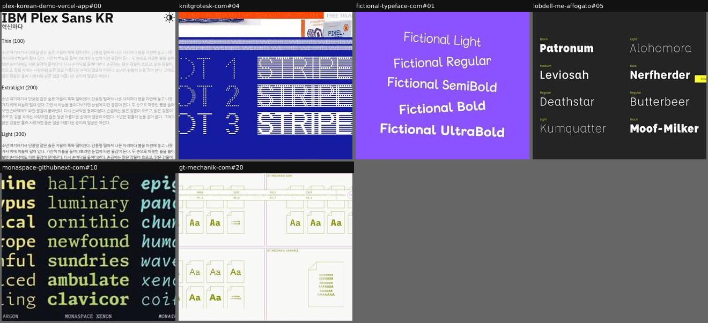
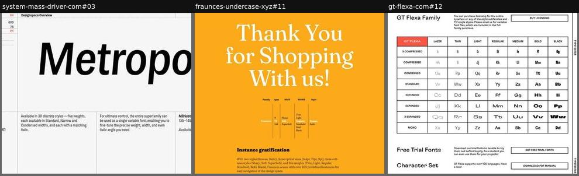
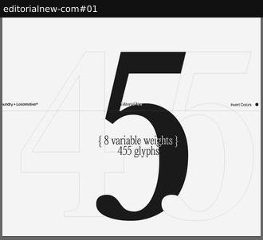

# family-overview

The family's styles and structure at a glance.

Sample: 10 blocks from 10 sites.

| variant | n | definition | recognise by |
|---|---|---|---|
| [style-word-grid](#style-word-grid) | 6 | Every style named and shown on a sample word or the same paragraph. | style labels plus samples in a grid or stack |
| [designspace-map](#designspace-map) | 3 | The family laid out along its axes: a matrix, a cube, or clickable stops that set the sample. | width × weight table, axis cube, stop pickers |
| [big-number-stats](#big-number-stats) | 1 | The family's size stated as huge figures (glyphs, weights, styles). | giant numerals with small labels |

## Rubric

Recorded for every instance in Phase 3, in addition to the cross-cutting attributes in `rubric.json`:

- **structure**: list | grid | matrix | map | stats
- **samples**: word | paragraph | glyph | name-only
- **interactive**: true | false

## style-word-grid

Every style named and shown on a sample word or the same paragraph.

**Recognise by:** style labels plus samples in a grid or stack

| example | look | feel | ux | learn |
|---|---|---|---|---|
| [plex-korean-demo-vercel-app#00](../../archive/plex-korean-demo-vercel-app/blocks/00.jpg) | Light grey, name and Korean word top, then 'Thin (100)' to 'Bold (700)' labels each over the same Hangul paragraph | Plain, documentary | Dark-mode toggle; otherwise static scroll | Repeat one paragraph in every weight: for a CJK or text face, colour on the page matters more than display words |
| [knitgrotesk-com#04](../../archive/knitgrotesk-com/blocks/04.jpg) | Royal blue, 'WEIGHTS' marquee strip, each style name (DOT 1-3, STRIPE 1-3) set in itself in white; previous block's orange marquee at top | Graphic, textile-like, crisp | static apart from scrolling marquee | Name styles after their texture (Dot, Stripe) and set each name in itself: the list is the specimen |
| [fictional-typeface-com#01](../../archive/fictional-typeface-com/blocks/01.jpg) | Flat violet, five centred lines 'Fictional Light' to 'Fictional UltraBold', each in its own weight, slightly rotated | Friendly, bouncy, childlike | Each style name is a button carrying its weight value (likely sets the specimen weight) | A stacked list of style names set in themselves is the cheapest family overview there is, and still reads as a specimen |
| [lobdell-me-affogato#05](../../archive/lobdell-me-affogato/blocks/05.jpg) | Charcoal, white sample words in each weight with small weight labels | Fun, fandom (spells from Harry Potter and Star Wars) | static | Themed sample words (spells) make a dry weight list memorable |
| [monaspace-githubnext-com#10](../../archive/monaspace-githubnext-com/blocks/10.jpg) | Black, five columns (Neon, Argon, Xenon, Radon, Krypton) each in its own pastel colour, words stepping through weights | Techy, playful, colourful | static | Colour-code each sibling family so a superfamily reads as distinct voices that share one grid |
| [gt-mechanik-com#20](../../archive/gt-mechanik-com/blocks/20.jpg) | Cream, four pink-ruled panels (Mono, Semi, Poly, Variable), each style as an olive font-file icon with 'Aa'; sticky ruler nav overlaps | Technical, diagrammatic, quirky | Style cards likely link/download; nav ruler shows scroll position with Type tester, Try, Buy | Drawing each style as a font-file icon makes the family feel like a set of tangible deliverables |

## designspace-map

The family laid out along its axes: a matrix, a cube, or clickable stops that set the sample.

**Recognise by:** width × weight table, axis cube, stop pickers

| example | look | feel | ux | learn |
|---|---|---|---|---|
| [system-mass-driver-com#03](../../archive/system-mass-driver-com/blocks/03.jpg) | Light grey ruled grid, axis readouts (WGHT 600, WDTH 75, SLNT -5), wireframe cube with red point, huge italic 'Metropolis', file-format notes below | Technical, systematic, spec-sheet | Sliders for weight, width, slant, size, spacing move the point in the cube and restyle the editable word | Draw the designspace as a cube with a moving dot: visitors see where an instance sits among all axes at once |
| [fraunces-undercase-xyz#11](../../archive/fraunces-undercase-xyz/blocks/11.jpg) | Saffron field, white serif 'Thank You for Shopping With us!', thin-ruled columns Family/opsz/SOFT/WGHT/Style, 'Instance gratification' note | Warm, witty, retro-friendly | Click stops in each column to switch the instance; sample text editable | Lay out the design space as a clickable table of named stops: it explains the family and lets you drive it |
| [gt-flexa-com#12](../../archive/gt-flexa-com/blocks/12.jpg) | White, black-ruled table: 8 widths x 7 weights, one letter pair per cell; then colour-coded charset, minisite list, credits | Systematic, Swiss, confident | Mostly static; buy licensing, free trial and PDF manual buttons beside each heading | A width-by-weight matrix explains a 56-style family better than any list; walk the alphabet across cells |

## big-number-stats

The family's size stated as huge figures (glyphs, weights, styles).

**Recognise by:** giant numerals with small labels

| example | look | feel | ux | learn |
|---|---|---|---|---|
| [editorialnew-com#01](../../archive/editorialnew-com/blocks/01.jpg) | Off-white, giant '455' with one solid serif '5' over outlined digits, small centred '{ 8 variable weights } 455 glyphs' | Elegant, editorial, quiet confidence | Parallax caption and a paper-fold transition on scroll; Invert colours and Get the font in the header | Set the glyph count in the font's own numerals: the statistic and the specimen are one object |
