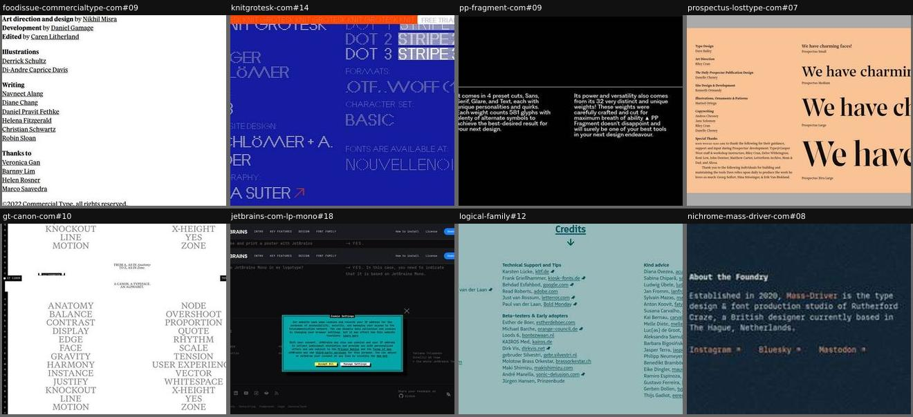
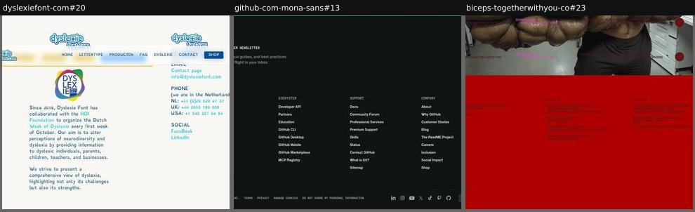
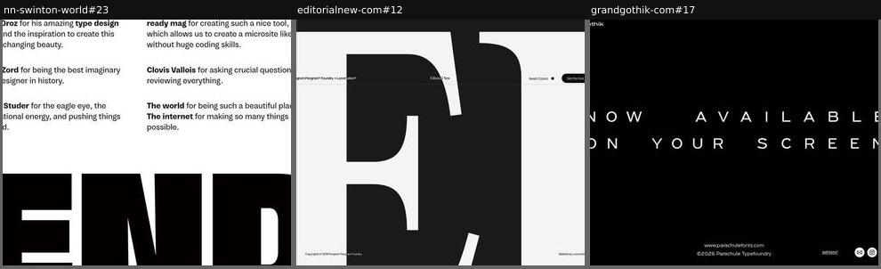
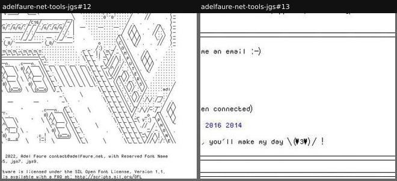
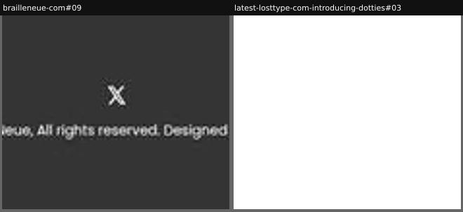

# footer

_Section: Footer_

The end of the page: colophon, contact, legal.

Sample: 18 blocks from 17 sites.

| variant | n | definition | recognise by |
|---|---|---|---|
| [credits-colophon](#credits-colophon) | 8 | Credits: designers, contributors, testers, tools, fonts used. | lists of names and roles |
| [link-columns](#link-columns) | 3 | A multi-column footer with links. | columns of links |
| [big-sign-off](#big-sign-off) | 3 | A large closing statement, then small legal lines. | display-size last line |
| [personal-sign-off](#personal-sign-off) | 2 | An informal closing note from the designer. | 'email me', kaomoji |
| [slim-legal-bar](#slim-legal-bar) | 2 | One or two lines: copyright and credit. | thin bar |

## Rubric

Recorded for every instance in Phase 3, in addition to the cross-cutting attributes in `rubric.json`:

- **contains**: any of credits, legal, contact, socials, newsletter, other-fonts, sign-off

## credits-colophon

Credits: designers, contributors, testers, tools, fonts used.

**Recognise by:** lists of names and roles

| example | look | feel | ux | learn |
|---|---|---|---|---|
| [foodissue-commercialtype-com#09](../../archive/foodissue-commercialtype-com/blocks/09.jpg) | White, black serif bold role labels with underlined names (design, illustrations, writing, thanks), copyright line | Editorial, generous | Names link out | Credit writers and illustrators like a magazine masthead: it signals the specimen is a real publication |
| [knitgrotesk-com#14](../../archive/knitgrotesk-com/blocks/14.jpg) | Cobalt blue, all text in the dotted/striped display font: Design, Release, Photography, Styles, Formats, Character set; orange marquee bar | Technical, textile, deadpan | Links to photographer and distributor; free-trial tab | Set the colophon's label-value pairs in the display face itself: the facts sheet doubles as a last specimen |
| [pp-fragment-com#09](../../archive/pp-fragment-com/blocks/09.jpg) | Black, small white grotesk, 'Credits' heading, four ruled columns: Typeface description and Visuals (website, artist) | Minimal, polished, agency | static | Credits can restate the family's facts (cuts, weights, glyph count) as a closing summary |
| [prospectus-losttype-com#07](../../archive/prospectus-losttype-com/blocks/07.jpg) | Peach card on grey: role/name credit list and special thanks left; 'We have charming faces!' at Small, Medium, Large, Xtra Large right | Witty, bookish, warm | Credit names link out; static | Pair the credits with a pun waterfall ('We have charming faces!') so the people and the optical sizes share one spread |
| [gt-canon-com#10](../../archive/gt-canon-com/blocks/10.jpg) | Capture shows a fixed layer of grey serif term columns A-Z ('Anatomy... Zone') and side alphabet rail; colophon text itself not visible | Literary, encyclopaedic | Editor's note, credits, links to other minisites, shop and trial links (from HTML) | An editor's note explaining how the content mirrors the optical sizes ties the site's structure to the font's |
| [jetbrains-com-lp-mono#18](../../archive/jetbrains-com-lp-mono/blocks/18.jpg) | Dark, mono licence FAQ ('May I use it in my logotype? -> YES'), Credits row, social icons, legal; teal cookie modal covers the middle | Developer-dry, friendly | Read FAQ; credits; social and legal links; language switch | Answer licence questions as yes/no FAQ lines in the font itself: legal clarity plus a mono specimen |
| [logical-family#12](../../archive/logical-family/blocks/12.jpg) | Teal, grouped name lists with linked studios, emoji-like icons | Generous, communal | links | Crediting beta testers and advisors shows the community behind the font |
| [nichrome-mass-driver-com#08](../../archive/nichrome-mass-driver-com/blocks/08.jpg) | Dark navy, small mono text in three columns: About the Website, About the Foundry, Links (buy, trials, specimen PDF) | Technical, understated, indie | Links to buy, trial, PDF and socials | Name the tools and fonts used to build the site (Coldtype, MD IO) and state 'no cookies': transparency as tone |

## link-columns

A multi-column footer with links.

**Recognise by:** columns of links

| example | look | feel | ux | learn |
|---|---|---|---|---|
| [dyslexiefont-com#20](../../archive/dyslexiefont-com/blocks/20.jpg) | Off-white, two columns: Dyslexia Week badge plus mission paragraph; email, phone per country, social links; sticky nav overlaps | Friendly, earnest, accessible | Contact links, phone numbers, social | Use the footer to restate the cause (dyslexia awareness week), not only contact details |
| [github-com-mona-sans#13](../../archive/github-com-mona-sans/blocks/13.jpg) | Near-black corporate footer: newsletter teaser, Platform/Ecosystem/Support/Company link columns, legal row, social icons | Corporate, standard, inherited | Many site-wide links; newsletter subscribe | Brand-owned microsites inherit the parent site's global footer; the specimen ends where the brand begins |
| [biceps-togetherwithyou-co#23](../../archive/biceps-togetherwithyou-co/blocks/23.jpg) | Photo of a flexing torso above a red band with small multi-column links | Brash, humorous (biceps) | links | The closing photo keeps the joke going right to the end |

## big-sign-off

A large closing statement, then small legal lines.

**Recognise by:** display-size last line

| example | look | feel | ux | learn |
|---|---|---|---|---|
| [nn-swinton-world#23](../../archive/nn-swinton-world/blocks/23.jpg) | White, two-column joke thanks ('The internet for making so many things possible'), then a giant black cropped 'END' | Cheeky, bold, self-aware | static | Literally ending on 'END' in the heaviest weight is a last specimen and a punchline at once |
| [editorialnew-com#12](../../archive/editorialnew-com/blocks/12.jpg) | Off-white, one giant black cropped glyph filling the frame, tiny copyright and 'Website by' lines, nav with Invert Colors and Get the font | Dramatic, minimal, confident | Invert colours toggle; 'Get the font' button; table of contents rail | Close on a single glyph so large it becomes abstract shape: the font's drawing quality is the final word |
| [grandgothik-com#17](../../archive/grandgothik-com/blocks/17.jpg) | Black, white letterspaced 'NOW AVAILABLE ON YOUR SCREEN', tiny © and imprint | Cinematic ending, like credits | Social icons, imprint | End with a line that echoes the opening: the page closes like a film |

## personal-sign-off

An informal closing note from the designer.

**Recognise by:** 'email me', kaomoji

| example | look | feel | ux | learn |
|---|---|---|---|---|
| [adelfaure-net-tools-jgs#12](../../archive/adelfaure-net-tools-jgs/blocks/12.jpg) | White, dense ASCII-art city (cars, buildings, 'COMPUTERS', 'PHONE') drawn in the font, then mono copyright and OFL notice | Handmade, nerdy, generous | static; read licence | Close with a big illustration drawn entirely in the font: the last specimen is also the sign-off |
| [adelfaure-net-tools-jgs#13](../../archive/adelfaure-net-tools-jgs/blocks/13.jpg) | White, monospace/pixel text, ASCII rules, kaomoji | DIY, warm, net-art | email link | A personal note suits a one-person, free, community font |

## slim-legal-bar

One or two lines: copyright and credit.

**Recognise by:** thin bar

| example | look | feel | ux | learn |
|---|---|---|---|---|
| [brailleneue-com#09](../../archive/brailleneue-com/blocks/09.jpg) | Charcoal strip, centred X icon over one line of copyright and 'Designed by' credit | Minimal, quiet | One social link and designer link | When the specimen is the statement, a one-line footer avoids competing with it |
| [latest-losttype-com-introducing-dotties#03](../../archive/latest-losttype-com-introducing-dotties/blocks/03.jpg) | White, small foundry badge logo left, five navy text links right, two-line copyright and 'Brought to you by' | Clean, friendly, foundry-standard | Links to Fonts, Store, Blog, Contact, About | A 'brought to you by X and friends' credit line keeps a corporate footer personal |
