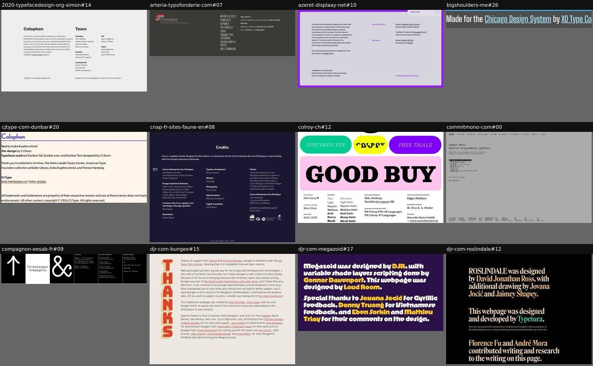
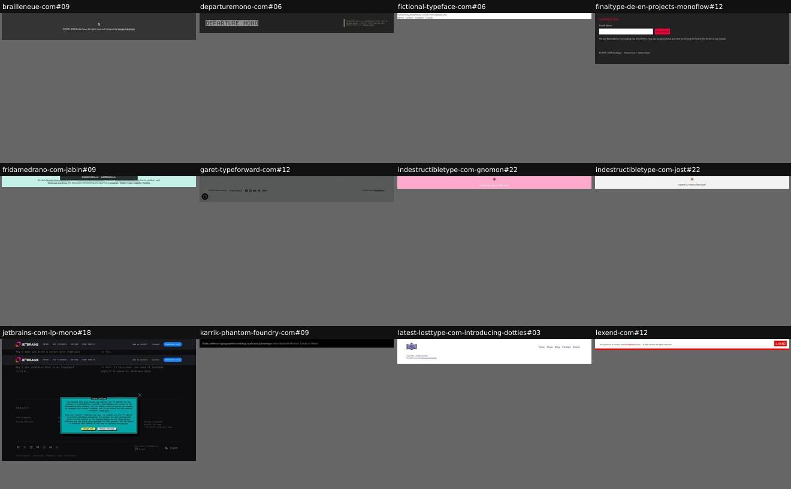
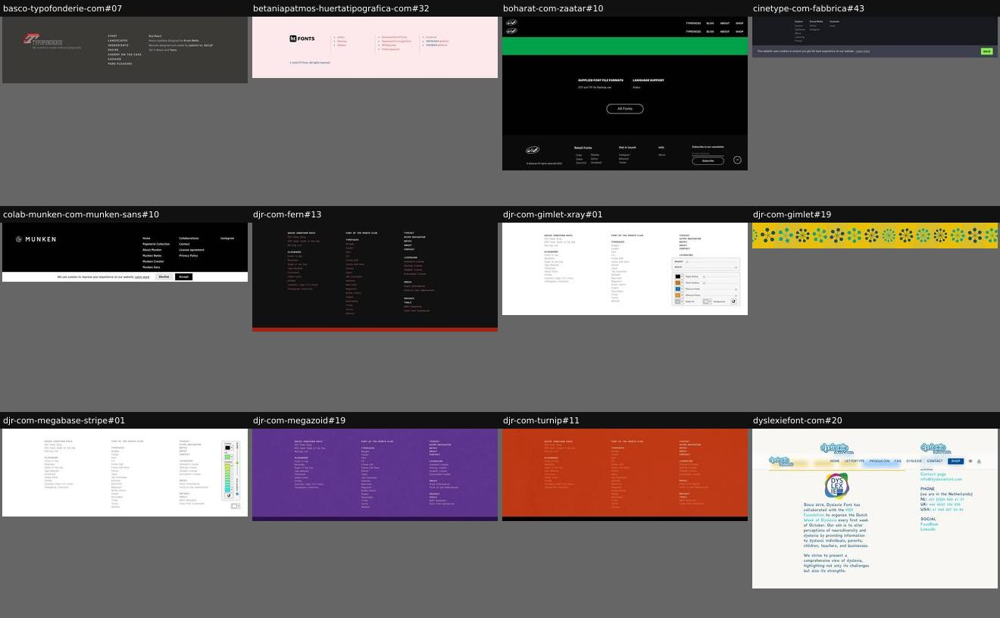
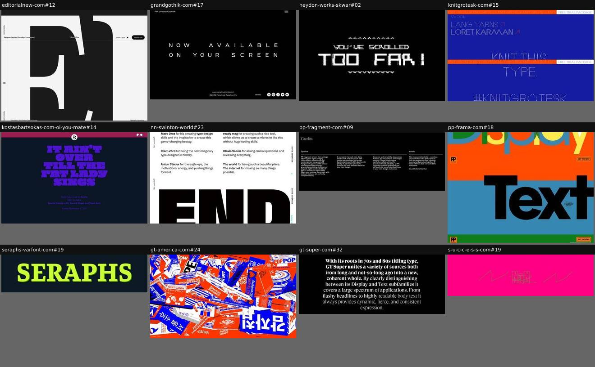
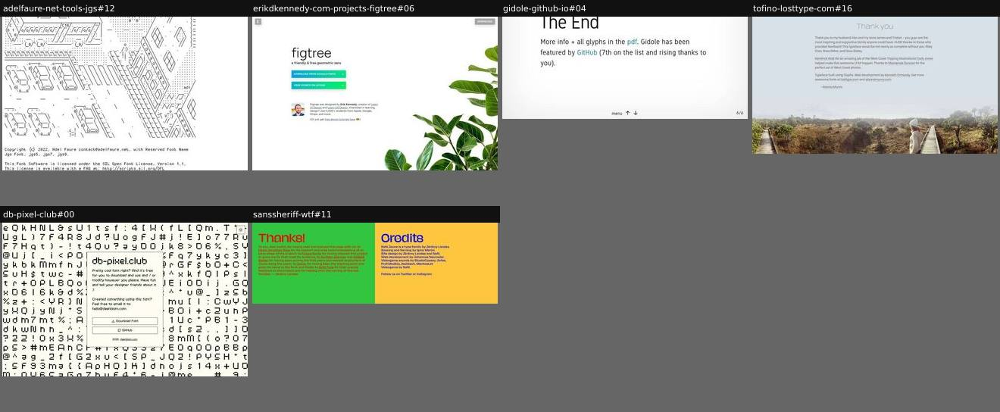

# footer

_Section: Footer_

The end of the page: colophon, contact, legal.

172 instances on 154 sites (the Phase 3 extraction of 181 sites).

| variant | sites | definition | recognise by |
|---|---|---|---|
| [credits-colophon](#credits-colophon) | 79 | Credits: designers, contributors, testers, tools, fonts used. | lists of names and roles |
| [slim-legal-bar](#slim-legal-bar) | 42 | One or two lines: copyright and credit. | thin bar |
| [link-columns](#link-columns) | 31 | A multi-column footer with links. | columns of links |
| [big-sign-off](#big-sign-off) | 14 | A large closing statement, then small legal lines. | display-size last line |
| [personal-sign-off](#personal-sign-off) | 6 | An informal closing note from the designer. | 'email me', kaomoji |

## Rubric

Recorded for every instance in Phase 3, in addition to the cross-cutting attributes in `rubric.json`:

- **contains**: any of credits, legal, contact, socials, newsletter, other-fonts, sign-off

## credits-colophon

Credits: designers, contributors, testers, tools, fonts used.

**Recognise by:** lists of names and roles

| example | look | feel | ux | learn |
|---|---|---|---|---|
| [2020-typefacedesign-org-simon#14](../../archive/2020-typefacedesign-org-simon/blocks/14.jpg) | Light-grey band: 'Colophon' with a thank-you paragraph and 'Typeface: Ohno Type's Degular', and 'Team' with roles (Branding, Content, Development, PM, UI/UX) and names in two sub-columns; a bottom line with the department | Warm wrap-up | One link to the typeface foundry | Close a template site with a role-by-role team list and a credited UI typeface |
| [arteria-typofonderie-com#07](../../archive/arteria-typofonderie-com/blocks/07.jpg) | Charcoal footer: Typofonderie logo with 'My wor(l)d is empty without typography.' at left, the section menu repeated in tracked Arteria caps, and a credits column ('Buy Arteria', typeface by Jean François Porchez, minisite coded by Joachim Vu, ZeCraft, set in Arteria and Mencken) | Quiet, signed | Section links scroll; 'Buy Arteria' and credit names link out | Repeat the section menu in the footer in tracked caps and credit both the type designer and the site developer |
| [azeret-displaay-net#10](../../archive/azeret-displaay-net/blocks/10.jpg) | Lilac card: a short story paragraph left ('The story of the typeface began with a draft…'), credits in two columns right (Azeret Typeface: Design Displaay Type Foundry (Martin Vácha, Daniel Quisek), Production Renegade Fonts; Microsite: Martin Ehrlich, Redlab), and '© 2021 Displaay Type Foundry' in violet | Quiet ending | Credit names link to studios | Put the one-paragraph story in the footer card: those who reach the end want the background |
| [bigshoulders-me#26](../../archive/bigshoulders-me/blocks/26.jpg) | One fitted line between blue bars: 'Made for the Chicago Design System by XO Type Co', with both names as underlined links |  |  |  |
| [cjtype-com-dunbar#20](../../archive/cjtype-com-dunbar/blocks/20.jpg) | 'Colophon' heading, then short lines: Text by Indra Kupferschmid, Site design by CJ Dunn, Typefaces used…, thanks to archives, CJ Type email and Twitter, and a trademark/copyright line | Quiet, bookish | mailto and Twitter links | Thank the archives that lent the scans in the colophon |
| [cnap-fr-sites-faune-en#08](../../archive/cnap-fr-sites-faune-en/blocks/08.jpg) | 'Credits' on navy: an intro line, then three columns of role headings and names (CNAP team, Imprimerie Nationale team, creation of the typeface by Alice Savoie, illustrations by Marine Rivoal, typeface development, website, photography, editorial advice, translation, thanks, CNAP address and email), partner logos, and a tiny 'Faune, Alice Savoie / Cnap — 2017' line | Thorough, official | Email and website links | Credit every role, down to translation and editorial advice, in a three-column colophon |
| [colroy-ch#12](../../archive/colroy-ch/blocks/12.jpg) | A four-column fact sheet under the GOOD BUY card: Typefamily 'NN Colroy ♥', Typeface design, Releases 2014, 2022; Weights Thin→Black with italics (each in its style); Available formats (Variable 'on request ✉'), character sets (STD 94 / 67 languages); Font mastering, Microsite design, Foundry with link | Tidy, friendly | 'on request' opens an email; foundry link | List the weights in the colophon in their own styles: the credits are a final specimen |
| [commitmono-com#00](../../archive/commitmono-com/blocks/00.jpg) | Rest of section 10, HTML only: 'Thank you', 'Inspiration', 'Programming font resources' with other free coding fonts, 'Programs used', and '← First section' | Community-minded | 22 outbound links, including to competing free coding fonts | List competing free fonts in your colophon: for an open project, generosity builds more trust than exclusivity |
| [compagnon-eesab-fr#09](../../archive/compagnon-eesab-fr/blocks/09.jpg) | Three small-text cells at the end of the grid: 'Crédits' (EESAB Rennes, type design workshop, 5th year graphic design, 2018, 'Made in France, Made in Brittany'), 'Les dessinateurs' (five designers with their websites) and 'Remerciements' (teachers, Velvetyne Type Foundry, Typewriter Database) | Collegial | Designer names link to their portfolios | Keep credits inside the same grid cells as the specimen so the colophon is part of the sheet |
| [djr-com-bungee#15](../../archive/djr-com-bungee/blocks/15.jpg) | Vertical 'THANKS' title beside four paragraphs: sponsors and the Open Font License, why the font is free, who built the page, and a long list of linked names | Gracious, personal | Many links to people and to the designer's retail typefaces | Write the licence and credits as a thank-you note: the legal facts land as gratitude, and the note can gently point to paid fonts |
| [djr-com-megazoid#17](../../archive/djr-com-megazoid/blocks/17.jpg) | Credits as two big paragraphs in white Megazoid on dark purple, every person's name in yellow: designed by DJR, shade-layer scripting by Connor Davenport, page by Loud Room, thanks to Cyrillic, Vietnamese and design reviewers | Celebratory | Names link to their sites | Set the credits in the display face at headline size: thanks become part of the specimen |
| [djr-com-roslindale#12](../../archive/djr-com-roslindale/blocks/12.jpg) | On black, three large statements in cream Display Condensed: 'ROSLINDALE was designed by David Jonathan Ross, with additional drawing by Jovana Jocić and Jaimey Shapey.', 'This webpage was designed and developed by Typetura.' (with a small note about free Typetura templates) and 'Florence Fu and André Mora contributed writing and research…', names in peach and Typetura in teal | Generous, celebratory | Names link to the contributors | Set credits at headline size in the display face: the colophon becomes one last specimen |
| [editorialnew-com#11](../../archive/editorialnew-com/blocks/11.jpg) | 'Credits' heading and four short paragraphs under hairline-ruled labels Typeface, Website, Visuals in white sans on near-black | Modest, collegial | static | Credit the image sources ('advertising archives from the 80s') beside the designer and the agency: it explains the art direction and covers rights |
| [escafina-losttype-com#06](../../archive/escafina-losttype-com/blocks/06.jpg) | 'Special thanks to…' in script, two paragraphs crediting family, the illustrator, the menu/badge designer, the site builder and the tool makers, and a small engraved-style 'LT' monogram at the bottom | Personal, modest | Name links; the monogram links to the shop page | Credit each collaborator with the exact thing they made (hand illustrations, menu and badge design, this website) |
| [etunni-github-io-arapey-minisite#12](../../archive/etunni-github-io-arapey-minisite/blocks/12.jpg) | Light grey footer in three columns: 'Made by friends of Google Fonts', credits (Arapey by Eduardo Tunni; website by Kabisa, design by Bureaudonald; thanks to Google Design and Google Fonts), and GitHub links (contribute, file a bug, view source) | Open, tidy | Underlined links to collaborators and the GitHub repo | Invite contributions (file a bug, view source) in the footer of an open-source specimen |

_…and 64 more in the gallery (`npm run app`)._

## slim-legal-bar

One or two lines: copyright and credit.

**Recognise by:** thin bar

| example | look | feel | ux | learn |
|---|---|---|---|---|
| [brailleneue-com#09](../../archive/brailleneue-com/blocks/09.jpg) | Charcoal 200px band with a centred X (Twitter) icon over '(C)2018-2022 Braille Neue, All rights reserved. Designed by Kosuke Takahashi.' in small white text | Quiet close | X icon and designer name link out | A single centred line with the designer's credit is enough for a project site |
| [departuremono-com#06](../../archive/departuremono-com/blocks/06.jpg) | Dark bar: 'DEPARTURE MONO' wordmark on a grey highlight at the left; at the right a 3-line credit 'Departure Mono is a monospaced pixel font by Helena Zhang, licensed under the SIL OFL. Website built by Tobias Fried.' with underlined links |  |  |  |
| dyslexiefont-com#22 | Fixed bottom bar captured off-position: 'Dyslexie Font is patented. Copyright © 2024 Dyslexie Font B.V. All rights reserved. Design by Dyslexie Font'; seen at the page end in the video |  |  |  |
| [fictional-typeface-com#06](../../archive/fictional-typeface-com/blocks/06.jpg) | Two small grey lines under the cards: 'A project by Jonas Pelzer, sounds from zapsplat.com.' and 'Imprint Contact Instagram LinkedIn' | Quiet | Underlined links | Credit the sound effects source when the page plays sounds |
| [finaltype-de-en-projects-monoflow#12](../../archive/finaltype-de-en-projects-monoflow/blocks/12.jpg) | '© 2016–2026 Finaltype — Impressum / Datenschutz' in tiny grey serif at the bottom of the charcoal footer | Minimal | Legal links | Keep legal to one line under the signup |
| [fridamedrano-com-jabin#09](../../archive/fridamedrano-com-jabin/blocks/09.jpg) | Mint bar with two centred 14px lines: licence links, email, Glyphs.app reference, and social links | A closing note | Text links | State the tools used in one line; other designers find it useful |
| [garet-typeforward-com#12](../../archive/garet-typeforward-com/blocks/12.jpg) | One line: '© 2026 Type Forward · Privacy Policy↗' and five small social icons (Facebook, Instagram, Behance, Dribbble, MyFonts) at left, 'We did it with Gradientic↗.' at right | Unobtrusive | Links out | Credit the web studio in the footer line: one sentence, no extra block |
| [indestructibletype-com-gnomon#22](../../archive/indestructibletype-com-gnomon/blocks/22.jpg) | A single magenta asterisk and a tiny centred 'Created by indestructible type*' |  |  |  |
| [indestructibletype-com-jost#22](../../archive/indestructibletype-com-jost/blocks/22.jpg) | A single red asterisk above tiny 'created by indestructible type*', centred on pale grey |  |  |  |
| [jetbrains-com-lp-mono#18](../../archive/jetbrains-com-lp-mono/blocks/18.jpg) | JetBrains site footer: a row of social icons, 'Share your feedback on GitHub', a language picker (English), then Privacy & Security, Terms of Use, Trademarks, Legal, Genuine Tools and a copyright line | Standard corporate | Links; feedback goes to GitHub | Route font feedback to the GitHub repo from the footer |
| [karrik-phantom-foundry-com#09](../../archive/karrik-phantom-foundry-com/blocks/09.jpg) | One grey line at the very bottom: 'Code, textes et typographies / coding, texts and typedesign: Jean-Baptiste Morizot  Lucas Le Bihan' |  |  |  |
| [latest-losttype-com-introducing-dotties#03](../../archive/latest-losttype-com-introducing-dotties/blocks/03.jpg) | White, small navy Lost Type badge left, 'Fonts Store Blog Contact About' right, and two small lines: 'Copyright © 2026 Lost Type. Brought to you by Riley Cran and friends.' | Tidy, standard | Site-wide links | A 'brought to you by X and friends' credit keeps a corporate footer personal |
| [lexend-com#12](../../archive/lexend-com/blocks/12.jpg) | One small line 'For questions & contact, email info@lexend.com. © 2026 Lexend. All rights reserved.' at the bottom-left, above the fixed red line |  |  |  |
| [lobdell-me-affogato#07](../../archive/lobdell-me-affogato/blocks/07.jpg) | Charcoal band: AFFOGATO in Black, copyright line, small yellow Privacy Policy link, all centred | Neat, closing | One link | Repeat the hero's dark field at the end to bookend the alternating bands |
| [marbla-de#06](../../archive/marbla-de/blocks/06.jpg) | A small black '→ Contact' pill centred above a slim bar with 'Imprint' at left and '© 2026 Katharina Gresch' at right | Quiet, tidy | Contact pill opens an obfuscated mailto; imprint links to the designer's site | One pill button for contact is enough when the font is not for sale |

_…and 27 more in the gallery (`npm run app`)._

## link-columns

A multi-column footer with links.

**Recognise by:** columns of links

| example | look | feel | ux | learn |
|---|---|---|---|---|
| andada-huertatipografica-com#28 | Beyond the capture (HTML only): HT FONTS logo and columns of section anchors (Overview … Font in use), 'Download from HT Fonts' / 'Download from Google Fonts', 'Contact us', Instagram and Facebook @htfonts, © HT Fonts | Tidy end | Anchor links and outbound download links | Repeat the section index and the download links in the footer of a long single page |
| [basco-typofonderie-com#07](../../archive/basco-typofonderie-com/blocks/07.jpg) | Dark grey band: Typofonderie logo left, list of chapters in small caps, then credits | Foundry-standard | Chapter links and credit links | List the chapters again in the footer as a table of contents |
| [betaniapatmos-huertatipografica-com#32](../../archive/betaniapatmos-huertatipografica-com/blocks/32.jpg) | Pink footer: HT FONTS logo and three ruled link columns (Letters / Overview / Patterns; Download from HT Fonts, Download from Google Fonts, PDF Specimen, Github repository; Contact us, Instagram, Facebook), '© 2026 HT Fonts' below | Tidy, utilitarian | Same template as the other HT microsites; downloads and PDF specimen repeated | Offer both the foundry and Google Fonts as download routes for an open-source font |
| [boharat-com-zaatar#10](../../archive/boharat-com-zaatar/blocks/10.jpg) | Near-black footer: logo oval and '© Boharat All rights reserved 2022' left; columns 'Retail Fonts' (Felfel, Zaatar, Qoronfull, Mestika, Zafran, Zanjabeel), 'Get in touch' (Instagram, Behance, Twitter), 'Info' (About); 'Subscribe to our newsletter' with an underlined email field and a pill 'Subscribe' button; round 'UP' button at the right edge | Tidy, small-foundry | Links to sibling font pages and socials; newsletter form; UP scrolls to top | Name every retail font in the footer: each microsite cross-sells the rest of the catalogue |
| [cinetype-com-fabbrica#43](../../archive/cinetype-com-fabbrica/blocks/43.jpg) | Dark slate footer with three small columns 'Explore' (Custom, Typefaces, About, Licensing, Privacy), 'Social Media' (Twitter, Instagram), 'Contacts' (email) and a copyright line; the green 'Got it!' cookie banner sits over its bottom | Quiet | Plain links | A three-column foundry footer is enough when the page itself is an essay |
| [colab-munken-com-munken-sans#10](../../archive/colab-munken-com-munken-sans/blocks/10.jpg) | Black band with white logo left and three small columns of links right: site pages, collaborations/contact/legal, Instagram | Solid, conventional | Links to the rest of the brand site | A single black band ends the paper-white page firmly |
| [djr-com-fern#13](../../archive/djr-com-fern/blocks/13.jpg) | DJR's black footer with links tinted Fern red: three columns (David Jonathan Ross feeds and mailing list + Elsewhere; Font of the Month Club + Typefaces list; Typeset/Glyph Navigator/Notes/About/Contact + Licensing, Press, Privacy, Tools), closed by a thin red strip | Functional; the red links keep the page's colour to the end | Plain links | Recolour the shared footer's links with the specimen's accent so the foundry chrome belongs to each family page |
| djr-com-fit#20 | Beyond the capture (HTML only): black DJR footer with columns DAVID JONATHAN ROSS (RSS, mailing list), ELSEWHERE (Fonts in Use, Mastodon, Type Network…), FONT OF THE MONTH CLUB, TYPEFACES (Bungee … Warbler), licensing and tools links | Comprehensive site footer | Plain link lists | A catalogue footer turns every product page into a door to the other families |
| djr-com-forma#16 | DJR's site footer (no crop; read from HTML): columns 'David Jonathan Ross' (RSS feeds, mailing list), 'Elsewhere' (Fonts in Use, Mastodon, Type Network, Fontstand, Adobe Fonts, GitHub, Type Crit Crew), 'Font of the Month Club' and 'Typefaces' (all families) | Functional, personal | Plain links | A shared foundry footer that lists every family turns each microsite into an entry point to the catalogue |
| [djr-com-gimlet-xray#01](../../archive/djr-com-gimlet-xray/blocks/01.jpg) | DJR's standard white footer in small mono: three columns (David Jonathan Ross feeds and mailing list + Elsewhere; Font of the Month Club + Typefaces Bungee → Warbler; Typeset, Glyph Navigator, Notes, About, Contact, Licensing…); the fixed control panel is stamped over its right edge in the capture | Orderly index | Links to every DJR family, licences and tools | A footer that lists the whole catalogue turns a one-off experiment into an entry point |
| [djr-com-gimlet#19](../../archive/djr-com-gimlet/blocks/19.jpg) | A mustard band of atomic-age starburst ornaments (teal and navy), then the navy DJR footer: three columns of small caps links (David Jonathan Ross RSS/mailing list, Elsewhere socials, Font of the Month Club, Typefaces list of ~20 families, Typeset, Glyph Navigator, Licensing, Press, Privacy, Tools) | Ordered, retro flourish | Plain links | A per-family ornament band before the shared foundry footer keeps the template feeling custom |
| djr-com-job-clarendon#28 | Beyond the 30000px capture (HTML and video only): DJR's black footer with links in Job Clarendon green, three columns (feeds and mailing list + Elsewhere; Font of the Month Club + Typefaces; Typeset, Glyph Navigator, Notes, About, Licensing, Press, Tools) and a blue strip at the very bottom | Functional, page-tinted | Plain links, hover white | Tint only the link colour of the shared footer to tie it to the page |
| [djr-com-megabase-stripe#01](../../archive/djr-com-megabase-stripe/blocks/01.jpg) | DJR's standard white footer in small mono: three columns (David Jonathan Ross RSS feeds and mailing list + Elsewhere links; Font of the Month Club + Typefaces list from Bungee to Warbler; Typeset, Glyph Navigator, Notes, About, Contact, Licensing, Press, Privacy, Tools incl. 'Color Font Customizer'); the demo's floating palette panel is stamped over its right edge | Orderly, like an index card | Links to every DJR family, licences and tools | A footer listing every family plus the tools used to build the demo turns a one-off experiment into an entry point to the catalogue |
| [djr-com-megazoid#19](../../archive/djr-com-megazoid/blocks/19.jpg) | DJR's site footer on purple: three columns of tiny caps links (David Jonathan Ross RSS and mailing list; Elsewhere; Font of the Month Club; Typefaces list; Typeset, Glyph Navigator, Notes, About; Licensing; Press; Privacy; Tools) | Utilitarian | Links across DJR's site and elsewhere | A shared foundry footer gives every microsite the same exits |
| djr-com-roslindale#15 | DJR's shared site footer (no crop; read from HTML): columns for David Jonathan Ross (feeds, mailing list), Elsewhere (Fonts in Use, Mastodon, Type Network, Fontstand, Adobe Fonts, GitHub), Font of the Month Club and Typefaces | Functional | Plain links | A catalogue footer turns every family page into a doorway to the rest of the foundry |

_…and 16 more in the gallery (`npm run app`)._

## big-sign-off

A large closing statement, then small legal lines.

**Recognise by:** display-size last line

| example | look | feel | ux | learn |
|---|---|---|---|---|
| [editorialnew-com#12](../../archive/editorialnew-com/blocks/12.jpg) | A single word 'EDITORIAL' at ~1700px slides past so only a huge fragment of the 'E' (and a quote-mark-like serif) fills the off-white frame; tiny copyright left and 'Website by Locomotive' right | Bold, abstract, final | The giant word translates horizontally with scroll (speed 10), so the visible letter changes as you reach the end | End on a word so large that scrolling pans across its letters: the last screen is pure letterform |
| [grandgothik-com#17](../../archive/grandgothik-com/blocks/17.jpg) | Black end card 'N O W  A V A I L A B L E / O N  Y O U R  S C R E E N' in very widely tracked caps across the width; at the bottom a small foundry URL and ©2026 Parachute Typefoundry, an IMPRINT link and five round white social icons | Like the last frame of a trailer | Social and mail links; IMPRINT opens a popup | End the page with a cinema end-card line ('Now available on your screen') to complete the film metaphor |
| [heydon-works-skwar#02](../../archive/heydon-works-skwar/blocks/02.jpg) | A looping video of 'YOU'VE SCROLLED / TOO FAR!' in glitchy, scan-lined SKWAR between rows of ^^^ and vvv, centred on black | Game-over screen | Autoplaying looped video; a paused still frame (#t=2) is swapped in for prefers-reduced-motion | End the page with a game-style 'you went too far' screen instead of a footer, and provide a still for reduced motion |
| [knitgrotesk-com#15](../../archive/knitgrotesk-com/blocks/15.jpg) | Centred dotted 'KNIT THIS / TYPE.' and '#KNITGROTESK' on ultramarine, then two small white buttons 'TYPEKNITTING.NET' and 'NOUVELLENOIRE.CH' | Friendly call to make something | Two link buttons; the hashtag invites sharing knitted results | End with an invitation to use the font in its medium plus a hashtag, turning buyers into contributors |
| [kostasbartsokas-com-oi-you-mate#14](../../archive/kostasbartsokas-com-oi-you-mate/blocks/14.jpg) | 'IT AIN'T OVER TILL THE FAT LADY SINGS' in dark violet on navy, stacked over small credits | A last-line gag | Credits links | Use an idiom about being fat in the ending for an ultra-fat face: the copy doubles as the type's character |
| [nn-swinton-world#23](../../archive/nn-swinton-world/blocks/23.jpg) | 'END' in giant black Extra Black across the full width, with the small line '…of this promosite but the beginning of a new era in type history.', then a black legal bar: AI-imagery disclosure, Nouvelle Noire address, directors, register | Film-credits ending, tongue-in-cheek | static | Close a story-driven page like a film: a single giant 'END' plus a wink in small type |
| [pp-fragment-com#09](../../archive/pp-fragment-com/blocks/09.jpg) | 'Credits' heading with Typeface (three columns of text) and Visuals ('This (awesome) website — courtesy of Locomotive… Visual Artist @barthur') under hairlines, then a giant white outlined-looking 'Ω' filling the screen with 'Copyright © 2022 Pangram Pangram Foundry / Website by Locomotive' centred inside its counter | Final, graceful | Links to Locomotive and Pangram Pangram | End on the last letter of the Greek alphabet (Ω) and put the legal line inside its counter |
| [pp-frama-com#18](../../archive/pp-frama-com/blocks/18.jpg) | Stacked colour bands: multicolour overlapping 'Display' letters on orange, a giant black 'Text' on blue with a tiny 'TEXT VARIABLE 5 WEIGHTS & ITALICS' note, then green with a thin cream 'Frama follow function' and a blocky geometric 'FF' monogram, an orange 'GRAB THE FONT NOW' button and a blue copyright bar; a metal 'PP FRAMA available on Pangram Pangram' badge slides in | Joyful, poster-like, conclusive | Bands enter as you scroll (sticky colour layers); the badge slides in from the right; button links to the shop | End on a pun on the design motto ('Frama follow function') in the thinnest weight after the two subfamily names in the heaviest: the last screen restates the whole range |
| [seraphs-varfont-com#19](../../archive/seraphs-varfont-com/blocks/19.jpg) | The hero's SERAPHS wordmark repeated, a hairline, then one tiny tracked line of links | Curtain call | Two inline links only | Repeating the hero lockup as the closer frames the page like a poster |
| djr-com-fit#19 | Beyond the capture (HTML only): 'KTHXBAI' fitted full width in Fit on a red-orange (#d81e00) band | Cheeky goodbye | static; refits on resize | End a loud page with one fitted slang line in the brand colour |
| [gt-america-com#24](../../archive/gt-america-com/blocks/24.jpg) | Closing full-screen pile-up of every package and airline prop on red-orange | Party, abundance | static end of page | End with the whole illustrated universe at once, a visual 'curtain call' |
| gt-pantheon-com#10 | HTML only: credits (Tobias Rechsteiner & Noël Leu; production with Antonio D'Elisiis; site with Jack Wild; animation Josh Schaub; story by Ferdinand Ulrich), a two-column gold list of other GT families, and the closing stage direction 'Exeunt omnes. Finis.' | Curtain call | Family names link to their microsites | End with a stage direction ('Exeunt omnes. Finis.'): the last line keeps the theatre conceit to the end |
| [gt-super-com#32](../../archive/gt-super-com/blocks/32.jpg) | A closing centred paragraph at ~42px whose weight steps down clause by clause, Super → Bold → Medium → Regular → Light, mirroring the intro | Decrescendo, a quiet landing | Editable via the style bar | Mirror the intro's weight ramp in reverse at the end: the page closes the loop typographically |
| [s-u-c-c-e-s-s-com#19](../../archive/s-u-c-c-e-s-s-com/blocks/19.jpg) | A wide scribbled NaN logo in thin brown-grey line, like a signature with zigzags on both sides, centred on flat magenta; no legal text | Hand-signed, casual | Logo links to nan.xyz | End with the foundry's signature-style logo at 75% width instead of a link footer |

## personal-sign-off

An informal closing note from the designer.

**Recognise by:** 'email me', kaomoji

| example | look | feel | ux | learn |
|---|---|---|---|---|
| [adelfaure-net-tools-jgs#12](../../archive/adelfaure-net-tools-jgs/blocks/12.jpg) | OFL copyright notice, a double rule, then 'contact@adelfaure.net send me an email :-)', an indented 'Find me on' list (Itch.io, Gamejolt, Gitlab, Instagram, Reddit (not often connected), Twitter, Soundcloud 2021 2016 2014), 'You can support me on Ko-fi, you'll make my day \(♥3♥)/ !' and '/\ Top' | Personal, warm | mailto, social and Ko-fi links; back-to-top link drawn as '/\' | Keep the footer in the same text grid and voice as the rest: an emoticon and a Ko-fi line say more than a logo row |
| [erikdkennedy-com-projects-figtree#06](../../archive/erikdkennedy-com-projects-figtree/blocks/06.jpg) | A small rounded portrait of Erik Kennedy beside 'Figtree was designed by Erik Kennedy, creator of Learn UI Design and Learn UX Design. Interested in learning design? Join 5,000+ students…' and '(Or just get free design tutorials here 😎)' | Approachable, self-promotional | Links to the designer's courses and newsletter | A free font is a calling card: close with the designer's face and a soft plug for what they sell |
| [gidole-github-io#04](../../archive/gidole-github-io/blocks/04.jpg) | Slide 6 switches to an off-white page with a soft vignette: 'The End' at ~109px in near-black and a short paragraph 'More info + all glyphs in the pdf. Gidole has been featured by GitHub (7th on the list and rising thanks to you).' with blue links | Light-hearted, thankful | Links to the PDF specimen and to GitHub's font showcase; the bottom UI switches to dark | Put the full glyph set in a linked PDF and close with one honest line: a small site can end without a footer |
| [tofino-losttype-com#16](../../archive/tofino-losttype-com/blocks/16.jpg) | Thin 'Thank you' heading and three short paragraphs thanking family, reviewers, the illustrator, UI-kit helper, photographer and web developer, signed '—Alanna Munro', over a misty photo of a woman on a boardwalk through marsh | Heartfelt, homely | Names link to each contributor's site and to losttype.com and alannamunro.com | Close with a thank-you letter that credits family and collaborators by name: credits become a human ending |
| [db-pixel-club#00](../../archive/db-pixel-club/blocks/00.jpg) | Inside the same card, above and below the buttons: 'Created something using this font? Feel free to email it to: hello@daanblom.com' and a centred tiny '2026, daanblom.com' line | Personal, open | Email address is plain text; the designer's site is an underlined link | Ask users to send what they make: the sign-off becomes a call for showcase material |
| [sanssheriff-wtf#11](../../archive/sanssheriff-wtf/blocks/11.jpg) | Green left half: red 'Thanks!' and a paragraph thanking the visitor, DJR, Future Fonts, early users and Grilli Type, signed '— Jérémy Landes' | Personal, sincere | Inline links to each person or company thanked | Thank the visitor first, then the people who helped: the page ends on a human note |
