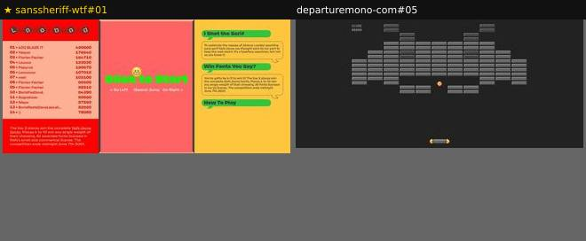
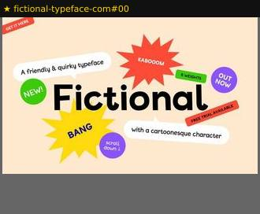

# game

_Section: Type tester (discovered type, alongside type-tester)_

A playable game made with the font.

3 instances on 3 sites (the Phase 3 extraction of 181 sites).

| variant | sites | definition | recognise by |
|---|---|---|---|
| [arcade-game](#arcade-game) | 2 | A playable arcade game set in or made from the font (platformer, Pong, Arkanoid), often with a leaderboard and font prizes. | canvas game, score, play button |
| [destructible-page](#destructible-page) | 1 | A hidden game layer over the specimen itself: elements can be shot or destroyed with clicks, with sounds, score, unlockable modes and a restore screen. | crosshair cursor, debris, score |

## arcade-game

A playable arcade game set in or made from the font (platformer, Pong, Arkanoid), often with a leaderboard and font prizes.

**Recognise by:** canvas game, score, play button

| example | look | feel | ux | learn |
|---|---|---|---|---|
| [★ sanssheriff-wtf#01](../../archive/sanssheriff-wtf/blocks/01.jpg) | Three coloured panels side by side: a red/salmon 'Leaderboard' with each heading letter in a dark round badge and 14 ranked names and scores; a coral game canvas with green heavy 'Click to Start', an emoji and '« Go Left (Space) Jump Go Right »'; a yellow column of chat bubbles ('I Shot the Serif', 'Win Fonts You Say?', 'How To Play') | Arcade cabinet meets group chat | Click to start a vertical jump-platformer drawn in p5.js (arrows/space, jump through side walls, avoid the devil); save your high score with name and e-mail; top 3 win the full family, places 4–10 a single weight; chat bubbles appear one after another | Turn the launch into a contest: a leaderboard with font prizes gives people a reason to come back and share the specimen |
| [departuremono-com#05](../../archive/departuremono-com/blocks/05.jpg) | '░ AND OF COURSE, DEPARTURE MONO IS PERFECT FOR YOUR 8-BIT VIDEO GAME OR ASCII ART' beside a canvas Arkanoid clone: grey bevelled bricks in a space-invader formation, an orange ball and capsule paddle, 'SCORE 00000' top-left; no leaderboard or prizes | Fun encore | Focusable section (tabindex 0); the visitor plays with keyboard or pointer | End a pixel-font page with a tiny playable game whose score uses the font: the last use case is play |

## destructible-page

A hidden game layer over the specimen itself: elements can be shot or destroyed with clicks, with sounds, score, unlockable modes and a restore screen.

**Recognise by:** crosshair cursor, debris, score

| example | look | feel | ux | learn |
|---|---|---|---|---|
| [★ fictional-typeface-com#00](../../archive/fictional-typeface-com/blocks/00.jpg) | Nothing signals the game in the capture: a hidden toolbar (↖ Select mode, T Text mode, F Fire mode, 'restore'), a score counter '0', toast notifications ('Toolbar unlocked!', 'Text mode unlocked!', 'Fire mode unlocked!', 'Congratulations! You shot ’em all!') and an off-screen violet 'r e s t o r e' screen whose letters drop in one by one | Secret, rewarding, silly | Clicking 'shootable' elements blows them away with a boom sound (or a 'blocked' sound), raising the score; progress unlocks a toolbar, then Text mode (edit the name, bubbles, paragraph and CTA within max lengths) and Fire mode; 'restore' plays the full-screen restore animation and rebuilds the page | Turn the specimen into the game board: shooting letters and stickers makes visitors touch every glyph, and unlocking 'text mode' rewards play with a tester |
