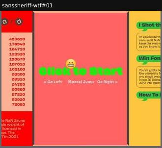

# game

A playable game made with the font.

Sample: 1 blocks from 1 sites.

| variant | n | definition | recognise by |
|---|---|---|---|
| [arcade-leaderboard](#arcade-leaderboard) | 1 | A browser game with a high-score table and font prizes. | score, play button |

## arcade-leaderboard

A browser game with a high-score table and font prizes.

**Recognise by:** score, play button

| example | look | feel | ux | learn |
|---|---|---|---|---|
| [sanssheriff-wtf#01](../../archive/sanssheriff-wtf/blocks/01.jpg) | Three bright panels: red leaderboard with scores, coral game canvas 'Click to Start' in green, yellow speech-bubble rules | Arcade, goofy, anti-corporate | Keyboard platform game (left, right, space); submit name and email to save a high score | Turn the launch into a competition: top scores win the family, and players read the font for minutes |
