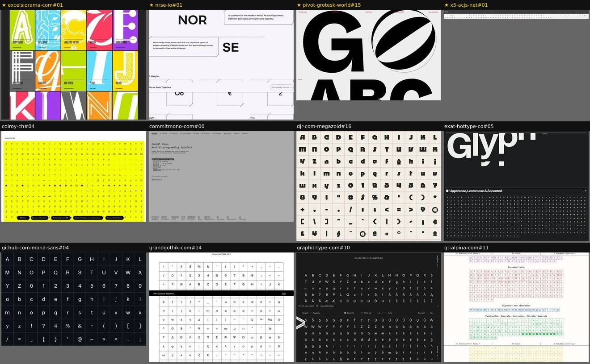
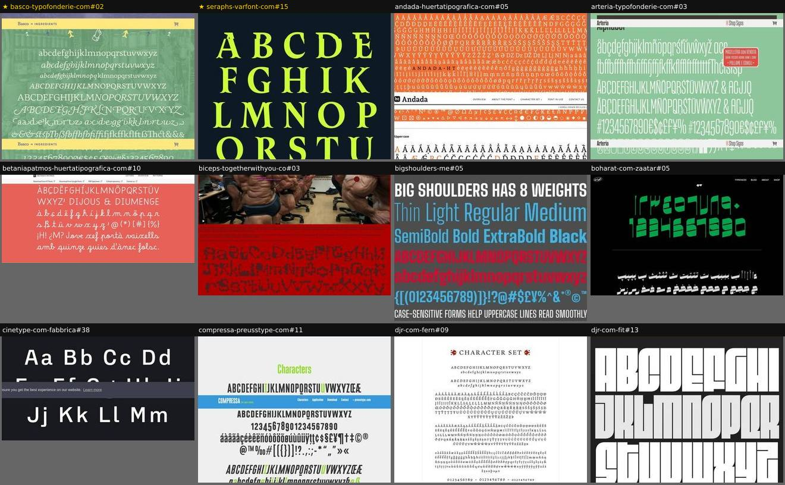
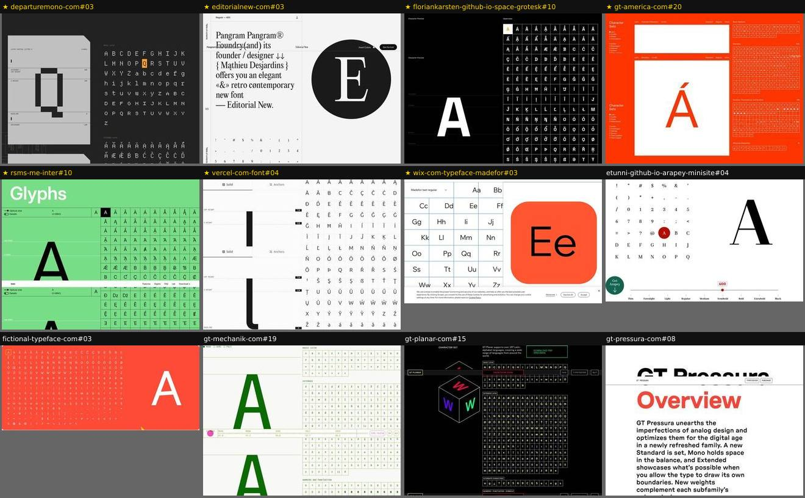
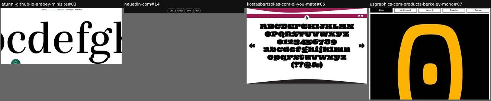
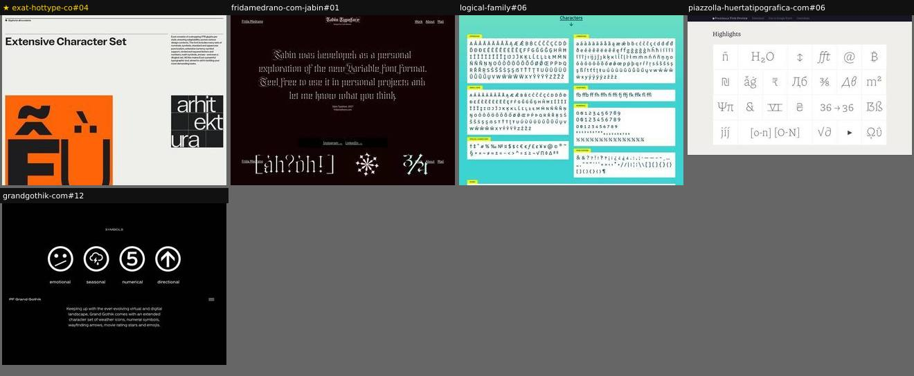
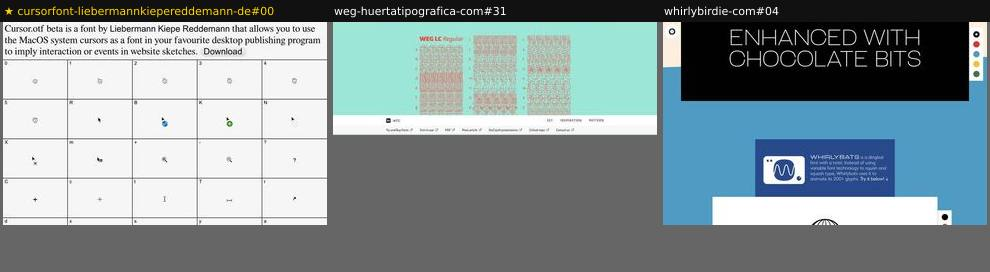

# glyph-table

_Section: Glyph table_

The character set itself, all or by category.

119 instances on 101 sites (the Phase 3 extraction of 181 sites).

| variant | sites | definition | recognise by |
|---|---|---|---|
| [full-grid](#full-grid) | 43 | The whole character set in uniform cells, in encoding order (sometimes with key labels for dingbat fonts). | dense grid of small cells |
| [category-lines](#category-lines) | 37 | The set typeset as running lines per category (or one moving line), no cells. | A–Z, a–z, 0–9 as lines of text |
| [glyph-inspector](#glyph-inspector) | 23 | A grid plus a large preview of the selected or hovered glyph on its metric lines. | big glyph panel, cap-height and x-height lines |
| [category-tabs](#category-tabs) | 5 | Tabs or a dropdown switch a large-size strip of one category at a time. | tabs: lowercase | uppercase | numerals |
| [bento-cards](#bento-cards) | 5 | A grid of cards, each a slice of the set or one feature (arrows, numerals, ligatures). | rounded cards of varied sizes |
| [keymap-grid](#keymap-grid) | 3 | Pictogram or dingbat cells labelled with the key that types them. | key letter in each cell corner |

## Rubric

Recorded for every instance in Phase 3, in addition to the cross-cutting attributes in `rubric.json`:

- **coverage**: full | partial | by-category
- **interaction**: static | hover | select | tabs | filter
- **metricsShown**: true | false
- **namesOrUnicode**: true | false

## full-grid

The whole character set in uniform cells, in encoding order (sometimes with key labels for dingbat fonts).

**Recognise by:** dense grid of small cells

| example | look | feel | ux | learn |
|---|---|---|---|---|
| [★ excelsiorama-com#01](../../archive/excelsiorama-com/blocks/01.jpg) | A wall of ~105 tall five-across cards, each a flat colour (lime, cyan, yellow, pink, purple, orange, grey) with one white glyph cropped by the card, a hairline, the contributor's name in Six Caps and a @handle; alternates carry a black 'ALT' tag | Trading cards, a wall of gig posters | Each handle links to the contributor's Twitter; the fixed A/a chip toggles .small on the cards so the wall shrinks | Turn the character set into a credit roll: each cell names who drew the letter, so the glyph table becomes the 'about' section and contributors have a card to share |
| [★ nrse-io#01](../../archive/nrse-io/blocks/01.jpg) | Four ruled sections (Characters, Numerals, Punctuation, Symbols), each with a label and small note at left and a 10-column grid of 100px bordered cells at right; letter cells show a case pair. Sticky bar repeats through the stitched crop | Clean and tabular | Hovering a cell inverts it to black; letter cells hold a hidden list of accented variants that expand on hover (Ā, Ç, Ď, Ę in the capture) | Put accents inside the base letter's cell and reveal them on hover: 29 cells stand in for ~120 glyphs and the grid stays short |
| [★ pivot-grotesk-world#15](../../archive/pivot-grotesk-world/blocks/15.jpg) | Opened by a giant 'G' beside a striped sphere and 'ABC abc&' at 420 pt, then 'Character Set' with a red note and a sticky pill switch 'Standard Character Set | 🌐 | Basic Character Set'; below, the whole set in small black glyphs over red Unicode codes, grouped under red headings (Uppercase, Uppercase Greek, Lowercase, Ligatures, Figures, Fractions, Punctuation, Symbols, Arrows, Superiors, Marks, Case Sensitive Forms, Stylistic Sets) | Exhaustive, clean, reference-like | The two pills swap the grid between the standard and basic character sets; figure and stylistic-set rows carry their feature tag (onum, tnum, zero, sups, case, ss01–ss04) instead of a code | Label each cell with its Unicode, or with the OpenType tag for alternates: the grid documents the features as well as the coverage |
| [★ x5-acjs-net#01](../../archive/x5-acjs-net/blocks/01.jpg) | The same 146-glyph table three times under dark labelled bars: 'Base' as a tiny pixel strip, 'Second power' as a compact grid, 'Third power' as huge 6-column cells where each stroke is itself a smaller pattern. Black for Unicode glyphs, red for non-standard ones, blue for algorithmic ones | Zooming into a mathematical object | Each cell is a link with the Unicode name in its title, going to a per-glyph page (/u0041). Section bars stick to the top while scrolling; a ▲ button returns to the top | For a generative typeface, repeat the entire table at increasing recursion depth: the same order at each scale turns a character map into a demonstration of how the design works |
| [colroy-ch#04](../../archive/colroy-ch/blocks/04.jpg) | 'CHARACTER SET' label and a borderless 26-column grid of black glyphs on a bright yellow panel: caps, lowercase, ligatures, lining and oldstyle figures, punctuation, symbols, dingbats (squares, circles, envelopes, planes, card suits), arrows, accented letters, small caps and fractions | Bright, generous | static | A single bright panel colour makes 900+ small glyphs feel like a poster rather than a table |
| [commitmono-com#00](../../archive/commitmono-com/blocks/00.jpg) | Docs Character set tab, HTML only: 'Full character set without alternates', 913 single-character cells, a 'new' note 'Added support for Greek. Καλώς ήρθες, απόλαυσε!', and 'Support for Cyrillic coming soon' | Complete, simple | Scrolled with W and S; ends with 'End of transmission.' | Sign off a long list with an in-world line: 'End of transmission.' gives a dry table some personality |
| [djr-com-megazoid#16](../../archive/djr-com-megazoid/blocks/16.jpg) | A 12-column grid of all 435 glyphs (A–Z, a–z, figures, punctuation, accents, Cyrillic) in black on cream inside thin pink hairline cells | Methodical, complete | static | Pink hairline cells on cream keep a 435-glyph grid on-palette |
| [exat-hottype-co#05](../../archive/exat-hottype-co/blocks/05.jpg) | On charcoal, a giant cropped 'Glyphs' title, then accordion rows with dot labels: 'Uppercase, Lowercase & Accented' open as a 40-column grid of small ruled cells, 'Cyrillic' and 'Figures & Symbols' collapsed | Orderly, reference-like | Click a row to expand its grid (↑/↓ icons); hovering a cell shows a tooltip enlargement | Fold the full set into accordions per category so the page stays short while everything is one click away |
| [github-com-mona-sans#04](../../archive/github-com-mona-sans/blocks/04.jpg) | One per family: a 12-column grid of 84 square-ish cells with hairline grey borders on near-black, white glyphs A–Z, 0–9, a–z and common punctuation (! ? # % & ~ ( ) [ ] / = _ { } ' @ — > < . ;) | Orderly, code-adjacent | Grid scripted by js-typegrid (likely a pointer/hover effect on cells; not visible in the capture) | A short 84-character grid (no accents) is enough for a brand font whose audience is developers: it shows the code-relevant punctuation alongside the alphabet |
| [grandgothik-com#14](../../archive/grandgothik-com/blocks/14.jpg) | 'CHARACTER SET': ~1000 characters in a 14-column grid of square hairline cells, from ASCII through Latin Extended, Greek, Cyrillic, alternates and ligatures to dozens of circled numerals, emoji faces, arrows and checkboxes | Thorough, plain | Hovering a cell shows a magnified glyph in a floating 280×280 canvas loupe at the pointer | A loupe that follows the pointer gives a big preview without a fixed side panel, keeping the grid full width |
| [graphit-type-com#10](../../archive/graphit-type-com/blocks/10.jpg) | 'CHARACTER SET SELECTION': 413 small glyphs on a uniform 20-column grid without cell lines | Calm reference after the loud sections | Static | No rules at all: a wide gap and one small size make a selection of 413 glyphs read as texture |
| [gt-alpina-com#11](../../archive/gt-alpina-com/blocks/11.jpg) | Bordered cell grids in a different colour per category: Basic Latin (purple), Extended Latin (red), Ligatures and Alternates (blue), Punctuation/Numerals/Currencies/Circular Numerals (green), Small Caps (yellow), Arrows/Blocks/Shapes/Flowers/Stars (teal), Icons and Emojis (pink) | Toy-box, complete | Hovering a cell shows it enlarged in a floating zoom box (#gt-character-zoomed); feature glyphs are rendered via ot-* classes (smcp, dlig, onum, case, ss01–ss04) | Give every glyph category its own colour and include the dingbats and emoji: the non-alphabetic extras become a selling point |
| [gt-flexa-com#12](../../archive/gt-flexa-com/blocks/12.jpg) | Character grid with each category in its own colour: Basic Latin coral, Extended Latin purple, numerals and circled numerals green, arrows and punctuation gold, OpenType feature alternates blue | Cheerful, systematic | Hovering a cell animates the glyph (keyframes 'charset-hover' on its axes) | Colour-code the glyph categories with the site's accent colours so a long grid stays readable |
| [gt-maru-com#06](../../archive/gt-maru-com/blocks/06.jpg) | 'EMOJI' chapter on blue: a text box, a roaring tiger character, an animated phone showing a sticker app ('450 emojis'), then two white grids of all emoji, 'GT MARU EMOJI COLOR ENCODING' and 'BLACK & WHITE ENCODING' | Sticker book | Text links to the free iOS sticker app; the phone animation plays when loaded | Show the colour and the black-and-white emoji fonts as two complete grids, one above the other, so buyers compare them cell by cell |
| [gt-maru-com#10](../../archive/gt-maru-com/blocks/10.jpg) | On turquoise, white bordered cells grouped under BASIC LATIN, EXTENDED LATIN, NUMERALS, CURRENCIES, CIRCULAR NUMERALS, ARROWS, PUNCTUATION and OPENTYPE FEATURE ALTERNATES | Clean reference | Hovering a cell animates the glyph (keyframes 'charset-hover') | White cells on a saturated field keep a dense grid light and in the site's colour world |

_…and 30 more in the gallery (`npm run app`)._

## category-lines

The set typeset as running lines per category (or one moving line), no cells.

**Recognise by:** A–Z, a–z, 0–9 as lines of text

| example | look | feel | ux | learn |
|---|---|---|---|---|
| [★ basco-typofonderie-com#02](../../archive/basco-typofonderie-com/blocks/02.jpg) | 'Ingredients': centred running lines of the set over a mint duotone spice shop; lowercase, italics, small caps, capitals, swash forms, ligatures, figures, circled numerals, superiors, math, arrows, marks; top row of pointing-hand dingbats | An inventory on a market shelf | Static | Naming the set 'ingredients' and listing it in centred lines keeps the glyph table inside the page's metaphor |
| [★ seraphs-varfont-com#15](../../archive/seraphs-varfont-com/blocks/15.jpg) | A-Z and a-z set as five huge centred lines of spaced letters filling a navy band and a lime band, each letter morphing between serif styles | An alphabet book that won't sit still | Static to the eye but looping: every letter breathes through weight and serif style, so one screen shows all the designs | Animating the whole alphabet along the style axis replaces a glyph grid per style: one block shows every serif shape on every letter |
| [andada-huertatipografica-com#05](../../archive/andada-huertatipografica-com/blocks/05.jpg) | An orange banner wall of every accented letter with 'ANDADA · HT' hidden in a line, then category blocks (Upper case, Lower case, Small caps, Figures and fractions, Punctuations, signs, symbols) set as running lines in which each base letter is orange and its accented forms follow in black, with one big glyph (R, ñ, S, ⟨F⟩) at the right of each block | Generous, typographic, hand-set | Animated GIF per category (the big glyph changes) | Colour the base letter and run its accented variants after it: the set reads as families of diacritics instead of a grid |
| [arteria-typofonderie-com#03](../../archive/arteria-typofonderie-com/blocks/03.jpg) | 'Alphabet' on green: six full-width white lines of glyphs in Arteria Light: accented lowercase, f-ligatures and Th/st/sp ligatures, accented caps, short caps, two numeral sets with currency, and a line of circled figures, arrows and dingbats | Tidy, airy | static | Run each glyph category as one justified line at display size; a compressed face fits a whole category per line |
| [betaniapatmos-huertatipografica-com#10](../../archive/betaniapatmos-huertatipografica-com/blocks/10.jpg) | Character set as running lines on colour bands: on red, caps 'ÀBÇDẼFGHÍJKLMNÕPQRSTÜV WXYZ' DIJOUS & DIUMENGE', cursive lowercase, punctuation and a Catalan pangram; on yellow, figures 1234567890, fractions in a sentence ('½ ES UNA FRACCIÓN # ¼ KG DE HELADO— ES UNA PORCIÓN :-D'), stacked alternative fractions, a worked sum '[(3×4)+6−3]÷5=… 15÷5= 3' and asterisks; on green, 'Arrows → fletxes ← flechas' over a grid of arrows | Lively, like classroom wall charts | static images; the 'Letters' nav anchor jumps here | Typeset the figures as a solved maths exercise and the fractions inside a sentence: the glyph set proves itself in the task it was made for |
| [biceps-togetherwithyou-co#03](../../archive/biceps-togetherwithyou-co/blocks/03.jpg) | The whole set as running lines in maroon on red at ~100px: 'AaBbCcDdEeFfGgHhIi…', 'JjKkLlMmNnOoPpQqRr', 'rSsTtUuVvWwXxYy', then figures and punctuation '1234567890.,?;!:'"([{}–-…/|&*@#$%^_`+=' | Chunky, bead-like | static | A small display set reads best as full-width lines at display size, case pairs side by side |
| [bigshoulders-me#05](../../archive/bigshoulders-me/blocks/05.jpg) | A–Z and a–z in fitted heavy red lines, tight to the point of touching, then numerals and symbols in brackets in blue | Dense, printed-poster | static | Colour the alphabets differently from the numerals so three fitted lines read as a labelled set with no labels |
| [boharat-com-zaatar#05](../../archive/boharat-com-zaatar/blocks/05.jpg) | Two rows of numerals in green, Arabic-Indic '١٢٣٤٥٦٧٨٩٠' above Western '1234567890', a thin green rule, then the whole Arabic alphabet in light grey running right-to-left as lines, every letter followed by its contextual forms (ب ببب ت تتت …), ending with punctuation and both numeral sets | Dense, rhythmic, workmanlike | static | For Arabic, list each letter with its initial, medial and final forms joined in a row: the set reads as connected script, not isolated glyphs |
| [cinetype-com-fabbrica#38](../../archive/cinetype-com-fabbrica/blocks/38.jpg) | Two dark panels with the alphabet in upper/lower pairs at display size: 'Aa Bb Cc Dd / Ee Ff Gg Hh Ii / Jj Kk Ll Mm' and 'Nn Oo Pp Qq / Rr Ss Tt Uu Vv / Ww Xx Yy Zz' in white, centred | Clean, specimen-sheet | static images | Case pairs in centred rows give a full A–Z at display size in two screens |
| [compressa-preusstype-com#11](../../archive/compressa-preusstype-com/blocks/11.jpg) | 'Characters' in lime green, then the set as centred running lines in roman and again in italic: caps, lowercase, small caps, two figure sets, accents and symbols, with the stylistic alternates (I, U, a, g, i, j, l, ß) highlighted in lime inline | Dense, specimen-sheet | static | Insert each alternate right after its default letter and colour it: the alphabet line doubles as an alternates index |
| [djr-com-fern#09](../../archive/djr-com-fern/blocks/09.jpg) | 'CHARACTER SET' between red fleurons, then centred running lines in the bordered page column: A–Z and a–z in roman and in italic, accented capitals, accented small capitals, accented lowercase, three sets of figures separated by red bullets, punctuation and symbols, fractions, and a closing row of dingbats | The glyph page at the back of a printed specimen | static | Centre the character set as wrapped lines of text in the same column as the specimens: it reads as part of the book rather than a data table |
| [djr-com-fit#13](../../archive/djr-com-fit/blocks/13.jpg) | The character set as full-width lines of nine to thirteen letters, alternating white and light grey on charcoal: A–Z, a–z, Greek capitals and lowercase, Cyrillic capitals and lowercase, figures, currency and punctuation (the crop is truncated by the 30,000px capture limit) | Dense, wall-like | Static; lines refit on resize | Break the alphabet into equal-count lines and let each fill the width: the glyph table becomes another display wall |
| [gt-standard-com#03](../../archive/gt-standard-com/blocks/03.jpg) | Black 'design' chapter: a short 'Concept' text, 'design' huge in white at the right, then Weight and Optical sliders and the alphabet A–Z a–z 0–9 in white bold running in lines, each glyph with a thin left rule and its advance width printed above (746, 659, 772…) | Engineered, transparent | Drag Weight (300–900) or Optical (10–30): the lines reflow and every advance-width label updates | Print each glyph's advance width above it and let the sliders change them: spacing becomes a visible, live number |
| [isolation-abc-xyz#01](../../archive/isolation-abc-xyz/blocks/01.jpg) | A specimen-sheet stack in white on black: A–Z and a–z set as running lines (~50px), a row of 16 arrows, 0–9 with circled and negative-circled numerals and €$¥£, big fractions ½ ¼ ⅛ and a 1/123456 arbitrary fraction, an outlined 'R', a © and a giant 'Aa' beside an outlined, rotated ß | Dense, poster-like, confident | static; interleaved with the ligature GIF cards (separate instance) | Mix filled and outline-only glyphs at different scales so a plain character listing reads as a composed poster |
| [jetbrains-com-lp-mono#11](../../archive/jetbrains-com-lp-mono/blocks/11.jpg) | A pill tab bar of weights (Thin, ExtraLight, Light, Regular, Medium, SemiBold, Bold, ExtraBold) with an Italic toggle, then the character set as spaced running lines under small grey labels: Basic latin, Monospace ligatures (-- == != <= && |> <!-- …), Diacritics, Numbers, Punctuation, Greek, Cyrillic, Other symbols, Block symbols, Box drawing, Control codes, Powerline; faint vertical lines mark the monospace cells | Like a terminal character map | Pick a weight or flip Italic to restyle the whole set | For a monospaced font, running lines on a faint column grid show both the glyphs and the fixed advance without boxing each glyph |

_…and 23 more in the gallery (`npm run app`)._

## glyph-inspector

A grid plus a large preview of the selected or hovered glyph on its metric lines.

**Recognise by:** big glyph panel, cap-height and x-height lines

| example | look | feel | ux | learn |
|---|---|---|---|---|
| [★ departuremono-com#03](../../archive/departuremono-com/blocks/03.jpg) | On dark grey: a sticky light-grey card with a clipped corner showing the selected glyph ~300px tall in pixels ('LATIN CAPITAL LETTER Q', 'U+0051') across ruled metric lines labelled ASCENDER/CAP HEIGHT 400, X-HEIGHT 300, BASELINE 0, DESCENDER -100; on the right a long grid by category (Basic Latin, Extended Latin, Cyrillic, Greek, Punctuation & Symbols, Numerals/Math/Currency, Graphical) with the active glyph boxed in orange | Engineering datasheet | Hover or click a glyph to load it in the card with its Unicode name and code point; the card stays pinned while the ~8000px grid scrolls; faint technical diagrams sit behind | For a pixel font, show the selected glyph on its unit metrics (400/300/0/-100): the grid and the numbers explain the whole design |
| [★ editorialnew-com#03](../../archive/editorialnew-com/blocks/03.jpg) | Left half: a sticky 'Regular — 400 ↓' style menu, a showcase sentence full of alternates and diacritics ('{ Mąthieu Desjardins } offers you an ełegant «&» retro cøntemporary new font'), then a 10-column grid of all 403 characters; right half: a sticky black disc with a huge white 'E' | Calm, browsable, bookish | Hovering a grid cell shows that glyph in the sticky disc; the sticky menu switches the whole book between the 8 weights (Thin 100 to Heavy 900) | Pin a big round preview beside a long grid: the visitor scrolls the set and the disc keeps a single glyph at display size |
| [★ floriankarsten-github-io-space-grotesk#10](../../archive/floriankarsten-github-io-space-grotesk/blocks/10.jpg) | Left half: a sticky 'Character Preview' panel with a huge white 'A' (~400px) on faint labelled metric lines (cap height, x-height, baseline, descender) and 'A  U+0041' at the bottom; right half: a hairline grid of ~45px cells grouped under labels Uppercase, Lowercase, Numbers, Punctuation, Currency, Symbols…, the selected cell white with an orange glyph | Precise, tool-like | Hover or click a cell to show the glyph large with its name and Unicode; the preview stays pinned while the long grid scrolls (~4500px) | Keep the preview sticky beside a long categorised grid: the whole set can be browsed without losing the big view |
| [★ gt-america-com#20](../../archive/gt-america-com/blocks/20.jpg) | On red-orange: a white square preview of the selected glyph ('Á', ~300px) beside a dense grid of the character set grouped as Basic Alphabet, Diacritics, Numbers & Punctuation, Alternates | Tool-like, exhaustive | Left list picks the script; Standard/Regular/Wide and style selectors; hovering or clicking a grid cell shows the glyph large with its Unicode | Group the grid by category with headings and keep a big preview square pinned: browsing becomes inspecting |
| [★ rsms-me-inter#10](../../archive/rsms-me-inter/blocks/10.jpg) | A green section headed 'Glyphs' in white: on the left a sticky inspector (toolbar with an 'Optical size' slider, 'Small opsz' and 'Details' switches, glyph name 'A' and 'U+0041', a small preview) above a canvas showing the selected glyph ~500px on white Cap height / x-height / Baseline lines; on the right a 10-column grid of 2,811 glyphs in hairline cells, grouped by base letter with every accented and Greek/Cyrillic look-alike next to it | Precise, tool-like, endless | Click a cell to load it into the inspector (URL hash #glyphs/<name>); drag opsz 14–32 or toggle Small opsz; 'Details' toggles construction details on the canvas; the inspector stays pinned while the ~19,000px grid scrolls; cells have a title tooltip with glyph name, code point and Unicode name | Order the grid by base letter, not by code point (A, Ä, Ã, …, Greek Α, Cyrillic А): it shows how far each letter's family extends, and the pinned inspector keeps the page usable at 2,800 glyphs |
| [★ vercel-com-font#04](../../archive/vercel-com-font/blocks/04.jpg) | Left half: a sticky preview of the selected glyph (here 'l') huge on dashed metric lines labelled CAP HEIGHT 710, X-HEIGHT 530, BASELINE 0, DESCENDER -150, with a 'Solid | Anchors' tab bar on top; right half: a 9-column grid of 652 glyphs in hairline cells, the selected cell inverted black | Precise, like a font editor | Click a glyph button → preview updates; Solid shows the filled shape, Anchors shows outline points and handles; the preview stays pinned while the long grid scrolls; a 'Skip to Playground' link lets keyboard users jump past the 270 buttons | Pin the inspector preview while the grid scrolls and label the metric lines with their unit values, so every glyph is seen in the same frame |
| [★ wix-com-typeface-madefor#03](../../archive/wix-com-typeface-madefor/blocks/03.jpg) | Left half: blue-ruled 4-column grid of letter pairs (Aa to Zz) with a style dropdown in the first cells; right half: the hovered pair huge on an orange rounded card | A friendly card catalogue | Hover a pair to preview it; the dropdown changes the style among nine (Text Regular to Display XBold) | A pair (Ee) rather than a single glyph in the preview shows caps and lowercase together; style selection lives inside the grid |
| [etunni-github-io-arapey-minisite#04](../../archive/etunni-github-io-arapey-minisite/blocks/04.jpg) | Left: a scrolling 7-column grid of all 693 characters with the selected 'A' circled in red; right: the selected glyph huge; below, a weight tick slider (Thin … Black) with a red badge at 600 | Precise, calm | Click a cell to zoom it; drag the weight slider to restyle grid and zoom together | One weight slider under a grid + zoom pair lets visitors watch a single glyph's weight change in detail |
| [fictional-typeface-com#03](../../archive/fictional-typeface-com/blocks/03.jpg) | A red rounded card: a 20-column grid of ~300 small white glyph buttons (A Á Ă … arrows) on the left, the active one framed by a yellow rounded square, and one big white 'A' on the right | Tidy, bright | Click a glyph to show it large; the large glyph animates (charsetdetail keyframes vary its weight); every cell is also shootable | A plain cell grid plus one big animated preview is enough of an inspector for a small display family |
| [gt-mechanik-com#19](../../archive/gt-mechanik-com/blocks/19.jpg) | Left: radio buttons ● MONO ○ SEMI ○ POLY and a sticky 'A' ~500px in dark green on four metric lines; right: a bordered cell grid in sections BASIC LATIN, EXTENDED, NUMBERS AND PUNCTUATION, ALTERNATES | Systematic, quiet | Hover a cell to zoom it on the left; the tone radio switches the whole table between Mono, Semi and Poly via a --TONE custom property | Drive the whole glyph table with one CSS variable (--TONE) so a three-way radio switches subfamily instantly |
| [gt-planar-com#15](../../archive/gt-planar-com/blocks/15.jpg) | A sticky isometric wireframe cube whose three visible faces show the current glyph ('W') at −30° in red, 0° in green and +30° in purple, beside pale-yellow bordered grids labelled BASIC LATIN, EXTENDED LATIN, ALTERNATE CHARACTERS, NUMBERS – PUNCTUATION – SYMBOLS | Toy-like, 3D, inspectable | Hovering a grid cell puts that character on all three cube faces at three slants; message centre reads 'Zoom zoom zoom' | Show the inspected glyph on the faces of a cube at three angles: the inspector demonstrates the slant axis at the same time |
| [gt-pressura-com#08](../../archive/gt-pressura-com/blocks/08.jpg) | A sticky framed preview at left showing a red glyph (ķ) on labelled metric lines (CAPS HEIGHT, X-HEIGHT, BASELINE, DESCENDER HEIGHT) beside bordered grids headed BASIC LATIN, EXTENDED LATIN, VIETNAMESE, CYRILLIC, GREEK, NUMBERS – PUNCTUATION – SYMBOLS | Precise, inspector-like | Hovering a cell shows it in the preview; when idle the preview cycles through glyphs (animation-charset-glyph) and the metric lines animate per glyph; the preview stays sticky while the grids scroll | Keep the inspector sticky beside a long grid so the big preview is always next to the cell you point at |
| [pp-fragment-com#04](../../archive/pp-fragment-com/blocks/04.jpg) | Left: a style dropdown 'Sans Regular ↓' (31 styles across Sans, Glare, Serif, Text), the sentence 'Pangram Pangram® Foundry offers you an elegant & retro contemporary new font — Fragment' at ~48px, then the full set in a 13-column white grid; right: a huge sticky preview of the selected glyph ('F') | Spacious, precise | Hover or click a glyph to show it large on the right (underline marks the active cell); the dropdown switches the whole set to another cut/weight | Put every cut and weight in one dropdown so the same grid serves a 31-style family |
| [calhern-frostype-xyz#33](../../archive/calhern-frostype-xyz/blocks/33.jpg) | Beyond the capture: 'Glyphs' grids by category (Uppercase, Lowercase, Extended Latin Uppercase/Lowercase, Cyrillic, Greek…) in ruled square cells; the active glyph shows large in the sidebar card on its metric lines | Methodical | Hover or click a cell to set the preview 'A' in the sticky card (likely) | Reuse the sticky metrics card as the glyph preview so the grid needs no separate inspector panel |
| [colab-munken-com-munken-sans#06](../../archive/colab-munken-com-munken-sans/blocks/06.jpg) | Centred lines of about 400 characters in small black type, grouped by caps, lowercase, numerals, accents, punctuation, maths, fractions, Roman numerals and arrows. The empty preview stays hidden on desktop; the mobile capture shows one large þ above the set with its cell outlined | Unadorned, complete | Hovering or tapping a character shows it large in the preview element above; on mobile the set scrolls in a strip | Centred, line-grouped glyphs look like a typeset page, and a hidden preview gives inspection without a visible panel |

_…and 8 more in the gallery (`npm run app`)._

## category-tabs

Tabs or a dropdown switch a large-size strip of one category at a time.

**Recognise by:** tabs: lowercase | uppercase | numerals

| example | look | feel | ux | learn |
|---|---|---|---|---|
| [etunni-github-io-arapey-minisite#03](../../archive/etunni-github-io-arapey-minisite/blocks/03.jpg) | A style dropdown and three text tabs (lowercase | uppercase | numerals) above a single giant black line of the alphabet cropped by both edges ('bcdefgh…') | Monumental, close-up | Tabs switch the strip between categories; the dropdown restyles it; the strip slides horizontally | Show one category at 500px+ and let it slide past: the reader studies letter details one by one instead of scanning a grid |
| [neuedin-com#14](../../archive/neuedin-com/blocks/14.jpg) | Four outlined pill tabs 'Latin Cyrillic Greek Thai' over a centred block of the basic set in white XXWide on black (caps, lowercase, figures), with alternates Q, a, i, j, l, 6, 7, 9 inserted beside their defaults | Wide, confident, poster-like | Tabs swap the alphabet to another script; hovering the block squeezes it from width 200 to 50 and back; the block animates between retalic and italic | Insert each alternate right after its default inside the alphabet: alternates are discovered without a separate section |
| [kostasbartsokas-com-oi-you-mate#05](../../archive/kostasbartsokas-com-oi-you-mate/blocks/05.jpg) | Black centred lines of the character set at ~64px on white, with hand-glyph left and right arrows at the edges paging between Latin, Greek and figures/symbols | Inky and heavy | Arrows flip between three slides of glyphs | A carousel of centred glyph stanzas keeps a heavy face readable without a dense grid |
| scenik-frostype-xyz#09 | 'Glyphs' chapter: an accordion of ruled rows 'Uppercase Latin 26 · Open', 'Lowercase Latin', 'Extended Uppercase Latin', 'Extended Lowercase Latin', 'Numerals', 'Punctuation & Symbols', 'Arrows', each opening into a grid of glyph cells (540 in total) | Clean, catalogue-like | Click 'Open' on a row to expand its grid to a preset height; one category at a time | Collapse a big glyph set into category rows with counts: the page stays short and visitors open only what they need |
| [usgraphics-com-products-berkeley-mono#07](../../archive/usgraphics-com-products-berkeley-mono/blocks/07.jpg) | 'Tribute to the Golden Era': tabs Zero, At Symbol, Letter K, Asterisk, Arrow; the panel shows one signature glyph filling a black square in amber (the dotted-oval zero) | Monumental, nostalgic | Tabs switch the single giant glyph | Pick the five characters that define a monospace's personality and give each its own full-panel tab |

## bento-cards

A grid of cards, each a slice of the set or one feature (arrows, numerals, ligatures).

**Recognise by:** rounded cards of varied sizes

| example | look | feel | ux | learn |
|---|---|---|---|---|
| [★ exat-hottype-co#04](../../archive/exat-hottype-co/blocks/04.jpg) | 'Extensive Character Set' heading and a mosaic of square cards: a huge 'ÊÜ' with detached accents on orange, 'arhitektura' split across a black grid, a yellow card of circled numbers beside Cyrillic and Latin words (Светло, Modern art, Простор, Hong Kong, Линија), a green arrow, a circled 'S' on pink, and a black video of concentric rings of letters and figures in red, orange and blue | Cheerful, inventive, a toolbox | Cards are static except the spiral alphabet video; the circled-S card is sticky (captured twice) | Give each glyph category (accents, Cyrillic, circled figures, arrows, symbols) its own colour card instead of a grid of cells |
| [fridamedrano-com-jabin#01](../../archive/fridamedrano-com-jabin/blocks/01.jpg) | Bottom half of the hero block: a borderless two-row grid of seven pink and mint GIFs of single items (punctuation, dagger, fraction, fi ligature, JT, @, rows of dots) | A cabinet of curiosities | Each GIF morphs a glyph along the axes in a loop | Pick the most exotic items in the set and let them animate alone on black |
| [logical-family#06](../../archive/logical-family/blocks/06.jpg) | 'Characters ↓' on turquoise: white cards with small yellow tag labels (UPPERCASE, LOWERCASE, SMALL CAPS, LIGATURES, NUMERALS, SPECIAL CHARACTERS, PUNCTUATION), a full-width ICONS card with ~400 pictograms, a dark '→ SHORTCODES' bar, and an UNDERLINE card repeating the set in the underlined styles | Organised, generous | The SHORTCODES bar expands to list the icon keywords; otherwise static | Give the icon set its own full-width card with a 'shortcodes' drawer: users need the keyword list more than the pictures |
| [piazzolla-huertatipografica-com#06](../../archive/piazzolla-huertatipografica-com/blocks/06.jpg) | 'Highlights': a 4-row grid of white tiles on pale grey, some double-width, each holding one glyph or feature in Thin (ñ, H₂O, ↕, fft, @, ₿, ₪, ẫġ, ₹, Ԯб, ⅜, Дв, m², Ψπ, &, Ⅵ, 36→36, ẞß, jíj, [o-n] [O-N], √∂, ▶, Ωü) | Tidy, collectible, like a cabinet of curiosities | Click a tile and it flips in 3D (0.4s) to show its Unicode code point or OpenType tag and a name ('sinf Scientific Inferiors', 'ss02 Dynamic arrows', 'U+20BF Bitcoin symbol') | Mix glyphs and features in one curated card grid and hide the technical label on the back: the front stays a clean specimen, the back teaches the tag |
| [grandgothik-com#12](../../archive/grandgothik-com/blocks/12.jpg) | 'SYMBOLS' on black: four big circled pictograms in a row (a wry face, a storm cloud, a circled 5, an up arrow) labelled emotional, seasonal, numerical, directional, over a short centred paragraph | Playful, concise | static | Introduce a large symbol set with one representative glyph per category and a one-word label instead of the whole grid |

## keymap-grid

Pictogram or dingbat cells labelled with the key that types them.

**Recognise by:** key letter in each cell corner

| example | look | feel | ux | learn |
|---|---|---|---|---|
| [★ cursorfont-liebermannkiepereddemann-de#00](../../archive/cursorfont-liebermannkiepereddemann-de/blocks/00.jpg) | A 5-column grid of light grey cells separated by 1px black rules; each cell has its key (0–5, R, B, K, N, X, m, +, -, ?, C, c, t, T, r, d, x, s, y, a, q, w, e, h, v, E, Q, H, V, W, S, M, A, D, p) in small type top-left and the cursor glyph (grab hand, arrow, spinning wait, copy-plus, not-allowed, zoom, I-beam, resize arrows, crosshair) centred | Reference sheet, deadpan | On desktop a follower element replaces the pointer with the font's own cursor glyph for the hovered key; the matching CSS value ('cursor: grabbing', 'cursor: nesw-resize') is in each cell, visible under the glyph on mobile | For a pictogram font, label every cell with the key to type and the real-world name (here the CSS cursor value): it becomes a cheat sheet for DTP users and web developers alike |
| [weg-huertatipografica-com#31](../../archive/weg-huertatipografica-com/blocks/31.jpg) | 'WEG LC Regular / Light / Thin': three columns of the lowercase keys a–z, each key letter followed by a strip of its pattern tile repeated, like a swatch book | Dense, fabric-like | static images | For a pattern font, show each key as a repeated strip, not a single cell: the reader sees the tile and how it joins its neighbours |
| [whirlybirdie-com#04](../../archive/whirlybirdie-com/blocks/04.jpg) | On a blue field with drifting large pictograms, a white card shows one big animated Whirlybats glyph (a globe) above an on-screen QWERTY keyboard whose grey keys show the pictograms; the selected key is blue with its letter, plus shift and '123' keys and a space bar | Gadget-like, inviting | Click a key (or type) to show that pictogram large, animated through its anim axis; shift and 123 switch the key layer; the large glyph is also contenteditable; colour dots recolour the card | For a dingbat font, render the keyboard itself: each key shows the picture it types, and the big preview plays the glyph's animation |
