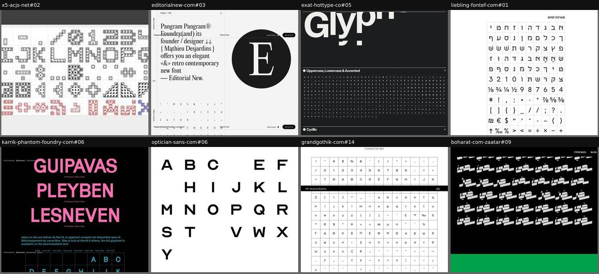
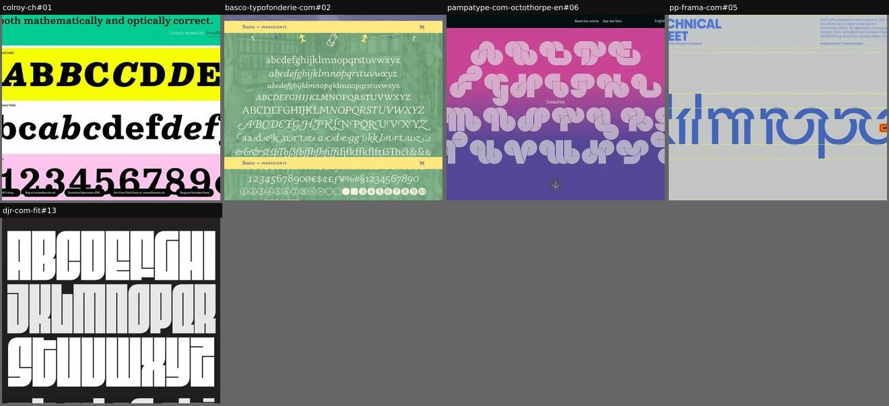
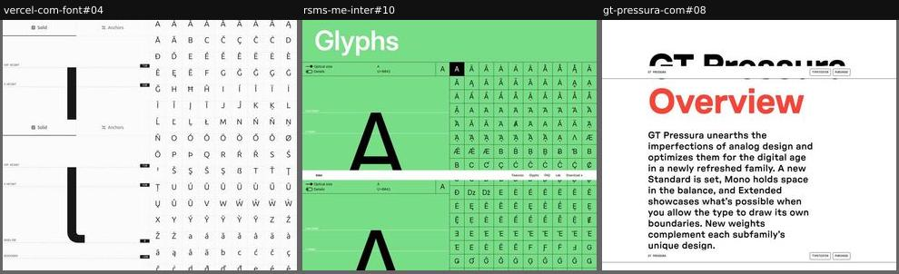
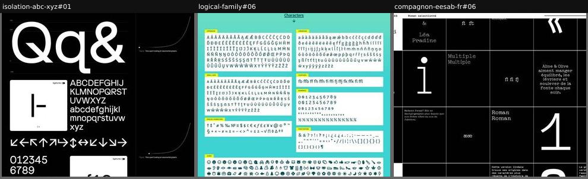
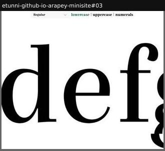
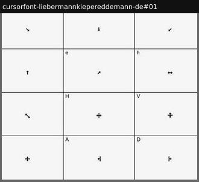

# glyph-table

The character set itself, all or by category.

Sample: 21 blocks from 21 sites.

| variant | n | definition | recognise by |
|---|---|---|---|
| [full-grid](#full-grid) | 8 | The whole character set in uniform cells, in encoding order (sometimes with key labels for dingbat fonts). | dense grid of small cells |
| [category-lines](#category-lines) | 5 | The set typeset as running lines per category (or one moving line), no cells. | A–Z, a–z, 0–9 as lines of text |
| [glyph-inspector](#glyph-inspector) | 3 | A grid plus a large preview of the selected or hovered glyph on its metric lines. | big glyph panel, cap-height and x-height lines |
| [bento-cards](#bento-cards) | 3 | A grid of cards, each a slice of the set or one feature (arrows, numerals, ligatures). | rounded cards of varied sizes |
| [category-tabs](#category-tabs) | 1 | Tabs or a dropdown switch a large-size strip of one category at a time. | tabs: lowercase | uppercase | numerals |
| [keymap-grid](#keymap-grid) | 1 | Pictogram or dingbat cells labelled with the key that types them. | key letter in each cell corner |

## Rubric

Recorded for every instance in Phase 3, in addition to the cross-cutting attributes in `rubric.json`:

- **coverage**: full | partial | by-category
- **interaction**: static | hover | select | tabs | filter
- **metricsShown**: true | false
- **namesOrUnicode**: true | false

## full-grid

The whole character set in uniform cells, in encoding order (sometimes with key labels for dingbat fonts).

**Recognise by:** dense grid of small cells

| example | look | feel | ux | learn |
|---|---|---|---|---|
| [x5-acjs-net#02](../../archive/x5-acjs-net/blocks/02.jpg) | Grey title bar 'Second power', white cells with dotted pixel-block glyphs, a few extra-script glyphs tinted red and blue | Technical, retro-digital | static | Tint the glyphs of other scripts or blocks so coverage reads at a glance inside a uniform grid |
| [editorialnew-com#03](../../archive/editorialnew-com/blocks/03.jpg) | Off-white, intro sentence full of alternates and diacritics ('{ Mąthieu Desjardins }'), big 'E' roundel, then a 10-column character grid in encoding order | Refined, editorial, airy | Long scroll through the grid; side 'Table of contents' tab, Invert colours toggle, Get the font | Open the charset with a sentence that smuggles in the alternates and accents, so the grid that follows feels earned |
| [exat-hottype-co#05](../../archive/exat-hottype-co/blocks/05.jpg) | Charcoal, huge cropped 'Glyphs' heading, tiny white glyphs in a ruled grid, collapsible sections (Uppercase/Lowercase & Accented, Cyrillic, Figures & Symbols) | Sober, Swiss, orderly | Accordion sections open one script or category at a time | Fold the charset into accordions by script, so a huge glyph set doesn't swallow the page |
| [liebling-fontef-com#01](../../archive/liebling-fontef-com/blocks/01.jpg) | White, Hebrew character set (letters, dagesh/niqqud forms, figures, fractions, punctuation) in a ruled grid, RTL order | Orderly, reference-like | static | Lay the grid out right-to-left for a Hebrew set so reading order matches the script |
| [karrik-phantom-foundry-com#06](../../archive/karrik-phantom-foundry-com/blocks/06.jpg) | Black, pink display place names with tiny style switches above a teal ruled glyph grid paginated by 100 (0-99…700-729) | Punky, playful, bilingual | Click Poltergeist/Alpha/Beta to restyle each word; page through the glyph set in hundreds | Paginate a large glyph set in fixed chunks so each glyph stays big enough to read |
| [optician-sans-com#06](../../archive/optician-sans-com/blocks/06.jpg) | White, black uppercase A–Z as images in a 6-column grid, wide spacing; some letters missing (lazy-load gaps) | Clinical, eye-chart calm | static | Generous spacing around each capital echoes an eye-test chart, tying the glyph set to the font's origin |
| [grandgothik-com#14](../../archive/grandgothik-com/blocks/14.jpg) | White, thin-ruled cells, Latin, Greek and symbols | Complete, neutral | static (maybe hover) | The completeness proof; pair it with something more expressive |
| [boharat-com-zaatar#09](../../archive/boharat-com-zaatar/blocks/09.jpg) | Black field, rows of white Arabic ligature combinations; viewport-cut tail of a 'Ligatures' section, green band below | Dense, rhythmic, graphic | static | Listing every ligature pair as a texture shows an Arabic display face's connective logic at a glance |

## category-lines

The set typeset as running lines per category (or one moving line), no cells.

**Recognise by:** A–Z, a–z, 0–9 as lines of text

| example | look | feel | ux | learn |
|---|---|---|---|---|
| [colroy-ch#01](../../archive/colroy-ch/blocks/01.jpg) | Colour bands (yellow, white, pink), each labelled with a style, caps / lowercase / figures alternating roman and italic, cropped at the right; quote tail on top | Bold, poster-like, fun | static; sticky pill bar (buy, PDF, trial, variable) | Alternate roman and italic letter by letter so each band compares the pair in one line |
| [basco-typofonderie-com#02](../../archive/basco-typofonderie-com/blocks/02.jpg) | Mint-tinted spice-market photo behind white centred glyph lines incl. swash caps and ligatures; yellow 'Ingredients' sticky bar; style list below | Warm, culinary, generous | static; sticky section bar with cart icon | Call the glyph set 'Ingredients' and lay it over a market photo: the charset becomes part of the brand story |
| [pampatype-com-octothorpe-en#06](../../archive/pampatype-com-octothorpe-en/blocks/06.jpg) | Pink-to-violet gradient, white multi-line swash letters in centred rows, small 'Swashes' label, round down-arrow; one of a run of full-screen slides | Psychedelic, 70s, joyful | Full-screen slide (pre-rendered image); down arrow jumps to the next slide | Give a special subset (swashes) its own full screen and colour, instead of burying it in the charset |
| [pp-frama-com#05](../../archive/pp-frama-com/blocks/05.jpg) | Grey field, blue 'TECHNICAL SHEET' title block with spec blurb, giant blue lowercase 'klmnopq' cropped on yellow metric lines | Engineered, spec-sheet, cool | Looping muted video (presumably the alphabet sliding over the guidelines); floating Get the font button | Draw the vertical metrics as thin lines behind a huge alphabet: it reads as a technical drawing with no labels needed |
| [djr-com-fit#13](../../archive/djr-com-fit/blocks/13.jpg) | Dark grey, white and light-grey ultra-condensed caps and lowercase, then Greek and Cyrillic, alternating row tints, full width | Massive, graphic, relentless | static | Alternate row tints so a dense alphabet set solid still reads line by line |

## glyph-inspector

A grid plus a large preview of the selected or hovered glyph on its metric lines.

**Recognise by:** big glyph panel, cap-height and x-height lines

| example | look | feel | ux | learn |
|---|---|---|---|---|
| [vercel-com-font#04](../../archive/vercel-com-font/blocks/04.jpg) | White, sticky large glyph left with dashed metric lines and numeric labels, thin-ruled grid of accented glyphs right | Precise, engineer-grade, minimal | Click a glyph to inspect it; Solid/Anchors tabs switch the rendering; skip link to playground | Show metrics with real unit values (710, 530, 0, -150): it speaks the language of developers and type nerds at once |
| [rsms-me-inter#10](../../archive/rsms-me-inter/blocks/10.jpg) | Mint green, big glyph 'A' left with metric lines and U+0041 code, dense grid of accented variants right; sticky site nav | Utilitarian, encyclopedic, crisp | Select a glyph to inspect; Optical size and Details toggles | Pair each glyph with its Unicode code point and metrics: the specimen is also a reference tool |
| [gt-pressura-com#08](../../archive/gt-pressura-com/blocks/08.jpg) | White, red 'Overview' and prose, subfamily × weight matrix of letter pairs, then ruled grids by script next to a big red ķ on metric lines | Technical, rigorous, clean | Hover a glyph to see it large on cap height, x-height, baseline; sticky Typetester/Purchase links | Pair a compact grid with one magnified glyph on its metrics: overview and close reading in the same view |

## bento-cards

A grid of cards, each a slice of the set or one feature (arrows, numerals, ligatures).

**Recognise by:** rounded cards of varied sizes

| example | look | feel | ux | learn |
|---|---|---|---|---|
| [isolation-abc-xyz#01](../../archive/isolation-abc-xyz/blocks/01.jpg) | Black, big 'Qq&', alphabet block, arrow set, numerals, white cards with ligature toggles, exponential-graph figures | Product-like, systematic, wry | Small toggles on cards (ligatures) | Cards let you show many feature slices without a monotonous grid |
| [logical-family#06](../../archive/logical-family/blocks/06.jpg) | Teal field, white cards per category (Uppercase, Lowercase, Small caps, Ligatures, Numerals, Punctuation, Icons) with tiny yellow tags | Organised, friendly, utilitarian | static | Category cards with colour tags let readers jump to the slice they care about (icons, small caps) without scanning a monolithic grid |
| [compagnon-eesab-fr#06](../../archive/compagnon-eesab-fr/blocks/06.jpg) | Black ruled grid of cells: huge 'i' and '1', ligatures (ff, fi, fl), æ œ, French sample sentences in a monospace; white sticky header with slider | Systematic, editorial, schoolish | Style slider in header ('Roman sélectionné'); theme toggle | Mix single glyphs, ligatures and full sentences in one cell grid so scale jumps keep the table lively |

## category-tabs

Tabs or a dropdown switch a large-size strip of one category at a time.

**Recognise by:** tabs: lowercase | uppercase | numerals

| example | look | feel | ux | learn |
|---|---|---|---|---|
| [etunni-github-io-arapey-minisite#03](../../archive/etunni-github-io-arapey-minisite/blocks/03.jpg) | White, giant black serif glyphs cropped by the viewport, minimal tab bar | Elegant, focused | Style dropdown, category tabs; glyphs probably scroll sideways | Showing glyphs huge, a few at a time, beats a tiny full grid for appreciating a text serif |

## keymap-grid

Pictogram or dingbat cells labelled with the key that types them.

**Recognise by:** key letter in each cell corner

| example | look | feel | ux | learn |
|---|---|---|---|---|
| [cursorfont-liebermannkiepereddemann-de#01](../../archive/cursorfont-liebermannkiepereddemann-de/blocks/01.jpg) | Light grey ruled grid, tiny black cursor arrows centred, key letters (q, w, e, H, V…) in cell corners | Utilitarian, quiet, tool-like | static | For a symbol font, label each glyph with its key: the table becomes the user manual |
