# hero

_Section: Hero_

The above-the-fold first impression: what the visitor sees before scrolling.

166 instances on 165 sites (the Phase 3 extraction of 181 sites).

| variant | sites | definition | recognise by |
|---|---|---|---|
| [giant-wordmark](#giant-wordmark) | 58 | The family name set as large as the viewport allows on a flat field, little else; may mix styles letter by letter to show range. | one dominant name, flat colour, minimal copy |
| [sentence-as-specimen](#sentence-as-specimen) | 25 | A headline sentence about the font, set in the font (sometimes beside one oversized glyph or rotating through styles): the pitch is the specimen. | readable claim or announcement in display size, CTA nearby |
| [kinetic-type](#kinetic-type) | 15 | The type in motion is the hero: animated, 3D, generative, video clips, or axes driven by scroll. | canvas/video/WebGL, scroll-scrubbed variation, the capture looks mid-animation |
| [typeset-page](#typeset-page) | 13 | A classical typeset composition (title page, broadside, dictionary entry) that uses the family's own hierarchy, italics and ornaments. | centred stacks, rules, ornaments, multiple sizes and italics |
| [illustration-scene](#illustration-scene) | 11 | An illustrated scene or mascot staged with the type; the illustration sets the tone. | characters, faces, drawn objects |
| [product-landing](#product-landing) | 11 | The software-product landing pattern: headline, tagline, paragraph, primary and secondary buttons. | SaaS layout, 'Try it now' and 'GitHub' buttons, common for coding fonts |
| [interactive-specimen](#interactive-specimen) | 9 | The hero is a specimen the visitor manipulates straight away (axes, weight, contrast, text), via controls or the wheel. | sliders, toggles or editable text inside the first screen |
| [name-over-photo](#name-over-photo) | 5 | Name and a short line over a full-bleed mood photograph. | landscape or scene photo, type overlaid |
| [material-photo](#material-photo) | 5 | A photograph of physical material (paper, textile, objects) carrying or framing the type. | tactile still life, the type printed or knitted on the material |
| [prop-collage](#prop-collage) | 4 | A collage of designed artefacts (documents, tickets, packaging, diagrams) set in the font, implying a fictional world. | many small designed objects, all set in the font |
| [construction-drawing](#construction-drawing) | 3 | A glyph shown as its construction (Bézier points, skeleton, strokes), often drawn on. | outline points, handles, metric lines in the hero |
| [mini-game](#mini-game) | 2 | The hero is a small playable game built from the page's own elements (e.g. Pong); collisions or score change the name's axes, CTAs can be game pieces. | ball, paddles, score in the first screen |
| [glyph-grid-sampler](#glyph-grid-sampler) | 2 | A small name over a large grid of characters from every covered script, often on writing-practice guide cells. | grid of CJK/Latin characters in guide cells |
| [click-to-stamp](#click-to-stamp) | 1 | An almost empty first screen; each click drops a word or phrase in the font at the pointer with randomised style or axis values, so the visitor composes the hero. | “click anywhere” prompt, scattered stamped words |
| [strip-mixer](#strip-mixer) | 1 | A typeset page cut into headline, deck and body strips, each its own carousel of styles cycling on its own timer and swipeable, so the page keeps recombining. | horizontal strips sliding independently |
| [word-slideshow](#word-slideshow) | 1 | An auto-advancing slideshow of pre-set display compositions (a place name, the family name in each weight with labels, a short phrase) in a full-width banner, one word or lockup per slide, usually above a facts panel; the hero is a sequence of words rather than one wordmark | auto-advancing display words in a banner |

## Rubric

Recorded for every instance in Phase 3, in addition to the cross-cutting attributes in `rubric.json`:

- **carrier**: name | sentence | glyph | photo | illustration | props | motion | controls (what carries the first impression)
- **cta**: none | buy | try | download | scroll | multiple
- **rangeShown**: one-style | several | whole-family
- **navVisible**: true | false

## giant-wordmark

The family name set as large as the viewport allows on a flat field, little else; may mix styles letter by letter to show range.

**Recognise by:** one dominant name, flat colour, minimal copy

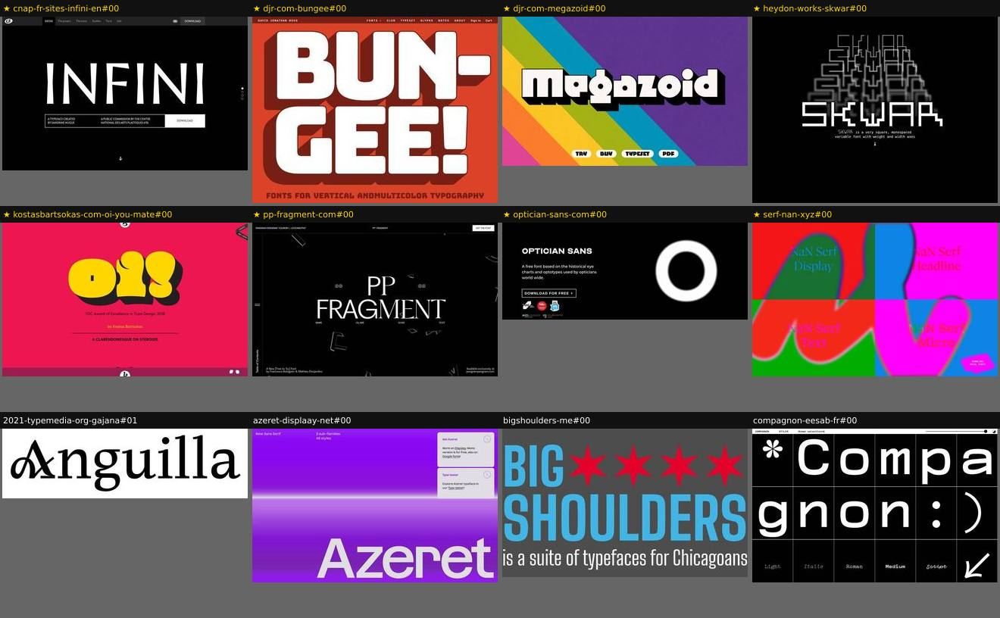

| example | look | feel | ux | learn |
|---|---|---|---|---|
| [★ cnap-fr-sites-infini-en#00](../../archive/cnap-fr-sites-infini-en/blocks/00.jpg) | Full black screen with 'INFINI' in white caps at ~240px, its flared, chiselled strokes the only ornament; beneath it a white-outlined strip split into 'A TYPEFACE CREATED BY SANDRINE NUGUE' | 'A PUBLIC COMMISSION BY THE CENTRE NATIONAL DES ARTS PLASTIQUES (FR)' | a solid white 'DOWNLOAD' cell; a ↓ arrow at the bottom | Monumental, civic | Download cell fetches the zip; the arrow or wheel snaps to the next full-screen section | Fold credits and the download into one ruled strip under the wordmark: it reads like a museum label and a button at once |
| [★ djr-com-bungee#00](../../archive/djr-com-bungee/blocks/00.jpg) | 'BUN-GEE!' hyphenated onto two lines, white with a deep maroon extruded Shade layer on signal red, filling the panel; a one-line dark-red tagline beneath | Roadside, shouting, fun | Static; the first panel of a horizontal scroll, the yellow panel peeking at the right edge invites scrolling sideways | Layer the same word in Regular and Shade at full viewport height and the hero demonstrates the chromatic system with no explanation; let the next panel peek in to teach the scroll direction |
| [★ djr-com-megazoid#00](../../archive/djr-com-megazoid/blocks/00.jpg) | Purple field crossed by diagonal rainbow stripes (pink, orange, yellow, olive, blue) from the bottom-left; 'Megazoid' in white with a deep black extruded shade across the middle; four white pill buttons TRY · BUY · TYPESET · PDF along the bottom | Loud, nostalgic, 70s packaging | Stripes draw in first, then the name appears and its shade depth animates in; DJR's slim site nav sits above | Build the shade from two stacked layers per letter (fill + variable shade font) so the 3D depth can be animated with an axis instead of an image |
| [★ heydon-works-skwar#00](../../archive/heydon-works-skwar/blocks/00.jpg) | 'SKWAR' in white at ~130px centred on black, with five grey copies stacked above it, each narrower and lighter, receding like a pyramid or a Star Wars crawl; a one-line description and a ↓ arrow below | Retro computer game title screen | No nav; the echo layers fade and blur in one after another on load, then the arrow invites the scroll | Stack the name at stepped axis values (wdth 500→1000 with wght 100→600) behind the final one: the hero both shows the axes and reads as a 3D title |
| [★ kostasbartsokas-com-oi-you-mate#00](../../archive/kostasbartsokas-com-oi-you-mate/blocks/00.jpg) | 'oi!' at 300px in yellow with a dark maroon extruded shadow on hot pink-red, centred, with a small credit stack below and an Awwwards 'Honors' ribbon on the right edge | A comic-book shout | static; fixed maroon bar above; ribbon links out | Stack two fonts, a fill and a shadow, in two colours: one word gets the depth of a logo, and it's still live text |
| [★ pp-fragment-com#00](../../archive/pp-fragment-com/blocks/00.jpg) | Black screen, centred 'PP / FRAGMENT' in white high-contrast caps flanked by circled numerals ⓶⓪ ⓶⓶, the four cut names SANS · GLARE · SERIF · TEXT spaced under the name, floating 3D glass shards around it; bottom-left 'A New 【Free to Try】 Font by Francesca Bolognini & Mathieu Desjardins', bottom-right 'Available exclusively at pangrampangram.com' | Elegant, cinematic | Long black loader (~8s, small spinner) before the hero; each letter rolls vertically through the four cuts at its own speed (1.3–2.3s); shards drift; fixed top bar with 'GET THE FONT'; 'Table of Contents' tab on the left edge | Let every letter of the name cycle through the cuts at a different speed: the wordmark itself shows that the four styles share one skeleton |
| [★ optician-sans-com#00](../../archive/optician-sans-com/blocks/00.jpg) | Black field: left 'OPTICIAN SANS' in white caps, a three-line tagline, an outlined 'DOWNLOAD FOR FREE ▸' button and a row of award badges (One Show, TDC, Communication Arts, ED Awards, Gullblyanten); right a single huge white 'O' that blurs and sharpens | Calm, clever, like looking into an eye-test machine | The 'O' loops between blurred and sharp (CSS filter blur 10px → 0) like an eye focusing; the button downloads the ZIP directly | Animate the one glyph with the theme's own effect (out-of-focus → sharp for an eye-chart font): a single CSS filter carries the whole concept |
| [★ serf-nan-xyz#00](../../archive/serf-nan-xyz/blocks/00.jpg) | Four flat quadrants (red, magenta, green, blue) each centring 'NaN Serf / Display|Headline|Text|Micro' in a contrasting quadrant colour; a fat, soft-edged scribble stroke in difference blend sweeps over them, inverting colours where it passes | Loud, joyful, poster-like; the serif feels unexpectedly pop | Nothing scrolls: the screen is the whole site (wheel events only advance the squiggle animation in the capture). Blocks 01–02 are later states of the same screen | Let colour and one ambient gesture carry a single screen; naming each optical size in its own opsz makes the family structure the whole message |
| [2021-typemedia-org-gajana#01](../../archive/2021-typemedia-org-gajana/blocks/01.jpg) | The name 'Anguilla' in the black display style, with a looping calligraphic swash 'A', filling a white image band edge to edge under the slim nav | Elegant, confident, hand-made | The cover image fades in on load (grey to black over ~1.5s); 'Jump to process ↓' sits just below | A cover image of the name in the display cut, with the template doing everything else, makes a strong first screen for a student project |
| [azeret-displaay-net#00](../../archive/azeret-displaay-net/blocks/00.jpg) | 'Azeret' in pale lilac at huge size anchored bottom-right over a looping violet video with a glowing horizontal light band; tiny 'New Sans Serif' and '3 sub-families / 48 styles' top-left; two floating lilac cards top-right ('Get Azeret', 'Type tester') | Cool, glowing, screen-like | Intro: a counter ('0') at the bottom-right, then the letters of 'azereT' animate in one by one before the name settles; the video loops behind | Push the wordmark into the bottom-right corner and let a slow light-band video carry the mood: the empty violet space reads as a screen |
| [bigshoulders-me#00](../../archive/bigshoulders-me/blocks/00.jpg) | 'BIG' plus four red Chicago-flag stars, 'SHOULDERS' below, and 'is a suite of typefaces for Chicagoans', each line fitted to the 700px column in sky blue and white on charcoal | Municipal, like a city banner | static | Use the four stars of the local flag as a typed glyph in the wordmark: place identity costs one line of text and no image |
| [compagnon-eesab-fr#00](../../archive/compagnon-eesab-fr/blocks/00.jpg) | '*Compagnon:)' spelled one character per cell across two rows of the 6-column black grid, white glyphs filling each cell; a third row names the styles (Light, Italic, Roman, Medium, Script, each in its own style) and ends with a big ↙ arrow | Cheeky, typewriter-like, systematic | Every letter cell is editable; style names jump to their chapter; ↙ jumps to the download cell | Spell the name one glyph per grid cell: the hero already is the specimen grid that the rest of the page continues, and the smiley ':)' sets the tone |
| [djr-com-forma#00](../../archive/djr-com-forma/blocks/00.jpg) | On yellow, two overlapping flat rectangles, magenta (top-left) and cyan (bottom-right) with a purple overprint where they meet, carrying the hyphenated name 'for- / ma' in white hairline at ~440px and a small boxed 'DJR'; a row of four small magenta buttons (TRY, BUY, TYPESET, PDF) underneath | Bright, modernist, like a 1960s specimen cover | TRY posts a form that adds the free Testing licence to the cart; BUY jumps to #buy; TYPESET opens typeset.djr.com with the font; PDF downloads the specimen | Overprint two process-colour rectangles behind a hairline name: the CMYK overlap introduces the print theme of the whole page in one image |
| [djr-com-gimlet#00](../../archive/djr-com-gimlet/blocks/00.jpg) | A short full-width banner of slanted stripes in orange, mustard and teal, with 'Gimlet!' in a tall white condensed italic filling the centre; the TRY · BUY · TYPESET · PDF button strip sits right under it | Upbeat, retro, a little boozy | static; buttons in the strip below jump to the tester and store, open the Typeset tool or the PDF | A banner-height wordmark (not a full screen) plus a CTA strip gets visitors into the essay immediately; the exclamation mark gives the name its personality |
| [etunni-github-io-arapey-minisite#00](../../archive/etunni-github-io-arapey-minisite/blocks/00.jpg) | 'Arapey' in deep red across the middle, 'Ara' in Black Display and 'pey' in Thin Display, over a faint canvas texture of tiny repeated 'A's; small byline 'A variable typeface by Eduardo Rodríguez Tunni', a red 'Scroll down for more Arapey ↓' and a green round 'Get Arapey ↓' badge above the name | Refined, quiet, Latin American modern | A 'Loading' screen precedes it; the green badge becomes a fixed button that follows the page; scroll prompt | Split the name across the two weight extremes at display opsz: one word shows the whole wght range with no slider |

_…and 43 more in the gallery (`npm run app`)._

## sentence-as-specimen

A headline sentence about the font, set in the font (sometimes beside one oversized glyph or rotating through styles): the pitch is the specimen.

**Recognise by:** readable claim or announcement in display size, CTA nearby

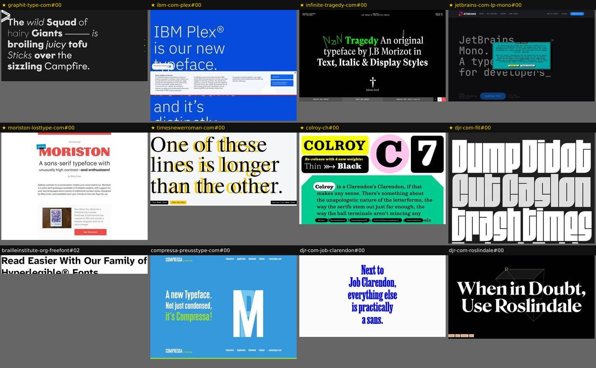

| example | look | feel | ux | learn |
|---|---|---|---|---|
| [★ graphit-type-com#00](../../archive/graphit-type-com/blocks/00.jpg) | A five-line left-aligned nonsense sentence on charcoal, each word in another weight or italic, with a long rule standing in for a word break; three pagination dots at the right edge | Storybook sentences as a weight sampler | Fade carousel of three sentences that auto-advances; lines reveal one by one upward; draggable, dots are clickable | Style word by word inside one sentence: the hero shows the whole family with no list, and the rotation gives three chances to read it |
| [★ ibm-com-plex#00](../../archive/ibm-com-plex/blocks/00.jpg) | Full IBM-blue screen with one enormous white sentence in IBM Plex Sans Light, left-aligned over ~8 lines: 'IBM Plex® is our new typeface. It's global, it's versatile and it's distinctly IBM.'; an 'Open Typetester' link (white circle) at the right; IBM's cookie banner covers the lower part in the capture | Calm, assured, institutional | Intro: horizontal blue-and-white bars (the IBM 8-bar motif) wipe across the screen before the page settles; 'Open Typetester' opens a global tester overlay | A brand typeface can introduce itself with a single possessive sentence ('our new typeface… distinctly IBM') set huge in the lightest weight: the statement is the specimen |
| [★ infinite-tragedy-com#00](../../archive/infinite-tragedy-com/blocks/00.jpg) | Black screen: small mono meta row at the top ('INFINITE EDITABLE TYPE SPECIMEN' / 'NaN.XYZ NaN TRAGEDY BY JEAN-BAPTISTE MORIZOT' / 'BERLIN DE JOIGNY FR'); centred three-line serif sentence 'NaN Tragedy An original typeface by J.B Morizot in Text, Italic & Display Styles' with a hand-scrawled green 'NaN', 'Tragedy' in bold green, the last line bold white; a white dagger and italic 'Infinite Scroll' below; white line drawings draw themselves across the screen | Theatrical, dark, slightly unhinged | Scroll cue (dagger + 'Infinite Scroll'); fixed bottom bar with three tabs and three colour-theme buttons; the line drawings change on each pass | Mix the styles inside one announcement sentence (regular, bold, display, scrawled logo) so the pitch lists the styles and shows them in the same breath |
| [★ jetbrains-com-lp-mono#00](../../archive/jetbrains-com-lp-mono/blocks/00.jpg) | Four lines of grey monospace at ~100px, 'JetBrains / Mono. / A typeface / for developers_', ending in a blinking underscore cursor; under it a small version block (v2.304, Updated 1,372 days ago, Release notes ↗), a big blue 'Download font' button and 'It's free & open source' | Terminal prompt, self-assured | The headline types itself on letter by letter (typed.js) on load; the last word 'developers' is contenteditable, so visitors can retype it | Type the pitch like a shell prompt and leave the last word editable: the hero becomes the first tester without any UI |
| [★ moriston-losttype-com#00](../../archive/moriston-losttype-com/blocks/00.jpg) | White page, short red bar on top, 'Introducing' kicker, red Black-weight 'MORISTON' with a tilted blue 'Edit Me!' sticker on its corner, then 'A sans-serif typeface with / unusually high contrast—and enthusiasm!' in two weights, 'by Riley Cran' and a short intro paragraph | Warm, approachable, a little cheeky | Name and tagline form one contenteditable block: click to retype the hero; each line re-fits to the column width | A tiny 'Edit Me!' sticker on the headline turns the hero itself into a tester without adding any controls |
| [★ timesnewerroman-com#00](../../archive/timesnewerroman-com/blocks/00.jpg) | 'One of these lines is longer than the other.' at ~190px, set twice on top of each other: black Times New Roman over yellow Times Newer Roman, the misregistration growing along each line; below, a black and a yellow label button | Witty, instantly understood | The two labels are radio labels, presumably switching which font is on top (the CSS is not in the archive). The overlap itself is the demo | Overprint the font on its rival in two colours: the drift along each line is the entire product pitch, with no need for a body sentence |
| [★ colroy-ch#00](../../archive/colroy-ch/blocks/00.jpg) | A board of rounded stickers on white: a yellow pill 'COLROY' in black slab caps, a black card 'Re-release with 4 new weights: Thin ⋙→ Black' (the words set in Thin and Black), a pink circle with a huge 'C' and a black rounded square with a white '7'; the green octagon of the intro paragraph starts below | Loud, fun, confident | static; the fixed bottom pill bar is already visible | Announce the news (new weights) as a sticker in which the two ends of the range are set in those weights ('Thin → Black') |
| [★ djr-com-fit#00](../../archive/djr-com-fit/blocks/00.jpg) | Ten full-width lines on a charcoal gradient, alternating white and light grey, each a two-word insult to a classic typeface ('Dump Didot', 'Cut Caslon', 'Trash Times', 'Reject Rotis', 'Abandon Arial', 'Hurl Helvetica', 'Forsake Futura', 'Chuck Clarendon', 'Give up Garamond', 'Renounce Rockwell'), every line justified edge to edge by its own width value | Brash, punk, laugh-out-loud | Lines refit live when the window is resized (each line's wdth is recomputed); DJR site nav bar above | Write lines of different lengths and let the width axis justify each one to the same measure: the variable range becomes visible as rhythm |
| [brailleinstitute-org-freefont#02](../../archive/brailleinstitute-org-freefont/blocks/02.jpg) | Bold black headline 'Read Easier With Our Family of Hyperlegible® Fonts' over two lines; below, a left column of large body copy opening 'Is this font easy for you to read? Good—that's the idea.' and a 'Download Now' button; on the right a grey video poster on graph paper reading 'every day' with a big yellow play button | Friendly, reassuring, public-service | Download Now jumps to the email-gated download form; the play button starts an embedded Vimeo film about the font | Ask the reader directly whether this text is easy to read: the whole hero copy becomes the legibility test |
| [compressa-preusstype-com#00](../../archive/compressa-preusstype-com/blocks/00.jpg) | On flat sky blue, a three-line slab-fitted pitch 'A new Typeface. / Not just condensed, / it's Compressa!' (last line lime green) on the left and a huge white capital on the right that cycles through the letters of the name with a pale-blue ghost of the next letter behind it | Loud, friendly, self-assured | Fixed blue nav bar above; the glyph on the right is an animated GIF spelling C-O-M-P-R-E-S-S-A letter by letter | A slab-fitted pitch (each line scaled to the same width) next to a single cycling capital: the sentence sells, the glyph loop shows the letterforms one at a time |
| [djr-com-job-clarendon#00](../../archive/djr-com-job-clarendon/blocks/00.jpg) | On off-white, a centred five-line claim in electric-blue condensed semibold: 'Next to / Job Clarendon, / everything else / is practically / a sans.'; the black/yellow action bar sits along the bottom of the first screen | A wisecrack set like a letterpress handbill | No controls in the hero; the action bar under it (Try, Typeset, PDF, Buy) is the call to action | A joke about the genre ('everything else is practically a sans') sells a heavy-serif display face faster than a description, and the line breaks make it a poster |
| [djr-com-roslindale#00](../../archive/djr-com-roslindale/blocks/00.jpg) | On black, 'When in Doubt, / Use Roslindale' centred in white Display Bold at ~150px over a thin tan wireframe of a tapering box (the designspace 'horn') with a small 'R' marking a corner; four small peach buttons TRIAL, BUY, TYPESET, PDF at the bottom left | Confident, theatrical, a little cheeky | The slogan is editable; TRIAL adds the testing licence to the cart, BUY jumps to the cart section, TYPESET opens DJR's typesetting app, PDF downloads the specimen; on load the hero slides up over a teal band (t≈1.6s) | Draw the family's designspace as a quiet wireframe behind the slogan: the diagram becomes the brand graphic before it is explained later |
| [dyslexiefont-com#01](../../archive/dyslexiefont-com/blocks/01.jpg) | Three lines 'READ WITH / DYSLEXIE / FONT' in black caps at maximum width on a signal-yellow field | Loud, clear, confident | Static; the first screen makes a single statement. The yellow field continues into the two following blocks | An accessibility font can be sold by its own legibility: a three-word imperative at huge size on a high-contrast field is the demo |
| [escafina-losttype-com#00](../../archive/escafina-losttype-com/blocks/00.jpg) | On teal, a small handwritten 'Edit Me' scribble above the cream script name 'Escafina', the tagline 'A balanced upright script with style & moxie!' in pale teal script, then 'by Riley Cran from Lost Type' | Friendly, retro sign-shop | Name and tagline are Draft.js editors; the 'Edit Me' scribble is an annotation image pinned to the letters 'scafin', so it travels with the text | Pin a hand-drawn 'Edit Me' note to a range of the headline's own text: the invitation to type looks like a proofreader's mark, not UI |
| [faction-losttype-com#00](../../archive/faction-losttype-com/blocks/00.jpg) | Centred white ultra-heavy caps on black: 'INTRODUCING / →FACTION← / A NEW DISPLAY TYPEFACE FROM LOST TYPE', the name and arrows in the Outline style, then a small credit line and an outlined pill 'Get Faction' | Loud, poster-like, like a gig flyer | Lines flicker on one after another at load; a single 'Get Faction' link to the Lost Type shop; a round day/night mode switch sits in the top-right corner | Let the launch announcement itself be the specimen, and set only the family name in the second style so both styles appear in the first line you read |

_…and 10 more in the gallery (`npm run app`)._

## kinetic-type

The type in motion is the hero: animated, 3D, generative, video clips, or axes driven by scroll.

**Recognise by:** canvas/video/WebGL, scroll-scrubbed variation, the capture looks mid-animation

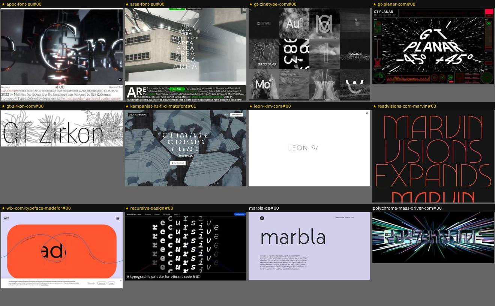

| example | look | feel | ux | learn |
|---|---|---|---|---|
| [★ apoc-font-eu#00](../../archive/apoc-font-eu/blocks/00.jpg) | Full-width video of chrome, mirror-polished 3D serif letters ('Apoc Revelations', 'New Styles Available', 'Gehenna') flying through a dark voxel city lit by red glows, inset 40px on white, with a white mute icon bottom-right and the slim 'Buy Apoc · APOC · Download Trial' bar on top | Cinematic, ominous, luxurious | Autoplay muted loop; the mute button toggles sound; clicking the video smooth-scrolls one viewport down; Buy and Trial links in the fixed bar | Render the family's words as reflective 3D objects in a film-like scene: a display serif gets drama a flat specimen can't give |
| [★ area-font-eu#00](../../archive/area-font-eu/blocks/00.jpg) | A rounded full-width video of a misty concrete building (camera gliding past balconies), with a centred white stack: five small 'AREA' lines growing heavier and wider, 'B L A Z E  T Y P E' letter-spaced, then five more 'AREA' lines growing to ~70px | Moody, architectural, premium | The stack's lines interpolate wght, wdth and INKT in a staggered loop over the drifting video; fixed Buy/Trial pills at the top | Stack the name ten times and give each line a slightly different point on all axes, then animate them: the whole design space reads as one moving column |
| [★ gt-cinetype-com#00](../../archive/gt-cinetype-com/blocks/00.jpg) | A 4×5 wall of square greyscale video loops: chemical-element tiles ('Au 79', 'Mo 42', 'Pb 82', 'Cr 24'), timecode counters ('81 00:00:03:09'), spinning and laser-drawn 'CINETYPE' logos, 'TELEPATH', 'HEADACHE', 'EVOL', a spiralling burst, all over grainy landscape footage | Retro sci-fi opening titles, analogue film grain | Nothing to click; all tiles autoplay muted. A tiny speaker button at the left edge (fixed) plays a looping soundtrack. Before the page, a loader video shows an old TV in a dark room reading 'PLEASE WAIT' | A mosaic of short title-sequence loops shows a font across many moods at once: each tile is a tiny film title card |
| [★ gt-planar-com#00](../../archive/gt-planar-com/blocks/00.jpg) | A cockpit HUD frames the screen (top status 'GT PLANAR ENG PXS VEC SNR NFO', red 'BUCKLE IN TO ENSURE PILOT SAFETY' ticker, red EXIT button, side gauges ENG, BAT, VEC, TLT, bottom PXS dial, MOD waveform, pilot portrait with FOCUS/OXYGEN/AWAKE bars, SNR radar) around a black starfield warp where 'TYPE THE FINAL FRONTIER' and 'GT PLANAR −45° +45°' fly at the viewer with every letter at a different slant | Arcade cockpit, exhilarating, nerdy | Stars accelerate into hyperspace on load; title planes zoom forward in sequence; HUD gauges read live values (scroll distance in px, tilt %, battery, pointer vector puck); 'EXIT' or the 'HUD' toggle hides the cockpit and reveals the page; the HUD can be re-opened from the fixed bar anywhere | Turn the scroll position and pointer into instrument readouts: a themed HUD makes ordinary browsing feel like piloting |
| [★ gt-zirkon-com#00](../../archive/gt-zirkon-com/blocks/00.jpg) | 'GT Zirkon' in hairline Ultra Light at ~288px, overgrown by dense clusters of grey tube-like strands and a small faceted crystal, like mineral fibres growing out of the letters | Organic and scientific at once, hypnotic | The strands grow continuously (generative SVG); a top-right text nav 'Stop Growth · Free Trial Fonts · PDF Specimen · Buy GT Zirkon' lets you freeze it; a fixed left sidenav (Intro, Story, Design, More) highlights the current section; loader shows an outline gem GIF and 'Loading…' | Pair a hairline weight with a generative drawing that grows over it, and offer a 'stop' link: the motion is the mood, the control is the courtesy |
| [★ kampanjat-hs-fi-climatefont#01](../../archive/kampanjat-hs-fi-climatefont/blocks/01.jpg) | Full-screen looping aerial video of broken sea ice in slate blue-grey; centred 'CLIMATE CRISIS FONT' in three white lines that keep melting from solid heavy caps into thin, fractured shapes and back, 'Type to Act.' below in serif, a white 'Free Download' button and an outlined 'Play video' button, a mouse-scroll indicator at the bottom | Alarming but beautiful | The title's weight animates through the year axis on a loop (CSS keyframes 'header_melt'); 'Play video' opens a Vimeo film in a lightbox; Free Download jumps to the download section | Animate the title across an axis that carries meaning (years of ice loss): the motion itself states the message before any copy |
| [★ leon-kim-com#00](../../archive/leon-kim-com/blocks/00.jpg) | On white, 'LEON SANS' in hairline caps (~60px) is drawn on stroke by stroke from the centre, thickens to a bold weight, then the view zooms until thin 'N SA' and finally 'SA' fill and overflow the screen | Calm, precise, generative | Plays by itself after load (the capture's wheel events may also step it); nothing to click except the GitHub corner icon | For a font that is code, show the drawing itself: stroke draw-on, live weight change and a camera zoom prove the glyphs are parametric, not static outlines |
| [★ readvisions-com-marvin#00](../../archive/readvisions-com-marvin/blocks/00.jpg) | On near-black, an all-caps headline in a red → pink → orange → yellow → cream gradient (one colour step per line). The first screen shows 'MARVIN / VISIONS / EXPANDS' as hairline caps filling the width; the stitched crop shows it getting bolder and smaller with each scroll step until the whole sentence 'MARVIN VISIONS EXPANDS & BECOMES A VARIABLE FONT WITH 2 OPTICAL SIZES & A RANGE OF WEIGHTS' fits, centred, in a heavy weight | Cinematic, like an opening title crawl | Scroll scrubs the headline: font-weight rises from ~20 to bold while font-size shrinks from 100% so further lines of the announcement come into view; the stage is pinned for ~5 viewports | Couple weight up with size down on scroll so the announcement literally 'expands' into its full sentence: the headline demonstrates the claim it makes |
| [★ wix-com-typeface-madefor#00](../../archive/wix-com-typeface-madefor/blocks/00.jpg) | Big orange rounded card on lilac; a thin blue Bézier line with handles loops through it, wrapping into 'Madefor' letters as it goes, while small words ride along the line | A pen drawing the brand in one movement | Loops: flat line with four labels, loops grow, the word is revealed inside them, line straightens, name fully shown, wipes away | One line tying the labels and the letters together shows a typeface's construction and table of contents in a single loop |
| [★ recursive-design#00](../../archive/recursive-design/blocks/00.jpg) | On black, the letters r-e-c-u-r-s-i-v-e as nine columns of repeated glyphs in white and greys, each copy an instance at a different weight, casualness and slant, floating in a WebGL scene with thin red (Weight), green (Casual) and blue (Slant) axis lines; the tagline 'A typographic palette for vibrant code & UI' sits under a dotted rule at the bottom | Dimensional, playful, nerdy | Letters fade in at load (black frame for ~1s); the three.js canvas takes pointer events, probably to orbit the designspace; the fixed nav's 'Get Recursive' button is the CTA | Spell the name through the designspace itself: every repetition of a letter is one coordinate, so the hero is a 3D map of the variable font |
| [marbla-de#00](../../archive/marbla-de/blocks/00.jpg) | On flat lavender, the lowercase name 'marbla' at ~230px in charcoal, a short paragraph under it, a round 'DE' language pill top-left and 'Experimental Variable Font' top-right | Calm then bubbly | The name's letters inflate and curl one after another (each letter its own span with staggered axis values), then deflate back to the thin Regular, on a loop; the DE/EN pill swaps all copy between German and English | Animate a variable wordmark per letter with a phase offset: the wave through the name shows the axes more vividly than a uniform morph |
| [polychrome-mass-driver-com#00](../../archive/polychrome-mass-driver-com/blocks/00.jpg) | A wide intro film: 'POLYCHROME' in 3D chrome lettering at the centre of a light-speed burst of cyan, magenta and white streaks on black | Spectacular, 70s sci-fi title card | A small 'Mass-Driver™' wordmark shows on black first; the video then plays in a small centred window (t≈0.9–2.2s) before filling the page width; no controls | Render the font as a chrome object in a hyperspace tunnel: one short film sets the 'retro high-tech' mood before any text appears |
| [2020-typefacedesign-org-simon#01](../../archive/2020-typefacedesign-org-simon/blocks/01.jpg) | An animated SVG: big black letters of the heaviest weight drop in one by one at odd angles and pile into a dense cluster reading roughly 'time for change'; the crop is blank because the <object> SVG did not paint in the screenshot, the storyboard shows it | Fun, tumbling, physical | Plays once on load (≈2–4s), then rests as a static cluster | Let a few huge letters fall into a heap: a one-shot SVG animation gives a text face a playful entrance without any controls |
| [surt-font-eu#00](../../archive/surt-font-eu/blocks/00.jpg) | A rendered stone ampersand floating and turning above a rocky coastal ridge under a hazy sky, inset 10px on white; a mute toggle bottom-right and small grey 'INTRODUCTION' / 'CREDITS' tabs along the bottom edge; no name | Mythic, cinematic, quiet | The 3D glyph rotates (different angles across the storyboard); sound toggle; clicking the video scrolls to the content; a sticky bar (Blaze Type / Buy Surt / Download Trial) appears after scrolling | Render one characteristic glyph as a physical monument in a landscape that matches the font's mythology: mood before name |
| [unbounded-polkadot-network#00](../../archive/unbounded-polkadot-network/blocks/00.jpg) | Black screen; a white disc rises from the bottom-left corner and 'THIS IS / UNBOUNDED' appears centred, the first line Light and the second Black; the name then breaks apart letter by letter as you scroll and the disc grows until the page turns white | Launch-event, dramatic | Lottie animation on a full-viewport canvas, scrubbed by scroll (data-scroll-call='updateBackground' flips the page background); a cursor-follow element trails the pointer | Use one geometric shape (a circle growing from a corner) as the transition from a black hero to the white page, so the hero literally opens into the site |

## typeset-page

A classical typeset composition (title page, broadside, dictionary entry) that uses the family's own hierarchy, italics and ornaments.

**Recognise by:** centred stacks, rules, ornaments, multiple sizes and italics

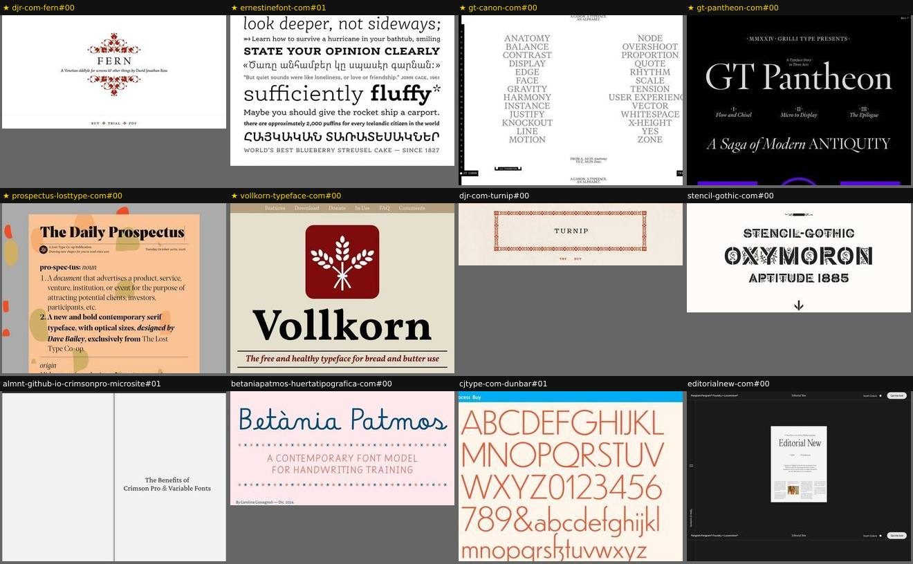

| example | look | feel | ux | learn |
|---|---|---|---|---|
| [★ djr-com-fern#00](../../archive/djr-com-fern/blocks/00.jpg) | A title page on white: 'FERN' in widely tracked titling caps between two mirrored red fleuron clusters, an italic line 'A Venetian oldstyle for screens & other things by David Jonathan Ross' under the name, and a hairline-ruled foot with 'BUY ❖ TRIAL ❖ PDF' in small caps | Quiet, ceremonial, like opening a fine-press book | Buy jumps to #buy; Trial is a form button that adds the Testing license to the cart; PDF downloads the specimen | Build the hero frame from the family's own ornament font (rows of fleuron glyphs typed as text): the decoration is itself a specimen of a family member |
| [★ ernestinefont-com#01](../../archive/ernestinefont-com/blocks/01.jpg) | A broadside of ten justified lines in black on white, each a different style and size: 'look deeper, not sideways;' (Light), '»→ Learn how to survive a hurricane in your bathtub, smiling', 'STATE YOUR OPINION CLEARLY' (Bold caps), an Armenian line in guillemets, a John Cage quote with small-caps credit, 'sufficiently fluffy*' (Light + Bold), 'Maybe you should give the rocket ship a carport.', a bold-italic puffin fact, Armenian capitals, 'WORLD'S BEST BLUEBERRY STREUSEL CAKE — SINCE 1827' in tracked light caps | Clever, friendly, typographically literate | The whole image links to the FontFont shop (Try & Buy) | Justify every line of a mixed-style broadside to one measure and fill it with odd, funny sentences: it shows weights, italics, small caps, arrows, quotes and the second script in one dense block |
| [★ gt-canon-com#00](../../archive/gt-canon-com/blocks/00.jpg) | White page, tiny centred title 'A CANON. A TYPEFACE. AN ALPHABET.', then two centred columns of 13 grey uppercase serif words each (ANATOMY, BALANCE, CONTRAST … ZONE), closing line 'FROM A, AS IN Anatomy TO Z, AS IN Zone.' with italics; a black A–Z letter rail on the left edge, black pills '● GT CANON' top-left and 'TRY/BUY | INFORMATION' top-right, 'Aa| TYPEWRITER' tab bottom-left | Quiet, bookish, like a table of contents | Each word (and each rail letter) links to an essay subpage /articles/<term>; an Editor's Note fades in before the word list; 'Information' slides in the specimen panel; 'Typewriter' opens the tester | Make the home page a glossary: 26 terms from A to Z set as a typeset index give the typeface an alphabet-shaped table of contents and a reason to come back |
| [★ gt-pantheon-com#00](../../archive/gt-pantheon-com/blocks/00.jpg) | Black playbill: '·MMXXIV· GRILLI TYPE PRESENTS·', tiny italic 'A Typeface Story in Three Acts', 'GT Pantheon' huge in silver, three act titles '·I· Flow and Chisel  ·II· Micro to Display  ·III· The Epilogue' in italics, 'A Saga of Modern ANTIQUITY' mixing italic and caps, then a flat geometric illustration (purple squares with orange suns, an arch) and a centred intro paragraph | Grand, witty, ceremonial | Act titles link to the acts; 'Buy ↗ Try ↓' at the top right ('Try' opens the tester overlay); the illustration loops (Lottie) | Frame the specimen as a theatre programme: a playbill title page sets the voice and doubles as the table of contents |
| [★ prospectus-losttype-com#00](../../archive/prospectus-losttype-com/blocks/00.jpg) | A peach newspaper page on flat grey, strewn with orange, olive and peach paper-cut blobs: masthead 'The Daily Prospectus' with a Lost Type roundel, 'A Lost Type Co-op Publication / Drawing new shapes for you to read since 2011' and today's date, then a dictionary entry 'pro·spec·tus: noun' with two numbered senses (the second: 'A new and bold contemporary serif typeface, with optical sizes, designed by Dave Bailey…') and an 'origin' paragraph | Clever, bookish, warm | The masthead (and entry) are editable Draft.js lines with a blinking caret; the blobs drift in and settle as the page loads; no buttons or nav | Define the font's name like a dictionary entry: roman, italic, bold, small and large sizes all appear naturally, and the second sense is the pitch |
| [★ vollkorn-typeface-com#00](../../archive/vollkorn-typeface-com/blocks/00.jpg) | A centred broadside in one narrow column: dark-red wheat icon tile, 'Vollkorn' in Black, ruled italic tagline, row of tan bakery icons, small-caps news line, 'free as always' in red, scripts line, 'pay what you want' in grey italic, oldstyle numerals, designer credit | Warm, homemade, like a bakery sign or a label on a flour sack | Most lines are links down the page (icons to In Use, 'free as always' to Download, 'pay what you want' to Donate), so the poster also acts as the menu. It's taller than the viewport at 1212px | Stack every feature of the family (Black, italic, small caps, oldstyle figures, Cyrillic and Greek) into one centred poster, each line delivering a fact: the hero becomes specimen, news and table of contents |
| [djr-com-turnip#00](../../archive/djr-com-turnip/blocks/00.jpg) | On grainy cream paper, 'TURNIP' in widely spaced small caps inside a rust-red rectangular border of square floret blocks with corner pieces, and 'TRY   BUY' in small red caps beneath; a swelled-rule ornament divider follows | A modest title page from a county printer | Try submits a form that adds the Testing licence to the cart; Buy jumps to #buy | Frame the name with the font's own border ornaments (sides plus corner blocks): the hero shows a feature the buyer will find in the glyph set |
| [stencil-gothic-com#00](../../archive/stencil-gothic-com/blocks/00.jpg) | Centred Victorian title stack on cream: small ornament, 'STENCIL-GOTHIC', a much larger 'OXYMORON', 'APTITUDE 1885', and a stencil arrow pointing down | A 19th-century specimen sheet that is quietly joking | Arrow suggests scrolling; a fixed nav and a logo stamp sit in the bottom corners | Pick words that describe the design as period specimen copy: 'Oxymoron Aptitude 1885' is a joke, a date and a brief in three lines |
| [almnt-github-io-crimsonpro-microsite#01](../../archive/almnt-github-io-crimsonpro-microsite/blocks/01.jpg) | An open book spread on the dark desk: a blank left page and, centred on the right page, a small half-title 'The Benefits of Crimson Pro & Variable Fonts' with an outlined italic ampersand | Hushed, bookish | static | A near-empty half-title spread sets a reading pace before the specimen begins |
| [betaniapatmos-huertatipografica-com#00](../../archive/betaniapatmos-huertatipografica-com/blocks/00.jpg) | On pale pink, 'Betània Patmos' in the dark-blue connected school script across the width, framed by two rows of alternating red and blue asterisks, with the tagline 'A CONTEMPORARY FONT MODEL FOR HANDWRITING TRAINING' in the font's salmon print capitals between them; byline 'By Carolina Giovagnoli — Dic. 2024.' | Cheerful, orderly, like the cover of an exercise book | Fixed two-row white nav above (Letters / Overview / Patterns + download links); no CTA in the hero itself | Pair the cursive and the print capitals of a school font in one title page, with rows of a glyph as rules, so both models appear in the first screen |
| [cjtype-com-dunbar#01](../../archive/cjtype-com-dunbar/blocks/01.jpg) | On cream, the full alphabet, figures and ampersand in thin coral Dunbar set as a justified five-line block (ABCDEFGHIJKL / MNOPQRSTUV / WXYZ0123456 / 789&abcdefghijkl / mnopqrsſztuvwxyz) signed 'DUNBAR by CJ Dunn' in bold coral | Old-specimen, calm, confident | static; fixed nav above | Open with the alphabet showing exactly as a metal-type foundry would: for a revival, the specimen page itself is the reference |
| [editorialnew-com#00](../../archive/editorialnew-com/blocks/00.jpg) | A small off-white newspaper front page floats centred on a near-black field: kicker 'A New (Free to Try) Font by Mathieu Desjardins', masthead 'Editorial New', '8 styles · 455 glyphs each', a boxed-word intro and four text columns with a photo. The rest of the 4.6-screen block is empty dark in the stitched capture. | Quiet, print-nostalgic, luxurious | The page is pinned (sticky) for ~2200px of scroll while it scales up and straightens until it fills the screen and can be read; a small ↓ button scrolls to the intro. A fixed header (Invert Colors, Get the font) and a 'Table of contents' rail frame it | Start with the whole specimen as a tiny printed object and let scrolling zoom the reader into it: the font's text and display roles arrive in one continuous move |
| [piazzolla-huertatipografica-com#00](../../archive/piazzolla-huertatipografica-com/blocks/00.jpg) | Title-page stack 'Piazzolla' (Bold) / 'type' / 'system' (ExtraLight), right-aligned and tightly leaded, beside a colophon list (DESIGNED BY / FOR / RELEASED IN / DISTRIBUTED BY in grey tracked small caps, italic values on teal underlines) and a white 'Get the font →' bar; pale teal lowercase letters scattered behind | Quiet, literary, like the title page of a well-set book | No nav in the first screen (the sticky toolbar appears only after the next section); one link out to htfonts.com | Turn the release facts into a colophon (small-caps labels, italic values on hairlines): the hero shows small caps, italics and two weight extremes before any copy |

## illustration-scene

An illustrated scene or mascot staged with the type; the illustration sets the tone.

**Recognise by:** characters, faces, drawn objects

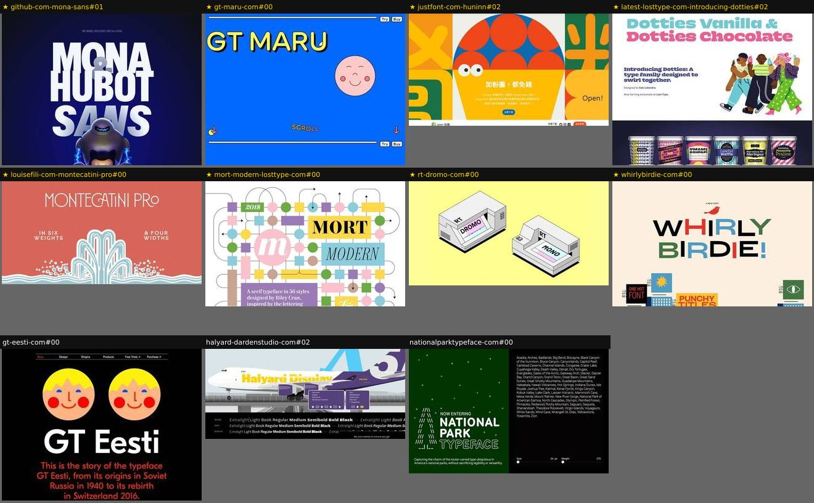

| example | look | feel | ux | learn |
|---|---|---|---|---|
| [★ github-com-mona-sans#01](../../archive/github-com-mona-sans/blocks/01.jpg) | Deep navy radial glow with the curve of a dark planet at the bottom; a tiny condensed kicker 'TWO VARIABLE, OPEN SOURCE FONTS from GITHUB'; a huge white stacked wordmark 'MONA / & / HUBOT / SANS' in four different widths, weights and slants; a glossy 3D render of the robot Hubot holding the octocat Mona, who holds a glowing 'T' font file, overlapping the last word; under it, 'Two files. / Thousands of variations. / Infinite possibilities.' in thin grey-lilac type | Cinematic, toy-like, grand | No buttons in the first screen; the mascots build in as the page scrolls (js-build-in-trigger) and the tagline's letters are split into spans for a per-character build-in | Make the wordmark itself the range demo: each line of the stacked name uses a different family, width, weight and slant (font-stretch 83%, extra-condensed, italic heavy), so the logo shows the design space |
| [★ gt-maru-com#00](../../archive/gt-maru-com/blocks/00.jpg) | Electric-blue sky, 'GT MARU' top-left in yellow with a black offset outline, a big pink round sun face with red cheeks on the right, white outlined clouds, and an orange 'SCROLL' between two down arrows at the bottom; a thin white progress-bar nav with 'Try' and 'Buy' pills at the top | Sunny, toy-like, welcoming | While the page loads, the sun sleeps (yawns, 'zz') and the nav tabs fill like a loading bar; once loaded it wakes and smiles. Scrolling snaps through steps in which clouds drift past and the sun reacts (surprised, curious) to the intro text | Use the loader as part of the hero story (the mascot sleeps while loading and wakes up when ready), so waiting feels like the opening scene |
| [★ justfont-com-huninn#02](../../archive/justfont-com-huninn/blocks/02.jpg) | Full-screen flat geometric poster: a yellow bubble-tea cup with googly eyes in the centre, topped by a dome of red tapioca 'pearls' on blue; side panels of giant cropped Chinese glyphs in orange, green and yellow, one tile reading 'Open!'; white title '加粉圓，都免錢' and a blue '免費下載' pill on the cup | Joyful, snack-like, warm | An intro build animation (~3s): coloured panels appear, the cup and pearls pop in, the eyes open, then the side glyphs slide in; one download CTA | Turn the font's name into the illustration (粉圓 = tapioca pearls): the cup and pearls are made of the same round shapes as the font's terminals |
| [★ latest-losttype-com-introducing-dotties#02](../../archive/latest-losttype-com-introducing-dotties/blocks/02.jpg) | On white, 'Dotties Vanilla &' in teal over 'Dotties Chocolate' in pink, both heavy and wide; below, 'Introducing Dotties: A type family designed to swirl together.' in navy slab at left and three illustrated friends strolling with ice-cream cones at right | Sunny, friendly, summery | static; foundry nav above | Give each subfamily a flavour and a colour (Vanilla = teal, Chocolate = pink) and keep that code for the whole page |
| [★ louisefili-com-montecatini-pro#00](../../archive/louisefili-com-montecatini-pro/blocks/00.jpg) | Coral-red field with 'MONTECATINI PRO' in white at ~137px, two small tracked captions 'IN SIX WEIGHTS' / '& FOUR WIDTHS' left and right, and a stylised pale-blue Liberty-style fountain with wavy water bands rising from the bottom edge | Sunny, nostalgic, poster-like | static; no site nav visible in the capture | A single period-correct illustration (a spa fountain) placed under the name makes the hero read as a Stile Liberty travel poster, so the historical reference is felt before it is explained |
| [★ mort-modern-losttype-com#00](../../archive/mort-modern-losttype-com/blocks/00.jpg) | A white field covered by a 'circuit board' of pastel squares, circles and bars joined by thin black lines and arrows, with 'MORT' (black caps on yellow), 'MODERN' (thin italic caps on blue), a pink disc with an italic 'm', a green '2018' tag and a purple box 'A serif typeface in 56 styles designed by Riley Cran…'. A line leads on to 'This is the story of a typeface.' and angled cut-out panels: a caricature 'This is Mortimer Leach.', 'Mortimer was a lettering artist.', a photo 'This is Riley Cran.', 'Riley is a type designer.', then a yellow banner 'This is Mort Modern' and a pitch sentence that mixes widths, weights and italics | Cheerful, nostalgic, narrative | On load the header boxes appear empty and their lettering fades in; scrolling follows the connecting line through the comic panels to a blue 'Get Mort Modern' pill (links to Lost Type). No nav bar | Introduce the font as the meeting of two people (the inspiring lettering artist and the designer) in captioned comic panels: the first screens tell the origin before any specimen |
| [★ rt-dromo-com#00](../../archive/rt-dromo-com/blocks/00.jpg) | Pale yellow field with two isometric line-drawn ticket machines, printing cards labelled DROMO and MONO | An office gadget from 1985, drawn by a Swiss engineer | Muted looping video; the two machines swap ticket labels and colours | Illustrate the source technology, not the letters: a ticket printer tells you the origin in one image and shows both subfamilies as its output |
| [★ whirlybirdie-com#00](../../archive/whirlybirdie-com/blocks/00.jpg) | On warm off-white, 'WHIRLY BIRDIE!' in a wide heavy cut with letters coloured black, red, blue and green, a red bird glyph perched above 'A NEW FONT!', and a flat illustrated city below: blue tower blocks holding signs ('ONE HOT FONT', 'PUNCHY TITLES', an animated sun and eye), a street with trees, a snail and a car | Sunny, toy-like, 1950s ad | Name letters bob alternately up and down; Whirlybats signs animate; a round icon button top-left opens the section menu; custom glyph cursor | Build the hero illustration from the dingbat companion font itself (sun, eye, car, snail are glyphs), so the scene is also a specimen of the second font |
| [gt-eesti-com#00](../../archive/gt-eesti-com/blocks/00.jpg) | Two round smiling blond children's faces (flat yellow hair, red cheeks) side by side on black, 'GT Eesti' in large white letters beneath, and a red four-line subtitle 'This is the story of the typeface GT Eesti, from its origins in Soviet Russia in 1940 to its rebirth in Switzerland 2016.' | Friendly, toy-like, a book cover | A ruled tab bar sits above the faces (Story in red as the current page, Design, Origins, Products, Free Trials ↗, Purchase ↗). The faces are looping videos | Use characters drawn in the style of the source material (Estonian children's books) as the mascots of the whole site |
| [halyard-dardenstudio-com#02](../../archive/halyard-dardenstudio-com/blocks/02.jpg) | Flat vector scene of a white cargo jet with a purple tail on a motorway overpass, 'Halyard Display' in yellow Black across its fuselage, two purple German autobahn signs (Hannover, Kassel, Dortmund… / Köln, Wiesbaden, München) set in Halyard, giant cyan and purple outlined letter shapes behind | Industrial, transport-signage, optimistic | The fuselage title is editable (type to repaint the livery); a 'Play with the type' corner button opens a panel; Buy sits in the sticky bar above | Make the hero's brand name an editable text field inside the illustration, so the first thing a visitor can do is see their own word on the plane |
| [nationalparktypeface-com#00](../../archive/nationalparktypeface-com/blocks/00.jpg) | Left half: a forest-green night sky of ASCII stars (+ * ^ o ,) over an ASCII-line arrowhead/tree emblem and the lockup 'NOW ENTERING / NATIONAL PARK / TYPEFACE' (solid caps, the last word in outline), with a one-sentence tagline below; right half: the black fixed tester listing park names | Arriving at a park gate at night; campfire-geeky | No nav; the tester sliders on the right are usable from the first screen; a lime download bar follows directly | Borrow the real-world sign formula ('Now entering …') for the lockup and draw the scenery in ASCII characters: the theme and the digital/router origin are both stated before any copy |

## product-landing

The software-product landing pattern: headline, tagline, paragraph, primary and secondary buttons.

**Recognise by:** SaaS layout, 'Try it now' and 'GitHub' buttons, common for coding fonts

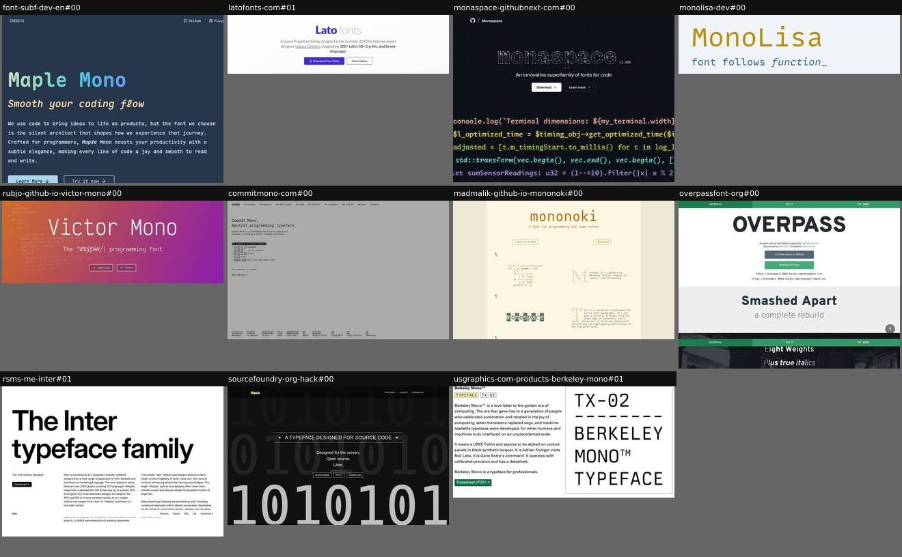

| example | look | feel | ux | learn |
|---|---|---|---|---|
| [font-subf-dev-en#00](../../archive/font-subf-dev-en/blocks/00.jpg) | Left-aligned in a 896px column on slate navy: 'Maple Mono' at ~80px bold with a mint-to-sky-blue gradient, 'Smooth your coding flow' in peach cursive italic below, a 5-line paragraph (with 'Maple Mono' in bold italic inline), then a filled light-blue 'Learn More ↓' and an outlined 'Try it now →' button | Warm, approachable dev tool | The title is drawn first as an outline (SVG stroke) and then filled, and keeps cycling between outline and fill (storyboard t≈0.9–2.2s); Learn More scrolls to #why, Try it now opens the playground | Use the cursive italic for the slogan right under the upright name: the font's signature feature is the first thing read |
| [latofonts-com#01](../../archive/latofonts-com/blocks/01.jpg) | Centred lockup 'Lato' in purple Black beside 'fonts' in grey Hairline at 72px, a three-line description and two buttons on a faint white-to-grey gradient | Tidy, utilitarian, like a software project page | Primary 'Download Free Fonts' and outlined 'View Gallery'; both go to subpages | A two-word lockup that sets the heaviest and lightest weight side by side shows the family's full range before any specimen, using only the name |
| [monaspace-githubnext-com#00](../../archive/monaspace-githubnext-com/blocks/00.jpg) | Near-black field with a faint dot grid; 'monaspace' as a white outline wordmark showing its Bézier points, a small 'v1.400' tag, the tagline 'An innovative superfamily of fonts for code', white 'Download ›' and ghost 'Learn more ›' buttons, then five full-width lines of real code, each in another family and accent colour, bleeding off the edges | Slick, product-launch, nerdy | Static GitHub sub-brand bar ('GitHub / Monaspace'); the code lines are clickable (cursor-pointer) and pick the active family, which also drives the wordmark's font; lines alternate left- and right-aligned so they crop on opposite sides | Let the hero's code lines double as a family picker: each line is a sample in one member, and clicking it re-sets the wordmark |
| [monolisa-dev#00](../../archive/monolisa-dev/blocks/00.jpg) | 'MonoLisa' in gold at 144px and 'font follows function_' in blue below (with 'function' in the script italic and a blinking underscore cursor), a ~27px one-paragraph pitch, then a gold 'Get MonoLisa' button with 'or try in the tester' as an underlined link, all left-aligned on pale blue-grey | Polished, quiet, editor-like | The name and tagline type themselves on (CSS steps animation, cursor '_' blinks then stops); the button jumps to #buy; the link opens /tester | Type the wordmark and tagline on with a terminal cursor and switch the last word to the script italic: two features of a coding font shown before any copy |
| [rubjo-github-io-victor-mono#00](../../archive/rubjo-github-io-victor-mono/blocks/00.jpg) | Name 'Victor Mono' at ~141px centred over a slowly shifting diagonal gradient (orange → magenta → violet, later teal → green) with a faint video of code being typed behind it; tagline 'The ___| programming font' and two outlined buttons 'Download' and 'Share' | Warm, techy, a bit playful | The adjective in the tagline is typed and deleted in a loop in the cursive italic ('dashing', 'definite', 'delicate', '"#%§§##/'); Share opens a row of social icons; the fixed nav appears only after the hero | Type the swapping word of the tagline in the italic: the typing animation shows the special style before any specimen |
| [commitmono-com#00](../../archive/commitmono-com/blocks/00.jpg) | Section 01: 'Commit Mono. / Neutral programming typeface.' at 24px, one sentence of description, a black-on-white 'Use keyboard to control website' tag with a keycap list, and 'Next section →' | Deliberately unimpressive | The first thing taught is the shortcuts; there is no buy or download button | For a font selling neutrality, an anti-hero fits: replace the display moment with operating instructions |
| [madmalik-github-io-mononoki#00](../../archive/madmalik-github-io-mononoki/blocks/00.jpg) | Lowercase 'mononoki' in Solarized orange, centred at ~96px, an italic tagline 'a font for programming and code review' beneath, and two small outlined green buttons '→ View on GitHub' and '→ Download' far apart on one row | Quiet, warm, like a light editor theme | Buttons link to the GitHub repo and directly to the release ZIP | Borrow a well-known editor colour scheme (Solarized) for the whole page: coders recognise the setting their font will live in |
| [overpassfont-org#00](../../archive/overpassfont-org/blocks/00.jpg) | Centred 'OVERPASS' in Black caps on near-white, a two-line credit ('inspired by Highway Gothic. Sponsored by Red Hat — Created by Delve Fonts'), a slate 'Visit the source on GitHub' button, a green 'Desktop OTF Files' button and two monospaced CDN stylesheet URLs | Practical, developer-friendly, no-nonsense | Buttons go to the GitHub repo and a release zip; the CDN URLs are read-only inputs that select themselves on click for copy-paste | For an open-source family, put the embed URL right in the hero as a click-to-select field: the hero is also the install instructions |
| [rsms-me-inter#01](../../archive/rsms-me-inter/blocks/01.jpg) | White page: 'The Inter / typeface family' in two lines of tight bold display type (~180px), then an 8-column row: tagline 'The 21st century standard' with a small black 'Download ↓' pill, and two columns of small explanatory text with inline links ('2000 glyphs', '147 languages') | Calm, documentation-like, self-assured | One primary button (Download ↓ → /inter/download/); inline links jump to #glyphs, #languages and #features | For a utility family the hero can be a doc page header: name huge, one-line claim, one button, and the spec (glyph count, languages, weights, opsz) as linked facts |
| [sourcefoundry-org-hack#00](../../archive/sourcefoundry-org-hack/blocks/00.jpg) | Three rows of huge '1010101' in Hack, ghosted at the top and bright at the bottom, on near-black dotted texture, under a centred boxed tagline, three short lines and three outlined buttons | Terminal-like, cinematic but stock | Full-viewport slider: on load the digit background splits into curtain strips, then captions drop in one after another; a second slide ('By Devs, For Devs', in the DOM only) follows. Buttons LEARN MORE, TRY IT, DOWNLOAD | Binary digits are the perfect sample for a code font: the slashed-dotted zero against the 1 shows the font's key disambiguation at billboard size, and it needs no copy |
| [usgraphics-com-products-berkeley-mono#01](../../archive/usgraphics-com-products-berkeley-mono/blocks/01.jpg) | Catalogue-entry layout: left half has 'Berkeley Mono™' heading, a yellow SKU tag 'TYPEFACE' and an outlined 'TX-02' tag, three short manifesto paragraphs and a green 'Datasheet (PDF) →' button; right half is a bordered card reading 'TX-02 / -------- / BERKELEY / MONO™ / TYPEFACE' in the font | Spec sheet, deadpan, engineered | Only CTA is the PDF datasheet; purchase is far below | Present the font like an industrial part (SKU, model number, datasheet) instead of a creative product: the framing itself tells programmers it is a tool |

## interactive-specimen

The hero is a specimen the visitor manipulates straight away (axes, weight, contrast, text), via controls or the wheel.

**Recognise by:** sliders, toggles or editable text inside the first screen

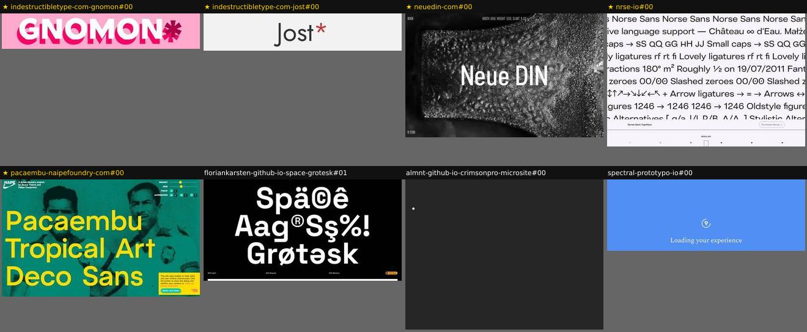

| example | look | feel | ux | learn |
|---|---|---|---|---|
| [★ indestructibletype-com-gnomon#00](../../archive/indestructibletype-com-gnomon/blocks/00.jpg) | On flat bubblegum pink: a tiny tracked white line 'THE INDESTRUCTIBLE TYPE* COMPANY PRESENTS', then 'GNOMON*' huge in white with a hot-magenta extruded shadow (dark-magenta asterisk), then two full-width sliders labelled 'Time of Day: 1:41' and 'Shadow Distance: 100%' and a white 'Download' between two thick white rules | Sunny, toy-like, poster-bold | The shadow is already set to the visitor's local time on load; dragging 'Time of Day' swings the shadow around the letters like a sundial, 'Shadow Distance' lengthens or shortens it; both readouts update live and the sliders also restyle every section heading on the page | Bind a custom axis to something real (the visitor's clock) and expose it as a slider: the font becomes a live object and the slider becomes an explanation |
| [★ indestructibletype-com-jost#00](../../archive/indestructibletype-com-jost/blocks/00.jpg) | 'Jost*' at 187px, charcoal with a red asterisk, on pale grey, above two long thin sliders labelled 'weight: book' and 'italic: 0%'. A small 'indestructible type*' link sits above it and was not cut as a block | Immediate, unpretentious | Drag the sliders to change the name's weight and slant; the labels update with style names and a percentage; the name itself can be retyped | Make the wordmark the tester: two sliders directly under a name, labelled in words instead of numbers, explain the variable axes in one gesture |
| [★ neuedin-com#00](../../archive/neuedin-com/blocks/00.jpg) | Full-screen grainy black-and-white macro footage of a cast letter's surface, 'Neue DIN' in white at ~200px in the centre, a tiny condensed readout 'WIDTH: 088, WEIGHT: 500, SLANT: 0.00' top-centre and rotated corner links FONTWERK, TRY, PDF SPECIMEN, BUY | Engineered, material, a little cinematic | Moving the mouse anywhere on the page changes the name's width, weight and slant and updates the readout; the name is editable; on phones a 'Request orientation permission' overlay lets device tilt drive the axes | Echo the live axis values in a small readout above the name: a pointer-driven hero then explains itself without sliders |
| [★ nrse-io#00](../../archive/nrse-io/blocks/00.jpg) | Nine full-bleed lines of repeating text at 60px, each demonstrating one OpenType feature (small caps → SS QQ GG, ligatures, fractions, slashed zero, arrow ligatures, oldstyle figures, stylistic alternates), cropped by both edges, above a small dotted weight slider with a 'REGULAR' label | A datasheet turned into a wall of type | The lines fade in one by one and drift sideways; dragging the single slider handle steps the whole wall through the weights, and the label above the handle names the current one | Make the hero sentence wall a feature inventory, each line repeating one feature, so one weight slider tests every feature at once |
| [★ pacaembu-naipefoundry-com#00](../../archive/pacaembu-naipefoundry-com/blocks/00.jpg) | Duotone teal halftone photo of two 1940s footballers, 'Pacaembu Tropical Art Deco Sans' in yellow at ~187px over three lines; NAIPE logo and credit top-left, a compact control panel top-right (WEIGHT and SIZE sliders with yellow knobs, ITALIC i/𝑖 toggle, ALTERNATES a/ɑ, 1/1, ?/? toggles). A yellow cookie banner covers the bottom-right corner | Warm, nostalgic, confident | The headline is contenteditable; the sliders set font-weight 100–900 and font-size 1–30vw (default 13vw), and each two-state toggle flips italic, ss01 (single-storey a), proportional numerals or ss02 (alternate ?); the toggles preview their two states as tiny glyph chips | Make the tagline the tester: a small control cluster in the corner turns the hero into a playground without leaving the first screen, and glyph chips ('a | ɑ') show what each toggle does before you press it |
| ★ liebling-fontef-com#03 | Fixed full-screen white stage (no crop; seen in the video and HTML) with eleven giant Hebrew and Latin letters (A, ת, R, V, ש, ב, פ, O, ח…) in red, blue, yellow, grey, black and outline, each at a random size, weight, alternate and rotation, overlapping like a 1930s poster; the name 'ליבלינג' with a one-line description and a ↓ arrow at the right edge; a round Fontef 'פ' logo fixed top-right | Energetic, modernist, toy-like | Letters can be dragged anywhere; each letter has five hidden controllers (alternate, weight, size, rotation, colour) that cycle its classes; the composition reshuffles itself repeatedly in the video until the visitor scrolls on | Randomise style, weight, size, rotation and colour per letter from a fixed set of classes: a few big draggable glyphs make an endless series of constructivist posters |
| [floriankarsten-github-io-space-grotesk#01](../../archive/floriankarsten-github-io-space-grotesk/blocks/01.jpg) | On black, three centred lines of white Bold 'Spä©ê / Aag®Sş%! / Grøtəsk' (diacritics, ®, ©, ə and an ss02 g) at ~218px, with a row of four small labels along the bottom, '300 Light', '400 Regular', '500 Medium' and an orange pill '700 Bold' (active) | Confident, nerdy, poster-like | Click a weight label to restyle the specimen (data-weight → font-weight); the active label becomes an orange pill | A glyph-salad headline (accents, symbols, alternates) plus a four-pill weight switch shows character and range in one screen with almost no UI |
| [almnt-github-io-crimsonpro-microsite#00](../../archive/almnt-github-io-crimsonpro-microsite/blocks/00.jpg) | Captured as an empty dark-grey screen with a single white dot (a slider thumb); the HTML holds a CSS 3D book: front cover 'Crimson Pro / is a variable font / for book and digital production…', spine 'Crimson Pro' and back cover 'Additional Credits' (Google: Dave Crossland, Irin Kim, Paula Ashton; site: Amélie Lamont) | Intimate, bookish (intended) | A range input (wght 200–900, default 200) beside the book likely changes the cover's weight and/or turns the book; nothing rendered in headless capture | Open a specimen with the font as a physical book object: the cover, spine and back carry the intro and credits |
| [spectral-prototypo-io#00](../../archive/spectral-prototypo-io/blocks/00.jpg) | Not visible in the capture (loader over everything). From HTML: first row is an 8/12 description tile at ~35px beside a 4/12 stack of small tiles (a 'Discover Spectral…' tile with Thickness arrows, prototypo.io URL tile, Production Type tile, share tiles); second row is a full-width tile with 'Spectral' at ~288px and a 'Try Spectral in prototypo' link | Tool demo, a tiled dashboard | Left and right arrows at the edge of the big word's tile show that moving the pointer across it changes Aperture; a tooltip legend names the parameter | Make the name itself the first control, with arrows inside the tile saying the whole box responds |

## name-over-photo

Name and a short line over a full-bleed mood photograph.

**Recognise by:** landscape or scene photo, type overlaid

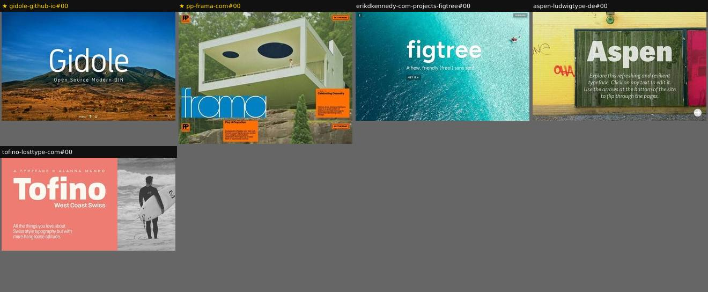

| example | look | feel | ux | learn |
|---|---|---|---|---|
| [★ gidole-github-io#00](../../archive/gidole-github-io/blocks/00.jpg) | Full-screen photo of Mount Gidole (blue sky over an ochre savanna) with 'Gidole' centred in white at 270px and 'Open Source Modern DIN' letterspaced below; 'menu ↑ ↓' bottom centre and '1/6' bottom right | Quiet, open-air, personal | Scroll (or the ↓ arrow) fades the title out over the first 300px while the photo blurs to 20px and saturates; the blurred photo stays as the backdrop of every following slide | Use one place photo as a persistent backdrop and blur it after the title: the hero becomes the stage for the whole deck, and the white type stays legible on top |
| [★ pp-frama-com#00](../../archive/pp-frama-com/blocks/00.jpg) | A full-bleed photo of a white cantilevered modernist house with oval cut-outs above rocks and lawn; a blue box holds a hairline 'frama' wordmark at left, and two orange info cards ('Celebrating Geometry', 'Beneath Its Apparent Simplicity Lies a Careful Play of Proportion') float over the picture | Calm, architectural, retro-modern | The photo is cut into depth layers (house, trees, rocks, lawn) that move at different speeds as you scroll, and the cards slide over them; the fixed orange 'PP foundry' logo and 'GET THE FONT' button sit at the corners | Pick a building whose geometry rhymes with the letterforms (ovals, slabs) and set the name in the thinnest weight: the photo argues 'geometric' before any copy |
| [erikdkennedy-com-projects-figtree#00](../../archive/erikdkennedy-com-projects-figtree/blocks/00.jpg) | Full-screen aerial photo of turquoise sea with a tiny sailboat; 'figtree' in white at ~200px Bold, 'A new, friendly (free!) sans serif' under it and a small dark 'GET IT ↓' button | Holiday-light, optimistic | Button jumps to #download; fixed 'E' logo top-left and grey DOWNLOAD button top-right stay on screen | A calm, wordless photo plus a three-word promise ('friendly, free') is enough for a free UI font |
| [aspen-ludwigtype-de#00](../../archive/aspen-ludwigtype-de/blocks/00.jpg) | Full-bleed photo of a yellow wall with a birch-forest mural door; 'Aspen' in Black on the door and four lines of italic text aligned to the door panel | Street-found signage | The copy tells you what to do: click text to edit, use arrows to flip; a right arrow sits bottom-right | Choose a photo with a flat framed area, and place the type in it so it looks painted on the scene |
| [tofino-losttype-com#00](../../archive/tofino-losttype-com/blocks/00.jpg) | Split screen: a coral panel (two thirds) with 'A TYPEFACE ♡ ALANNA MUNRO' in tracked caps, a huge cream 'Tofino', 'West Coast Swiss' under it and a three-line tagline; a black-and-white photo of a surfer carrying a board into the waves fills the right third | Relaxed, sunny, confident | static; no nav or buy button in the first screen (the photo is hidden on small screens) | Pair a heavy display name with a mood photo of the place it is named after: the subtitle ('West Coast Swiss') and the image explain the concept together |

## material-photo

A photograph of physical material (paper, textile, objects) carrying or framing the type.

**Recognise by:** tactile still life, the type printed or knitted on the material

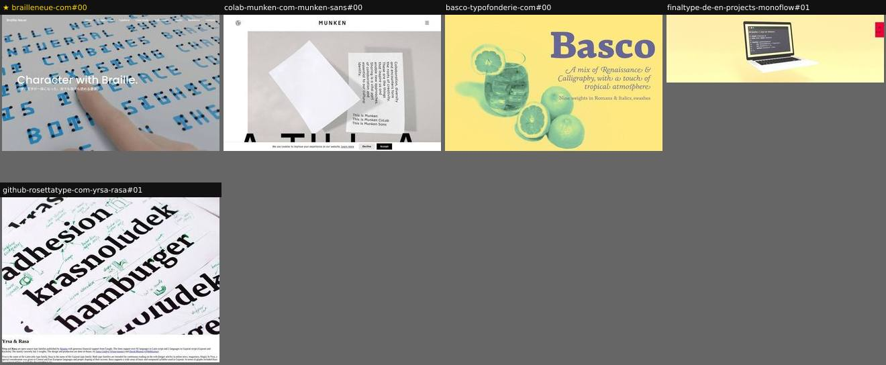

| example | look | feel | ux | learn |
|---|---|---|---|---|
| [★ brailleneue-com#00](../../archive/brailleneue-com/blocks/00.jpg) | Full-screen photo, darkened to 70%, of a white surface printed with blue Braille Neue words with raised black dots, a fingertip touching them; 'Character with Braille.' in white Poppins at 72px left of centre with the Japanese line '点字と文字が一体になった、目でも指でも読める書体。' under it; a transparent top bar with 'Braille Neue' and 8 anchor links | Gentle, tactile, hopeful | Anchor nav to About, Project Movie, Typeface, Case Study, Collaborator, Media, Reference, Contact; headline fades in after load | For a tactile typeface, the hero photo should show a hand reading it: the image explains 'readable by eye and by finger' before any copy |
| [colab-munken-com-munken-sans#00](../../archive/colab-munken-com-munken-sans/blocks/00.jpg) | Full-screen grey paper still life: a blank white sheet tilted over a printed sheet with a rotated manifesto and 'This is Munken / CoLab / Sans'; the giant 'A TILL Ö' peeks up from below the fold. A cookie bar covers the bottom of the capture | Quiet, material, considered | No CTA. The sheets are rendered in a WebGL canvas that fades in on load (blank until t≈1.5s, then settles); scrolling leaves it behind | For a paper brand, render the hero as lit paper with real shadows and displacement: the font's first appearance is as ink on the client's product |
| [basco-typofonderie-com#00](../../archive/basco-typofonderie-com/blocks/00.jpg) | Butter-yellow screen with a cut-out mint-duotone photo of a citrus drink and fruit at left; 'Basco' in heavy lavender, swash-italic tagline and a small style note right-aligned | Printed menu from a beach bar | A 'Basco…' loader fattens from Thin to Bold for ~4s, then the hero fades in | One duotone cut-out in the palette's second colour on a flat field gives a whole theme with no type effects |
| [finaltype-de-en-projects-monoflow#01](../../archive/finaltype-de-en-projects-monoflow/blocks/01.jpg) | A full-width pale-yellow band with a rendered white laptop floating at an angle, its screen showing a dark code editor set in Monoflow ('# Monoflow // enjoy the difference', 'import finaltype.de'); below on warm beige the title 'Monoflow' (~125px), an italic byline, a four-line intro in Monoflow and a small black 'Get the regular weight for free via Fontspring →' button (title area never cut as a block, attached to 01) | Calm, friendly, tech-product | The 3D laptop video plays once on load (the laptop flies in and opens; at the end it closes flat); the button links out to Fontspring for the free Regular | Put the coding font where it will live: a rendered laptop screen with real-looking code says 'for programmers' before any copy |
| [github-rosettatype-com-yrsa-rasa#01](../../archive/github-rosettatype-com-yrsa-rasa/blocks/01.jpg) | Full-width photo of printed test sheets lying at an angle: huge bold Yrsa words ('adhesion', 'krasnoludek', 'hamburger') covered with green handwritten correction notes, arrows and redrawn letters | Hands-on, scholarly, in progress | static image; no name or text over it | Open with annotated proofs: the corrections prove the craft and show the type at display size at the same time |

## prop-collage

A collage of designed artefacts (documents, tickets, packaging, diagrams) set in the font, implying a fictional world.

**Recognise by:** many small designed objects, all set in the font

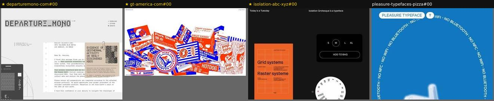

| example | look | feel | ux | learn |
|---|---|---|---|---|
| [★ departuremono-com#00](../../archive/departuremono-com/blocks/00.jpg) | Top-left wordmark 'DEPARTURƎ_MOƝO' in pixel caps on a grey selection-like bar with a tiny 'v1.500'; top-right '↓ DOWNLOAD / > GITHUB / ♥ DONATE'; below, a collage of mission paperwork: a Mercury Research Labs letter to 'Dr. Kerning' with sage-highlighted lines, a tan 'EVIDENCE OF GEOTHERMAL ACTIVITY ON NEWLY DISCOVERED KBOS' clipping with a QR-like pixel block and paperclip, a dark access badge '2 0 7 … E. Kerning', a line-drawn highlighter and planet construction circles | Cinematic, nerdy, quietly funny | Loader shows a grey bar, then the title appears and glitches letters into look-alikes (E→Ǝ/3, N→Ɲ, O→0); collage pieces shift with scroll; side caption '░ DEPARTURE MONO IS A MONOSPACED PIXEL FONT WITH A LO-FI TECHNICAL VIBE' | Glitch the wordmark between look-alike glyphs of the font itself: the name animates without any extra artwork |
| [★ gt-america-com#00](../../archive/gt-america-com/blocks/00.jpg) | Pile of flat-illustrated snack boxes, cans and badges in red-orange and electric blue on white, every label set in GT America in many scripts | Cheerful, nostalgic, international | Fixed corner links: name top-left, '↓ Type Tester' top-right, chapter index and '↑ Trials ↗ Buy' bottom-left | Invent a product universe (snack brands) and letter every package in a different script: the hero proves multi-script coverage before any copy |
| [★ isolation-abc-xyz#00](../../archive/isolation-abc-xyz/blocks/00.jpg) | Near-black page with two small white lines at the top ('Today is a Tuesday' left, 'Isolation Grotesque is a typeface' at centre) and a staggered two-column scatter of objects set in the font: an orange 'Grid systems / Raster systeme' book cover, a black shop widget (S M L XL, ADD TO BAG), a camera shutter dial, a 'Times Sq–42 St Station' subway sign, a 'Similar Times' T-shirt, a keyboard and a 'SERIFEN? NEIN DANKE' sticker | Dry, witty, insider design culture | No nav and no big name: the weekday is filled in live by JavaScript (a lockdown joke); props are images with Readymag hover animations; the scatter runs ~2.5 screens before the intro paragraph | Let the hero be a scatter of familiar design objects (Müller-Brockmann cover, subway sign, shop UI) re-set in the font, each a joke about where a grotesque usually lives; a live 'Today is a <weekday>' line adds a human touch for free |
| [pleasure-typefaces-pizza#00](../../archive/pleasure-typefaces-pizza/blocks/00.jpg) | Left half: a glowing duotone photo of a silver flip phone inside a ring of small caps 'NO BLUETOOTH · NO NFC · NO WIFI' on blue; right half (fixed column, seen in the video): the colophon flyer 'PLEASURE TYPEFACE / DESIGNED IN MARSEILLE BY FLIRT(STUDIO) / DEVELOPPED IN PARIS BY PIZZA TYPEFACES / ©2021' with recycle, CC and '1' icons; white pills 'PLEASURE TYPEFACE ?' top-left and 'buy now' top-right | Nostalgic, tongue-in-cheek, glossy | Scrolling moves the two halves in opposite directions at once | Pick a lost everyday object (the dumb phone) as the font's world: its slogans (NO WIFI, PREPAID SIM) give every specimen its copy |

## construction-drawing

A glyph shown as its construction (Bézier points, skeleton, strokes), often drawn on.

**Recognise by:** outline points, handles, metric lines in the hero

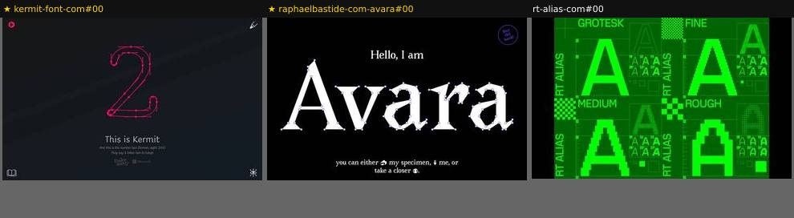

| example | look | feel | ux | learn |
|---|---|---|---|---|
| [★ kermit-font-com#00](../../archive/kermit-font-com/blocks/00.jpg) | Dark blue-grey screen with soft diagonal light streaks; one big glyph (a '2', on other loads a 'K' or '&') drawn as a hot-pink outline with Bézier points and handles, captioned 'This is Kermit / And this is the number two (Roman, wght 266) / They say it takes two to tango' above small Underware and Microsoft logos | Calm and wondrous, like watching a pen write in the dark | The outline draws itself stroke by stroke after a ~4s load (storyboard: partial '2' at 4.7s, complete by 7.9s); a hidden '▶write' button and a 0–1000 slider (#splashSlider) replay and scrub the writing; the glyph and its caption are picked at random per visit | Introduce a time-based font by letting the hero glyph write itself as an outline with its points visible: the mechanism is the message |
| [★ raphaelbastide-com-avara#00](../../archive/raphaelbastide-com-avara/blocks/00.jpg) | Black screen: 'Hello, I am' in small white serif, then 'Avara' as a huge white SVG outline (~1290px wide) with a small white square handle stroked in violet at every point, showing that the font has only straight segments; a violet outlined circle 'Buy the book!' badge in the top-right corner | Charming, transparent, hacker-craft | The headline talks in the first person; the letterforms are an inline SVG of the glyph paths built with Snap.svg, so the points are scriptable (probably draggable, not confirmed in the capture); a white screen shows for ~1.5s before the page appears | For a font whose idea is its construction (no curves), draw the name as its outline with point handles: the concept is understood before reading a word |
| [rt-alias-com#00](../../archive/rt-alias-com/blocks/00.jpg) | A green-on-green specimen sheet in four quadrants (GROTESK, FINE, MEDIUM, ROUGH): each a huge bright-green 'A' on metric guide lines, a vertical 'RT ALIAS' label, an outlined 'A' showing its pixel grid, a 3×2 key of small A's (Light/Regular/Bold, roman/oblique) and checkerboard swatches of the pixel size | Technical, CRT-like, systematic | static image | Introduce a pixel system by putting the same letter in every subfamily side by side, each with its own grid: the range and the logic in one frame |

## mini-game

The hero is a small playable game built from the page's own elements (e.g. Pong); collisions or score change the name's axes, CTAs can be game pieces.

**Recognise by:** ball, paddles, score in the first screen

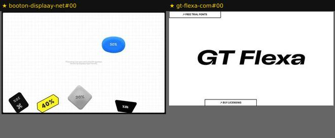

| example | look | feel | ux | learn |
|---|---|---|---|---|
| [★ booton-displaay-net#00](../../archive/booton-displaay-net/blocks/00.jpg) | A white graph-paper field inside a thin dark viewport frame with rounded inner corners; a tiny grey centred line 'Presenting new sans-serif uniwidth typeface Booton by Displaay Type Foundry'; glossy 3D-looking UI buttons and tags (black trapezoid '10%', black key '⌘ 20%', grey squircle '30%', yellow hexagon '40%', blue pill '50%', yellow oval '60%', emoji chip '70%', red bar '90%', pink pill '100%') falling and piling up at the bottom | Tactile, gamified, sale-sticker humour | Tetris-like: pieces drop one by one; move them with the mouse or ←/→ keys, rotate with a click or the spacebar; fill the screen to the top to reveal a 15% discount; idle, the pile collapses and restarts | Turn the font's natural use (UI buttons, price tags) into the game pieces, and make the reward a real discount: playing becomes buying |
| [★ gt-flexa-com#00](../../archive/gt-flexa-com/blocks/00.jpg) | White screen, 'GT Flexa' in black at the centre (captured wide, bold and italic), an outlined '↗ FREE TRIAL FONTS' box on the top edge, an outlined '↗ BUY LICENSING' box on the bottom edge, and a small yellow ball | Cheeky, arcade-like, surprising | The two CTA buttons are Pong paddles sliding along the top and bottom edges; the yellow ball bounces between them, and each hit on the name changes its width, weight and italic (frames show it condensed upright, wide roman, wide italic). The paddles stay clickable links | Turn the obligatory buy/trial buttons into game pieces: the CTA is the first thing visitors play with, and every bounce shows a new point in the design space |

## glyph-grid-sampler

A small name over a large grid of characters from every covered script, often on writing-practice guide cells.

**Recognise by:** grid of CJK/Latin characters in guide cells

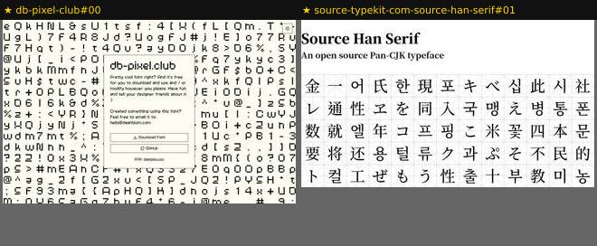

| example | look | feel | ux | learn |
|---|---|---|---|---|
| [★ db-pixel-club#00](../../archive/db-pixel-club/blocks/00.jpg) | Cream page filled edge to edge with a monospaced grid of random pixel characters (letters, digits, punctuation) in near-black, with one small cream card centred on top carrying the name 'db-pixel.club' | Terminal-like, playful, low-key | Nothing to scroll; characters in the grid re-roll at random so the background shimmers; a fixed square sun/moon button top-right flips light/dark (persisted in localStorage, defaults to the system theme) | For a single-style display font, a field of the font's own random characters is both the texture and the character-set preview; let a few cells change at a time so it feels alive without distracting |
| [★ source-typekit-com-source-han-serif#01](../../archive/source-typekit-com-source-han-serif/blocks/01.jpg) | White page: 'Source Han Serif' in bold serif and 'An open source Pan-CJK typeface' below it, then a 5-row grid of characters mixing Traditional Chinese, Simplified Chinese, Japanese kana and Korean hangul (社 시 此 십 べ キ 포 現 …), each in a square cell with faint diagonal and centre guide lines like a calligraphy practice sheet; the grid bleeds off the left edge | Orderly, literary, inclusive | A short loader first (a boxed '源' turning like a cube, ~1s); then static; section jumps via the fixed STORY / TEAM / FONTS tabs | Interleave the scripts cell by cell instead of grouping them: one grid says 'four languages, one design' before any text, and the 米字格 guide lines frame them in a shared tradition |

## click-to-stamp

An almost empty first screen; each click drops a word or phrase in the font at the pointer with randomised style or axis values, so the visitor composes the hero.

**Recognise by:** “click anywhere” prompt, scattered stamped words

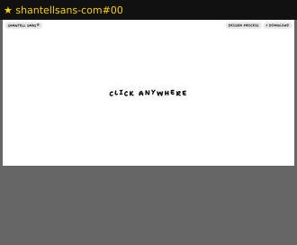

| example | look | feel | ux | learn |
|---|---|---|---|---|
| [★ shantellsans-com#00](../../archive/shantellsans-com/blocks/00.jpg) | A blank white screen (~80vh) with only 'CLICK ANYWHERE' in small bold bouncy caps at the centre and the fixed pill nav in the corners | Open, a blank sheet waiting for marks | Clicking (or tapping: the hint switches to 'TAP ANYWHERE' on touch) places one of Shantell Martin's 'May you…' phrases at the pointer, in varying weight, italic, informality and bounce, with a wobble animation; the hint disappears once the wall fills | Let the first interaction be a single click on empty space: the visitor makes the specimen, which suits a font born from an artist drawing on walls |

## strip-mixer

A typeset page cut into headline, deck and body strips, each its own carousel of styles cycling on its own timer and swipeable, so the page keeps recombining.

**Recognise by:** horizontal strips sliding independently

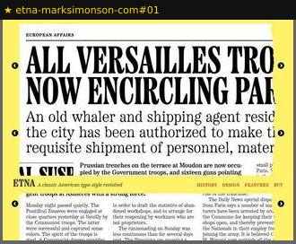

| example | look | feel | ux | learn |
|---|---|---|---|---|
| [★ etna-marksimonson-com#01](../../archive/etna-marksimonson-com/blocks/01.jpg) | On a lemon-yellow field, a white newspaper page ('EUROPEAN AFFAIRS · ALL VERSAILLES TROOPS NOW ENCIRCLING PARIS') bleeding off its right edge, cut into three strips with black round arrow buttons at both ends of each strip | Period-authentic, witty, tactile like flipping cards | The headline, deck and body strips each autoplay on their own timer (5.3s, 3.6s, 4.2s) and slide sideways to a version in another width or style; visitors can drag/swipe a strip or click its ← → arrows, so headline, deck and body recombine independently | Cut a typeset page into independent strips: each strip cycles through the family's widths, and the page never shows the same combination twice, showing how the widths pair up in a hierarchy |

## word-slideshow

An auto-advancing slideshow of pre-set display compositions (a place name, the family name in each weight with labels, a short phrase) in a full-width banner, one word or lockup per slide, usually above a facts panel; the hero is a sequence of words rather than one wordmark

**Recognise by:** auto-advancing display words in a banner

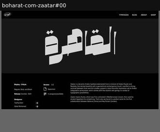

| example | look | feel | ux | learn |
|---|---|---|---|---|
| [boharat-com-zaatar#00](../../archive/boharat-com-zaatar/blocks/00.jpg) | A charcoal banner across the top of the page with one huge light-grey Arabic word per slide: 'القاهرة' (Cairo) in the capture; other slides show 'زعتر' three times with green oval stamps 'ZAATAR BLACK' / 'ZAATAR REGULAR', and 'لحظة نحن هنا؟' in white over green | Punchy, poster-like, local | Slides cross-fade/slide automatically (13 slides, '3 / 13' counter in the DOM); no visible controls; nav fixed above | Rotate a few words with local meaning (a city, the name in each weight with a stamp label) instead of one fixed wordmark: the first screen shows range and place in a few seconds |
