# hero

_Section: Hero_

The above-the-fold first impression: what the visitor sees before scrolling.

Sample: 48 blocks from 47 sites.

| variant | n | definition | recognise by |
|---|---|---|---|
| [giant-wordmark](#giant-wordmark) | 8 | The family name set as large as the viewport allows on a flat field, little else; may mix styles letter by letter to show range. | one dominant name, flat colour, minimal copy |
| [kinetic-type](#kinetic-type) | 8 | The type in motion is the hero: animated, 3D, generative, video clips, or axes driven by scroll. | canvas/video/WebGL, scroll-scrubbed variation, the capture looks mid-animation |
| [sentence-as-specimen](#sentence-as-specimen) | 7 | A headline sentence about the font, set in the font (sometimes beside one oversized glyph or rotating through styles): the pitch is the specimen. | readable claim or announcement in display size, CTA nearby |
| [interactive-specimen](#interactive-specimen) | 5 | The hero is a specimen the visitor manipulates straight away (axes, weight, contrast, text), via controls or the wheel. | sliders, toggles or editable text inside the first screen |
| [typeset-page](#typeset-page) | 4 | A classical typeset composition (title page, broadside, dictionary entry) that uses the family's own hierarchy, italics and ornaments. | centred stacks, rules, ornaments, multiple sizes and italics |
| [name-over-photo](#name-over-photo) | 4 | Name and a short line over a full-bleed mood photograph. | landscape or scene photo, type overlaid |
| [product-landing](#product-landing) | 4 | The software-product landing pattern: headline, tagline, paragraph, primary and secondary buttons. | SaaS layout, 'Try it now' and 'GitHub' buttons, common for coding fonts |
| [construction-drawing](#construction-drawing) | 2 | A glyph shown as its construction (Bézier points, skeleton, strokes), often drawn on. | outline points, handles, metric lines in the hero |
| [material-photo](#material-photo) | 2 | A photograph of physical material (paper, textile, objects) carrying or framing the type. | tactile still life, the type printed or knitted on the material |
| [illustration-scene](#illustration-scene) | 2 | An illustrated scene or mascot staged with the type; the illustration sets the tone. | characters, faces, drawn objects |
| [prop-collage](#prop-collage) | 2 | A collage of designed artefacts (documents, tickets, packaging, diagrams) set in the font, implying a fictional world. | many small designed objects, all set in the font |

## Rubric

Recorded for every instance in Phase 3, in addition to the cross-cutting attributes in `rubric.json`:

- **carrier**: name | sentence | glyph | photo | illustration | props | motion | controls (what carries the first impression)
- **cta**: none | buy | try | download | scroll | multiple
- **rangeShown**: one-style | several | whole-family
- **navVisible**: true | false

## giant-wordmark

The family name set as large as the viewport allows on a flat field, little else; may mix styles letter by letter to show range.

**Recognise by:** one dominant name, flat colour, minimal copy

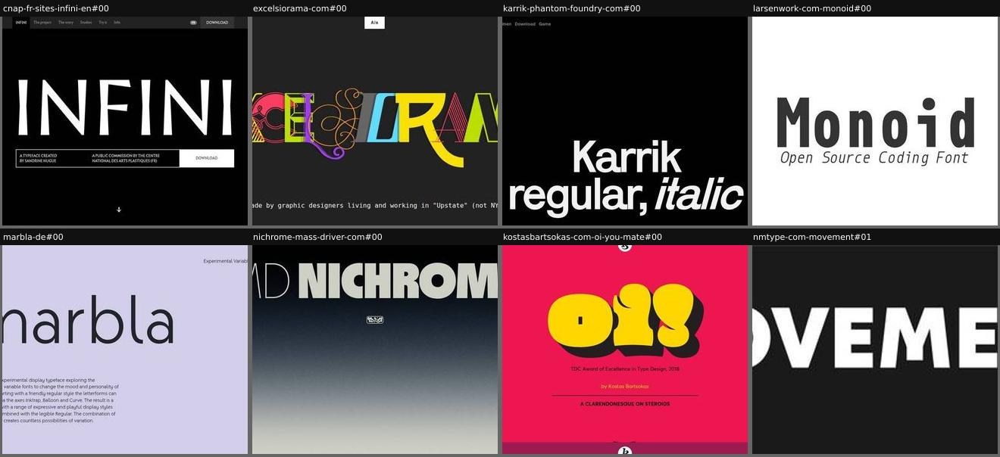

| example | look | feel | ux | learn |
|---|---|---|---|---|
| [cnap-fr-sites-infini-en#00](../../archive/cnap-fr-sites-infini-en/blocks/00.jpg) | White INFINI on black, full width; info bar with credits and a DOWNLOAD button; anchor nav | Monumental, institutional | Download CTA in the hero; anchor nav (project, story, studies, try it) | A credits strip under the wordmark (designer, commissioner) gives instant provenance |
| [excelsiorama-com#00](../../archive/excelsiorama-com/blocks/00.jpg) | Each letter of EXCELSIORAMA in a different style and colour on black | Playful, eclectic, vaudeville | A/a toggle top centre (case switch) | A wordmark that mixes the styles is a one-glance family overview |
| [karrik-phantom-foundry-com#00](../../archive/karrik-phantom-foundry-com/blocks/00.jpg) | White heavy grotesque on black, bottom-anchored, roman plus italic | Blunt, contemporary | static; tiny nav (Download, Game) | Naming the styles in the wordmark ('regular, italic') makes it informative as well as loud |
| [larsenwork-com-monoid#00](../../archive/larsenwork-com-monoid/blocks/00.jpg) | Black condensed mono name on white, italic tagline | Plain, utilitarian | static | The minimal baseline: name plus one line that says what it is |
| [marbla-de#00](../../archive/marbla-de/blocks/00.jpg) | Lavender field, thin rounded 'marbla' cropped off the left, short description | Soft, experimental | static (the wordmark likely animates through axes) | Cropping the wordmark off-canvas signals 'display face' and adds movement |
| [nichrome-mass-driver-com#00](../../archive/nichrome-mass-driver-com/blocks/00.jpg) | Full-width 'MD NICHROME' in hairline plus black weights, small foundry badge, black-to-grey grain gradient | Cool, metallic, restrained | static | Setting the prefix in the thinnest weight and the name in the heaviest shows the weight range inside the wordmark |
| [kostasbartsokas-com-oi-you-mate#00](../../archive/kostasbartsokas-com-oi-you-mate/blocks/00.jpg) | Hot pink, giant yellow 'oi!' with a black extruded shadow, small award line, 'A clarendonesque on steroids' | Loud, cheeky, punk | Mostly static; a '<|' button, probably opens the menu | A two-letter interjection as the wordmark shows a fat display face better than the full name would |
| [nmtype-com-movement#01](../../archive/nmtype-com-movement/blocks/01.jpg) | Near-black band, big white 'MOVEMENT' with sheared joins, tiny 'Variable font' and '→ Trial fonts' below | Bold, minimal | static; trial link | A cover band (name plus two tiny labels) works as a hero inside a foundry's specimen template |

## kinetic-type

The type in motion is the hero: animated, 3D, generative, video clips, or axes driven by scroll.

**Recognise by:** canvas/video/WebGL, scroll-scrubbed variation, the capture looks mid-animation

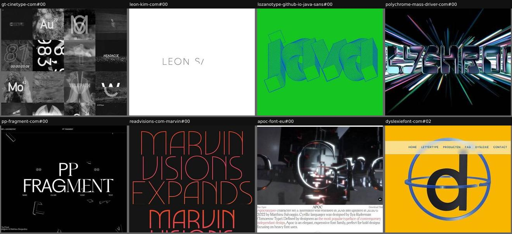

| example | look | feel | ux | learn |
|---|---|---|---|---|
| [gt-cinetype-com#00](../../archive/gt-cinetype-com/blocks/00.jpg) | Monochrome grid of film stills: numerals, timecodes, letters over smoke, clouds and light | Cinematic, moody | autoplaying video tiles | The type's origin (film subtitling) becomes the medium: the specimen is a film strip |
| [leon-kim-com#00](../../archive/leon-kim-com/blocks/00.jpg) | White, thin line letters 'LEON S' being drawn stroke by stroke | Delicate, technical, generative | Animated drawing in code (canvas) | A code-drawn font can show its own drawing process live |
| [lozanotype-github-io-java-sans#00](../../archive/lozanotype-github-io-java-sans/blocks/00.jpg) | Neon green, 3D extruded wireframe 'Java' in blue lines | Energetic, generative, retro-digital | Animated 3D extrusion | Extruding the letters in 3D shows off bold shapes even before any text |
| [polychrome-mass-driver-com#00](../../archive/polychrome-mass-driver-com/blocks/00.jpg) | Black, chrome-rendered 3D 'POLYCHROME' with iridescent hyperspace light streaks | Sci-fi, flashy, retro-futurist | Autoplaying muted video; static otherwise | A rendered 3D video of the wordmark sells a display face as an object, not just letters |
| [pp-fragment-com#00](../../archive/pp-fragment-com/blocks/00.jpg) | Black, centred white 'PP FRAGMENT' with SANS / GLARE / SERIF / TEXT labels under it, floating glass shards, 'Get the font' button | Elegant, cinematic | Letters roll slot-machine style through the sub-families; shards drift; sticky top bar | Rolling each letter through the sub-families shows the whole superfamily inside the name |
| [readvisions-com-marvin#00](../../archive/readvisions-com-marvin/blocks/00.jpg) | Black, uppercase art-deco sentence in a red-to-yellow gradient, going from hairline display to bold small text as words are added | Retro-futurist, theatrical | Scroll drives weight, opsz and size of a sticky h1 inside a ~5-viewport section | Let the sentence announce the feature ('becomes a variable font…') while scroll demonstrates it |
| [apoc-font-eu#00](../../archive/apoc-font-eu/blocks/00.jpg) | Full-bleed video of chrome 3D serif glyphs in a dark voxel city; slim 'Buy / APOC / Download Trial' bar; cut also has intro prose, faint giant marquee word, facts table | Cinematic, dark, luxurious | Autoplay video with mute toggle; click scrolls down; buy and trial links | Render the letters as 3D objects in a scene to give a display serif drama a flat specimen can't |
| [dyslexiefont-com#02](../../archive/dyslexiefont-com/blocks/02.jpg) | Saturated yellow, dark 3D lowercase 'd' inside blue gyroscope rings, translucent nav bar over it | Friendly, explanatory | Canvas animation; 'Rotate the 3D letter' control spins the d | Spinning a 3D 'd' shows how b, d, p and q swap places: the problem the font solves, without words |

## sentence-as-specimen

A headline sentence about the font, set in the font (sometimes beside one oversized glyph or rotating through styles): the pitch is the specimen.

**Recognise by:** readable claim or announcement in display size, CTA nearby

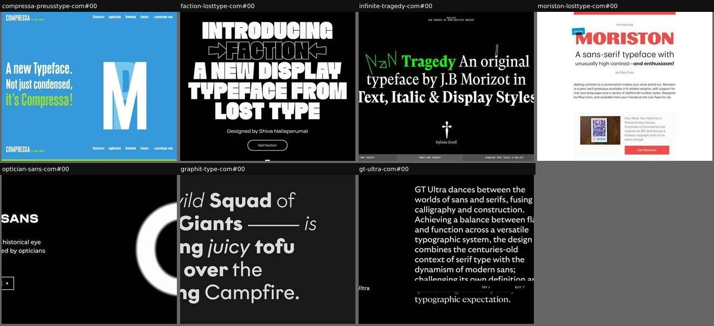

| example | look | feel | ux | learn |
|---|---|---|---|---|
| [compressa-preusstype-com#00](../../archive/compressa-preusstype-com/blocks/00.jpg) | Cyan field, condensed headline left in white/green, giant compressed 'M' right, nav top and bottom | Punchy, poster-like | static | Pair the claim ('not just condensed') with one giant glyph that proves it |
| [faction-losttype-com#00](../../archive/faction-losttype-com/blocks/00.jpg) | White heavy display caps on black, arrows framing the name, pill CTA | Loud, announcement-like | 'Get Faction' CTA | 'INTRODUCING →FACTION←': the launch announcement itself is the specimen |
| [infinite-tragedy-com#00](../../archive/infinite-tragedy-com/blocks/00.jpg) | Black, serif sentence mixing roman and italic with a green hand-drawn 'NaN', dagger ornament, 'Infinite Scroll' | Literary, dramatic, irreverent | Infinite scroll specimen; the specimen is editable | The hero sentence lists the styles (Text, Italic & Display) while demonstrating them |
| [moriston-losttype-com#00](../../archive/moriston-losttype-com/blocks/00.jpg) | White, centred red 'MORISTON' wordmark with a blue 'Edit Me!' sticker, tagline below, short paragraph, pay-what-you-want card with riso print photo | Friendly, enthusiastic, indie | Name and tagline are one contenteditable block; 'Get Moriston' CTA in a promo card | A small 'Edit Me!' sticker on the headline turns the hero itself into a tester without adding any UI |
| [optician-sans-com#00](../../archive/optician-sans-com/blocks/00.jpg) | Black, white name and tagline left, outlined 'Download for free' button, award badges, huge blurred white 'O' right | Clinical, confident, conceptual | Download button; glyph animates in (tile caught it mid-slide) | Blurring the hero glyph like an eye-test letter makes the font's origin (optotypes) felt before it is read |
| [graphit-type-com#00](../../archive/graphit-type-com/blocks/00.jpg) | Charcoal, large white geometric sans sentence mixing thin italic, light and bold, a long dash, slide dots | Playful, storybook, confident | Fade carousel of sentences, line-by-line reveal, draggable | Assign a different weight or italic to each word of a silly sentence: the range reads as rhythm, not a list |
| [gt-ultra-com#00](../../archive/gt-ultra-com/blocks/00.jpg) | Black, right-aligned white paragraph that shifts from sans to serif lower down, slim sticky 'GT Ultra / Try / Buy' bar | Calm, confident, editorial | Contrast axis (CNTR) animates the paragraph between sans and serif, likely on scroll | When the pitch is 'between sans and serif', let the pitch sentence itself travel along that axis |

## interactive-specimen

The hero is a specimen the visitor manipulates straight away (axes, weight, contrast, text), via controls or the wheel.

**Recognise by:** sliders, toggles or editable text inside the first screen

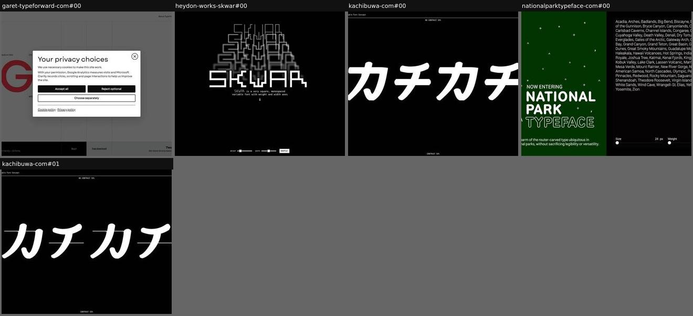

| example | look | feel | ux | learn |
|---|---|---|---|---|
| [garet-typeforward-com#00](../../archive/garet-typeforward-com/blocks/00.jpg) | Big red 'G' and weight columns (Hairline 50 → Medium 500, 276px, #ff3b4e); privacy modal covers the capture | Systematic, product-like | Columns expose weight, size and colour values; Buy and Free download links | Print the live values (weight, px, hex) next to the specimen, like design-tool inspector labels |
| [heydon-works-skwar#00](../../archive/heydon-works-skwar/blocks/00.jpg) | Black, stacked SKWAR repetitions fading into a pyramid, white mono intro | Retro computer, experimental | Weight and width sliders plus a SHUFFLE button right in the hero | Put the two axes right under the name: the hero is the tester |
| [kachibuwa-com#00](../../archive/kachibuwa-com/blocks/00.jpg) | Huge white katakana on black edge to edge; 'CONTRAST 50%' readouts top and bottom | Bold, experimental, minimal | Wheel/scroll changes the contrast axis live | Map scrolling onto a variable axis: the visitor drives the design space without seeing a control |
| [nationalparktypeface-com#00](../../archive/nationalparktypeface-com/blocks/00.jpg) | Split screen: dark green left with ASCII-style tree, stars and the name; black right with every park name as running text, size and weight sliders | Outdoorsy, nocturnal, calm | Size and weight sliders restyle the list of park names live | Use a list of real names from the font's world (all the parks) as the default tester text |
| [kachibuwa-com#01](../../archive/kachibuwa-com/blocks/01.jpg) | Second state of the hero: katakana with strike-through lines | Experimental | Scrolling changes the axis; this is a later wheel frame | Wheel-driven specimens produce distinct states worth showing as a sequence |

## typeset-page

A classical typeset composition (title page, broadside, dictionary entry) that uses the family's own hierarchy, italics and ornaments.

**Recognise by:** centred stacks, rules, ornaments, multiple sizes and italics

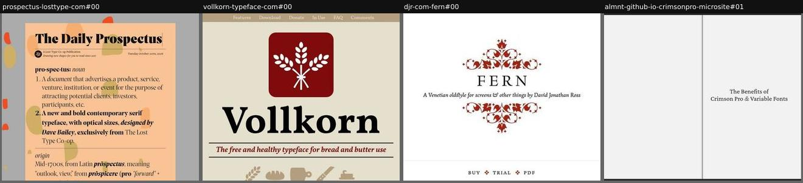

| example | look | feel | ux | learn |
|---|---|---|---|---|
| [prospectus-losttype-com#00](../../archive/prospectus-losttype-com/blocks/00.jpg) | Peach newspaper page 'The Daily Prospectus' over grey with orange blobs; serif definition with bold, italic and small caps | Witty, literate, editorial | The page text is editable (caret after the masthead) | A dictionary entry is a natural excuse to show roman, italic, bold and small text in one short block |
| [vollkorn-typeface-com#00](../../archive/vollkorn-typeface-com/blocks/00.jpg) | Cream, maroon wheat logo, big black serif name, italic tagline between rules, bread pictograms, small caps, 'free as always', scripts, numerals | Wholesome, bookish, generous | Mostly static; lines link to download, donate and in-use sections | Each line of a broadside can show one more feature (small caps, Cyrillic, Greek, figures) while still reading as a title page |
| [djr-com-fern#00](../../archive/djr-com-fern/blocks/00.jpg) | White, spaced-caps 'FERN' between symmetric red fleuron clusters, italic subtitle, 'BUY ❖ TRIAL ❖ PDF' row | Refined, Renaissance, quiet | Buy anchor, trial form button (adds trial to cart), PDF specimen link | Build the frame from the family's own ornament glyphs: decoration that is also a specimen |
| [almnt-github-io-crimsonpro-microsite#01](../../archive/almnt-github-io-crimsonpro-microsite/blocks/01.jpg) | Open-book spread on light grey: blank left page, centred serif title on the right with an outlined ampersand | Bookish, quiet, literary | static; the site pages like a book (next spreads hold sliders) | Staging the whole site as book spreads makes a text serif feel at home and paces content page by page |

## name-over-photo

Name and a short line over a full-bleed mood photograph.

**Recognise by:** landscape or scene photo, type overlaid

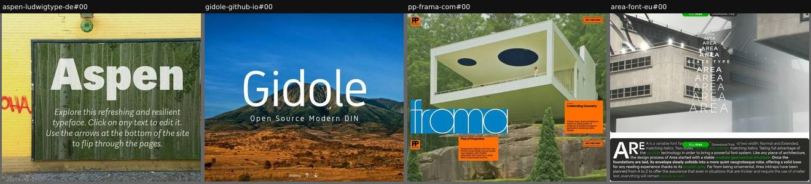

| example | look | feel | ux | learn |
|---|---|---|---|---|
| [aspen-ludwigtype-de#00](../../archive/aspen-ludwigtype-de/blocks/00.jpg) | Photo of a weathered fence with aspen trees; big semi-transparent wordmark, italic intro | Outdoorsy, calm, editorial | Text is editable in place ('click any text to edit'); arrows flip through pages like slides | Make every specimen string editable, so the hero is quietly also a tester |
| [gidole-github-io#00](../../archive/gidole-github-io/blocks/00.jpg) | Landscape photo (blue sky, savanna), thin white name, letterspaced tagline | Open, calm, generic-stock | Menu with up/down page arrows | A photo hero works for a neutral DIN but says little about the design itself |
| [pp-frama-com#00](../../archive/pp-frama-com/blocks/00.jpg) | Full-bleed photo of a white modernist house with oval cut-outs; blue box with 'frama'; orange info cards ('Celebrating Geometry', 'Play of Proportion') | Architectural, sunny, mid-century | Scroll moves the orange cards over the photo; 'Get the font' button | Choose a photo whose geometry rhymes with the letterforms (ovals, slabs) so the image explains the design |
| [area-font-eu#00](../../archive/area-font-eu/blocks/00.jpg) | Full-bleed video of brutalist concrete; 'AREA' stacked ten times from narrow to extended; then dark card with drop-cap intro and facts table | Architectural, cool, precise | Autoplay video; sticky Buy / Download Trial pills | Stacking the name across all widths turns the wordmark into a width axis diagram |

## product-landing

The software-product landing pattern: headline, tagline, paragraph, primary and secondary buttons.

**Recognise by:** SaaS layout, 'Try it now' and 'GitHub' buttons, common for coding fonts

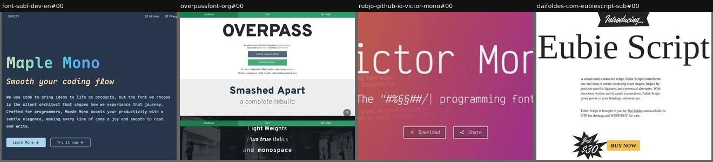

| example | look | feel | ux | learn |
|---|---|---|---|---|
| [font-subf-dev-en#00](../../archive/font-subf-dev-en/blocks/00.jpg) | Dark slate, pastel gradient mono wordmark, italic tagline, two buttons | Developer tool, friendly | 'Learn more' and 'Try it now' CTAs; GitHub and Playground in nav | Coding fonts borrow dev-tool landing conventions; 'Try it now' leads into a playground |
| [overpassfont-org#00](../../archive/overpassfont-org/blocks/00.jpg) | Green sticky tab bar, big dark 'OVERPASS', grey GitHub and green OTF buttons, CDN CSS URLs; cut also includes the next sections | Open-source, utilitarian | GitHub and download buttons; read-only inputs that select the webfont URL on click | Put the copy-ready webfont embed URL in the hero: for open-source fonts, installation is the CTA |
| [rubjo-github-io-victor-mono#00](../../archive/rubjo-github-io-victor-mono/blocks/00.jpg) | Orange-to-purple gradient, white mono name and tagline, faded source code in the background, two outlined buttons | Developer tool, friendly | Download and Share buttons | Ghosted code behind the headline places a programming font in its real habitat at zero cost |
| [daifoldes-com-eubiescript-sub#00](../../archive/daifoldes-com-eubiescript-sub/blocks/00.jpg) | White, black 'Introducing…' ribbon, large name (rendered in a fallback serif: webfont not loaded), short paragraph, 'Just $30' starburst and yellow BUY NOW | Retro ad, cheerful | Buy button | A price starburst next to the buy button answers 'how much?' before the visitor has to ask |

## construction-drawing

A glyph shown as its construction (Bézier points, skeleton, strokes), often drawn on.

**Recognise by:** outline points, handles, metric lines in the hero

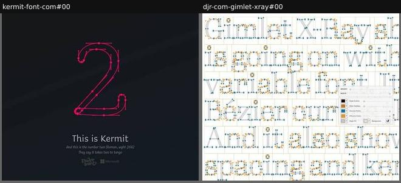

| example | look | feel | ux | learn |
|---|---|---|---|---|
| [kermit-font-com#00](../../archive/kermit-font-com/blocks/00.jpg) | Dark gradient, magenta numeral '2' outlined with on-curve and off-curve points; small caption | Friendly-technical, crafted | animated drawing | Start from the outline points: it signals craft and introduces the font's variable 'wght 266' |
| [djr-com-gimlet-xray#00](../../archive/djr-com-gimlet-xray/blocks/00.jpg) | White, a full page of serif text drawn as grey outlines with blue on-curve and orange off-curve points, sidebearing boxes, floating control panel | Nerdy, transparent, educational | Whole text is editable; weight, width and point-size sliders; colour pickers for outline, points, fill and background | Ship a colour-font 'x-ray' version so anyone can see Bézier points, spacing and kerning by just typing |

## material-photo

A photograph of physical material (paper, textile, objects) carrying or framing the type.

**Recognise by:** tactile still life, the type printed or knitted on the material

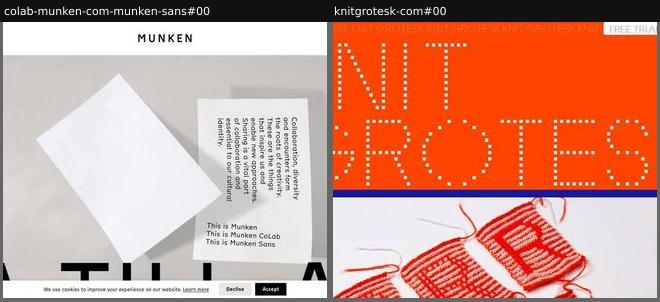

| example | look | feel | ux | learn |
|---|---|---|---|---|
| [colab-munken-com-munken-sans#00](../../archive/colab-munken-com-munken-sans/blocks/00.jpg) | Grey still life of paper sheets, vertical text printed on a sheet, giant type cropped at the bottom | Tactile, quiet, Scandinavian | static (cookie banner overlays the capture) | Show the font printed on the paper it was made for; the material does the branding |
| [knitgrotesk-com#00](../../archive/knitgrotesk-com/blocks/00.jpg) | Dotted stitch-grid name on orange, photo of real knitted letters below, scrolling marquee | Crafty, warm, tactile | Marquee; Free Trial link | Show the physical origin (knitting) next to the digital letters |

## illustration-scene

An illustrated scene or mascot staged with the type; the illustration sets the tone.

**Recognise by:** characters, faces, drawn objects

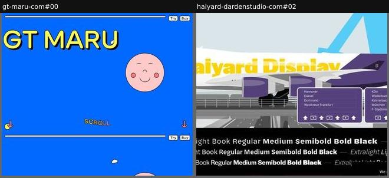

| example | look | feel | ux | learn |
|---|---|---|---|---|
| [gt-maru-com#00](../../archive/gt-maru-com/blocks/00.jpg) | Saturated blue, yellow outlined name, pink smiling moon face, 'SCROLL' with arrows; Try and Buy tabs on rails | Cute, rounded, playful (Japanese-inspired) | Scroll-driven animation; persistent Try/Buy controls | A mascot built from the type's own roundness sets the tone faster than any copy |
| [halyard-dardenstudio-com#02](../../archive/halyard-dardenstudio-com/blocks/02.jpg) | Flat illustration of a purple-and-white cargo jet with yellow 'Halyard Display' on the fuselage, airport signs; black band below with Micro/Text/Display weight rows; cookie notice at corner | Wayfinding, transit, upbeat | Title on the plane is editable; weight lists scroll as marquees | Paint the editable title onto an object in the scene (a plane livery) so testing feels like branding |

## prop-collage

A collage of designed artefacts (documents, tickets, packaging, diagrams) set in the font, implying a fictional world.

**Recognise by:** many small designed objects, all set in the font

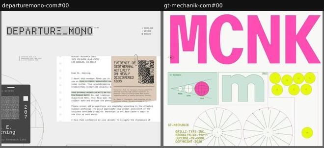

| example | look | feel | ux | learn |
|---|---|---|---|---|
| [departuremono-com#00](../../archive/departuremono-com/blocks/00.jpg) | Letters, boarding passes, receipts, departure boards; monochrome with a pale green accent | Retro-futurist sci-fi, storytelling | static; scroll reveals more props | Invent a fictional world (here, a space agency) and design its paperwork; every prop is a specimen |
| [gt-mechanik-com#00](../../archive/gt-mechanik-com/blocks/00.jpg) | Giant pink MCNK, then technical-diagram collage: mono/semi/poly schematics, circles of letters | Engineered, schematic | static; scroll into diagrams | Engineering diagrams explain the mono/semi/poly widths visually before any text |
