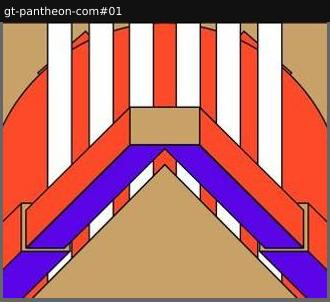

# interlude

Pure transition between sections; no information.

Sample: 1 blocks from 1 sites.

| variant | n | definition | recognise by |
|---|---|---|---|
| [scroll-door-animation](#scroll-door-animation) | 1 | A pinned, scroll-scrubbed illustration opening like doors. | symmetry, scrubbing |

## scroll-door-animation

A pinned, scroll-scrubbed illustration opening like doors.

**Recognise by:** symmetry, scrubbing

| example | look | feel | ux | learn |
|---|---|---|---|---|
| [gt-pantheon-com#01](../../archive/gt-pantheon-com/blocks/01.jpg) | Flat tan, orange, violet and white architectural motif (beams, arches, sun) mirrored four ways | Monumental, Art Deco, ceremonial | Lottie canvas plays as you scroll ~1500px while pinned | A scroll-driven 'door' between chapters adds ceremony and pacing without a word of copy |
