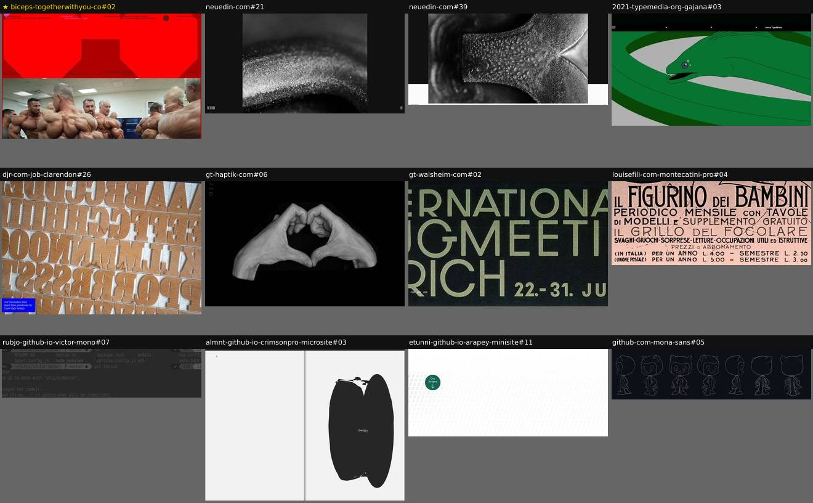
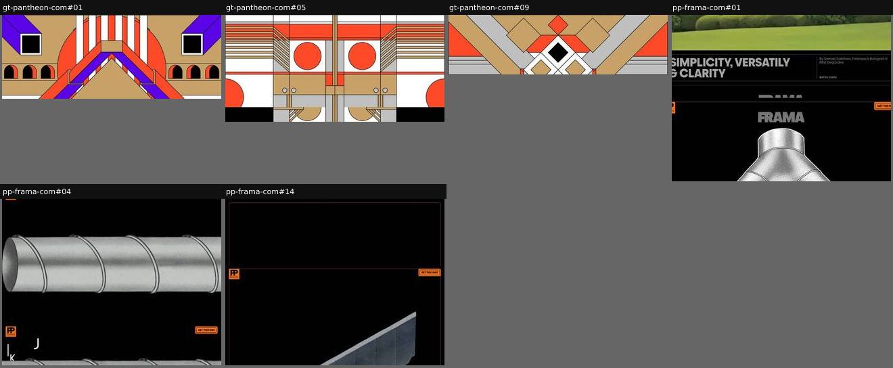
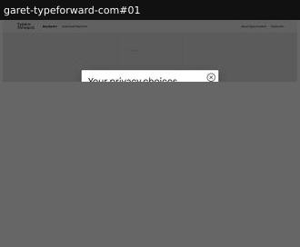
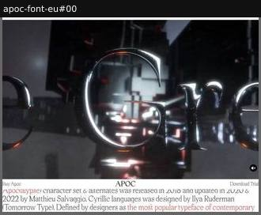

# interlude

_Section: Specimen showcase (discovered type, alongside specimen-showcase)_

Pure transition between sections; no information.

24 instances on 17 sites (the Phase 3 extraction of 181 sites).

| variant | sites | definition | recognise by |
|---|---|---|---|
| [full-bleed-image](#full-bleed-image) | 12 | A full-viewport image without text (close-up of the source or of the letters) as a pause between chapters. | one photo, no text |
| [scroll-scrubbed-sequence](#scroll-scrubbed-sequence) | 2 | A pinned, scroll-scrubbed animation (pre-rendered frame sequence or illustration, e.g. doors opening, an object turning or releasing letters) between sections, with little or no text. | sticky stage, image changes with scroll |
| [chapter-title-overlay](#chapter-title-overlay) | 1 | A fixed full-screen overlay flashing the chapter number or name in giant type each time a chapter scrolls in, then fading. | giant blended numerals over content |
| [annotated-spacer](#annotated-spacer) | 1 | Empty bands of the page's visible grid between sections, each labelled with a technical note. | grid cells with small labels, no content |
| [ghost-marquee](#ghost-marquee) | 1 | One sentence from nearby copy, set near viewport height in a very pale tint, scrolling sideways as an endless band between sections. | huge pale marquee text |

## full-bleed-image

A full-viewport image without text (close-up of the source or of the letters) as a pause between chapters.

**Recognise by:** one photo, no text

| example | look | feel | ux | learn |
|---|---|---|---|---|
| [★ biceps-togetherwithyou-co#02](../../archive/biceps-togetherwithyou-co/blocks/02.jpg) | Full-width photographs with no type: grotesquely over-muscled bodybuilders in fluorescent-lit offices and kitchens (a crowd flexing among office chairs, a torso folded over mugs, a man crossing gigantic arms by a printer, a body swollen into a muscle blob over a desk, a row of muscle mounds on a workbench); one is a Vimeo video with a play button | Absurd, funny, slightly disturbing | Pauses between glyph screens; the video plays on click | Pair a modular 'dumbbell' font with a single absurd visual metaphor (offices full of bodybuilders): the joke carries the concept between specimens |
| [neuedin-com#21](../../archive/neuedin-com/blocks/21.jpg) | A large grainy macro photograph of a curved glittering stroke (cast or printed letter surface) on black, inset to 80vw | Close, material, quiet | static pause | Macro shots of a letter's surface make an industrial font feel physical between dense specimens |
| [neuedin-com#39](../../archive/neuedin-com/blocks/39.jpg) | A looping macro video of a letter's stroke junction in grainy cast metal, inset to 80vw, half over black and half over the white section that follows | Close-up, physical | autoplay, muted, loop | Let the interlude straddle the colour change between sections to stitch dark and light chapters |
| [2021-typemedia-org-gajana#03](../../archive/2021-typemedia-org-gajana/blocks/03.jpg) | Flat vector illustrations of the font's namesake, an eel: a green eel with a sparkling eye coiled over grey, and later an abstract close-up of green eel curves on white | Witty, colourful pause | Static images that fade in | Illustrate the font's name (Anguilla = eel) between specimen panels to give a text face a mascot and a colour |
| [djr-com-job-clarendon#26](../../archive/djr-com-job-clarendon/blocks/26.jpg) | A full-bleed photo of rows of mirrored maple wood-type letters (Job Clarendon Bold), with a small blue caption box bottom-left: 'Job Clarendon Bold wood type, produced by Type High Design' | Warm, physical, the font returned to its letterpress origin | static | End the visual story with the digital face cut back into wood type: the photo proves the homage without a word of argument |
| [gt-haptik-com#06](../../archive/gt-haptik-com/blocks/06.jpg) | Black screen with a black-and-white cut-out photo of two hands forming a heart | Affectionate, human | static pause between the alternates and the touch GIFs | Use the hand, the font's real 'reader', as the recurring image: the photos carry the concept between technical slides |
| [gt-walsheim-com#02](../../archive/gt-walsheim-com/blocks/02.jpg) | Full-screen close-up of the 'Internationales Flugmeeting Zürich 22.–31. Juli' poster: pale grey-green geometric capitals on dark navy, cropped at both edges, print grain visible | Tactile, like leaning into the paper | static; a cover slide between the intro and the 'Baumberger's Lettering' chapter | Show the source lettering at a scale where the texture of the print reads: it makes the leap to a digital typeface visible before any text explains it |
| [louisefili-com-montecatini-pro#04](../../archive/louisefili-com-montecatini-pro/blocks/04.jpg) | Full-width enlarged detail of the 'Il Figurino dei Bambini' poster from the history section: condensed and expanded black caps on pink paper with halftone texture | Tactile, archival | static pause between the story and the overview | Blow up a detail of one source poster so visitors see the mixed widths in the original before they see them in the font |
| [rubjo-github-io-victor-mono#07](../../archive/rubjo-github-io-victor-mono/blocks/07.jpg) | A 350px full-width strip of a dimmed terminal screenshot (Powerline prompt, git status, file listing) set in Victor Mono | Atmospheric, at home in the terminal | static divider between sections | Cropped, dimmed screenshots of the font in a real tool make quiet section breaks that still show the font |
| [almnt-github-io-crimsonpro-microsite#03](../../archive/almnt-github-io-crimsonpro-microsite/blocks/03.jpg) | Chapter-opener spreads: a blank numbered left page and a right page filled by a black ink-blob shape (an ovoid, a leaning slab, a heart-like curve) with a tiny white label 'Design', 'Example' or 'Acknowledgment' | Calm, graphic pauses | static | Use a full-page abstract shape with a one-word label as a chapter divider in a book-like specimen |
| [etunni-github-io-arapey-minisite#11](../../archive/etunni-github-io-arapey-minisite/blocks/11.jpg) | A pale full-width band of the canvas letter texture (tiny grey letters in diagonal rows) fading out, echoing the hero, before the footer | Soft fade-out | static in the capture | Reuse the hero's texture as the closing band so the page ends where it began |
| [github-com-mona-sans#05](../../archive/github-com-mona-sans/blocks/05.jpg) | A full-width strip of faint white line sketches of the mascot from seven angles (character turnaround): Mona after the Mona Sans grid, Hubot after the Hubot Sans grid | Quiet, concept-art | static separator between the family sections | Character turnaround sketches make a soft, on-brand divider between two dense sections |
| [rubjo-github-io-victor-mono#14](../../archive/rubjo-github-io-victor-mono/blocks/14.jpg) | 350px strip of a dimmed character-set specimen image: accented Latin, Greek and Cyrillic in three columns (Regular, cursive Italic, Oblique), cropped at both edges; it belongs to block 13 but the capture shows it at the top of block 14 | Texture, density | static divider | A cropped glyph-set image works as a textured divider that hints at coverage |
| [rubjo-github-io-victor-mono#16](../../archive/rubjo-github-io-victor-mono/blocks/16.jpg) | 350px strip of a dimmed Glyphs-app screenshot (a glyph outline with nodes, metric lines and guides); it is block 15's image, captured at the top of block 16 | Behind-the-scenes | static divider before the credits | A cropped editor screenshot hints at the making without a making-of section |
| [wix-com-typeface-madefor#08](../../archive/wix-com-typeface-madefor/blocks/08.jpg) | Concentric hairline outlines of an 'O'-like form in black on lilac, closing the Symbols section; the top is cut by a screen boundary | A breath before the philosophy text | Static in the capture; possibly animated | Overlaying all weights of one letter as hairlines makes a calm abstract image |

## scroll-scrubbed-sequence

A pinned, scroll-scrubbed animation (pre-rendered frame sequence or illustration, e.g. doors opening, an object turning or releasing letters) between sections, with little or no text.

**Recognise by:** sticky stage, image changes with scroll

| example | look | feel | ux | learn |
|---|---|---|---|---|
| [gt-pantheon-com#01](../../archive/gt-pantheon-com/blocks/01.jpg) | A full-width band of flat geometric architecture (gold diamonds, orange half-suns, purple-and-black checkered domes, white stripes) mirrored left/right and top/bottom like a kaleidoscopic stage curtain | Curtain between acts | Pinned while you scroll 1500px; the mirrored drawing opens outward like doors to reveal the next act | Mirror one Lottie four ways and scrub it with scroll: a cheap, symmetric 'curtain' that marks act changes |
| [gt-pantheon-com#05](../../archive/gt-pantheon-com/blocks/05.jpg) | Second door: mirrored white/orange/gold/grey geometry with orange suns and gold panels | Act change | Pinned and scrubbed on scroll like the first door | Vary the colourway per door so each act opens differently with the same mechanism |
| [gt-pantheon-com#09](../../archive/gt-pantheon-com/blocks/09.jpg) | Third door (gold, white, orange): the curtain before Act III | Last curtain | Scroll-scrubbed | Three doors for three acts make the structure felt, not just read |
| [pp-frama-com#01](../../archive/pp-frama-com/blocks/01.jpg) | A credit row ('SIMPLICITY, VERSATILY & CLARITY' in grey heavy caps; 'By Samuel Salminen, Francesca Bolognini & Mat Desjardins', 'Built for clarity.') then a black stage with a halftone-shaded steel Y-pipe junction under a grey 'FRAMA' wordmark | Mechanical, deadpan | The stage is sticky; scrolling scrubs through 39 frames so the pipe rotates in place | A scroll-scrubbed object render (a pipe fitting for a 'functional' face) gives a type page the physicality of a product film without video |
| [pp-frama-com#04](../../archive/pp-frama-com/blocks/04.jpg) | A long spiral-seam steel duct crosses the black screen horizontally; letters (I, k, J, mirrored S and b) tumble out of its open end | Mechanical, slightly absurd | Pinned stage; 59 full-HD frames scrub with scroll so the duct slides and blows letters out | Have the themed object produce the letters (a duct blowing out glyphs): the interlude still says 'this is a typeface' |
| [pp-frama-com#14](../../archive/pp-frama-com/blocks/14.jpg) | A snap-off utility-knife blade slides diagonally up into a black stage framed by a thin orange line; mid-sequence an orange slogan 'bring precision into your life.' appears, rotated along the blade | Sharp, punchy | Sticky stage; 87 frames (72 unique, 2880×1600) scrub with scroll as the blade advances and the slogan appears | Pair a precision tool with a one-line slogan in the heaviest weight: the interlude delivers the brand promise in one image |

## chapter-title-overlay

A fixed full-screen overlay flashing the chapter number or name in giant type each time a chapter scrolls in, then fading.

**Recognise by:** giant blended numerals over content

| example | look | feel | ux | learn |
|---|---|---|---|---|
| gt-mechanik-com#23 | Fixed overlay (multiply blend) with a giant frequency '91.2', '95.6', '97.7' or '99.2' (~620px) in the chapter colour, a repeating '91.2 — MONO' typewriter column and small letters of the chapter name scattering into a crosshair, circle or line; it shows on top of every chapter start in the capture | Like tuning to a new station | Triggered when a [data-channel] section enters; fades in and out over the content; pointer-events none | Announce each chapter with one oversized number that the nav also uses: the frequency becomes the wayfinding system |

## annotated-spacer

Empty bands of the page's visible grid between sections, each labelled with a technical note.

**Recognise by:** grid cells with small labels, no content

| example | look | feel | ux | learn |
|---|---|---|---|---|
| [garet-typeforward-com#01](../../archive/garet-typeforward-com/blocks/01.jpg) | 300px bands of empty hairline-ruled cells between every section; one cell in each carries a tiny centred measurement like '47,400 px²', '263,400 px²', '99,600 px²' | Blueprint, tongue-in-cheek | static | Make the grid itself visible and label the empty cells with their area: the pauses between demos become part of the typographic system and show off superscripts |

## ghost-marquee

One sentence from nearby copy, set near viewport height in a very pale tint, scrolling sideways as an endless band between sections.

**Recognise by:** huge pale marquee text

| example | look | feel | ux | learn |
|---|---|---|---|---|
| [apoc-font-eu#00](../../archive/apoc-font-eu/blocks/00.jpg) | Three full-bleed bands of one huge sentence in near-white grey (#f0f0f0) on white, cropped at both edges: 'Apoc is an elegant, expressive font family…' (Revelations), 'With agressive serifs, sharp as if there were cut by a knife.' (Revelations) and 'It will do marvels if you want to balance your layout's optical gray…' (Sans) | Ghostly, slow, airy | The line drifts horizontally in a loop (different crop in each frame of the video); no interaction | Echo a phrase from the paragraph above as a pale giant marquee: it adds display-size letterforms and pacing without competing with the content |
