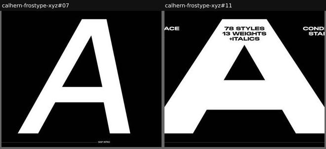

# intro-animation

_Section: Hero (discovered type, alongside hero)_

A timed or pinned full-screen sequence played before the page proper, like film opening titles.

Sample: 2 blocks from 1 sites.

| variant | n | definition | recognise by |
|---|---|---|---|
| [title-sequence](#title-sequence) | 2 | Full-screen frames revealing name, facts and specimen in sequence, often skippable. | 'Skip intro', pinned frames |

## title-sequence

Full-screen frames revealing name, facts and specimen in sequence, often skippable.

**Recognise by:** 'Skip intro', pinned frames

| example | look | feel | ux | learn |
|---|---|---|---|---|
| [calhern-frostype-xyz#07](../../archive/calhern-frostype-xyz/blocks/07.jpg) | Black, one huge white sans 'A' filling the frame, thin rule and 'SKIP INTRO' at the bottom | Cinematic, stark | Timed or scroll-pinned frames; Skip intro control | A single glyph per frame, full screen, lets each letter perform like a title card |
| [calhern-frostype-xyz#11](../../archive/calhern-frostype-xyz/blocks/11.jpg) | Black, viewport-filling white 'A' with '78 styles 13 weights +italics', 'Condensed Standard Wide' in the corners, progress line and 'Skip intro' | Cinematic, bold, film-noir credits | Plays frame by frame (neighbouring blocks add movie-credit lines in the counter); Skip intro and Buy buttons | Stage the key facts as an opening credit sequence, and always offer 'Skip intro' for returning visitors |
