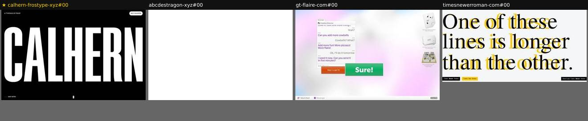

# intro-animation

_Section: Hero (discovered type, alongside hero)_

A timed or pinned full-screen sequence played before the page proper, like film opening titles.

5 instances on 5 sites (the Phase 3 extraction of 181 sites).

| variant | sites | definition | recognise by |
|---|---|---|---|
| [title-sequence](#title-sequence) | 5 | Full-screen frames revealing name, facts and specimen in sequence, often skippable. | 'Skip intro', pinned frames |

## title-sequence

Full-screen frames revealing name, facts and specimen in sequence, often skippable.

**Recognise by:** 'Skip intro', pinned frames

| example | look | feel | ux | learn |
|---|---|---|---|---|
| [★ calhern-frostype-xyz#00](../../archive/calhern-frostype-xyz/blocks/00.jpg) | White on black, like film opening titles: 'CALHERN' in condensed black caps filling the width; then 'A / TYPEFACE / OF / EXTREMES' builds word by word in a centred stack (the 'A' thinning to a hairline skeleton); a single 'A' swells from condensed to a huge wide black 'A'; corner captions appear in wide caps ('TYPEFACE BY FROST', '78 STYLES 13 WEIGHTS +ITALICS', 'CONDENSED STANDARD WIDE'); finally a film billing block ('STARRING STERLING HAYDEN AND LOUIS CALHERN … DIRECTED BY JOHN HUSTON') sits under the A | Cinematic, dramatic, monumental | Pinned for ~11 screens of scroll; a thin progress line grows along the bottom with 'SKIP INTRO'; a scroll prompt icon at first; the fixed 'A TYPEFACE BY FROST' / 'BUY CALHERN' bar stays on top | Stage the family's range as an opening-credits sequence scrubbed by scroll, with a 'Skip intro' progress bar so impatient visitors can jump straight to the content |
| [abcdestragon-xyz#00](../../archive/abcdestragon-xyz/blocks/00.jpg) | A blank white screen where a line is typed and deleted letter by letter in the centre: 'Hi, I'm Estragon!' then 'What's new?' (the crop is captured before typing starts) | Conversational, like a chatbot greeting | Plays automatically (~5s), then the panel shrinks to the left half and the app appears | Introduce a display face with a typed greeting in its own letters: the first words are the font speaking |
| [gt-flaire-com#00](../../archive/gt-flaire-com/blocks/00.jpg) | Blurred pink-blue cloud wallpaper with desktop file icons (cartoon page with eyes, 'Amazing-Presentation-Very-Final-99f.design', an isometric floor plan) and a Messenger window where a 'Creative Director' sends messages ('Can you add more cowbells', 'Add more fun! More pizzazz! More flaire!', 'I need it now…'); below it a small orange 'No! I can't!' button and a big green 'Sure!' button in Flaire Extra; white taskbar 'Skip & Start · Messenger · 1:32 PM' | Funny, relatable agency life | A 'Flaire OS' boot screen ('Initializing stuff… Loading font files… Adding cowbells… Extra Flaire…') with a rainbow 'GT Flaire' logo, then the chat types itself out; 'Sure!' or 'Skip & Start' scrolls into the page; 'Reboot' at the end replays it | Open with a scripted chat that states the font's premise as a client brief ('More flaire!'), and let the visitor answer with a button set in the expressive style |
| [timesnewerroman-com#00](../../archive/timesnewerroman-com/blocks/00.jpg) | About 2.5s full-screen black preloader with a rotating gradient frame (yellow, red, blue) around 'MSCHF DROP #03 / TIMES NEWER ROMAN'. It's the shared MSCHF preloader and wasn't cut as a block; seen only in the video (t<3s), attached to the first block | Product drop, a tease | Plays once and fades over the hero; not skippable | Numbering each project as a 'drop' turns a font joke into a limited release, and a shared preloader brands a whole series of sites |
| pp-frama-com#19 | A fixed full-viewport Vimeo player (autoplay, muted, no loop, no controls) layered over the page; the capture only shows ~2s of dark screen before the hero | Cinematic opening (inferred) | Plays once over the page on load and then gives way to the hero; not visible in the stitched capture | A one-shot muted video overlay is the cheapest way to add an opening title to a page builder site |
