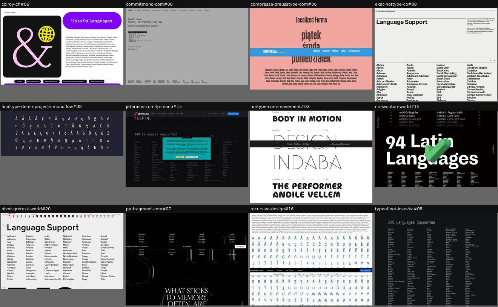
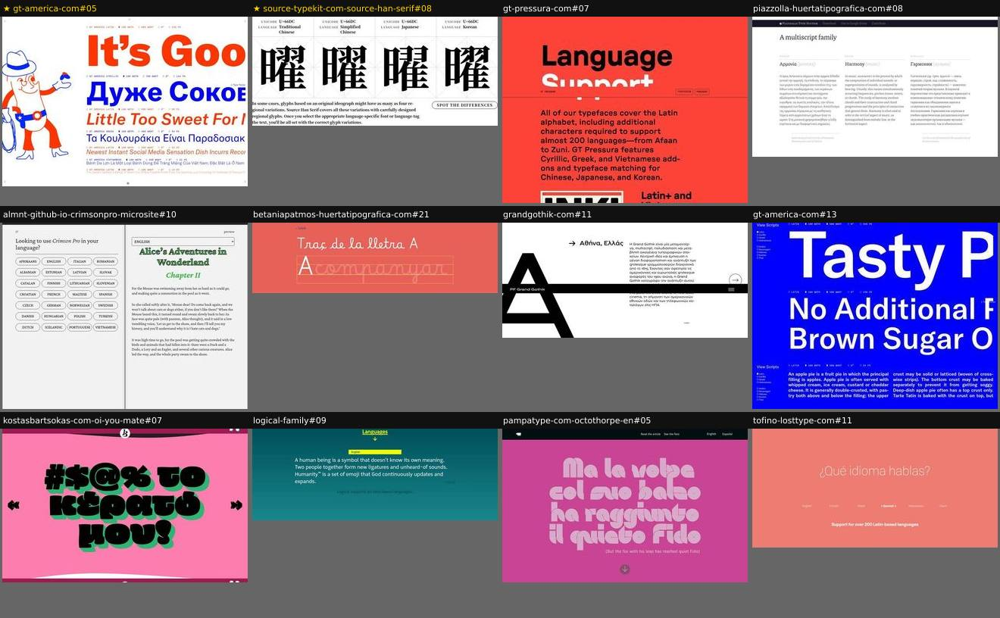
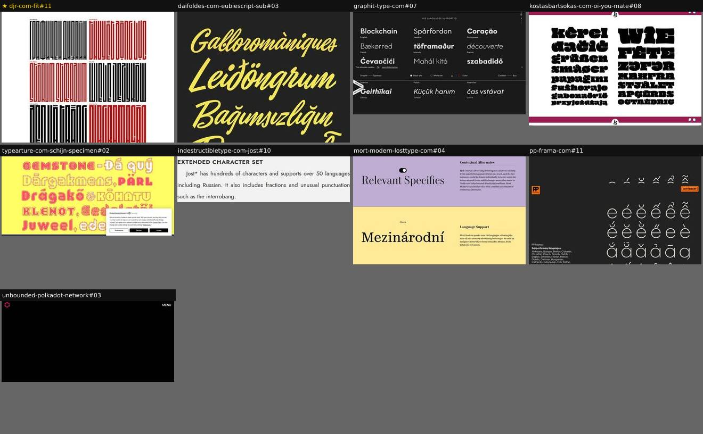
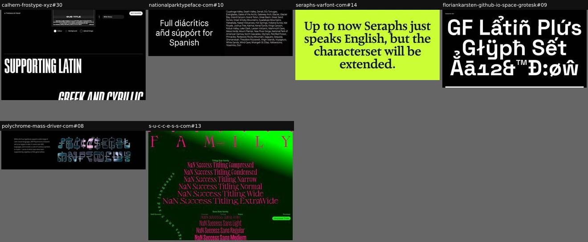
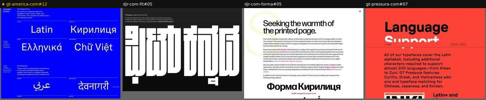
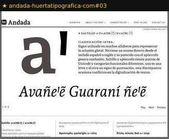
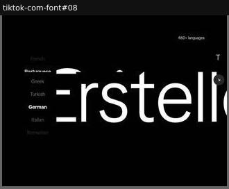

# language-support

_Section: Glyph table (discovered type, alongside glyph-table)_

Script and language coverage.

63 instances on 52 sites (the Phase 3 extraction of 181 sites).

| variant | sites | definition | recognise by |
|---|---|---|---|
| [language-name-list](#language-name-list) | 27 | The supported languages listed by name, as small running text, columns, or a per-script table with credits and style counts; the list is the proof. | long alphabetical list of language names |
| [multiscript-specimen](#multiscript-specimen) | 14 | Sample lines in several scripts, each tagged with script and settings. | LATIN / ARABIC / THAI labels |
| [diacritic-word-wall](#diacritic-word-wall) | 9 | Real words from many languages chosen for their diacritics, at display size. | accent-heavy words |
| [coverage-statement](#coverage-statement) | 6 | A big-type sentence stating the coverage instead of showing it. | 'Supports 200+ languages' |
| [script-catalogue](#script-catalogue) | 4 | Each supported script named in its own script at display size, in a grid, with style counts and notes on how it was made. | Кирилиця, Ελληνικά, عربي as headings |
| [language-profile](#language-profile) | 1 | A deep dive into the one language the family was designed for: special characters with Unicode and keyboard notes, a map, the alphabet and a sample text. | map, alphabet, single-language focus |
| [translated-word-picker](#translated-word-picker) | 1 | A wheel or list of language names beside one giant word; picking a language swaps the word for its translation. | language list + one big word |

## Rubric

Recorded for every instance in Phase 3, in addition to the cross-cutting attributes in `rubric.json`:

- **method**: samples | word-wall | statement | list | map
- **nonLatin**: true | false

## language-name-list

The supported languages listed by name, as small running text, columns, or a per-script table with credits and style counts; the list is the proof.

**Recognise by:** long alphabetical list of language names

| example | look | feel | ux | learn |
|---|---|---|---|---|
| [colroy-ch#06](../../archive/colroy-ch/blocks/06.jpg) | 'LANGUAGE SUPPORT': a black rounded card with a pink '&' and a yellow globe icon, a violet pill 'Up to 94 Languages', and a running paragraph of language names (Afrikaans, Albanian, Asu, Basque … Zulu) | Cheerful, clear | static | Pair the number in a pill with the full list as running text: headline for skimmers, proof for checkers |
| [commitmono-com#00](../../archive/commitmono-com/blocks/00.jpg) | Docs Languages tab, HTML only: an alphabetical list of language names, ending at Zulu | Dry reference | static list inside the tab | A plain alphabetical list behind a tab serves the one reader who needs to check a language, without costing the page anything |
| [compressa-preusstype-com#06](../../archive/compressa-preusstype-com/blocks/06.jpg) | Under the Localized Forms carousel, a centred justified paragraph 'Languages: Afrikaans, Albanian, Asu, Basque, … Welsh, Zulu' in small dark condensed type on salmon | Matter-of-fact | static | Put the language list right under the localized-forms demo so coverage and locl are read together |
| [exat-hottype-co#08](../../archive/exat-hottype-co/blocks/08.jpg) | 'Language Support' heading with a note on Koeberlin's Latin M and Adobe Extended Cyrillic, then four columns of language names (Abaza … Chokwe) at ~16px bold, paged with ← → arrows | Reference list, generous | Arrows page through the 430+ names in a slider | Paginate a long language list in a slider so it keeps its display size without a giant scroll |
| [finaltype-de-en-projects-monoflow#08](../../archive/finaltype-de-en-projects-monoflow/blocks/08.jpg) | Under the diacritics figure (never cut as a block, attached to 08): 'Support for more than 37 languages' in bold, then one paragraph listing them, 'Afrikaans, Albanian, Basque, Bosnian … Welsh and Zulu.' | Dry, reassuring | static | Pair the visual accent sampler with the plain language list right below it |
| [jetbrains-com-lp-mono#15](../../archive/jetbrains-com-lp-mono/blocks/15.jpg) | '148 languages supported' then six tight columns of language names (Afrikaans … Zulu) in small grey monospace | Plain reference | static | A count in the heading plus an alphabetical column list answers 'does it support X?' in one glance |
| [nmtype-com-movement#02](../../archive/nmtype-com-movement/blocks/02.jpg) | 'Language support' label and six narrow columns of language names, many of them African (Bemba, Chiga, Kinyarwanda, Ndebele, Shona, Sotho, Swahili, Xhosa, Zulu) | Plain, inclusive | static | List languages in short alphabetical columns; for a South African project the African languages are the point |
| [nn-swinton-world#15](../../archive/nn-swinton-world/blocks/15.jpg) | Under '94 Latin Languages', seven columns of small white language names (Afrikaans … Zulu) on black | Dry, complete | static | Keep the full list under the big number so the claim and the proof sit together |
| [pivot-grotesk-world#20](../../archive/pivot-grotesk-world/blocks/20.jpg) | 'Language Support' in Medium, then six columns of ~95 language names (Afrikaans … Zulu) in black on grey, with red '34 pt' and '9 pt' labels | Orderly, complete | static | Set the language list large enough to read (25px) in even columns so it doubles as a text-size specimen |
| [pp-fragment-com#07](../../archive/pp-fragment-com/blocks/07.jpg) | Four centred columns of language names (Afrikaans … Turkish, '(And more)') over dim glass 3D letters | Understated | static; glass letters drift | A plain four-column list is enough when the script is Latin only; let the background do the atmosphere |
| [recursive-design#16](../../archive/recursive-design/blocks/16.jpg) | '## Supports over 200 languages.' (seen in the video; top of the iframe), a sentence on Vietnamese, currencies, symbols and fractions, then one dense paragraph of language names (Abenaki, Afaan Oromo, Afar … Zulu, Zuni) | Exhaustive | Static | A single run-in paragraph of 200+ language names reads as proof without needing samples |
| scenik-frostype-xyz#10 | 'Language Support': an A–Z index with the initial letter in a narrow column and language names beside it (Afrikaans, Albanian, Asu … Zulu), two index columns side by side, ending with a cartoon of a waiter carrying a dog | Orderly, dictionary-like | static | Index the language list by initial letter like a dictionary so a buyer finds their language at a glance |
| [typeof-net-iosevka#08](../../archive/typeof-net-iosevka/blocks/08.jpg) | '248 Languages Supported' title over five long columns of language names in Iosevka | A credits roll | static | Lead with the count and let a tall alphabetical list serve as the proof |
| [usgraphics-com-products-berkeley-mono#09](../../archive/usgraphics-com-products-berkeley-mono/blocks/09.jpg) | 'International – Wide Language Support': a two-column list of ~26 European language names in blue mono at display size (Albanian … Welsh), then two cards: accented capitals and lowercase in green (ÀÂÆÇÉÈÊË ÎÏÔŒÙÛÜŸ…) and a huge red capital ẞ for German | Orderly, factual | static | Set the language list itself at display size in the font: the names are the proof, and a giant capital ẞ adds one memorable detail |
| [andada-huertatipografica-com#05](../../archive/andada-huertatipografica-com/blocks/05.jpg) | 'Language support: LATIN PLUS' then a running comma-separated list of 219 language names validated by Underware (Abenaki, Afaan Oromo, Afar, Afrikaans…) at the end of the character set (beyond the truncated crop) | Dense, credible | static | Cite the validator (Underware's Latin Plus) and the count before the list: '219 languages from 212 countries' |

_…and 12 more in the gallery (`npm run app`)._

## multiscript-specimen

Sample lines in several scripts, each tagged with script and settings.

**Recognise by:** LATIN / ARABIC / THAI labels

| example | look | feel | ux | learn |
|---|---|---|---|---|
| [★ gt-america-com#05](../../archive/gt-america-com/blocks/05.jpg) | A waterfall of food headlines, each in another script and colour (orange/blue alternating), each tagged with a Mono readout of script, width, weight, slant and px size; animated cowboy hot-dog mascot on the left | Lively, menu-like, global | Lines animate their wdth or wght (the filled dot shows which); Lottie mascot animation; '↓ Type Tester' link at the right | Tag every sample line with its exact settings (script · wdth · wght · slant · px): the specimen teaches the system while showing it |
| [★ source-typekit-com-source-han-serif#08](../../archive/source-typekit-com-source-han-serif/blocks/08.jpg) | One code point four times: '曜' at ~200px in four guide-lined cells, each headed 'UNICODE U+66DC / LANGUAGE Traditional Chinese | Simplified Chinese | Japanese | Korean'; an outlined 'SPOT THE DIFFERENCES' button and a caption about regional glyph variants | Puzzle-like, enlightening | Clicking 'Spot the Differences' reveals circles (four .spot markers per cell) on the strokes that differ between the regional forms | Show the same Unicode code point in each locale side by side and let the visitor ask for the answer: it explains language tagging better than prose |
| [gt-pressura-com#07](../../archive/gt-pressura-com/blocks/07.jpg) | Red 'Language Support' section: a large coverage statement, then for Latin+ & Vietnamese, Cyrillic and Greek a beige specimen card of ruled, numbered cells ('INK! Initiate', 'CARGO Force', 'NHƯỢNG?', 'GÆST'; 'ГЛАЗА', 'ДОМОЧАДЦЫ'; 'δέλτα!', 'Φρεσκάρω') beside a short note naming the consultant | Letterpress proof sheets | static; cards alternate sides | Set each script as a proof sheet of numbered cells mixing widths, weights and italics: one card shows coverage and range together |
| [piazzolla-huertatipografica-com#08](../../archive/piazzolla-huertatipografica-com/blocks/08.jpg) | 'A multiscript family': three equal columns, Greek / Latin / Cyrillic, each the same encyclopedia article on harmony in music (Αρμονία (μουσική), Harmony (music), Гармония (музыка)) with small caps and italics, and an italic credit line for the script's collaborator | Balanced, scholarly | static | Set one article in each script side by side at text size so the colour and rhythm of the scripts can be compared directly, and credit each script's helper underneath |
| [almnt-github-io-crimsonpro-microsite#10](../../archive/almnt-github-io-crimsonpro-microsite/blocks/10.jpg) | Spread: left page 'Looking to use Crimson Pro in your language?' with 28 outlined pill buttons (AFRIKAANS … VIETNAMESE); right page 'preview' with a select ('ENGLISH') over 'Alice's Adventures in Wonderland / Chapter II' in green outlined bold and three paragraphs of the chapter | Literary, inviting | Choosing a language (pill or select) swaps the Alice chapter into that translation | Use a book that exists in every language (Alice) as the language sample: real translated prose instead of pangrams |
| [betaniapatmos-huertatipografica-com#21](../../archive/betaniapatmos-huertatipografica-com/blocks/21.jpg) | Five short colour bands, one per supported language, each tagged '→ Català / Castellano / English / Guaraní / Deutsch' and showing a worksheet exercise in that language: 'Traç de la lletra A — Acompanyar' (the A solid, the rest faded for tracing), 'Escribe palabras con B — Búho, botón', 'Underline the letter M — AMAZING', 'Completa: e - ẽ — ma ↔ ña'' with blank boxes, 'Die Lücken füllen — Schla_zeug' | Practical, multilingual classroom | static images | Prove language support with a typical exercise in each language (trace, fill the gap, underline) instead of a pangram: buyers see the font doing the job in their language |
| [grandgothik-com#11](../../archive/grandgothik-com/blocks/11.jpg) | Carousel of language slides; the captured Greek slide has a giant black 'A' cropped at the left edge, a heading '→ Αθήνα, Ελλάς' and a narrow justified Greek paragraph translating the back story, labelled GREEK | Postcard-like, editorial | Circled arrow pages through 4 slides, one per script or language (city heading + translated paragraph) | Head each script sample with a city name in that script ('Athens, Greece'): a place gives the language slide a reason to exist |
| [gt-america-com#13](../../archive/gt-america-com/blocks/13.jpg) | Left 'View Scripts' tab list; on the right a headline 'Tasty P…' (~158px), subhead 'No Additional Preservatives' (~70px) and two-column body text in white on blue, each with a Mono settings readout | Magazine-like | Clicking a script in the left list swaps the headline, subhead and body samples to that script | Show each script at three roles (headline, subhead, body), not just one line, so typesetters see the full hierarchy |
| [kostasbartsokas-com-oi-you-mate#07](../../archive/kostasbartsokas-com-oi-you-mate/blocks/07.jpg) | Carousel of full-screen colour slides, each with one expletive-toned phrase with a speech-bubble or shadow treatment: a Slovak pangram on yellow, Greek '#$@% το κέρατό μου!' in black on green-shadowed pink, 'oh là là' | Swearing in several languages | Hand arrows page through the slides | Pick phrases native speakers would shout in each language; coverage becomes the joke rather than a list |
| [logical-family#09](../../archive/logical-family/blocks/09.jpg) | 'Languages ↓': a yellow dropdown ('English') over the poem in white ('A human being is a symbol that doesn't know its own meaning…', via Dirk Vis) and the line 'Logical supports 91 latin based languages.' | Quiet, personal | The dropdown swaps the poem into another language | Translate one short poem into the supported languages and switch it with a picker: coverage shown through meaning, not pangrams |
| [pampatype-com-octothorpe-en#05](../../archive/pampatype-com-octothorpe-en/blocks/05.jpg) | Three pangram panels in white striped lettering, each with its English translation in brackets below: Italian 'Ma la volpe col suo balzo ha raggiunto il quieto Fido' on magenta, Polish 'Pchnąć w tę łódź jeża lub ośm skrzyń fig' on blue, Russian 'В чащах юга жил бы цитрус? Да, но фальшивый экземпляр!' on green | Witty, worldly | static | Translate each foreign pangram in a bracketed caption: visitors enjoy the sentence and still see which accents it exercises |
| [tofino-losttype-com#11](../../archive/tofino-losttype-com/blocks/11.jpg) | On coral, one thin question at display size, '¿Qué idioma hablas?', over a row of six language names (English, Finnish, Polish, Spanish, Vietnamese, Czech) with the active one marked ↑ Spanish ↑, and 'Support for over 200 Latin-based languages' in bold below | Friendly, conversational | Clicking a language translates the question ('What language do you speak?', 'Mitä kieltä puhut?'…) into it; the row likely also auto-cycles | Ask 'what language do you speak?' in the visitor's language: one translated question proves diacritic coverage more personally than a list |
| [vollkorn-typeface-com#01](../../archive/vollkorn-typeface-com/blocks/01.jpg) | Cyrillic and Greek cards: running lines of the rarer letters at ~36px, with localized forms in red, closing with a pangram in Bold Italic ('Съешь же ещё этих мягких цельнозерновых французских булок…') or a Greek sentence | Dense, celebratory | Static with an 'info ▼' pill thanking the Cyrillic adviser | Lead with the unusual letters, not the alphabet everyone has: the extended Cyrillic forms are what a Cyrillic reader checks first |
| [exat-hottype-co#07](../../archive/exat-hottype-co/blocks/07.jpg) | Not in the crop (block 07 was truncated): a stack of coloured text cards, each a pangram in one language tagged 'Language: …' (Vietnamese, Czech, Danish, Russian, Hungarian, German) | Cheerful, international | Cards stack on scroll (textCardStack) | Use real language pangrams, one per card in a different colour, to prove diacritics and Cyrillic in running text |
| rsms-me-inter#12 | Beyond the capture limit (HTML only): the basic alphabet of each script under a small label, Latin, Greek (ΑΒΓΔ… αβγδ…), Cyrillic (АБВГ… абвг…) | Neutral | static | Repeat the same alphabet block per script so coverage can be compared at one glance |

## diacritic-word-wall

Real words from many languages chosen for their diacritics, at display size.

**Recognise by:** accent-heavy words

| example | look | feel | ux | learn |
|---|---|---|---|---|
| [★ djr-com-fit#11](../../archive/djr-com-fit/blocks/11.jpg) | Two columns of square tiles on white, alternating black and red, each a word in another language set in two lines and squeezed to fill the square (ГРАФИЧЕН ДИЗАЙН, THUYẾT ĐỘNG LỰC, STÓRUM STÆRÐUM, WIELE JĘZYKÓW, DIAGRAMAÇÃO, JÄNNITTÄVÄ, ΠΑΡΆΞΕΝΟΣ…), with the language name in tiny mono caps above | Graphic, checkerboard, global | Tiles refit on resize | Fit each language sample into an identical square so accents and scripts are compared at the same footprint |
| [daifoldes-com-eubiescript-sub#03](../../archive/daifoldes-com-eubiescript-sub/blocks/03.jpg) | Six long accented words, one per line, filling the width in accent yellow on near-black: Galloromàniques, Leiðöngrum, Bağımsızlığın, Rozpoczęły, Pääkaupungissa, Edelweiß | Loud, celebratory | static; word colour follows the page accent (orange in the first pass of the video, yellow later) | Pick long real words packed with diacritics and set each one to fill the line: the wall proves Latin-1 coverage and how the connections survive accents |
| [graphit-type-com#07](../../archive/graphit-type-com/blocks/07.jpg) | '+93 LANGUAGES SUPPORTED': 3×4 grid of words in different weights and italics, each with its language in tiny text | A menu of foreign words | Static on desktop, swiper dots on mobile | A fixed grid with varied weights keeps a diacritics wall lively; the small language label doubles as caption |
| [kostasbartsokas-com-oi-you-mate#08](../../archive/kostasbartsokas-com-oi-you-mate/blocks/08.jpg) | Two justified black columns of accent-heavy words on white: lowercase at left (kêrel, đačić, grüßen, småøer…), caps at right (WÎE, FÊTE, ZƏFƏR, MAĦFRA…), each fit to the column so sizes shrink with word length | A blackletter-like poster | static | Fit each word to the column, so shorter words get larger and the diacritics become the texture |
| [typearture-com-schijn-specimen#02](../../archive/typearture-com-schijn-specimen/blocks/02.jpg) | On lemon yellow, five lines of the word 'gemstone' translated: 'GEMSTONE – Đá quý, Dārgakmens, PÄRL, Drágakő, KŌHATU, KLENOT, Edelstein, Juweel, edelsteen', in coral and pink faceted styles with small caps and inline dingbats | Jewel-box, cheerful | static image | Translate the font's theme word into many languages to get a word wall full of diacritics that still stays on concept |
| [indestructibletype-com-jost#10](../../archive/indestructibletype-com-jost/blocks/10.jpg) | 'Extended character set' paragraph above three words with small language labels: 'några' (swedish), 'экранизация' (russian), 'año' (spanish) | Light, international | Static SVG row | Three well-chosen words carry coverage: a diacritic, a whole script, and a tilde |
| [mort-modern-losttype-com#04](../../archive/mort-modern-losttype-com/blocks/04.jpg) | On the yellow band, one word at ~96px, 'Mezinárodní', with a small italic language label 'Czech' above it; the paragraph at right says Mort Modern speaks over 150 languages | Calm, international | The word cycles on a timer through translations of 'international' (Czech Mezinárodní, Croatian Međunarodna…), fading between them with the label updating | Cycle one meaningful word ('international') through languages with diacritics: coverage shown one clean example at a time |
| [pp-frama-com#11](../../archive/pp-frama-com/blocks/11.jpg) | On charcoal, a six-column grid of thin accented letters (e é ĕ ế ể ễ, ǻ ă ǎ ả ā ą…) at ~160px fills the right half, with the top row cropped to bare diacritics; bottom-left a small 'PP Frama / Supports many languages' and the language list | Calm, precise | Sticky panel; the rows of accented letters appear to roll upward in a loop (top row clipped mid-move) | Stack every diacritic on one base letter in a rolling grid: Vietnamese double accents prove the vertical spacing works |
| [unbounded-polkadot-network#03](../../archive/unbounded-polkadot-network/blocks/03.jpg) | Four huge marquee lines of greetings in Unbounded Light joined by long arrows (Привіт ⟶ Habari ⟶ Pele o ⟶ / ⟵ Ndew ⟵ Hej ⟵ Hei ⟵ Olá / Bonjour ⟶ Hallo ⟶ Ciao ⟶ / ⟵ Labas ⟵ Witam ⟵ Hola!), with a magenta disc 'Over 400 supported languages · VIEW ALL' floating over them | Friendly, worldly | Each line scrolls in the direction its arrows point (alternating); the disc moves at its own scroll speed (data-scroll-speed=1) and its button opens the full language list | Let the arrows inside the copy announce each marquee's direction, and use greetings, the first word anyone looks for in their language |

## coverage-statement

A big-type sentence stating the coverage instead of showing it.

**Recognise by:** 'Supports 200+ languages'

| example | look | feel | ux | learn |
|---|---|---|---|---|
| [calhern-frostype-xyz#30](../../archive/calhern-frostype-xyz/blocks/30.jpg) | Three huge condensed lines staggered left and right: 'SUPPORTING LATIN', 'GREEK AND CYRILLIC' (skewed into italic), 'IN 150 LANGUAGES'; white on black, then black on white as the background flips | Emphatic, poster-like | Pinned while the lines slide sideways in opposite directions and the middle one skews −10° | Shout the coverage as a three-line title card and move each line on its own: a statement can still feel like a specimen |
| [nationalparktypeface-com#10](../../archive/nationalparktypeface-com/blocks/10.jpg) | On black, a centred three-line sentence in white 'Full diácrítics añd súppórt for Spanish' whose language name and accents change in a loop (the mobile capture shows 'Fůll ďiacrítičs áňd support foř Czěch') | Witty, compact | Looping GIF cycles through languages | Put the accents of each language into the coverage sentence itself and rotate the language name: one line states and proves support |
| [seraphs-varfont-com#14](../../archive/seraphs-varfont-com/blocks/14.jpg) | Lime band, one centred sentence: 'Up to now Seraphs just speaks English, but the characterset will be extended.' | Candid, in the same humorous voice | Static | A limitation can be a one-line display statement that keeps the page's tone |
| [floriankarsten-github-io-space-grotesk#09](../../archive/floriankarsten-github-io-space-grotesk/blocks/09.jpg) | 'Character Set' label, then 'GF Lẩtiñ Plứs / Głÿpħ Sết / Ẳā₁₂&™Đ:øŵ' in white Bold at ~218px: the name of the glyph set ('GF Latin Plus Glyph Set') spelled with stacked Vietnamese and other diacritics | Witty, confident | The display weight animates in a loop (variable-animation class, 'Space Grotesk Linear') | State the glyph set's name in big type and spell it with its own hardest diacritics: the statement is the proof |
| [polychrome-mass-driver-com#08](../../archive/polychrome-mass-driver-com/blocks/08.jpg) | A short grey paragraph ('covers over 400 languages, and includes a suite of currency symbols') beside two rows of chrome-rendered currency symbols (₱ ₿ ₵ ¢ ₡ $ € ₲ ₴ ₸ …) with pink and teal reflections | Shiny, collectable | static | Back the coverage claim with the rarest glyphs (currency signs never drawn in this genre) rendered as precious objects |
| [s-u-c-c-e-s-s-com#13](../../archive/s-u-c-c-e-s-s-com/blocks/13.jpg) | Small neon-green letter-spaced text crawling along wavy SVG paths in both side margins of the style list: 'All styles support 156 Latin-bsed languages and 5 Cyrillic based languages' on the left, '( T h i s i s t h e p r i c e o f S u c c e s s )' on the right, pointing at the price pill | Playful margin note | Text loops along the path continuously | Put the coverage claim on a moving text path in the margin: it is noticed without taking any layout space |

## script-catalogue

Each supported script named in its own script at display size, in a grid, with style counts and notes on how it was made.

**Recognise by:** Кирилиця, Ελληνικά, عربي as headings

| example | look | feel | ux | learn |
|---|---|---|---|---|
| [★ gt-america-com#12](../../archive/gt-america-com/blocks/12.jpg) | On blue, a two-column grid of script names (Latin, Кирилиця, Ελληνικά, Chữ Việt, عربي, देवनागरी, עברית, 한글, 简体中文, 繁體中文, 日本語) in white at ~60px, each with a Mono label and '6 widths · 7 weights' | Calm, encyclopedic | static | Naming each script in itself is the most direct coverage proof; add counts per script for the buyer |
| [djr-com-fit#05](../../archive/djr-com-fit/blocks/05.jpg) | Six screens on charcoal, one per script extension (Kannada, Arabic, Tamil, Devanagari, Armenian, Hebrew): a small credit ('Fit Kannada, designed by Taresh Vohra') and a three-line note top-left, then the script's own name set huge in white across the full width | Monumental, generous to collaborators | 'Read the full story here »' links to each designer's write-up | Give each guest designer a full screen: their name and note, then the script's name in itself at poster size |
| [djr-com-forma#05](../../archive/djr-com-forma/blocks/05.jpg) | A centred column of 'Forma + script name' set in five scripts in black Bold (Форма Кирилиця, فورما عربي, ฟอร์มา ไทย, Φορμα Ελληνικά, פורמה עברית), each captioned in magenta 'Cyrillic, designed by Jovana Jocić' | Inclusive, credited | Each sample links to that script's page; designer names link out | Set 'Forma' plus the script's own name in each script and credit the designer underneath: coverage and authorship in one line |
| [gt-pressura-com#07](../../archive/gt-pressura-com/blocks/07.jpg) | 'Chinese, Japanese, and Korean Typeface Matching': isometric red packaging illustrations (Grilli chocolate, Snake fireworks, Fruit Candy), then three beige columns headed 'SIMPLIFIED CHINESE AR JINGXIRUNHEI', 'JAPANESE TP SKY ROUND', 'KOREAN (HANGEUL) SANDOLL GOTHICNEOROUND', each with the script's name in itself (漢語, 日本語, 한국어), a mixed Latin/CJK headline ('Shibuya 渋谷 TOKYO 東京') and a partner note | Friendly cross-cultural pairing | static; packaging illustration likely animated (Lottie in section) | When a script is covered by partner fonts, show the pairing in mixed headlines (Latin + CJK on one line) and name the matched font |

## language-profile

A deep dive into the one language the family was designed for: special characters with Unicode and keyboard notes, a map, the alphabet and a sample text.

**Recognise by:** map, alphabet, single-language focus

| example | look | feel | ux | learn |
|---|---|---|---|---|
| [★ andada-huertatipografica-com#03](../../archive/andada-huertatipografica-com/blocks/03.jpg) | 'About Guaraní language': a 3-slide slideshow of the saltillo — a huge 'aꞌ' beside its definition ('✳ SALTILLO → U+A78B [ꞌ] / U+A78C [Ꞌ]', 'CLASIFICACIÓN: LETRA…') and 'Avañeꞌẽ Guaraní ñeꞌẽ'; three columns comparing saltillo, apostrophe (U+2019) and prime (U+2032); a dotted world map with South America and Spain highlighted; facts on where it is official; an orange Guaraní text sample set with ss01; the 33-letter Guaraní alphabet with vowels, consonants and digraphs | Careful, educational, culturally rooted | Slideshow controls; static map and lists | When a font serves a minority language, explain its key character (Unicode, class, keyboard problem) and show it in a real text: the visitor learns why the font exists |

## translated-word-picker

A wheel or list of language names beside one giant word; picking a language swaps the word for its translation.

**Recognise by:** language list + one big word

| example | look | feel | ux | learn |
|---|---|---|---|---|
| [tiktok-com-font#08](../../archive/tiktok-com-font/blocks/08.jpg) | '460+ languages' label top-right; a vertical drum of language names on the left (Spanish, French, Portuguese, Russian, Indonesian, English, Greek, Turkish, German, Italian, Romanian, Dutch, Malay, Vietnamese) fading toward the ends with the active one bold white; the translation of 'create' ('Crear', 'Erstellen') huge in white, bleeding off the right edge | Clean, confident | Click a language (or let it cycle) to swap the giant word; the list scrolls to centre the active item | Translate one meaningful verb ('create') instead of a pangram: each language shows its own diacritics and word shape at display size |
