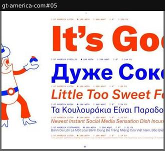
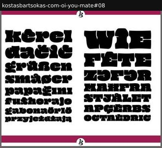
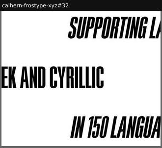

# language-support

Script and language coverage.

Sample: 3 blocks from 3 sites.

| variant | n | definition | recognise by |
|---|---|---|---|
| [multiscript-specimen](#multiscript-specimen) | 1 | Sample lines in several scripts, each tagged with script and settings. | LATIN / ARABIC / THAI labels |
| [diacritic-word-wall](#diacritic-word-wall) | 1 | Real words from many languages chosen for their diacritics, at display size. | accent-heavy words |
| [coverage-statement](#coverage-statement) | 1 | A big-type sentence stating the coverage instead of showing it. | 'Supports 200+ languages' |

## Rubric

Recorded for every instance in Phase 3, in addition to the cross-cutting attributes in `rubric.json`:

- **method**: samples | word-wall | statement | list | map
- **nonLatin**: true | false

## multiscript-specimen

Sample lines in several scripts, each tagged with script and settings.

**Recognise by:** LATIN / ARABIC / THAI labels

| example | look | feel | ux | learn |
|---|---|---|---|---|
| [gt-america-com#05](../../archive/gt-america-com/blocks/05.jpg) | White, red and blue lines in Latin, Cyrillic, Greek and Vietnamese at falling sizes, each with a tiny 'script · Wdth · Wght · 0° · px' caption; cartoon waiter at left | Playful, cosmopolitan, diner-menu | static | Write each language's line on one theme (food) so the coverage list reads like a menu, not a test |

## diacritic-word-wall

Real words from many languages chosen for their diacritics, at display size.

**Recognise by:** accent-heavy words

| example | look | feel | ux | learn |
|---|---|---|---|---|
| [kostasbartsokas-com-oi-you-mate#08](../../archive/kostasbartsokas-com-oi-you-mate/blocks/08.jpg) | White between magenta bands, fat black blobby display: lowercase words left, caps words right (kêrel, grüßen, ZƏFƏR, MAĦFRA) | Cheeky, bold, worldly | static | Pick words that each stress a different diacritic or special letter: coverage proven with no language table |

## coverage-statement

A big-type sentence stating the coverage instead of showing it.

**Recognise by:** 'Supports 200+ languages'

| example | look | feel | ux | learn |
|---|---|---|---|---|
| [calhern-frostype-xyz#32](../../archive/calhern-frostype-xyz/blocks/32.jpg) | White, black condensed italic caps 'SUPPORTING LATIN / GREEK AND CYRILLIC / IN 150 LANGUAGES' staggered left and right | Confident, punchy | static | State coverage as a headline set in the font: the claim and the specimen are the same line |
