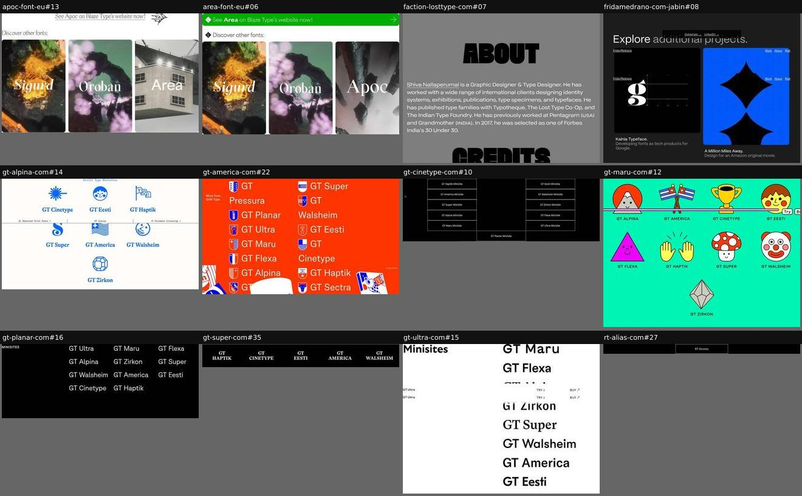
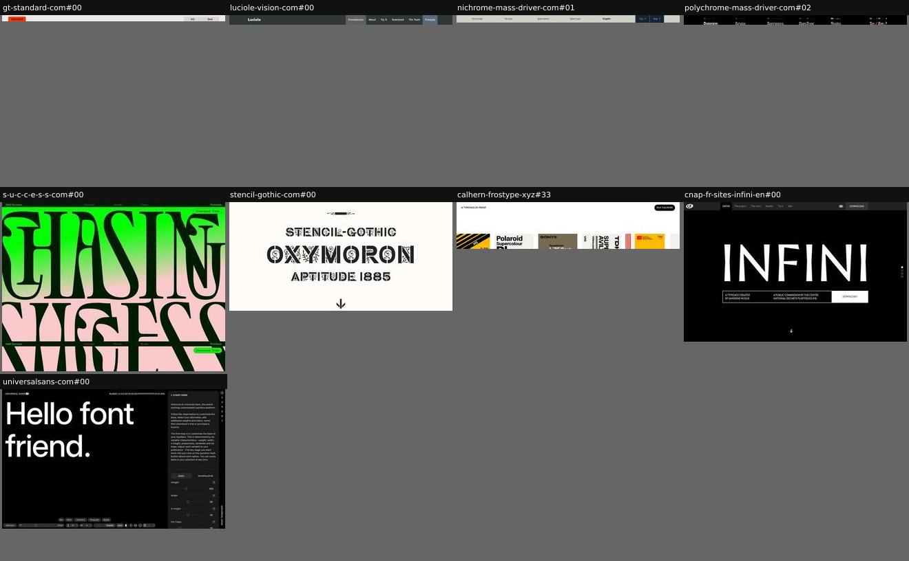
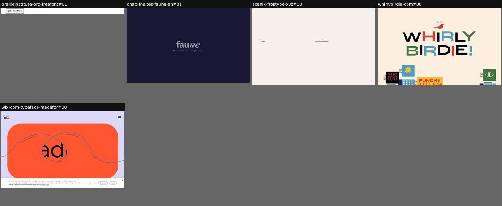
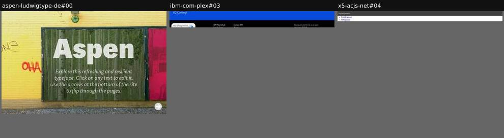

# navigation

_Section: Footer (discovered type, alongside footer)_

Wayfinding and cross-promotion beyond the global nav.

46 instances on 42 sites (the Phase 3 extraction of 181 sites).

| variant | sites | definition | recognise by |
|---|---|---|---|
| [related-projects](#related-projects) | 21 | Cards linking to the designer's or foundry's other fonts. | 'More from…' |
| [scroll-spy-nav](#scroll-spy-nav) | 14 | A fixed bar or tab strip of the page's chapters that marks the current one while scrolling (highlight, needle on a dial); click to jump. | chapter list with active state |
| [toc-drawer](#toc-drawer) | 8 | An off-canvas panel of section links opened from a fixed edge tab or menu icon. | edge tab, slide-out list |
| [next-chapter-link](#next-chapter-link) | 3 | A band at the end of a page linking to the next numbered page of a multi-page microsite. | “Next: 02 …” band |

## related-projects

Cards linking to the designer's or foundry's other fonts.

**Recognise by:** 'More from…'

| example | look | feel | ux | learn |
|---|---|---|---|---|
| [apoc-font-eu#13](../../archive/apoc-font-eu/blocks/13.jpg) | 'Discover other fonts:' over a row of three tall rounded video cards (Sigurd in fire, Oroban with a rock arch and pink blossoms, Area on a hovering concrete house), each name in white in its own font | Moody, collectible | Each card links to the foundry page of that family; draggable carousel | Give each sibling family its own 3D-rendered world as a looping card: cross-selling becomes a trailer reel |
| [area-font-eu#06](../../archive/area-font-eu/blocks/06.jpg) | 'Discover other fonts:' and three tall rounded video cards (fiery ember scene 'Sigurd', violet blossoms and rock arch 'Oroban', misty black pillars 'Apoc'), each name set large in white in its own typeface | Atmospheric, collectible | Each card links to that font's site; background videos loop | Give each sibling font its own short world-building video so cross-links feel like trailers |
| [faction-losttype-com#07](../../archive/faction-losttype-com/blocks/07.jpg) | 'ALSO' heading, one line of copy, then two full-column specimen banners: 'ORWELLIAN' over a grey ampersand on white, 'Enemy' over a grey 'a' on black | Collectible, poster-like | Each banner links to that family's Lost Type page; the page ends here | Cross-sell the designer's other faces with one specimen poster each rather than a list of names |
| [fridamedrano-com-jabin#08](../../archive/fridamedrano-com-jabin/blocks/08.jpg) | 'Explore additional projects.' at 78px in grey sans, then two big rounded cards with short captions: Kalnia Typeface, A Million Miles Away | Back to portfolio | Card click goes to the case study | Hard cut to a neutral portfolio section ends a themed page clearly |
| [gt-alpina-com#14](../../archive/gt-alpina-com/blocks/14.jpg) | 'Grilli Type Minisites': 7 blue pictograms (starburst, face, YO! flag, S, striped flag, winking face, faceted gem) above GT Cinetype, Eesti, Haptik, Super, America, Walsheim, Zirkon in a centred 3-column grid | Collectible, badge-like | Each name links to that family's minisite | Ship the sibling-site icons as glyphs of an icon font (mapped to CJK code points) so the cross-links are pure text |
| [gt-america-com#22](../../archive/gt-america-com/blocks/22.jpg) | 'More from Grilli Type': two columns of other GT family names at ~40px, each with a small Swiss-flag-style shield icon; the colophon sits just above | Branded, collectible | Each name links to that family's microsite | Give each sibling family a heraldic mini-logo so the cross-links feel like a collection |
| [gt-cinetype-com#10](../../archive/gt-cinetype-com/blocks/10.jpg) | 13 outlined boxes in two columns plus one centred below: 'GT Haptik Minisite', 'GT Eesti Minisite' … 'GT Planar Minisite' | Index-like | Each box links to a sibling microsite | Re-use the CTA box style for cross-links so the end of the page reads as one control panel |
| [gt-maru-com#12](../../archive/gt-maru-com/blocks/12.jpg) | A 4-column grid of sibling families, each an illustrated icon in the site's cartoon style above its name: a sun-and-mountain for GT Alpina, crossed flags for America, a trophy for Cinetype, a boy's face for Eesti, a pink triangle for Flexa, waving hands for Haptik, a toadstool for Super, a clown for Walsheim, a gem for Zirkon | Sticker sheet | Each tile links to the sibling microsite | Draw each sibling as a character in your site's own style: cross-promotion that feels like part of the world |
| [gt-planar-com#16](../../archive/gt-planar-com/blocks/16.jpg) | 'MINISITES' label and eleven GT family names in white at ~32px in a 3-column grid; a 'CREDITS' row (Dominik Huber, Patrick Savolainen, Josh Schaub, Jack Wild) sits just above but was not segmented | Quiet ending | Names link to the sibling minisites | End a spectacular page with plain text links: the calm is part of the landing |
| [gt-super-com#35](../../archive/gt-super-com/blocks/35.jpg) | Five-cell link bar 'GT HAPTIK · GT CINETYPE · GT EESTI · GT AMERICA · GT WALSHEIM' in the same ruled style as the CTA bar |  |  |  |
| [gt-ultra-com#15](../../archive/gt-ultra-com/blocks/15.jpg) | 'Minisites' heading on the left, and a right-hand list of ten sibling names (GT Maru, Flexa, Alpina, Zirkon, Super, Walsheim, America, Eesti, Cinetype, Haptik), each set in its own typeface | A shelf of siblings | Each name links to its microsite; two stacked images per link suggest a hover swap | Set each sibling's name in its own font (as images) so the cross-links are a mini specimen of the catalogue |
| [rt-alias-com#27](../../archive/rt-alias-com/blocks/27.jpg) | 'Check out other Razzia typefaces:' over three outlined white boxes 'RT Dromo', 'RT Rondelle', 'RT Vitrine', each linking to its own microsite |  |  |  |
| [rt-dromo-com#63](../../archive/rt-dromo-com/blocks/63.jpg) | Three stacked black bars with white names: RT Alias, RT Rondelle, RT Vitrine; the line 'Check out other Razzia typefaces:' above them was not cut into a block | Short ticket stubs | Each bar links to a sister microsite | Sister-site links as flat bars keep cross-promotion quiet |
| [rt-rondelle-com#65](../../archive/rt-rondelle-com/blocks/65.jpg) | 'Check out other Razzia typefaces:' over three outlined rectangular buttons 'RT Alias', 'RT Dromo', 'RT Vitrine' (each linking to its own microsite) |  |  |  |
| [s-u-c-c-e-s-s-com#18](../../archive/s-u-c-c-e-s-s-com/blocks/18.jpg) | 'Visit the other NaN Microsites' in Sans Black at 10vw on magenta, then three screenshot cards (sans-sheriff, infinite-tragedy, generativefonts) with URL captions | Club-like, cross-promotional | Each card opens the sibling microsite in a new tab | Cross-link microsites with screenshots rather than names: the visitor sees each site's personality before clicking |

_…and 6 more in the gallery (`npm run app`)._

## scroll-spy-nav

A fixed bar or tab strip of the page's chapters that marks the current one while scrolling (highlight, needle on a dial); click to jump.

**Recognise by:** chapter list with active state

| example | look | feel | ux | learn |
|---|---|---|---|---|
| gt-maru-com#13 | Fixed top bar: a long rounded progress bar that fills with the current chapter's colour as you scroll, colour-coded chapter tabs (Story, Design, Typeface, Mono, Mega, Emoji, Overview) that jump to each chapter (shown while loading or at the top), 'Loading…' then white 'Try' / 'Buy' pills |  |  |  |
| gt-mechanik-com#24 | Fixed bottom bar (inset 40px, 60px tall, white, olive border) styled as a radio tuner: magenta knob 'GT-MCNK' whose indicator rotates with scroll, a tick scale with MCNK 87.8 · MONO 91.2 · SEMI 95.6 · POLY 97.7 · INFO 99.2 and a needle, then pill buttons TYPE TESTER / TRY / BUY |  |  |  |
| [gt-standard-com#00](../../archive/gt-standard-com/blocks/00.jpg) | Slim light-grey top bar with a red 'standard' tab left and grey 'try' / 'buy' tabs right; each chapter starts with a 40px sticky label (design, system, platform, outro) that docks into the bar as a new tab coloured like its chapter (black, yellow, blue…), so the bar grows into a breadcrumb of chapters |  |  |  |
| [luciole-vision-com#00](../../archive/luciole-vision-com/blocks/00.jpg) | Sticky dark-green bar: 'Luciole' in Bold left, section links right with the current one on a grey tab, 'Français' language switch in a slate tile, plus a skip-to-content link for keyboards. It is repainted over the crops of the following blocks (a capture artefact of sticky positioning) |  |  |  |
| [nichrome-mass-driver-com#01](../../archive/nichrome-mass-driver-com/blocks/01.jpg) | Sticky 50px sage bar: Overview, Design, Specimens, OpenType, Glyphs in small mono spread across, the current chapter set bold, plus dark navy 'Try ↗' and 'Buy ↗' boxes at the right |  |  |  |
| [polychrome-mass-driver-com#02](../../archive/polychrome-mass-driver-com/blocks/02.jpg) | Sticky 62px black bar with the chapter links Overview, Design, Specimens, OpenType, Glyphs set in MD Polychrome (~24px), the current chapter white and the others grey, and a pink 'Try / Buy ↗' at the right |  |  |  |
| [s-u-c-c-e-s-s-com#00](../../archive/s-u-c-c-e-s-s-com/blocks/00.jpg) | Fixed 32px near-black bar: 'NaN Success' in neon green left, Concept / Testing / Styles in grey centre (the current chapter turns green), 'Purchase' right, and a neon-green 'Download Trials' pill hanging below it on the right; never cut as a block, attached here | Discreet, like a system bar | Anchor links to #concept, #testing, #styles; the active chapter's link lights up green as you scroll; on mobile it collapses to a 'Menu' button | A one-colour change on the current chapter link is enough scroll-spy feedback when the bar is otherwise grey |
| [stencil-gothic-com#00](../../archive/stencil-gothic-com/blocks/00.jpg) | Never cut as a block (fixed): bottom-left stack ABOUT / RESEARCH / REVIVAL / PURCHASE in tiny tracked caps with the active item reversed black on cream, and a vertical rule at left; visible in stitched crops 03, 05 and 08 | Discreet | Active item follows scroll; clicking jumps to the section | Tiny fixed nav in a corner keeps a long article scholarly; a reversed bar is enough to mark the current chapter |
| basco-typofonderie-com#08 | Slim butter-yellow top bar that slides in after the hero: 'Basco → LANDSCAPES' naming the current chapter, cart icon right; offscreen in the DOM and stitched repeatedly into crops 01-06 |  |  |  |
| [calhern-frostype-xyz#33](../../archive/calhern-frostype-xyz/blocks/33.jpg) | Beyond the capture: a sticky left sidebar for the technical section with 'Styles / Glyphs / Support / Features' links above a metrics card (a big 'A' on Cap-Height 680, x-Height 500, Baseline 000, Descender −200 lines) and 'CALHERN Grotesk Sans 78 Styles 13 Weights · From £50.00 GBP · Buy' | Spec-sheet, orderly | The links jump to and highlight the current sub-section; the card stays visible while the right column scrolls | Pin a spec card with the glyph metrics and price beside the technical lists: reference and purchase stay in view together |
| [cnap-fr-sites-infini-en#00](../../archive/cnap-fr-sites-infini-en/blocks/00.jpg) | Four small outlined dots fixed at the right edge, the current section's dot filled (white on the black hero, black on the white slides) | Unobtrusive | Marks which of the four full-screen sections is active; clicking a dot jumps there | A dot column is all a snap-scrolling deck needs for orientation |
| gt-flaire-com#07 | Narrow vertical OS-style tab strip at the left edge: 'GT Flaire' then rotated tabs Intro · Learn · Design · Facts · Test · Buy, the current section's tab highlighted in purple |  |  |  |
| karrik-phantom-foundry-com#10 | Fixed tiny grey links top-left 'Informations  Specimen  Download  Game'; the current chapter turns white (Specimen, Download, Game in the stitched screens); 'Menu' toggle on mobile |  |  |  |
| [universalsans-com#00](../../archive/universalsans-com/blocks/00.jpg) | A 45px rail at the right edge with step numbers 1–7 stacked at the top (current one in a circle) and 'UNIVERSAL SANS' set vertically at the bottom; a hover menu names the steps (Geometry, Alternates, Weights, Italics, Optical Size, Name, Download) | Quiet progress indicator | Marks the step currently in view in the panel; click a number to jump; the vertical name opens the information drawer | A numbered rail doubles as progress bar and table of contents for a multi-step tool |

## toc-drawer

An off-canvas panel of section links opened from a fixed edge tab or menu icon.

**Recognise by:** edge tab, slide-out list

| example | look | feel | ux | learn |
|---|---|---|---|---|
| editorialnew-com#14 | 490px panel sliding in from the left edge (opened from the rotated 'Table of contents' rail and ☰ icon): 'Editorial New', numbered section links Introduction, Customization, Characters, Font Sampler, Applications, Special Characters, 'Get (the font)', then foundry/agency links and Terms, FAQ, Contact |  | Links smooth-scroll to section anchors; the current section is marked is-current |  |
| pp-fragment-com#12 | Off-canvas left drawer (~510px) opened from the vertical 'Table of Contents' tab: 'Fragment' title, links Introduction · From Sans to Serif · Glyph Set · Font Sampler · Fragment in Use · Special Characters, 'Get 〖the font〗', and Pangram Pangram / Locomotive / Terms / FAQ / Contact |  |  |  |
| [brailleinstitute-org-freefont#01](../../archive/brailleinstitute-org-freefont/blocks/01.jpg) | Small outlined '☰ Section Menu' button at the top-left of the content (navy offset shadow) that opens a panel of the section's sub-pages |  |  |  |
| [cnap-fr-sites-faune-en#01](../../archive/cnap-fr-sites-faune-en/blocks/01.jpg) | A small fixed 'Menu' label with three lines at the left edge, mid-height, visible over every section (never cut as a block) | Unobtrusive | Opens a panel listing Home, Foreword, Faune (with essay chapters: Introduction, Reinventing the notion of a typeface family, A collaboration with the Imprimerie Nationale, …), Mix-and-match, Download, Credits; 'Retour' closes it | List the essay's chapters inside the menu so readers can jump into a long text from anywhere |
| exat-hottype-co#12 | Hidden full-screen menu (HTML only) listing the chapters in large type: About font, Type tester, Extensive Character Set, Design Space, Stylistic Sets, Open Type Features, Language Support | Poster-like index | Opened from the hamburger; each item scrolls to its section | A full-screen chapter list in display size doubles as one more specimen |
| [scenik-frostype-xyz#00](../../archive/scenik-frostype-xyz/blocks/00.jpg) | Never captured open: a two-line burger icon at the top-right of the fixed header opens a panel with a progress bar, the nine chapter links (Foreword, Family, Styles, Origins, Variables, Features, Mood, Glyphs, Support) and a long repeated sentence 'FT Scenik builds a bridge between the American Gothic and European Grotesque…' | Calm, magazine-like | Burger toggles the drawer; a progress bar shows how far down the page you are; links jump to section anchors | Put a reading-progress bar inside the chapter drawer: the menu doubles as a sense of where you are in a long specimen |
| [whirlybirdie-com#00](../../archive/whirlybirdie-com/blocks/00.jpg) | A small white circular button fixed top-left showing a Whirlybats pictogram that changes with the section (gear, camera, pointing hand, piggy bank); never cut as its own block | Discreet, witty | Click opens a full-screen nav with four big entries: Whirly Birdie, Whirlybats, Playground, Buy Now! each flanked by a pictogram; the current one is marked selected | Let the menu button's icon be a dingbat that swaps per section: it doubles as a section indicator and a teaser of the dingbat font |
| [wix-com-typeface-madefor#00](../../archive/wix-com-typeface-madefor/blocks/00.jpg) | WIX logo top-left and a hamburger icon top-right on the hero; the menu lists Introduction, Typetester, Glyphs, Design features, Examples, Signs, Philosophy; attached to the hero, not cut as a block | Unobtrusive | The burger opens a chapter menu; closed state only in the capture | Numbered chapters in the page pair well with a menu listing them by the same names |

## next-chapter-link

A band at the end of a page linking to the next numbered page of a multi-page microsite.

**Recognise by:** “Next: 02 …” band

| example | look | feel | ux | learn |
|---|---|---|---|---|
| [aspen-ludwigtype-de#00](../../archive/aspen-ludwigtype-de/blocks/00.jpg) | A round translucent white arrow button fixed bottom-right, linking to the next page; attached to the screen block, never cut on its own | Slideshow pager | Click goes to vote.html; left-side round buttons appear for share and download | One round arrow turns a set of photo pages into a flip-book |
| [ibm-com-plex#03](../../archive/ibm-com-plex/blocks/03.jpg) | Full-width IBM-blue band with '↓' and '02 Concept' in white (~24px Plex Sans) linking to /plex/concept/ |  |  |  |
| [x5-acjs-net#04](../../archive/x5-acjs-net/blocks/04.jpg) | 'Higher powers' section with a two-item bullet list linking to the separate pages /n4 and /n5, which are too large to inline; thin dark section bar |  |  |  |
