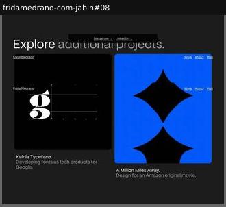

# navigation

Wayfinding and cross-promotion beyond the global nav.

Sample: 1 blocks from 1 sites.

| variant | n | definition | recognise by |
|---|---|---|---|
| [related-projects](#related-projects) | 1 | Cards linking to the designer's or foundry's other fonts. | 'More from…' |

## related-projects

Cards linking to the designer's or foundry's other fonts.

**Recognise by:** 'More from…'

| example | look | feel | ux | learn |
|---|---|---|---|---|
| [fridamedrano-com-jabin#08](../../archive/fridamedrano-com-jabin/blocks/08.jpg) | Charcoal field, 'Explore additional projects.', two image cards (glyph with metrics, blue diamond shapes) with captions; fixed bars repeated by capture | Portfolio-polished, restrained | Click a card to visit another project | Ending a microsite with sibling projects keeps visitors inside the designer's world instead of bouncing |
