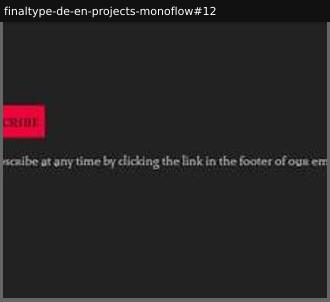

# newsletter

_Section: Checkout (discovered type, alongside checkout)_

Email capture.

Sample: 1 blocks from 1 sites.

| variant | n | definition | recognise by |
|---|---|---|---|
| [email-signup](#email-signup) | 1 | Email field and subscribe button. | input type=email |

## email-signup

Email field and subscribe button.

**Recognise by:** input type=email

| example | look | feel | ux | learn |
|---|---|---|---|---|
| [finaltype-de-en-projects-monoflow#12](../../archive/finaltype-de-en-projects-monoflow/blocks/12.jpg) | Dark, red subscribe button, privacy note in serif | Foundry housekeeping | Email input and subscribe | - |
