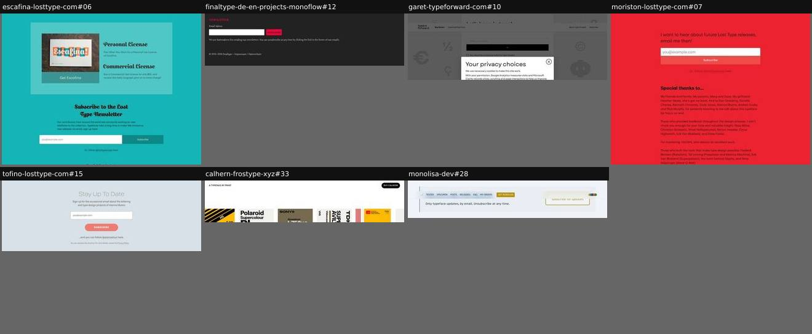

# newsletter

_Section: Checkout (discovered type, alongside checkout)_

Email capture.

9 instances on 9 sites (the Phase 3 extraction of 181 sites).

| variant | sites | definition | recognise by |
|---|---|---|---|
| [email-signup](#email-signup) | 9 | Email field and subscribe button. | input type=email |

## email-signup

Email field and subscribe button.

**Recognise by:** input type=email

| example | look | feel | ux | learn |
|---|---|---|---|---|
| [escafina-losttype-com#06](../../archive/escafina-losttype-com/blocks/06.jpg) | On teal, below a repeat of the riso-print buy card: script heading 'Subscribe to the Lost Type Newsletter', a short reason, a white email field joined to a darker teal 'Subscribe' button, and 'Or, follow @losttypecoop here.' | Community, low-pressure | Mailchimp form in a new tab; Twitter alternative | Explain the cadence ('typefaces take a long time to make') so the signup promises rare, worthwhile email |
| [finaltype-de-en-projects-monoflow#12](../../archive/finaltype-de-en-projects-monoflow/blocks/12.jpg) | In the charcoal footer: red small caps 'NEWSLETTER', label 'Email Adress', a white input and a red 'SUBSCRIBE' button, a one-line note about Buttondown | Unobtrusive | Email field and submit (Buttondown) | One line explaining the mailing provider and unsubscribe makes the form feel trustworthy |
| [garet-typeforward-com#10](../../archive/garet-typeforward-com/blocks/10.jpg) | 'Let's keep in touch' centred between two grids of cells each holding one large glyph (ä € ½ ç | ж ß © Φ) in mixed weights; email field, full-width black '↳' submit, consent checkbox and small print | Tidy, specimen-like even for a form | Brevo form with consent checkbox and inline errors; the variable-weight glyph cells (wvar) shift weight | Frame the sign-up form with single glyph specimens in the grid so even the newsletter section shows the font |
| [moriston-losttype-com#07](../../archive/moriston-losttype-com/blocks/07.jpg) | On bright red, the line 'I want to hear about future Lost Type releases, email me then!', a white email field and a lighter red full-width 'Subscribe' bar, 'Or, follow @losttypecoop here' underneath | Chatty, friendly | Mailchimp form posts in a new tab; Twitter as the alternative | Write the signup prompt in the visitor's voice ('I want to hear…, email me then!'), and the prompt line is itself editable type |
| [tofino-losttype-com#15](../../archive/tofino-losttype-com/blocks/15.jpg) | Pale blue-grey band: thin 'Stay Up To Date', a line about Alanna Munro's lettering and type projects, a white email field, a coral 'SUBSCRIBE' pill, '…and you can follow @alannamun here.' and a privacy note | Quiet, personal | MailerLite form posts in a new tab; Twitter link | Make the newsletter about the designer, not the font: the specimen becomes the entry point to a person's work |
| [calhern-frostype-xyz#33](../../archive/calhern-frostype-xyz/blocks/33.jpg) | Beyond the capture (video): 'FREE TRIAL / TRY BEFORE YOU BUY' in tall condensed caps on black with an underlined field 'Enter your email for trials', a 'SUBSCRIBE' button and 'Please don't use the trials in any published or commercial work.' | Plain, trustworthy | Mailchimp form: the email gets the trial fonts (and joins the list) | Gate trials behind an email field on the page: one input, a clear usage note |
| [monolisa-dev#28](../../archive/monolisa-dev/blocks/28.jpg) | A ruled box: 'Stay up to date with MonoLisa — Only typeface updates, by email. Unsubscribe at any time.' with an outlined gold 'Subscribe for updates' button at right | Low-key | Button links to an external sign-up form (no field on the page) | A link-out sign-up keeps the page free of forms and tracking scripts |
| grandgothik-com#18 | Hidden modal 'FREE TRIAL FONTS' (HTML only, never shown in the capture): name and e-mail fields, checkboxes for newsletter and Trial Font EULA, reCAPTCHA and submit | Formal gate | Trial download gated behind a mailing-list sign-up (the desktop TRIAL link goes straight to a Dropbox zip instead) | Gating the trial behind the newsletter trades a free download for a lead; keep the EULA checkbox next to it |
| universalsans-com#02 | 'Stay in touch 👋' with an email field and a grey 'Subscribe for updates' button, seen on the mobile fallback page (the form also sits in the DOM for desktop, not visible in the capture) | Casual | Email field (required) and submit | When the main tool cannot run on phones, capture the visitor's email so they come back on desktop |
