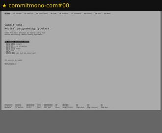
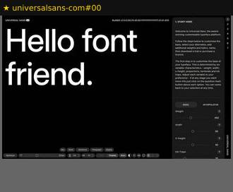

# playground-app

_Section: Type tester (discovered type, alongside type-tester)_

The whole site is an application rather than a scrolling page.

2 instances on 2 sites (the Phase 3 extraction of 181 sites).

| variant | sites | definition | recognise by |
|---|---|---|---|
| [keyboard-driven-app](#keyboard-driven-app) | 1 | A single-screen app driven by keyboard shortcuts. | key legend, no scroll |
| [configurator-wizard](#configurator-wizard) | 1 | A one-screen app where numbered steps build the visitor's own version of the font (axes, alternates, weights, name) with a live preview, saved as a shareable ID and ending in trial or purchase. | numbered steps, big preview, share/buy at the end |
| [desktop-os-windows](#desktop-os-windows) | 0 | The site staged as a desktop OS with draggable windows. | windows, taskbar, wallpaper |

## keyboard-driven-app

A single-screen app driven by keyboard shortcuts.

**Recognise by:** key legend, no scroll

| example | look | feel | ux | learn |
|---|---|---|---|---|
| [★ commitmono-com#00](../../archive/commitmono-com/blocks/00.jpg) | A flat mid-grey screen with black 12–24px mono text, a row of numbered section tabs on top and a legend of keycaps along the bottom. No images, no display sizes: it resembles a terminal or an old manual | A tool for programmers, not a page about one | No scrolling: ↑↓←→ move focus between controls, 1 2 3… jump to sections, WASD scrolls inside a section, + − zoom, ENTER/ESC edit text, R reset, B L I weight and italic, M light/dark, C high contrast, H hides keys. All state restyles the whole site live. Mobile shows a warning to use desktop for all features | Make navigation part of the pitch: a site driven like an editor proves to programmers that the designer thinks like them, and global shortcuts turn every paragraph into a specimen |

## configurator-wizard

A one-screen app where numbered steps build the visitor's own version of the font (axes, alternates, weights, name) with a live preview, saved as a shareable ID and ending in trial or purchase.

**Recognise by:** numbered steps, big preview, share/buy at the end

| example | look | feel | ux | learn |
|---|---|---|---|---|
| [★ universalsans-com#00](../../archive/universalsans-com/blocks/00.jpg) | Black app screen: huge white 'Hello font friend.' filling the left 3/4, a charcoal side panel at right headed '1. START HERE' with intro copy, BASIC | INTERPOLATOR pill tabs and slider rows (Weight 450, Width 50, X-height 40, Ink Traps 25…) each with a '?' button, a numbered step rail 1–7 on the far right edge, and a slim top bar with 'UNIVERSAL SANS 2.0' and the live 'BuildID v2.0.0.50.25.40.50.1111…450' | A design tool, not a brochure: calm, confident, empowering | Work down seven steps: 1 Geometry (six axis sliders or the XY interpolator), 2A–2C Alternates (pick numbered variants for a, a spur/tail, g, shoulder hn, y, terminal curve tfj, l, J, Q, R, G, K/k junction; numerals 1 2 3 7 6&9; round or square dots, curly or straight punctuation), 3 Add weights (+/– extra weights), 4 Add italics (9° slant, single-storey a option), 5 Optical size (Text, Display or both), 6 Name your typeface, 7 Download (trial or licence); every choice updates the sample and the BuildID in the URL hash so the build can be saved and shared | Turn the variable font's design space into a guided build-your-own-family flow: numbered steps, a '?' explanation for every option and a URL-encoded build ID make an open-ended configurator feel safe and finishable |

## desktop-os-windows

The site staged as a desktop OS with draggable windows.

**Recognise by:** windows, taskbar, wallpaper

_No instance yet._
