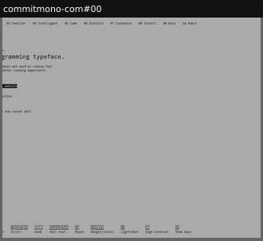
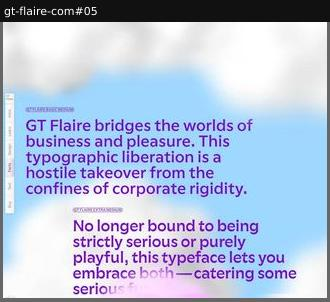

# playground-app

The whole site is an application rather than a scrolling page.

Sample: 2 blocks from 2 sites.

| variant | n | definition | recognise by |
|---|---|---|---|
| [keyboard-driven-app](#keyboard-driven-app) | 1 | A single-screen app driven by keyboard shortcuts. | key legend, no scroll |
| [desktop-os-windows](#desktop-os-windows) | 1 | The site staged as a desktop OS with draggable windows. | windows, taskbar, wallpaper |

## keyboard-driven-app

A single-screen app driven by keyboard shortcuts.

**Recognise by:** key legend, no scroll

| example | look | feel | ux | learn |
|---|---|---|---|---|
| [commitmono-com#00](../../archive/commitmono-com/blocks/00.jpg) | Monospace UI, grey, numbered section tabs, key legend along the bottom | Tool-like, nerdy, calm | Arrow keys navigate, keys toggle weight, italic, light/dark, zoom; text fields editable | For a coding font, let visitors use it the way they will use it: from the keyboard |

## desktop-os-windows

The site staged as a desktop OS with draggable windows.

**Recognise by:** windows, taskbar, wallpaper

| example | look | feel | ux | learn |
|---|---|---|---|---|
| [gt-flaire-com#05](../../archive/gt-flaire-com/blocks/05.jpg) | Pastel cloud wallpaper, big purple manifesto paragraphs, then retro OS windows: GT Shop, Credits, Flaire Book, Site Explorer, taskbar | Playful, nostalgic, ironic-corporate | Drag windows around; glyph viewer with weight/flair/italic sliders and alternates switch; taskbar jumps | An OS-desktop metaphor turns dull facts (buy, credits, charset) into objects people want to poke |
