# specimen-showcase

_Section: Specimen showcase_

The family shown in use or in display compositions.

221 instances on 120 sites (the Phase 3 extraction of 181 sites).

| variant | sites | definition | recognise by |
|---|---|---|---|
| [in-use-mockups](#in-use-mockups) | 49 | Realistic applications (posters, books, screens, signage, client work) as a wall, carousel, shuffler or filmed object. | photographic mockups, credits |
| [word-stack](#word-stack) | 35 | Display words or phrases stacked vertically, often cropped, for rhythm and character. | huge words, one per line |
| [poster-series](#poster-series) | 32 | A sequence of self-contained poster or specimen-page compositions, often pastiching a period. | full-width graphic panels one after another |
| [prop-collage](#prop-collage) | 16 | Invented artefacts (UI windows, tickets, files, stickers) set in the font, collaged into a scene. | fictional brand objects, humour |
| [kinetic-scenes](#kinetic-scenes) | 15 | Animated, generative or physics compositions (falling or scattered glyphs, liquid) after the hero. | canvas/WebGL, overlapping glyphs |
| [use-case-samples](#use-case-samples) | 9 | Tabs or panels with realistic content samples per use case (code, data tables, UI). | tabs: SQL | finance | … |
| [size-waterfall](#size-waterfall) | 7 | The same running text at a descending series of labelled sizes, from display to caption, often in several weights side by side; sometimes a light/dark switch. | px labels, shrinking repeated text |
| [editorial-in-use](#editorial-in-use) | 6 | The font running a real or realistic publication (articles, magazine pages) with genuine content. | headlines, bylines, body copy |
| [modular-grid](#modular-grid) | 6 | A uniform grid of cells mixing large glyphs, sentences and notes, like a specimen sheet. | equal cells, mixed content |
| [themed-infographic](#themed-infographic) | 5 | An interactive infographic on the font's theme, set in the font so the numerals and labels do real work. | data, line-ups, timetables |
| [slider-morph-mockups](#slider-morph-mockups) | 2 | Realistic layouts (ads, tickets, flyers) each with an axis slider that morphs the whole design between the axis extremes. | mockup plus slider underneath |
| [generative-layout-stream](#generative-layout-stream) | 1 | An endless scroll appending randomly composed layout modules (columns, captions, lists, display words) with themed, often editable copy. | infinite scroll, varied modules |
| [draggable-glyph-tiles](#draggable-glyph-tiles) | 1 | Overlapping square tiles of huge cropped glyphs (some animated GIFs) that the visitor can drag and resize into their own collage; the specimen is a pile of cards on a table rather than a fixed layout. | overlapping square glyph tiles, drag handles |

## Rubric

Recorded for every instance in Phase 3, in addition to the cross-cutting attributes in `rubric.json`:

- **medium**: type-only | photo-mockup | illustration | video | generative | ui
- **sequence**: single | series | grid | carousel

## in-use-mockups

Realistic applications (posters, books, screens, signage, client work) as a wall, carousel, shuffler or filmed object.

**Recognise by:** photographic mockups, credits

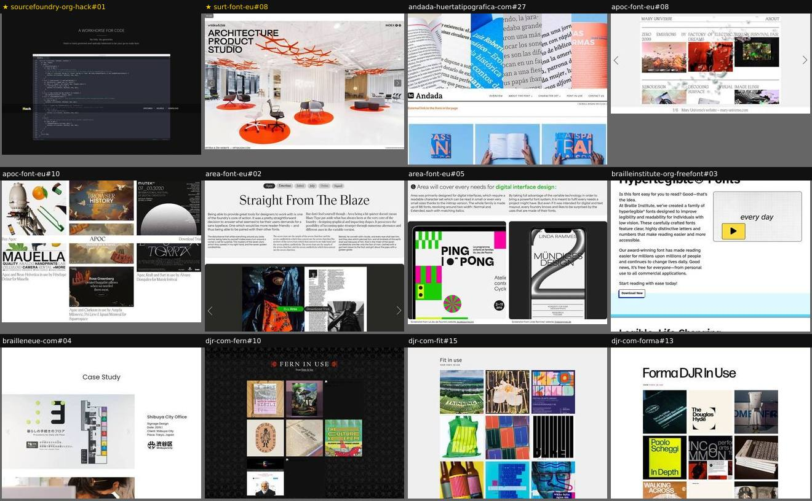

| example | look | feel | ux | learn |
|---|---|---|---|---|
| [★ sourcefoundry-org-hack#01](../../archive/sourcefoundry-org-hack/blocks/01.jpg) | 'A WORKHORSE FOR CODE' heading, 'No frills. No gimmicks.', then one large screenshot of a dark code editor showing syntax-highlighted Angular source set in Hack | Honest, at-work | Static image | For a code font the single most convincing proof is the real environment: a full editor window at true size, with line numbers and syntax colours |
| [★ surt-font-eu#08](../../archive/surt-font-eu/blocks/08.jpg) | 'IN USE' tab, one large carousel slide (Vrtiška & Žák architecture studio website with orange ceiling sculptures) with arrows and a dot strip, then a three-column masonry of small carousels (Rencontres Photographiques, Enzo Carniel at La Petite Halle poster, HIAS website, Tirana Art Lab, Studio Futura vinyl, Hinkilink identity, Lily Paris West, Milid app, Sneakers Generator), each captioned in small caps with green/grey dot pagination | Credible, a portfolio of real clients | Each project is its own looping, draggable carousel; the dots after the caption show its slide count | Give every in-use project its own mini-carousel and put the dots in the caption line: a dense wall that still lets each project show several views |
| [andada-huertatipografica-com#27](../../archive/andada-huertatipografica-com/blocks/27.jpg) | A collage banner of book pages in Andada, then 'External link to the Fonts in Use page' and project after project as 3×2 photo grids of books (Transpassar, a Chinese horoscope, Nosotros Valemos, La jarana de Mario…), each with title, short description, designer, font pairing and a [fontsinuse] link | Credible, real-world, book-heavy | Links to each Fonts In Use entry (crop truncated by the 30,000px capture limit) | Show real book projects with their font pairings ('Andada + Montserrat'): text faces are proven in pages, not posters |
| [apoc-font-eu#08](../../archive/apoc-font-eu/blocks/08.jpg) | A one-up carousel of website screenshots on light grey (Mary Universe's site with a project grid, Women in the forest, Acla Essentials…), thin chevron arrows at both edges, caption '1/6 Mary Universe's website — mary-universe.com' | Clean, gallery-like | Arrows or drag change slide; loops; the counter and caption update | Show the font in real websites by real clients, one at a time with a counter and URL credit |
| [apoc-font-eu#10](../../archive/apoc-font-eu/blocks/10.jpg) | Three columns of client work: Mauella's still-life photo and 'MAUELLA' sign, a stack of three Squarespace 'Browser History' campaign screens with clouds and doves, and a Mutek festival poster; captions credit fonts and designers ('Apoc and Clarkson in use by Angela Milosevic…') | Credible, varied | static | Caption each in-use image with the pairing used and the designers: the gallery doubles as pairing advice |
| [area-font-eu#02](../../archive/area-font-eu/blocks/02.jpg) | Dark rounded carousel of real projects: a Submarine magazine spread (fashion photo with 'Taller de colecciones y editorial de moda', dense text page) and Zeppelin Museum pieces, with thin < > arrows and a caption '1/10 Submarine magazine, issue 1, April 2021 — awayo.studio' | Credible, stylish | Arrow buttons step through 10 slides (Splide), with a counter and credit | Credit each in-use image with the publication and studio: real clients beat mockups |
| [area-font-eu#05](../../archive/area-font-eu/blocks/05.jpg) | '❺ Area will cover every needs for digital interface design:' then two dark rounded tiles: a laptop showing the Jeu de Paume 'PING PONG' kids programme site in green and pink, and a phone with Linda Rammes' 'MÜNDIGES DESIGN' site, each credited with a link | Practical, current | Caption links to the real websites | For an interface typeface, show real sites on device frames, cropped tight on the type |
| [brailleinstitute-org-freefont#03](../../archive/brailleinstitute-org-freefont/blocks/03.jpg) | 'Hyperlegible® Across Industries': 2×3 grid of rounded photo cards of real uses (Blue Origin website, Munich MVG departure sign, makeup packaging, book covers, a brochure, the USC Roski Eye Institute report) each titled Websites / Signage / Packaging / Print Publications / Digital Tools and Software / Employee Communications with a benefit line | Trustworthy, wide-reaching | static; final line 'Contact us today' for companies | Label in-use photos by industry with one benefit each: visitors find their own context instead of browsing a mood wall |
| [brailleneue-com#04](../../archive/brailleneue-com/blocks/04.jpg) | 'Case Study': three rows, each a photo carousel on the left (Shibuya City Office floor signage with a dot-and-number '3', a child reading a Panasonic Center exhibit, the 'Fix me.' storybook) and on the right the project name, type of work, date, client, place and the client's logo | Credible, real-world | Each image area has prev/next arrow zones (60px wide) at its edges to page photos | For an accessibility typeface, real public installations (city hall signage, exhibitions, a children's book) are the strongest legibility argument: show them with client and date |
| [djr-com-fern#10](../../archive/djr-com-fern/blocks/10.jpg) | On a black damask texture of the ornaments, 'FERN IN USE' with 'From Fonts In Use' under it, then a 3-column grid of square thumbnails (book covers, a chicken-shack logo, an engraved stone, a magazine spread); 3 of the 8 images failed to load in the capture | Proof of real use, framed like an endpaper | Each thumbnail links to its Fonts In Use page; on hover the image fades to 50% and a white title tag appears bottom-left | Pull the in-use grid live from Fonts In Use so the page stays current, and reuse the ornament texture as the backdrop |
| [djr-com-fit#15](../../archive/djr-com-fit/blocks/15.jpg) | 'Fit in use — FROM FONTS IN USE': a 3-column grid of 20 square photos of real work set in Fit (posters, beer labels, tote bags, book covers, a crop-field installation) | Credible, varied | Each tile links to its Fonts In Use entry | Pull real uses from Fonts In Use into a square grid: proof that a wild display face gets used |
| [djr-com-forma#13](../../archive/djr-com-forma/blocks/13.jpg) | 'Forma DJR In Use' with a small 'FROM FONTS IN USE' credit, then a 3-column grid of 24 square thumbnails (Severance props, book covers, posters, magazines, an app screen) | Busy, credible | Each tile links to its Fonts In Use entry | Pull in-use examples from Fonts In Use thumbnails: an always-current proof wall with no curation cost |
| [djr-com-gimlet#16](../../archive/djr-com-gimlet/blocks/16.jpg) | 'Gimlet In Use' with a small 'FROM FONTS IN USE' label, then a 3×3 grid of square photos of real uses (Slaughterhouse-Five edition, a recipe book, a magazine cover 'Sole Legend', a poster, matchboxes, magazines, a report) | Proof by real work | Each tile links to its Fonts In Use entry | Pull real uses from Fonts In Use into a square grid: credible social proof with no mockup work |
| [djr-com-job-clarendon#25](../../archive/djr-com-job-clarendon/blocks/25.jpg) | On electric blue, 'Job Clarendon in use' in mint green with 'From Fonts In Use', then a 3-column grid of 11 square photos (film-club poster, Vietnamese book spread, newspaper, album covers, transit posters) | Evidence of real adoption | Each tile links to Fonts In Use; hover dims the image and shows a white title tag | Recolour the shared in-use grid's heading to the page palette so the template module feels native |
| [djr-com-roslindale#11](../../archive/djr-com-roslindale/blocks/11.jpg) | On cream, 'Utility.' at ~360px, a short paragraph, then a staggered collage of 16 in-use images that bleed off both edges (La Rústica pizza menu and box, The Politician poster, Felt, Omelet logo and mugs, Haus, Trucks and Taps, Hellas Banknotes, Styx, Pillar, Peter Demulsant, Shopify), each with a tiny mono caption tab | Abundant, proof-of-versatility | Static gallery; heading editable and drifting with scroll | Let the in-use collage break the column and the page edges: it signals real-world range more than a tidy grid |

_…and 42 more in the gallery (`npm run app`)._

## word-stack

Display words or phrases stacked vertically, often cropped, for rhythm and character.

**Recognise by:** huge words, one per line

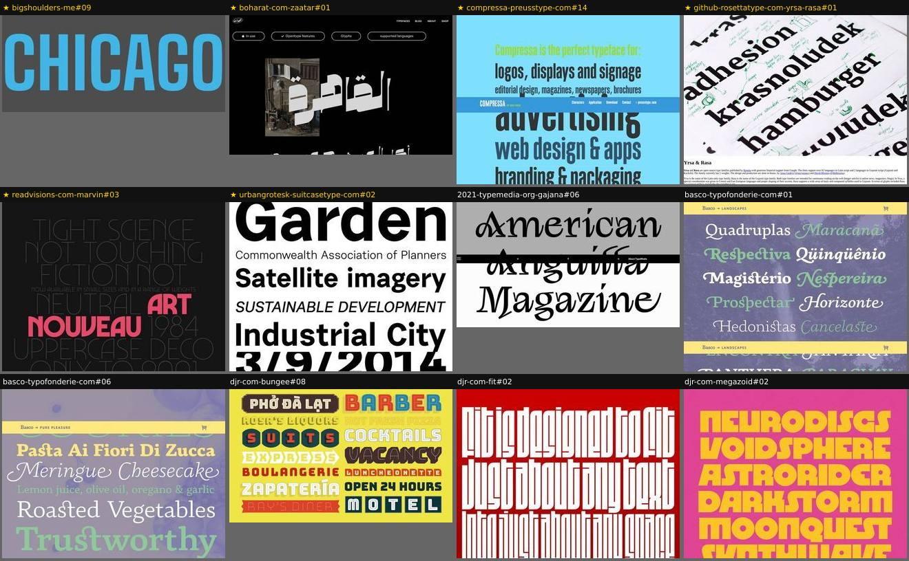

| example | look | feel | ux | learn |
|---|---|---|---|---|
| [★ bigshoulders-me#09](../../archive/bigshoulders-me/blocks/09.jpg) | Sandburg's full poem in the column: 'CHICAGO' at 220px in blue, then stanza after stanza of lines fitted to 700px in shifting weights and small caps, the size set by line length, with BAREHEADED, / SHOVELING, / WRECKING… running Thin to Black and a red 'Laughing!' at 212px | Loud, muscular, read aloud | Static; a plain scroll, the page rhythm comes from the changing line sizes | A public-domain text with a rhythm of its own does the art direction: fitting every line to the measure and mapping weight to the words gives you a whole-page poster for free |
| [★ boharat-com-zaatar#01](../../archive/boharat-com-zaatar/blocks/01.jpg) | On black, Egyptian colloquial sayings set huge in light grey and centred ('القاهرة', 'أكل العيش صعب ومرّ' twice, 'مساكين بنضحك من البلوة', 'الصبر' in a 2×2 pair, 'حكي كلونيا حكي جاتوه'), each paired with a small vintage film still (a Cairo alley, an oud player, two actors laughing) tucked behind or beside the words | Warm, witty, cinematic-nostalgic | Plain scroll; a green four-way arrow icon between the 'الصبر' pairs and tiny green 'M' / 'E' marks around 'حكي' are decorative | Use well-known film lines and sayings of the target culture as specimen copy, with a still from the source: local readers recognise the words before they judge the letters |
| [★ compressa-preusstype-com#14](../../archive/compressa-preusstype-com/blocks/14.jpg) | 'Compressa is the perfect typeface for:' in lime, then a justified tower of use cases, each line slab-fitted to the same width so sizes swing from ~70px ('editorial design, magazines, newspapers, brochures') to 515px ('t-shirts'), ending 'You have so many, many, many creative possibilities!' in italic | Exuberant, poster wall | Every other line pulses lighter/darker (blinking) as you scroll past | Fit every line of a list to one column width: line length drives the size, so short words become huge and the list becomes a typographic poster |
| [★ github-rosettatype-com-yrsa-rasa#01](../../archive/github-rosettatype-com-yrsa-rasa/blocks/01.jpg) | Two tall specimen sheets (SVG images) of rows separated by hairlines, alternating teal and black, mixing sizes and weights: 'Safflowers', a Bharata quote, '¿Qué está pasando?', a Lithuanian paragraph, 'Harmonious performance', 'Jedyne £64', 'Theater & Dance', two-column sonnet text, 'Süßholzraspeln', Polish, then Gujarati: 'શેરી નાટકો', 'હો રે છબીલા તારા', a bilingual two-column note on the Natya Shastra, ending with 'Tickets 156₹ | ટિકિટ ૧૫૬₹ | ટિકિટ 156₹' | Elegant, literary, festival-programme | static images | Theme one specimen sheet around a subject that belongs to both scripts (Indian theatre and dance) and end with a mixed-script line (prices in Latin and Gujarati numerals): harmony between scripts is shown, not claimed |
| [★ readvisions-com-marvin#03](../../archive/readvisions-com-marvin/blocks/03.jpg) | A centred stack of all-caps lines: most in hairline dark grey ('TIGHT SCIENCE / NOT TOUCHING / FICTION NOT / NEUTRAL … 1984 / UPPERCASE DECO / ONLY TO 2001 / EFFORTLESSLY / MYSTERIOUS / GEOMETRIC / BUT NOT …'), with a few phrases jumping out in heavy pink or orange ('ART NOUVEAU', 'REALLY STRONG & STABLE', Cyrillic 'СЪНУВАТ ЛИ АНДРОИДИТЕ ЕЛЕКТРИЧЕСКИ ОВЦЕ?'), and small-size caption lines between ('NOW AVAILABLE IN SMALL SIZES AND IN A RANGE OF WEIGHTS') | Moody, witty, sci-fi | static | Set the stack in a near-invisible hairline and pop selected words in the heaviest weight and a bright colour: the weight range reads as a highlight pen |
| [★ urbangrotesk-suitcasetype-com#02](../../archive/urbangrotesk-suitcasetype-com/blocks/02.jpg) | Three white 'windows' through which a tall stack of justified lines slides by: each line a word or phrase forced to the full column width at its own size and weight ('Garden', 'Commonwealth Association of Planners', 'Satellite imagery', 'SUSTAINABLE DEVELOPMENT', 'Industrial City', '3/9/2014', 'ISBN 0-06-430376-4', 'Cornershop', '1862–1907', 'MECHANIZED'…) | Dense, newspaper-like, rhythmic | Each window is a background image that scrolls at a different speed from the page (parallax), so the stack drifts past as you scroll | Justify every line of a word stack to the same width and vary only size, weight and case: the column shows the whole family's colour range at a glance, and parallax keeps it moving |
| [2021-typemedia-org-gajana#06](../../archive/2021-typemedia-org-gajana/blocks/06.jpg) | Three images of three stacked, centred words each: 'American / Anguilla / Magazine' in the swash display, 'Électrifié / Ōkeanós / Predators' in Bold, 'Åletjønn / Električna / WĘGORZ' in Regular | Themed and international | Static images | Pick eel words in several languages so a themed word stack also shows diacritics and each style |
| [basco-typofonderie-com#01](../../archive/basco-typofonderie-com/blocks/01.jpg) | Lavender duotone waterfall photo under paired Portuguese words: two columns of word pairs, alternating white and mint, Roman and swash italic, then capitals | Words like a jungle postcard | Words fade in as the section scrolls; the storyboard shows them nearly invisible on entry | Two-word rows mixing weights and two colours keep a stack dense, and Portuguese words sell the designer's Brazilian voice |
| [basco-typofonderie-com#06](../../archive/basco-typofonderie-com/blocks/06.jpg) | 'Pure pleasure': full-width justified lines of food words over a mauve duotone of blueberries, each with its own size and style and fit to the column | A chalkboard menu at full volume | Fades in during scroll | Fit each line to the same measure by changing the size, and the page becomes one big typographic menu |
| [djr-com-bungee#08](../../archive/djr-com-bungee/blocks/08.jpg) | Yellow panel with two columns of seven horizontal shop signs each: PHỞ ĐÀ LẠT, ROSA'S LIQUORS, SUITS, EXPRESS, BOULANGERIE, ZAPATERÍA, RAY'S DINER, BARBER, HOT FRESH PIZZA, COCKTAILS, VACANCY, LUNCHEONETTE, OPEN 24 HOURS, MOTEL | A whole downtown on one screen | static | Sign words from several languages show diacritics in passing, and vary layer, colour and banner shape line by line so each word is a new recipe |
| [djr-com-fit#02](../../archive/djr-com-fit/blocks/02.jpg) | Three statement walls, every line justified by width: on red, 'Fit is designed to fit / Just about any text / Into just about any space' in white; on red, 'Difficult to read / BUT / Impossible to miss!' with a huge wide 'BUT'; on white, 'FIT IS THE SHIT!' in red caps over 'Grab a license now' in black | Shouty, funny, honest | Lines refit when the window resizes | Admit the font's weakness in display size ('Difficult to read BUT impossible to miss'): honesty set at full width is the strongest pitch |
| [djr-com-megazoid#02](../../archive/djr-com-megazoid/blocks/02.jpg) | Three bands of stacked sci-fi words filling the width: yellow caps on pink (NEURODISCS, VOIDSPHERE, ASTRORIDER, DARKSTORM, MOONQUEST, SYNTHWAVE); two columns on yellow with olive cast shadows, caps (METRIC, RETURN, PHOBIA…) and lowercase (Angular, Echelon, Optimal…) in Shade Right and Shade Left; white mixed-case words on blue (Stereoscopic, Amalgamate, Upgradeable, Whiteboards, Effervescent, Micrometers) | Energetic, poster-like | static | Pick words from the genre's vocabulary (astro-, synth-, -zoid) and justify them to the band width: the stack reads like an album-cover tracklist |
| [grandgothik-com#06](../../archive/grandgothik-com/blocks/06.jpg) | A tall stack of justified display words, each labelled with its style in tiny caps: Automobiles (Compressed Black), NEON (Extended Ultra), CANADIEN (Condensed XBold), EDITIONS Cűlhingás (Extended Ultra and its italic), Unførgettåble / Celestial phantasmagoria show / AVENUE / Eternal sunshine of the spotless mind / POSTMODERN (Wide styles) | Loud, marquee-like | static | Fit every word to the same column width whatever the style: the width axis becomes visible because the words all end at the same edge |
| [graphit-type-com#05](../../archive/graphit-type-com/blocks/05.jpg) | 'DISPLAY SIZES': single words stacked and nearly full width, switching weight each line: Great, 893, Quesadilla, bleistift, fashion magazine, 26 fr., Graffiti battle; hand-drawn arrows point at the curves in '26 fr.' | Poster-size confidence | Static, scroll | Choose one word per weight whose letters show off the signature shapes, and add one annotated line to teach what to look at |
| [kampanjat-hs-fi-climatefont#06](../../archive/kampanjat-hs-fi-climatefont/blocks/06.jpg) | Full-screen black wall of the line 'CLIMATE CHANGE ISN'T REAL' repeated in white edge to edge, each row a few years further along the axis so the words thin, crack and break apart towards the bottom | Ironic, unsettling | Background image with parallax (background-position changes with scroll); no text to select | Let the font contradict the sentence: a denialist line visibly melting down the screen is an argument without commentary |

_…and 27 more in the gallery (`npm run app`)._

## poster-series

A sequence of self-contained poster or specimen-page compositions, often pastiching a period.

**Recognise by:** full-width graphic panels one after another

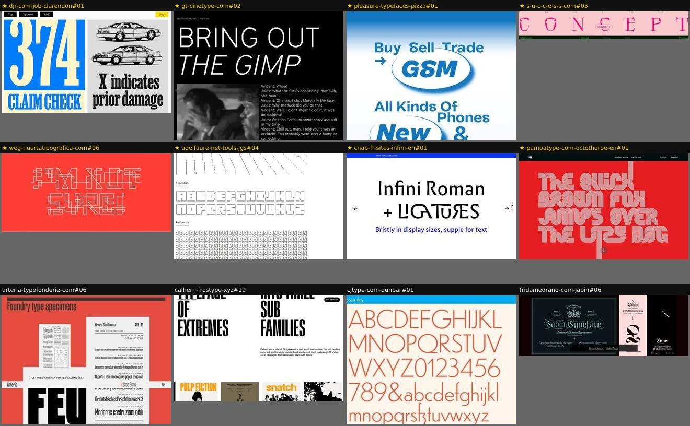

| example | look | feel | ux | learn |
|---|---|---|---|---|
| [★ djr-com-job-clarendon#01](../../archive/djr-com-job-clarendon/blocks/01.jpg) | Twenty-six job-printing posters as flat images in a centred column, one, two or three per row: '374 CLAIM CHECK', '"X" indicates prior damage', a cut-out 'a' and 'EXIT', 'eternity in an hour*' over clouds, 'We Move The World' with a globe, 'N.Y.C', 'Guitar Lessons' tear-off flyer, 'Archery' target, 'I SURVIVED CLARENCE'S HAUNTED HAYRIDE', 'WINNER 2018 Belgian Grand Prix', 'Voyager II', 'VOTE CLARENDON', 'Leather Goods', 'Old & New Bargains (323)-555-0134'… | A wall of handbills from a busy print shop: loud, funny, varied | static images; the sticky action bar overlays them while scrolling | Commission one designer to make a long series of genre posters (claim checks, flyers, race posters, playbills) so every width and weight is shown doing the job the genre was made for |
| [★ gt-cinetype-com#02](../../archive/gt-cinetype-com/blocks/02.jpg) | Four black specimen pages, one per style pair, each labelled at top-left ('GT Cinetype Light / Italic — Pulp Fiction', 'Regular / Italic — Arnold Schwarzenegger', 'Bold / Italic — Star Wars / Star Trek', 'Mono — Technical specifications and statistics'): a giant quote ('BRING OUT THE GIMP', 'Right? Wrong!', 'MAY THE FORCE BE WITH YOU', 'CinemaScope'), a subtitled film clip beside a second size, then a paragraph and small text; the Mono page swaps the clip for a top-10 box-office table and film-format specs | Fan-made, funny, loud | Read-only; the clips loop silently | Give each weight its own film genre and quote it at five fixed sizes: the series doubles as a family overview and a size waterfall, and the Mono page proves itself with tabular numbers |
| [★ pleasure-typefaces-pizza#01](../../archive/pleasure-typefaces-pizza/blocks/01.jpg) | A stack of shop-flyer posters in blue and white with glossy gradients and ellipse badges: 'Buy Sell Trade → GSM / All Kinds Of Phones / New & Used / Any Brands*', 'ENJOY THE PLEASURE OF NEW TASTE' in outline caps over a hand with lightning, price stickers ('€1', 'FREE', '€5', '-60%', 'OFFER PERIOD EXPIRED'), a huge '@' blister-pack tab with 'Ple@sure in @ny W@y / M@RSEILLE — P@RIS', 'UNLOCK / REPAIR' running vertically beside a flip phone, a ruled list of phone numbers '+33(0) 622 122 869…', '↘ SLOW DOWN (PLEA-SURE) ↗ UP 2020–2021', 'MADE FOR PLEASURE' on a cloud, 'GUILTY / SMS'; the right column adds 'PIN 1234 PREPAID SIM', 'CONNECTING PEOPLE', 'CRAKED ↔ SCREEN FIX IT', 'INTERNATIONAL SERVICE express 24/24 NON STOP 7/7 N°1', an SMS thread 'Msg (184)' in slang, 'QUICK Delivery 30 minutes guarantee' | Cheeky, saturated, nostalgic | The two columns counter-scroll so each screen pairs two different flyers; several headlines are contenteditable; '@' panel swaps a still for an animated GIF | Counter-scrolling columns turn a list of posters into ever-changing pairs; a two-colour duotone keeps very different images feeling like one set |
| [★ s-u-c-c-e-s-s-com#05](../../archive/s-u-c-c-e-s-s-com/blocks/05.jpg) | Under the spaced chapter title 'C O N C E P T' (magenta letters spread edge to edge with a small outlined 'CONCEPT' pill in the middle), a bento of seven specimen-page SVGs on black, pink, green and white: a word wall, the 'One expression, 3 different genres' Titling/Sans/Text 'Aa' diagram, a Cyrillic text page, '18 styles' with the style list, 'USE IT BIG TOO', 'A titling machine – 280 ligatures and alternates', 'Infinite possibilities' over a grainy photo | Zine-like, saturated, maximal | static | Reuse the PDF specimen's pages as SVG tiles in a bento grid: each tile is a finished poster and the mixed tile widths keep the rhythm lively |
| [★ weg-huertatipografica-com#06](../../archive/weg-huertatipografica-com/blocks/06.jpg) | Two-colour posters alternating red and mint: 'I'M NOT SURE!' in the line font, 'BUT, THE BIG QUESTION IS: WHERE COULD I USE THIS FONT?' in a box inside a giant Regular glyph, 'USING THIS TYPEFACE UNDER 72PT IS AT YOUR OWN RISK' beside tangled letters, 'TO USE ABOVE 72 POINTS' over a giant filled cut, a cryptic three-line word block beside a huge frame (20), and the giant 'WEG' path wordmark (28) | Funny, honest, punchy | static images interleaved with the mockups | Let the posters talk about the font's own limits ('under 72pt at your own risk') in a plain bold face: the joke doubles as usage guidance |
| [★ adelfaure-net-tools-jgs#04](../../archive/adelfaure-net-tools-jgs/blocks/04.jpg) | A run of full-width ASCII-art figures, each under a small underlined heading: 'Alphabet' (A–Z as blocky outline letters), 'Patterns' (border bands and lattices), 'Faces' (nine portraits with glasses, hats, curly hair), 'Interior' (a room with furniture), 'Landscape' (clouds, hills, forest, cyclists) and 'Isometric view' (a city with buildings, signs, cars and a bus), signed 'adl' | Patient craft, delightful | static; scrolling reveals ever more complex scenes; everything re-renders when the toolbar changes font, size or mode | Order the figures from primitives to full scenes: the visitor learns the building blocks, then sees what they add up to |
| [★ cnap-fr-sites-infini-en#01](../../archive/cnap-fr-sites-infini-en/blocks/01.jpg) | Three full-screen sections, one per style, each with a thin electric-blue label bar ('INFINI ROMAN + LIGATURES', 'INFINI ITALIC', 'INFINI BOLD + PICTOGRAMS') and a title slide: 'Infini Roman + LIGATURES' / 'Bristly in display sizes, supple for text', 'Infini italic' / 'Faithful partner for the roman, yet independent', 'Infini bold + PICTOS' (with a snake pictogram) / 'Oversized to overshadow its neighbors', large black type with a blue tagline; ← → arrows at the screen edges | Clean, characterful, slide-show | Wheel moves between style sections; side arrows (or swipe) page horizontally through 15 Roman, 12 Italic and 13 Bold specimen slides whose backgrounds alternate white, blue and black (only the title slides were captured) | Give each style its own horizontal slide deck under a one-line characterisation: the visitor chooses depth per style instead of scrolling one long specimen |
| [★ pampatype-com-octothorpe-en#01](../../archive/pampatype-com-octothorpe-en/blocks/01.jpg) | Full-screen poster panels of white striped lettering on colour fields that blend into each other: the English pangram in four stacked lines on red, lowercase 'octothorpe' with stripes running up and down, '—QUESTION EVERYTHING —WHY?' on violet, formulas '(x+y)²=4×(½)xy+z²', 'PLATFORM 9¾', 'C₁₀H₁₂N₂O' on cyan, a two-slide carousel of a physics sentence ('For a finite-size system to evolve in such a way that… imposed currents') on green, prices '€ 9.823', '¥ 1.000,8000', '₿ 0,0007' on yellow | Joyful, rhythmic, record-sleeve | Scroll from panel to panel (each 100vh with a ↓ button); the green panel is a Bootstrap carousel with ← → buttons and no autoplay | Grade the background from one panel's colour into the next: a run of separate posters reads as one continuous rainbow scroll |
| [arteria-typofonderie-com#06](../../archive/arteria-typofonderie-com/blocks/06.jpg) | 'Foundry type specimens': a 6500px cascade of overlapping off-white specimen pages on red, pastiching ATF 1923, Nebiolo, Stephenson Blake, Fonderie Typographique Française and Livret Typographique: price lists by corps, 'LETTRES ARTERIA FORTES ALLONGÉES' with giant 'FEU RU', 'CONFÉRENCE ÉLECTRICITÉ PAQUEBOT MAISON', numbered sample lines with weights and kilo prices | Archival, generous | Pages appear to drift at different speeds as you scroll (staggered layout) | Reset the family into the specimen-book conventions it descends from: the pastiche proves the historical claim better than prose |
| [calhern-frostype-xyz#19](../../archive/calhern-frostype-xyz/blocks/19.jpg) | A strip of film posters re-set in Calhern running edge to edge (Pulp Fiction in orange, a tan 'Brilliant… a brakeless freewheel' poster, 'snatch', a hooded figure, 'The French Dispatch', 'Rogue One'), plus a large 'snatch' and an 'Ocean's'-style cast poster with billing blocks | Cinema lobby, collectible | The strip slides sideways as you scroll | Pastiche a whole genre (film one-sheets) so every condensed and wide style appears where it historically belongs |
| [cjtype-com-dunbar#01](../../archive/cjtype-com-dunbar/blocks/01.jpg) | A column of full-width posters: big blue 'Dunbar' banner with an orange bar; 'Low' beside a stack of striped names (Lugosi, Dark, Entries, Colonel, Telegram); a blue 'LEIPZIGER MESSE' trade-fair ad (Eisen-, Stahlwerke Hoesch, Motoren); a brown poster with a rainbow-striped 'a' and a weight list Ultra → Extra Light ('Dunbar Tall'); 'Paradise Garage '77' with coloured stripes; a dense blue word list; and an animated hot-pink 'You are the observer' GIF | Exuberant, period-hopping | static images, one animated GIF | Pastiche one period per poster (1920s German trade ad, 1970s disco stripes) to show that a revival can be 'retro in more than one way' |
| [fridamedrano-com-jabin#06](../../archive/fridamedrano-com-jabin/blocks/06.jpg) | Three animated specimen sheets: a teal certificate-like 'Jabin Typeface' document, a tall pink page with big ligature, a tall black page with a 'Time' word and clock hand | Proclamations and certificates | GIFs loop | A certificate layout is a natural form for blackletter; the axis morph brings it to life |
| [github-com-mona-sans#10](../../archive/github-com-mona-sans/blocks/10.jpg) | Six portrait posters in a staggered three-column wall: 'Software is eating the world one byte at a time' (dotted grid, Pac-Man), 'IF A SQUIRREL TELLS YOU TO SHIP IT YOU MUST SHIP IT' (condensed black on white with the GitHub app icon), 'GIT' on yellow with a branch diagram, 'Commit' in a black frame, 'Blazing fast cloud environments' (Codespaces) vertical, and 'dem os not me mos' on a blue-green gradient | Witty, design-literate, in-house | static images | Stagger the columns' top offsets (128 / 0 / 64px) so a poster grid feels pinned up by hand rather than tiled |
| [indestructibletype-com-jost#02](../../archive/indestructibletype-com-jost/blocks/02.jpg) | Full-width dark panel cross-fading between five SVG type compositions; the capture shows a huge 'a' beside 'minimal' stacked in lightening greys, and the video shows a list 'Jost* Hairline! … Black!' | Quietly stylish | Auto-advances every 5 seconds with a fade, no controls | Five full-width SVG posters on a simple timer are the cheapest way to add a display moment to a plain text page |
| [louisefili-com-montecatini-pro#06](../../archive/louisefili-com-montecatini-pro/blocks/06.jpg) | Two full-width illustrated travel posters set in Montecatini: 'HÔTEL COMELLA / SORRENTO' (navy band, pink-outlined white inline caps, orange trees and Vesuvius) and 'VILLA & RISTORANTE «GROSSETO»' (green and coral caps over a coral hotel silhouette with pink clouds) | Holiday, period-perfect | static image breaks before Features and before the closing | Commission new posters in the source genre instead of showing old ones: the font proves it can produce the very artefacts it was drawn from |

_…and 20 more in the gallery (`npm run app`)._

## prop-collage

Invented artefacts (UI windows, tickets, files, stickers) set in the font, collaged into a scene.

**Recognise by:** fictional brand objects, humour

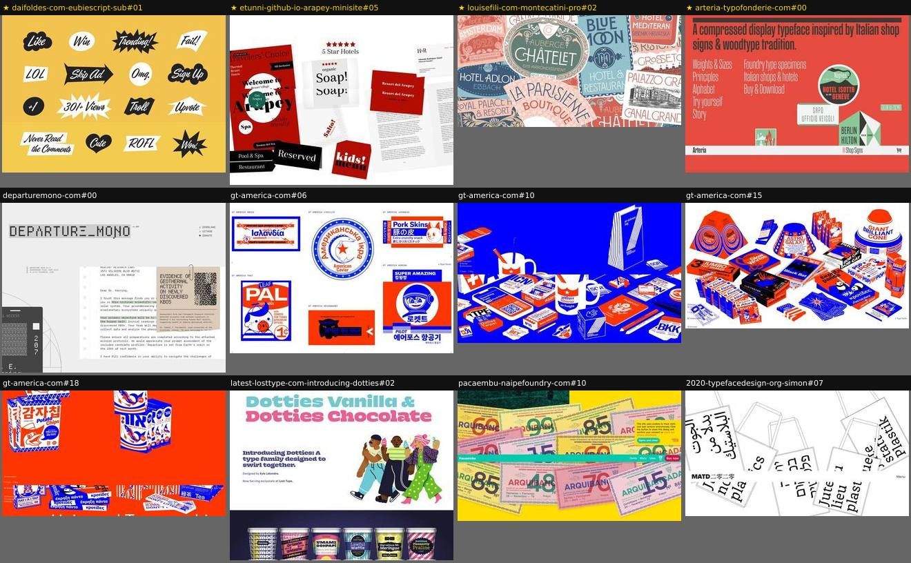

| example | look | feel | ux | learn |
|---|---|---|---|---|
| [★ daifoldes-com-eubiescript-sub#01](../../archive/daifoldes-com-eubiescript-sub/blocks/01.jpg) | A 4×4 grid of sticker shapes (cloud, oval, starburst, arrow, heart, ribbon, flag) in black or white on a mustard field, each lettered with internet slang: Like, Win, Trending!, Fail!, LOL, Skip Ad, Omg., Sign Up, +1, 301+ Views, Troll, Upvote, Never Read the Comments, Cute, ROFL, Wow! | Cheeky, pop, sticker-sheet | static; the background colour cycles with the page accent | Put a retro showcard script on modern internet slang: the contrast between period style and present-day words makes the font feel current |
| [★ etunni-github-io-arapey-minisite#05](../../archive/etunni-github-io-arapey-minisite/blocks/05.jpg) | A scattered collage of flat branding props for an invented 'Resort del Arapey Hotel & Spa': a red Travelers' Choice brochure ('Welcome to Arapey'), black Pool & Spa / Restaurant signs, a 'Reserved' table tent, an 'organic Soap!' wrapper, a five-star rating, a red 'kids! menu', business cards, a napkin, an open magazine | Polished, touristy | Props are separate SVG layers that appear to move at different speeds while scrolling (some appear doubled in the stitched capture) | Brand a fictional local business top to bottom (signage, stationery, menus, soap): the range of weights finds a job in each artefact |
| [★ louisefili-com-montecatini-pro#02](../../archive/louisefili-com-montecatini-pro/blocks/02.jpg) | Full-width collage of overlapping vintage hotel luggage labels (Hotel Adlon, Auberge Châtelet, Blue Moon, La Parisienne Boutique, Palazzo Grassi, Canal Grande, Royal Palace) in coral, pale blue, pink and dark green, every label lettered in Montecatini; the same artwork returns near the end, cut out on white | Grand-tour, collectible | static image breaks between sections | Luggage labels are a natural home for a poster face: each label is a tiny logo, so one collage shows the widths, weights and ligatures doing branding work |
| [★ arteria-typofonderie-com#00](../../archive/arteria-typofonderie-com/blocks/00.jpg) | About 15 vintage stickers scattered across the sections, overlapping the content: round and shield-shaped hotel luggage labels (Hotel Isotta Genève, Palmes Palermo, Princesse Hotel Evian, Guglielmina Grand Hotel, Alicante) and enamel-style shop signs (Macelleria con vendita, Dirigente Movimento, Univers Napoli, Panafico), all lettered in Arteria | Collectible, like a suitcase covered in labels | Each sticker can be dragged around the page; the 'Shop Signs' checkbox in the fixed nav hides or shows them all | Treat the in-use props as a removable layer: draggable stickers scattered over the specimen, with one nav toggle for readers who want them out of the way |
| [departuremono-com#00](../../archive/departuremono-com/blocks/00.jpg) | Overlapping travel ephemera: a white diner receipt ('Double R Diner, Terminal 9… Cherry pie 39.75, Damn good coffee 25.50'), a dark 'KÁRMÁN SPACELINES BOARDING PASS' LAX ▸▸ KBA with barcode, and a sage luggage tag 'KUIPER ALPHA 45 LBS' | Playful, Twin Peaks wink | static apart from scroll offsets | Receipts, passes and tags are natural homes for a pixel mono: numbers, codes and tiny labels in one glance |
| [gt-america-com#06](../../archive/gt-america-com/blocks/06.jpg) | Loose grid of flat packaging illustrations (caviar tin, milk-chocolate boxes, popcorn bags), each captioned 'GT AMERICA GREEK / THAI / CYRILLIC…' in Mono | Collectible, catalogue-like | static | Caption each prop with the script it demonstrates, so the illustration grid is also a coverage index |
| [gt-america-com#10](../../archive/gt-america-com/blocks/10.jpg) | Chapter opener: full-screen electric-blue field with an isometric spread of airline props (mugs, passport, boarding passes, air-sickness bag) lettered in many scripts | Jet-set, optimistic | static; marks the start of the Languages chapter | Switch the background colour and the prop theme at each chapter: colour-coded chapters give a long page clear rhythm |
| [gt-america-com#15](../../archive/gt-america-com/blocks/15.jpg) | Design-chapter opener: isometric still life of packaging (Astro Galaxy, Black Bat, Glow Worms) on white | Toy-shop, nostalgic | static | Reuse the same illustration language for every chapter opener to tie a long page together |
| [gt-america-com#18](../../archive/gt-america-com/blocks/18.jpg) | Information-chapter opener: red-orange field with packaging (potato chips, Hebrew and Greek products) scattered at the edges | Bright, fun | static | Leaving the centre empty in a chapter opener frames the next heading |
| [latest-losttype-com-introducing-dotties#02](../../archive/latest-losttype-com-introducing-dotties/blocks/02.jpg) | On a deep indigo band, three shelves of illustrated ice-cream pints, 18 tubs each with an invented flavour label in a different Dotties style ('UMAMI OOHPAPI', 'Lawful Waffle', 'Marvelous Mr. Meringue', 'Milkiest Magician', 'Velvety Smooth', 'Thoroughly THIQUE'…) | Freezer-aisle abundance, witty | static | Packaging pastiche lets every tub test a different weight, width and pairing while the puns keep it fun |
| [pacaembu-naipefoundry-com#10](../../archive/pacaembu-naipefoundry-com/blocks/10.jpg) | A pile of pastel stadium tickets ('ARQUIBANCADA', seat numbers 85, 48, 70, 15, 60, 90 huge in different colours, 'Palmeiras × Flamengo 28 — Novembro — 79') overlapping at angles on yellow, bridging the Legends and Line-ups sections | Nostalgic, tactile | static | A band of overlapping props between two data sections gives a breather while still showing big numerals |
| [2020-typefacedesign-org-simon#07](../../archive/2020-typefacedesign-org-simon/blocks/07.jpg) | Full-width line drawings of artefacts lettered in chunky: tote bags printed 'Jute statt Plastik' in Arabic, Hebrew, French and German; a tilted 'chunkyset' spacing proof sheet (hhhhii iiijjjjkk…); a folded newspaper page of small ads ('Get chunky for your work:') mixing Latin, Hebrew and Arabic | Grounded, everyday, activist | Static SVGs | Draw everyday objects in thin outline and letter them in several scripts, so the type is the only filled element on the page |
| [calhern-frostype-xyz#33](../../archive/calhern-frostype-xyz/blocks/33.jpg) | A sideways-moving row of flat VHS and film-stock packaging set in Calhern (yellow-black striped 'HS', 'Polaroid Supercolour', 'SONY Dynamicron L-750HG', 'TDK SUPER AVILYN', a red-striped 'Eastman T120', Kodak); later scattered tapes beside a counter (only the top of the row is captured) | Nostalgic, tactile, video-store | The row slides horizontally with scroll in a seamless loop (duplicate rows before and after) | Pastiche period packaging (VHS, film stock) where condensed and wide grotesks were native: the props date and place the type |
| [escafina-losttype-com#03](../../archive/escafina-losttype-com/blocks/03.jpg) | Three vintage signage badges in a row: a round 'ETHYL Gasoline' badge with an orange sunburst, a teal rectangle 'Pennsylvania Motor Oil / GUARANTEED QUALITY', and an orange 'UNION 72' highway shield | Americana, roadside | static | Pastiche the very source genre (oil and gas signage) the script was drawn from, pairing it with a plain sans for the secondary lines |
| [gt-america-com#14](../../archive/gt-america-com/blocks/14.jpg) | Long blue section of airline ephemera (tickets, baggage tags, playing cards, badges) interleaved with multiscript sample lines tagged with weight readouts | Busy, celebratory | Sample lines animate weight; mascots animate | Alternate artefacts and tagged sample lines so the showcase never goes more than a screen without real text |

_…and 12 more in the gallery (`npm run app`)._

## kinetic-scenes

Animated, generative or physics compositions (falling or scattered glyphs, liquid) after the hero.

**Recognise by:** canvas/WebGL, overlapping glyphs

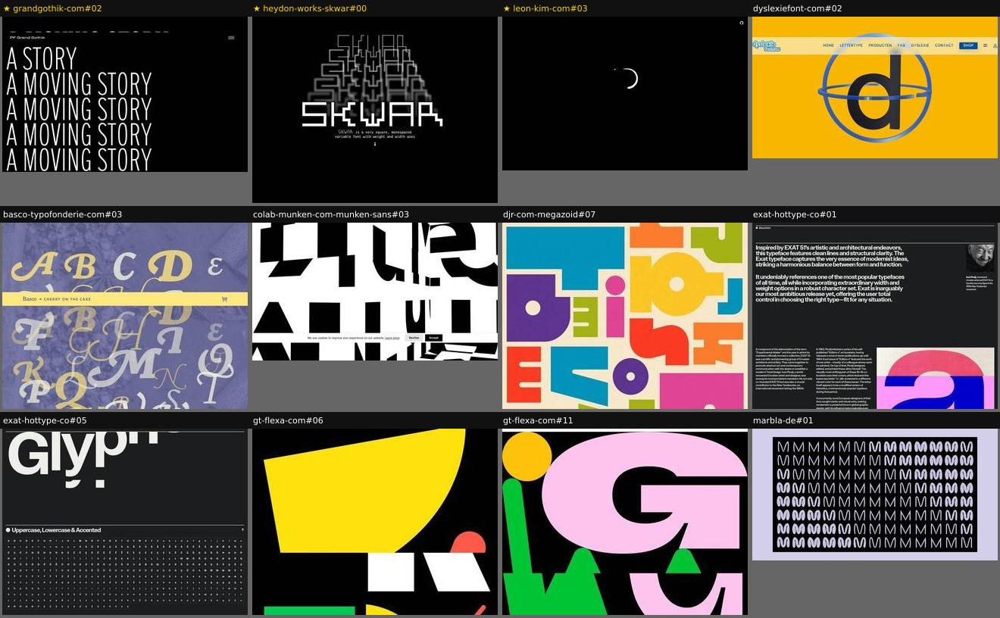

| example | look | feel | ux | learn |
|---|---|---|---|---|
| [★ grandgothik-com#02](../../archive/grandgothik-com/blocks/02.jpg) | Four full-screen black interludes of white type in motion: 'A STORY / A MOVING STORY' lines stacking in Compressed caps; 'mensional … dimensional' repeating as the width grows to Extended Thin; a diagonal wall of 'CHANGE CHANGE' in Compressed Black Italic; 'MULTISCRIPT' stacked lines stepping through weights | Film title sequence, hypnotic | Each panel is pinned (ScrollMagic) while the next white chapter slides over it; videos autoplay muted on loop | Use short looping videos of one word sweeping an axis as chapter breaks: they show the variable range without any UI and set a cinematic rhythm |
| [★ heydon-works-skwar#00](../../archive/heydon-works-skwar/blocks/00.jpg) | A graphic equalizer drawn with letters: ten vertical columns of rotated random capitals rising from a hairline baseline, in shades of grey and white, with a white 'PLAY?' button in the middle | Retro hi-fi, cheeky | PLAY? starts a music track (guess_the_track.mp3) and the letter bands react like equalizer bars by changing their width axis | Map the width axis to an audio level: a variable font becomes a visualiser, and each bar is set type rather than a shape |
| [★ leon-kim-com#03](../../archive/leon-kim-com/blocks/03.jpg) | Black scenes: a white rounded 'B' (~260px) is drawn on from a single arc, sinks into a wavy white liquid floor rising from the bottom while capitals (K, W, J, O, Z, H, Y, &) rain from the top with physics; then white, and (video only, t≈19–21s) the word 'composition' written in multicoloured dashed strokes | Toy-like, satisfying, experimental | Watch-only sequence; each scene demonstrates a different capability of the code font (draw-on, rounded weight, physics bodies, fluid/metaball floor, colour pattern strokes) | When the font is a library, the specimen is a reel of demos: each scene shows one thing you can do with the glyph paths (animate, collide, melt, recolour) |
| [dyslexiefont-com#02](../../archive/dyslexiefont-com/blocks/02.jpg) | A 3D extruded dark lowercase 'd' inside a thin blue arrow ring on yellow; in the mobile capture it is turned so far it reads as a 'p' | Playful, explanatory | WebGL letter that rotates with scroll (data-mode=scroll) and can also be dragged (cursor grab) or set by keyboard (role=slider); an SVG 'd' is the fallback | Turning a 'd' in 3D until it looks like another letter acts out what dyslexic readers report, far better than a sentence could |
| [basco-typofonderie-com#03](../../archive/basco-typofonderie-com/blocks/03.jpg) | 'Cherry on the cake': the swash capitals A-Z scattered at varied sizes and weights over lavender duotone spices, in yellow and pale grey, overlapping | Spilled sprinkles | The letters seem to drift in layers as you scroll; the doubled letters in the crop are the same letters caught mid-motion | Treat decorative capitals as confetti: scatter, vary weight and size, and let them overlap |
| [colab-munken-com-munken-sans#03](../../archive/colab-munken-com-munken-sans/blocks/03.jpg) | Full-width looping muted video (cube_2.mp4) of huge black letter fragments on white, sliced and shifted in bands, on the faces of what the file name suggests is a cube | Op-art, restless | Autoplays lazily, loops, no controls | Pure black shapes cropped from huge letters are recognisably the typeface: it is a pause in a text page that still shows nothing but type |
| [djr-com-megazoid#07](../../archive/djr-com-megazoid/blocks/07.jpg) | A tall cream field packed with huge cropped glyph fragments in pink, purple, blue, yellow, orange, olive and red, interlocking like building blocks | Joyful, toy-block | Each letter path has an 'animate' class: pieces appear to slide or pop into place as the section scrolls in | Crop giant glyphs and tile them like Tetris pieces in the palette: the letters' raw geometry becomes the illustration |
| [exat-hottype-co#01](../../archive/exat-hottype-co/blocks/01.jpg) | Recurring motion bands between chapters: a 7×5 grid of off-white 'c' letters each rotated a little further (01), square tiles of letter patterns (yellow 'A' in black circles, a blue/orange chevron weave of 'a's, pink-on-green and red-on-yellow letter textures) (06), and a black band of giant cropped 'S' shapes (07) | Op-art, kinetic, Bauhaus-inspired | Letters rotate as you scroll (GSAP rotators); some tiles are looping videos | Repeat one letter in a grid and rotate each copy progressively: pure type becomes a pattern that keeps the long page moving |
| [exat-hottype-co#05](../../archive/exat-hottype-co/blocks/05.jpg) | A field of ~240 blue lowercase 'a's in tight rows on charcoal, all Extra Light in the capture (multicoloured with a weight gradient on mobile) | Alive, like iron filings under a magnet | Letters near the pointer gain weight (and colour), falling off with distance | Map pointer distance to weight on a grid of one letter: the visitor feels the weight axis without any control |
| [gt-flexa-com#06](../../archive/gt-flexa-com/blocks/06.jpg) | A full-width black 'interrupter': big flat shapes (yellow quarter-discs, white parallelograms, a green block, a coral stroke) assembling into letters, with 'FINALLY, A FUN GROTESK' in purple compressed caps at the bottom | Toy blocks, celebratory | The video loops when in view; the headline animates its axes ('h3-jump') | Break the letters into their primitive shapes and let them reassemble: it shows the 'simple shapes' construction as a pause between chapters |
| [gt-flexa-com#11](../../archive/gt-flexa-com/blocks/11.jpg) | Second black interrupter: huge pink 'G' and 'U', a green 'W' and an orange-dotted 'i' made of flat shapes, with 'MIX AND MATCH', each word in a different width and weight, at the bottom | Collage, energetic | Looping video; each headline word animates its own axes (h3-mix, h3-and, h3-match) | Close the axes chapter with a mixed-width headline that literally mixes and matches styles |
| [marbla-de#01](../../archive/marbla-de/blocks/01.jpg) | A black panel with a 13×8 grid of lavender capital Ms, each at a different point between thin Regular and fully inflated Balloon/Curve, forming diagonal waves | Hypnotic, wave-like | Looping muted video; a separate portrait video for mobile | Repeat one glyph in a grid and sweep its axes as a travelling wave: the whole design space reads as motion |
| [pp-frama-com#10](../../archive/pp-frama-com/blocks/10.jpg) | Off-white panel: heavy caps 'LETTERS BUILT TO DO THE HEAVY LIFTING' and a short paragraph left; in a framed box at right, a looping video of 'Ä' characters stacked in a human pyramid, one on top of three, their umlaut dots like heads | Playful, cartoonish | Sticky panel; muted looping video ('A_push_up') plays in view | Animate a letter as a character acting out the headline (Ä doing push-ups for 'heavy lifting'): copy and specimen tell one joke |
| [vercel-com-font#05](../../archive/vercel-com-font/blocks/05.jpg) | Two square video cells: left, a Geist 'a' drawn with its Bézier handles under a scrolling mono ticker 'CODING AND DESIGN SPIRIT WITHIN OUR COMMUNITY OF CREATORS'; right, a big black Vercel triangle with the caption 'OPEN SOURCE GEIST SANS & MONO / DEVELOPED BY VERCEL · 2023' | Product-film, graphic | Autoplaying muted loops; the ticker scrolls continuously | Pair a construction loop of one letter with the brand mark in matching square cells to tie the type to the company |
| [whirlybirdie-com#05](../../archive/whirlybirdie-com/blocks/05.jpg) | 'Playground': a flat-illustrated mauve study: a bookshelf whose spines carry titles in different widths and weights (Silver Cave, Brave Stars, On the Trail, Liminal Zinc), a wall clock with Whirlybats pictograms for numerals, a card with a huge narrow 'A', a red lamp, a TV with a green waveform, a plant, and a desk with a computer and chair | Warm, homely, toy room | Objects are glyphs and react when clicked or hovered (bounce containers, animated clock hands, a glyph-built computer and chair); the clock keeps real time | Furnish a room out of the two fonts: book spines show the text face's widths, and every object (clock face, chair, monitor) is a dingbat |

_…and 2 more in the gallery (`npm run app`)._

## use-case-samples

Tabs or panels with realistic content samples per use case (code, data tables, UI).

**Recognise by:** tabs: SQL | finance | …

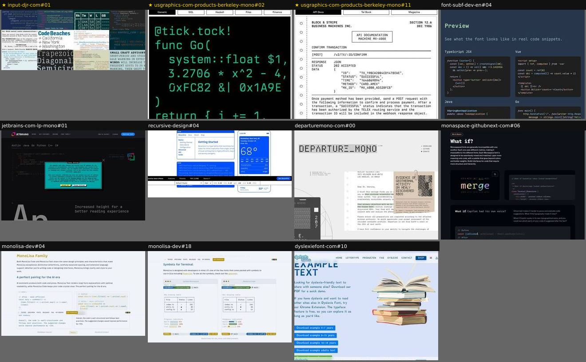

| example | look | feel | ux | learn |
|---|---|---|---|---|
| [★ input-djr-com#01](../../archive/input-djr-com/blocks/01.jpg) | A tight 4×3 mosaic of tiles, each a different text in its own editor theme: Racket/Lisp on navy, HTML in Monokai, a baseball standings table drawn with box characters, a JS function, a NASA screenplay, 'Code Beaches + California + New York + Washington' in Input Sans, Python in Solarized, C++ on dark teal, Ruby, 'Trapezoid / Diagonal / Semicircle' in large Input Serif, TeX, a 'SMALL CRAFT ADVISORY' marine forecast, a Unix 'top' process list | Busy, smart, like a wall of terminals | Tiles swap on a timer (tileswap.js): one tile at a time is replaced by another sample, so the mosaic keeps changing while you read | Show a coding font in every context a programmer meets (many languages, themes, data tables, prose, screenplays) as a self-shuffling mosaic of real text, not screenshots |
| [★ usgraphics-com-products-berkeley-mono#02](../../archive/usgraphics-com-products-berkeley-mono/blocks/02.jpg) | 'Engineered for Code': a strip of five outlined tabs (Generic, SQL, Haskell, Files, Finance) above a black panel of large green code ('@tick.tock! func Go( system::float $1, 3.2706 * x^2 - 4, 0xFC82 &| 0x1A9E ) return { i += 1, get["KEY"].run() };') | Phosphor terminal, confident | jQuery UI tabs swap the panel image per language or data type; on mobile the tab labels shorten to 1–5 | Write fake code that packs the troublemakers (0/O, braces, operators, hex) into a few lines, and set it huge: a code font proves itself in code, not in pangrams |
| [★ usgraphics-com-products-berkeley-mono#11](../../archive/usgraphics-com-products-berkeley-mono/blocks/11.jpg) | 'Exceptional legibility': tabs API Docs, Tel Book, Magazine over a perforated-margin printout ('BLOCK & STRIPE BUSINESS MACHINES INC.', API DOCUMENTATION MACHINE MX-4000, a POST request and JSON response); below, prose on long-form use (user manuals, movie scripts, Submarine EXIT signs) next to a dense 'Annual Financial Report 1968–1979' table | Mainframe printout, believable | Tabs swap the document type; static otherwise | Prove text legibility with full fake documents (API reference, phone book, magazine, financial tables) that a monospace would really set |
| [font-subf-dev-en#04](../../archive/font-subf-dev-en/blocks/04.jpg) | 'Preview — See what the font looks like in real code snippets.' then a 2-column grid of dark rounded code cards captioned TypeScript JSX, Vue, Java, Go, Python, C++, with VS Code-like highlighting, ligatures (=>, !==, ::) and cursive italic keywords (function, const, class, return) | Editor-realistic | static (the editable playground is a separate page) | Show the same features (ligatures, cursive italic keywords) across six languages so every reader sees their own stack |
| [jetbrains-com-lp-mono#01](../../archive/jetbrains-com-lp-mono/blocks/01.jpg) | Large language tabs (Kotlin, Java, Go, Python, C++, C#; underline indicator on the active one) above a line-numbered, syntax-coloured code sample (Kotlin quickSort) in an editor-like panel; at right a note 'Default editor font in JetBrains IDEs + CLion' with the IDE's logo | At home in the IDE | Tabs (scrollable with arrows on small screens) switch the sample language and the IDE logo beside it | Pair each language sample with the IDE that ships the font: the showcase doubles as proof of adoption |
| [recursive-design#04](../../archive/recursive-design/blocks/04.jpg) | Three blue-outlined interface mockups set entirely in Recursive: a documentation site (Basics, Getting Started, API), a solid-blue terminal window with fontTools log lines, and a phone weather app ('Manhattan, New York, NY', '68°', hourly temps, Friday 52°/42°) | Practical, polished | Self-contained demo; parts appear to shift or scroll slowly (slowShift keyframes) | Show the same family running a docs site, a terminal and a mobile app side by side: one font, three very different UI jobs |
| [departuremono-com#00](../../archive/departuremono-com/blocks/00.jpg) | Panels per use case, each tagged by a tiny '░' comment: a departures board in box-drawing characters ('Destination ↑ | Departing | Gate | Status', KBA Kuiper Alpha row highlighted sage) with '░ IT'S GREAT FOR WORKING WITH TABULAR DATA'; on dark, a TCP header bit diagram and a full keyboard drawn in box-drawing lines ('░ INCLUDED: BOX DRAWING CHARACTERS FOR YOUR PSEUDO-GRAPHICAL NEEDS'); Rust code with orange types, a huge SQL 'SELECT mission_… FROM gamma_bl…', a labelled Mercury-capsule line drawing and an orange pixel countdown '14' ('░ ADD A RETRO FLAVOR TO YOUR CODE AND TECHNICAL DOCUMENTATION') | Convincing, in-world | The board row blinks; the countdown ticks down; panels are otherwise static | Caption each sample with the job it proves (tables, box drawing, code, docs) as a code comment: the showcase reads like a feature list |
| [monaspace-githubnext-com#06](../../archive/monaspace-githubnext-com/blocks/06.jpg) | 'Mix & Match' pill and 'What if?' heading, then a bento of three dark panels: 'merge' with each letter in a different family and colour (ghost letters above and below like a slot reel) and a shuffle button; a code snippet whose comments are set in Radon (handwriting) and docstrings in Xenon (slab); and 'What if Copilot had its own voice?' with a Before/After code pair where the suggested part is set in another family | Visionary, playful | Shuffle button rerolls the font of each letter of 'merge'; Copilot ghost text pulses (ghostpulse keyframes) and types in | Show what metric-compatible families make possible by assigning each kind of code text (comments, docstrings, AI suggestions) its own typeface in a real snippet |
| [monolisa-dev#04](../../archive/monolisa-dev/blocks/04.jpg) | 'MonoLisa Family' and 'A perfect pairing for the AI era' copy above two framed panels side by side: left 'Markdown Source' (an AI code-review reply in MonoLisa Code, with ## headings and a ```typescript block), right 'Rendered Output' (the same reply rendered with headings and body in MonoLisa Text and the code snippet in Code); a small 'Replay' button between captions | Practical, of the moment | Replay re-runs the streaming of the reply into both panels, like an AI chat response | Show a superfamily's two members on the same content in its raw and rendered states: the pairing argument is made by the sample itself |
| [monolisa-dev#18](../../archive/monolisa-dev/blocks/18.jpg) | 'Symbols for Terminal' (PowerLine) above two macOS-style terminal windows side by side, 'System Monospace' and 'MonoLisa Code', each showing a powerline shell prompt (user@host › ~/projects/app › main), a box-drawing table (File / Status / Lines with ✓ ●), progress bars (Build 62%, Tests 100%, Lint 25%) and a vim-style status line (NORMAL › main · index.ts · utf-8 · 42:15) | Familiar, convincing | static; link to the specimen for all symbols | Render the same terminal UI in the system font and in yours: broken box-drawing and missing powerline glyphs make the case |
| [dyslexiefont-com#10](../../archive/dyslexiefont-com/blocks/10.jpg) | 'EXAMPLE TEXT' with four stacked blue PDF buttons by reader age (5–7, 8–15, 16–18, adults), a green 'Try out Chrome Extension', and an illustrated stack of books | Teacherly, helpful | Each button downloads a PDF sample in the font | Offer sample texts by reader age: sharing is the conversion step, because the buyer is often a parent or teacher |

## size-waterfall

The same running text at a descending series of labelled sizes, from display to caption, often in several weights side by side; sometimes a light/dark switch.

**Recognise by:** px labels, shrinking repeated text

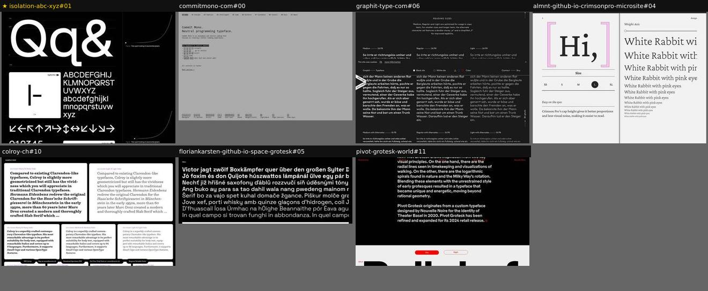

| example | look | feel | ux | learn |
|---|---|---|---|---|
| [★ isolation-abc-xyz#01](../../archive/isolation-abc-xyz/blocks/01.jpg) | 'Isolation' repeated at six shrinking sizes (~200 → 32px); from the fifth line the word grows into German compounds with the extra part in grey ('Isolations|bescheid', 'Isolations|bescheidsformularvorlage'); then the same Fort Boyard paragraph at labelled sizes 'Regular · 28px', '20px', '14px', '11px' in columns | Playful, systematic | static | As the size drops, lengthen the word (German compounds) so every line keeps roughly the same width: the waterfall stays a solid block and the joke rewards reading |
| [commitmono-com#00](../../archive/commitmono-com/blocks/00.jpg) | Under the game, HTML only: one string of confusable characters, 'tl1I|!ijO0QDØ38B:;.,`‘'"2Z5S7T6b', repeated from 40px down to 8px, each row labelled in rem and px | An eye test | static | Use only confusable glyphs for a waterfall: for a coding font, the only size question is when the characters stop being distinct |
| [graphit-type-com#06](../../archive/graphit-type-com/blocks/06.jpg) | 'READING SIZES': note on Medium, Regular and Light, then three columns of Kafka-like German prose at 24px, then the same at 16px labelled 'with Alternates' | Serious reading test | Static on desktop; dots on mobile make the columns a swiper | Label each column 'Style — size' in the same small ruled format and pair default forms with text alternates |
| [almnt-github-io-crimsonpro-microsite#04](../../archive/almnt-github-io-crimsonpro-microsite/blocks/04.jpg) | Right page 'Weight Axis': a thin slider over twelve lines of 'White Rabbit with pink eyes' shrinking from ~48px to ~8px, cropped at the page edge | Classic specimen, Alice-themed | One weight slider (100–900) restyles all twelve lines at once | Pair a size waterfall with a single weight slider: visitors see how weight reads at every size |
| [colroy-ch#10](../../archive/colroy-ch/blocks/10.jpg) | 'SAMPLE TEXT' on black: white rounded cards in rows of 2, 3, 4 and 5, each card the same paragraph about Colroy in one style pair (Heavy & Heavy Italic, Light & Light Italic, Medium …), the text getting smaller row by row | Reading-room calm amid the colour | static | Shrink the card size with the text size: one grid shows every weight at several reading sizes |
| [floriankarsten-github-io-space-grotesk#05](../../archive/floriankarsten-github-io-space-grotesk/blocks/05.jpg) | A '48px' block of eight pangram lines in German, Hungarian, Czech, Filipino, Slovenian, Catalan, Irish and Italian, each cut off at the right edge; then three paragraph columns of the Universal Declaration of Human Rights in German (24px), Italian (21px) and Spanish (13px), each with its size label, and the weight pill switch (300/400/500/700) at the bottom | Practical, international | The weight pills restyle all paragraphs at once; the 48px lines are static | Label each block with its pixel size and reuse the hero's weight switch: visitors check reading sizes and weights with one control |
| [pivot-grotesk-world#11](../../archive/pivot-grotesk-world/blocks/11.jpg) | Sticky red pill switch 'Day | Night' over 'Ballet of Day and Night.' in huge Bold, then the same lyrical text about the Earth's rotation at 48, 24, 18, 12, 10, 8 and 6 pt, first as one wide paragraph, then two, three and four columns in different weights, each size marked in red in the margin; it ends with 'Any flat earthers here?' | Book-like, thorough | Day / Night pills switch the section between black-on-grey and light-on-black (two copies of the text, one shown at a time) | Step the text size down while multiplying columns and weights: one screen proves headline, body and footnote, and a Day/Night switch tests both polarities |

## editorial-in-use

The font running a real or realistic publication (articles, magazine pages) with genuine content.

**Recognise by:** headlines, bylines, body copy

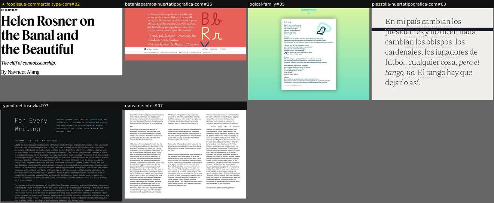

| example | look | feel | ux | learn |
|---|---|---|---|---|
| [★ foodissue-commercialtype-com#02](../../archive/foodissue-commercialtype-com/blocks/02.jpg) | Six article teasers zig-zagging left and right down a white page, each a small caps section label (INTERVIEW, ESSAY, FICTION, COOKING, NEWS, EATING), a big black serif headline ('Helen Rosner on the Banal and the Beautiful', 'Becoming a Regular', 'A Beginner's Guide to Kuih'…), an italic dek and a byline | Serious, generous, like a real magazine cover list | Each teaser is a link card to the full article subpage; there is no image, so the type carries the page | Commission real writing in several genres and present it as a contents page: the hierarchy of label, headline, dek and byline is the specimen, and people actually read it |
| [betaniapatmos-huertatipografica-com#26](../../archive/betaniapatmos-huertatipografica-com/blocks/26.jpg) | On red, a Catalan children's story in white cursive ('Hi havia una vegada una escola que es va quedar sense lletres…') with dialogue dashes, beside big print/cursive letter pairs 'Bb', 'Rr', 'X' in red, cream and navy | Fairy-tale, affectionate | static image | Set a short children's story in the cursive next to print/cursive letter pairs: a reading text and a letter chart in one panel |
| [logical-family#05](../../archive/logical-family/blocks/05.jpg) | 'Intermission ↓': a white paper card with a soft shadow carrying a song lyric 'Bird's Song' by Dirk Vis: a large cloud-and-bird icon, verses with inline icons (:bird:, :cat:, :heart:), and choruses in German, English and Dutch italics | Gentle, literary, humorous | static | Commission a short text written for the font's quirk (icons replacing words): an interlude that is also an in-use specimen |
| [piazzolla-huertatipografica-com#03](../../archive/piazzolla-huertatipografica-com/blocks/03.jpg) | Piazzolla's quote 'En mi país cambian los presidentes… pero el tango, no.' set huge in light roman with the italic clause, and the English translation threaded between the lines in pale grey, widely tracked small caps | Elegant, musical, like a pull quote in a printed programme | static | Run the translation as interlinear tracked small caps in the line gaps: a display size and a caption style shown together, and the bilingual reading becomes the layout |
| [typeof-net-iosevka#07](../../archive/typeof-net-iosevka/blocks/07.jpg) | 'For Every Writing' header over a long essay on grammatical gender in Indo-European, set in Iosevka Etoile with a toolbar to switch Aile/Etoile, weight 1–9 and Italic/Oblique | Bookish, surprising for a code font | Toolbar re-sets the fixed text; it isn't editable. Hidden on mobile | Show a code family's proportional cuts on old philology, with Greek and Latin inline, to prove it can leave the terminal |
| [rsms-me-inter#07](../../archive/rsms-me-inter/blocks/07.jpg) | 'Example text, Regular': three justified-looking ragged columns of ~17px body text, an excerpt about the Pharos of Alexandria with italics and inline Greek, ending 'Excerpt from "Lighthouses and Lightships"' | Book-page calm | static | Show the text weight in real long-form prose with italics and a second script inline, not a lorem block |

## modular-grid

A uniform grid of cells mixing large glyphs, sentences and notes, like a specimen sheet.

**Recognise by:** equal cells, mixed content

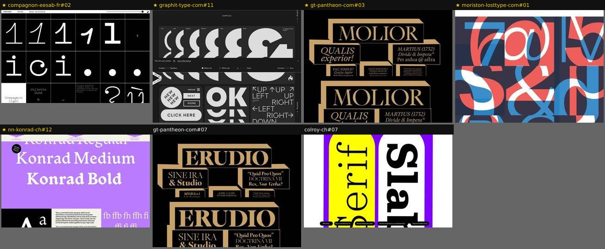

| example | look | feel | ux | learn |
|---|---|---|---|---|
| [★ compagnon-eesab-fr#02](../../archive/compagnon-eesab-fr/blocks/02.jpg) | Six chapters (Light, Italic, Roman, Light & Roman Monofaked, Medium, Script), each opened by a white cell 'Compagnon Light' etc., then the designers' names, the reference date range ('1873 – 2018', '1884 2018', '1313 2018'), huge single glyphs (2, @, ¶, ß, %, f, z, &, $), quirky French sentences ('Tac! Tac! Tac! Cling!', 'Olivia aime les bonbons…', 'Trump, jugez-y fake news d'ex-bolchevique !') and small notes on the historical typewriter source, all in uniform black cells | Archive drawer, playful, rigorous | Every cell can be retyped; the header slider changes cells per row; the 'STYLES' menu jumps to each chapter | One uniform cell grid can hold every kind of specimen content (glyph, pangram, date, note, credit); a white cell is enough to mark each chapter |
| [★ graphit-type-com#11](../../archive/graphit-type-com/blocks/11.jpg) | 'SAMPLES': a 5300px bento of charcoal rounded cards on near-black: S wave of weights, UI button stickers, OK shapes, arrows of words, smartwatch times, 'Book of Stones', Gin No.2 label, a menu price list, 'Mood' with emoji letters, a periodic table, Auguststraße | A brand book for a dozen imaginary clients | Static, long scroll | Stay monochrome, change the invented subject on every card: a grid can show range without a single photo |
| [★ gt-pantheon-com#03](../../archive/gt-pantheon-com/blocks/03.jpg) | A wall of black stone blocks with gold 3D extrusions, each block a specimen cell of Latin inscriptions: 'MOLIOR' across the top, 'QUALIS experior!', 'MARTIUS (1732) Divide & Impera* Per ardua @ astra', 'FAC SIMILE? Gratia Agere №/Numerus DE FUTURO', two small text blocks; caption 'Fig. 1. Weight Axis of GT Pantheon · Current Weight: 715' | Architectural, weighty, playful | Pinned for 300vh: the blocks fly in from depth with rotation and stack into a wall as you scroll; moving the pointer left–right sets the weight of all blocks (300–900, quantised) and the caption prints the current value | Build the specimen sheet as masonry that assembles in 3D, then hand the weight axis to the pointer: architecture metaphor and axis demo in one |
| [★ moriston-losttype-com#01](../../archive/moriston-losttype-com/blocks/01.jpg) | A tall 3×4 grid of square tiles, each holding one giant cropped glyph (7, @, 5, S, &, ®, m, ?, %, Q, £…), overprinted in coral red and blue so overlaps go navy and glyph-on-glyph knocks out white | Screen-printed, playful, poster-like | static | Recreate the bonus print as live SVG text: two layers of cropped glyphs multiplied together give a riso overprint look with real font outlines |
| [★ nn-konrad-ch#12](../../archive/nn-konrad-ch/blocks/12.jpg) | A 3-column grid of equal square cells in black, purple, cream and white, each labelled with its style at the bottom: 'A a', ligatures 'fb ffb fh ffh fi / fk ffk ff fl ffl ft tt', 'Gutenberg's Invention was brought to Rome.', 'Rr', an alphabet card, '&', 'FORTIS MEDIUM SPIRITUS', an angle-annotated stroke detail (33°), the 'Weyfl of Rome' winged dog illustration, and later 'BOOKS WITHOUT NUMBER' with cross pattées, a pilcrow and 'Roman Roman Roman' | Bold, rhythmic, a specimen sheet with jokes | static | Alternate cell colours in a strict square grid and label every cell with the style: the sheet stays orderly however varied the content |
| [gt-pantheon-com#07](../../archive/gt-pantheon-com/blocks/07.jpg) | Second 3D block wall: 'ERUDIO SINE IRA & Studio', '"Quid Pro Quos" DOCTRINA Ⅶ', 'Res, Non Verba? Id Est (i.e.) [ei] id vident: DRAMATIS & auditorium!', coordinates '41.8986° N, 12.4769°', a Latin paragraph with '(fig. 1)' and bibliographic references; caption 'Fig. 2. Optical Size Axis of GT Pantheon · Current Optical Size' | Erudite, playful | Same 3D assembly on scroll; here the pointer drives optical size (10–32) instead of weight | Reuse a striking mechanism for a second axis: the visitor already knows the gesture, so the new axis is the only thing to learn |
| [colroy-ch#07](../../archive/colroy-ch/blocks/07.jpg) | A 'Design features' run of sticker tiles with glyphs cropped huge: 'Serif' and 'Slab' set vertically in yellow and white rounded pillars on violet, a giant cropped 'fb', a curved stroke on pink, an 'r' with its ball terminal on yellow, a white arrow on green, a circle 'O' on pink | Playful close-ups | static | Crop glyphs inside rounded colour tiles so details (ball terminals, bracketed serifs) read as graphic shapes |

## themed-infographic

An interactive infographic on the font's theme, set in the font so the numerals and labels do real work.

**Recognise by:** data, line-ups, timetables

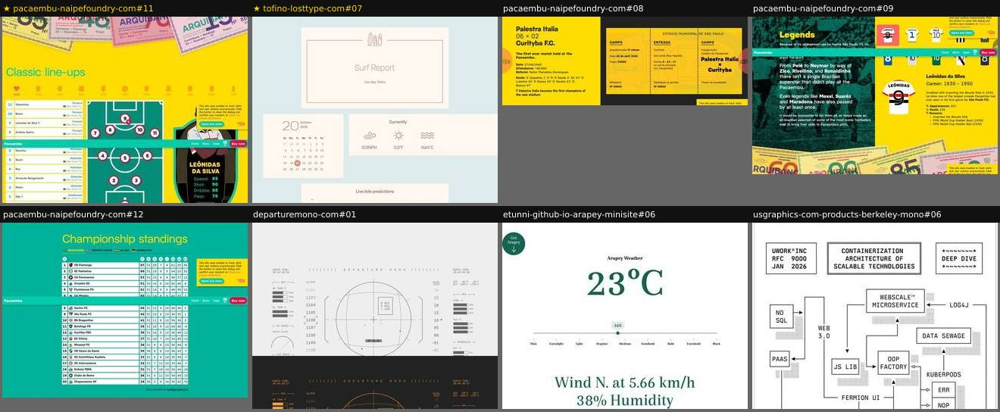

| example | look | feel | ux | learn |
|---|---|---|---|---|
| [★ pacaembu-naipefoundry-com#11](../../archive/pacaembu-naipefoundry-com/blocks/11.jpg) | 'Classic line-ups' in teal on yellow; a row of 11 crest icons with years (1946 … 2002, 1470); below, a numbered player list (11 Teixeirinha Forward 🇧🇷 São Paulo F.C. …), a green pitch with numbered red-ringed player discs in formation, and an MVP card (illustrated Leônidas portrait with Speed 85, Shot 90, Dribble 86, Pass 76) | Game-like, fan culture | Click a year to load that team's line-up: the list, the formation on the pitch and the MVP card all change | A tabular figures-heavy UI (numbers, positions, stats) is the best stress test for a sans: build a real mini-app on the font's theme |
| [★ tofino-losttype-com#07](../../archive/tofino-losttype-com/blocks/07.jpg) | A pale-blue board of cream cards making a 'Surf Report, Cox Bay, Tofino': framed title card with surfboard icons, a calendar on today's date ('20 October 2026'), a 'Currently' card with wind, sun and wave icons, a 'Live tide predictions' area chart, a green map with a compass rose, and a High/Low tide table | Practical, friendly, app-like | Calendar, weather and tide data are fetched live for the visitor's date; the weather API had failed in the capture (0.0 MPH, NaN°C); no inputs | Build a small real dashboard on the theme (tides, weather, dates): numerals, tables and chart labels in the face prove it works as UI |
| [pacaembu-naipefoundry-com#08](../../archive/pacaembu-naipefoundry-com/blocks/08.jpg) | Match card: on yellow, 'Palestra Italia 06 × 02 Curityba F.C.' (team names Bold, score Light), a description, date, attendance, referee, goal list with ⚽ minutes and the winner line; on the dark right half a yellow ticket graphic ('ESTÁDIO MUNICIPAL DE SÃO PAULO', CAMPO / ENTRADA / CAMPO stubs) set entirely in the font | Collectible, matchday | Red manicule buttons at both edges step through 10 landmark matches; each has its own ticket artwork | Reset a real ticket in the font for every match: the data card and the prop together show text, numerals and caps at once |
| [pacaembu-naipefoundry-com#09](../../archive/pacaembu-naipefoundry-com/blocks/09.jpg) | 'Legends': left half a teal halftone photo with heading and large white intro ('From Pelé to Neymar…'); right half yellow with a grid of 20 illustrated club shirts (name and number lettered in the font) and a player card for the selected one (Leônidas da Silva, Career 1930–1950, appearances, goals, honours) | Collector's album | Click a shirt to load that player's card; selected shirt gets a red tile; two buttons scroll the shirt grid | Letter each item of a picker (shirt names and numbers) in the font, so browsing the data is browsing numerals and caps |
| [pacaembu-naipefoundry-com#12](../../archive/pacaembu-naipefoundry-com/blocks/12.jpg) | 'Championship standings' in yellow on teal; tabs 🇧🇷 BRASILEIRÃO · 🇬🇧 PREMIER LEAGUE · 🇪🇸 LA LIGA · 🇩🇪 BUNDESLIGA; a 20-row league table with crests and columns P M W D L GF GA GD; 'Data provided by football-data.org' | Useful, live | Tabs switch league; the table is filled from live data | Pull a live data feed into the specimen: a real table of figures proves tabular numerals better than any static sample |
| [departuremono-com#01](../../archive/departuremono-com/blocks/01.jpg) | A cockpit HUD: 'EARTH TIME: 20:44:48:49' clocks, '|||||||| D E P A R T U R E   M O N O ||||||||' header, gauge bars (OMS He tank, N₂ tank, fuel %, H₂O %, hydraulic), a scrolling 'GLYPHS' counter 1182…1190 with 1186 bracketed, an attitude sphere with 'R 012 P 021 Y 130' and 'AUTO', an ACCEL ticker, and a fact row 'INITIATED: 2022 · LAUNCHED: 2024 · CLASSIFICATION: PIXEL MONOSPACED · LICENSE: SIL OFL'; drawn grey on light, then repeated orange on near-black | Immersive, ‘launch’ moment | As you scroll through it the page flips from light to dark and the HUD from grey to orange; clocks, counters and attitude values tick | Turn the font's facts (glyph count, release dates, licence) into instrument readings, and use the section as the light→dark switch of the page |
| [etunni-github-io-arapey-minisite#06](../../archive/etunni-github-io-arapey-minisite/blocks/06.jpg) | 'Arapey Weather': three big green readouts stacked (23°C; Wind N. at 5.66 km/h / 38% Humidity; Local time Tuesday 8:42), each with its own weight tick slider (Thin … Black) and a numeric badge (468, 404, 367) | Useful, friendly | Each slider sets the weight of its readout; the readouts appear to show the town's live weather and local time | Use live local data (weather, clock) as sample text: figures and units are the hardest test for a display serif and change every visit |
| [usgraphics-com-products-berkeley-mono#06](../../archive/usgraphics-com-products-berkeley-mono/blocks/06.jpg) | 'Box Drawing Characters': a mock architecture diagram drawn entirely with box-drawing glyphs and arrows, boxes labelled WEBSCALE™ MICROSERVICE, NO SQL, WEB 3.0, PAAS, JS LIB, OOP FACTORY, DATA SEWAGE, KUBERPODS, ERR/NOP/SOE, AI ENGINE, FERMION UI, with hatched drop shadows | In-joke, ASCII-art | static | Show box-drawing support by drawing something programmers know (a parody system diagram) instead of listing the U+2500 block |

## slider-morph-mockups

Realistic layouts (ads, tickets, flyers) each with an axis slider that morphs the whole design between the axis extremes.

**Recognise by:** mockup plus slider underneath

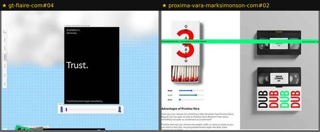

| example | look | feel | ux | learn |
|---|---|---|---|---|
| [★ gt-flaire-com#04](../../archive/gt-flaire-com/blocks/04.jpg) | Sky-blue grid 'desktop' with four '.gtdesign' file windows: a black lawyer ad 'Smith&Son's Advocacy — Trust.', a railway ticket 'Bern → Earth 12.12.2042 ¥589463.99', a 'basic store' discount flyer, a car-wash ad 'OPEN 24/7 EXIT 66'; under each a 'Flaire' slider with plain jeans at one end and flared trousers at the other; critique stickers ('Add More Flaire!', 'cringe?', 'N.O.', 'is that all?', 'omg') pile on | Hilarious, chaotic, very on-brand | Drag the Flaire slider: the ad animates from sober Basic to over-the-top Extra and the sticker reactions change by state (meh → interesting → add more flaire → flairing amazing); file names mock version hell ('ticket-redesign-redo-v8-FINAL-final.gtdesign') | Let one axis slider rewrite a whole realistic layout, and add client reaction stickers: the visitor feels what the axis does to tone, not just to letters |
| [★ proxima-vara-marksimonson-com#02](../../archive/proxima-vara-marksimonson-com/blocks/02.jpg) | Two photographed props with live type laid on top: a white matchbox printed with a huge red '3' and 'ON A MATCH' running down it, and two black VHS tapes on grey with labels ('Friends Seasons 1–9', '90210 Cosmos VH1') and a sleeve reading 'DUB DUB DUB DUB' in black, red, green and red; each prop has Weight, Width and Slant sliders under it | Retro, tactile, fun | Dragging a prop's sliders restyles all lettering on that prop at once (wght 100–900/850, wdth 50–100/85, ital 0–125); the text layers are live HTML over the photos | Lay live variable text over a photo of a real object: one slider then 'reprints' the matchbox, so visitors judge styles on a believable product |

## generative-layout-stream

An endless scroll appending randomly composed layout modules (columns, captions, lists, display words) with themed, often editable copy.

**Recognise by:** infinite scroll, varied modules

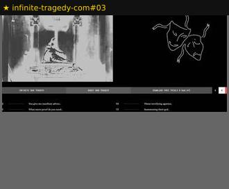

| example | look | feel | ux | learn |
|---|---|---|---|---|
| [★ infinite-tragedy-com#03](../../archive/infinite-tragedy-com/blocks/03.jpg) | A module of two editable columns of tragic one-liners in small serif, a grainy greyscale photo of a Pietà-like sculpture captioned 'Tragedy', white line drawing of comedy/tragedy masks at right, then a numbered list ('2 — You give me excellent advice..', '52 — Those terrifying agonies..') | Like leafing through an endless programme for a Greek tragedy | Scrolling near the end loads another batch (section.loading), each starting with the intro screen again; every paragraph, caption and list line is contenteditable | Generate the specimen from a library of layout modules and a corpus of themed lines: each visit composes a different page, and the text sizes and styles get shown in many contexts |

## draggable-glyph-tiles

Overlapping square tiles of huge cropped glyphs (some animated GIFs) that the visitor can drag and resize into their own collage; the specimen is a pile of cards on a table rather than a fixed layout.

**Recognise by:** overlapping square glyph tiles, drag handles

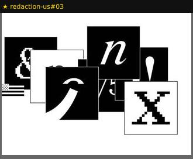

| example | look | feel | ux | learn |
|---|---|---|---|---|
| [★ redaction-us#03](../../archive/redaction-us/blocks/03.jpg) | Seven overlapping black or white squares, each cropping one huge glyph (&, n, a pixelated X, a comma-like shape, !, /5), scattered on white | Evidence photos spread on a desk | Each tile can be dragged and resized by edge handles; some contain animated GIFs by Zipeng Zhu with a JPG fallback. On mobile the tiles stack in a column | Give the visitor a heap of cropped letters to push around: curating a collage makes them look at details they would scroll past |
