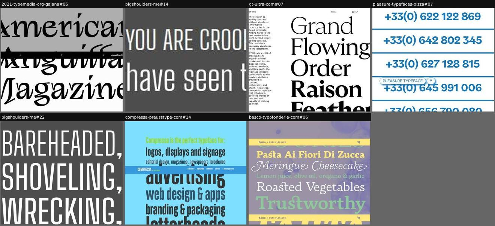
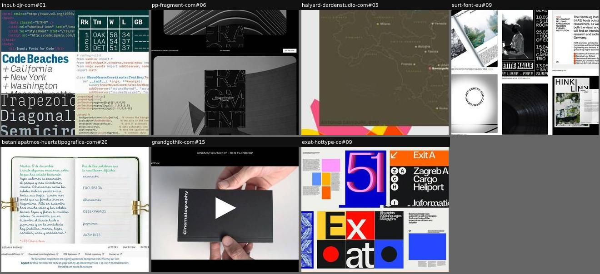
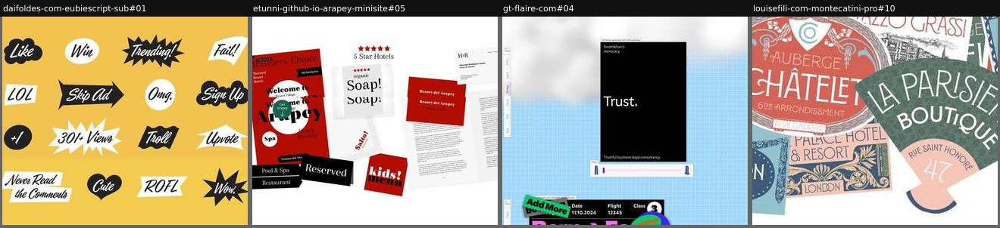
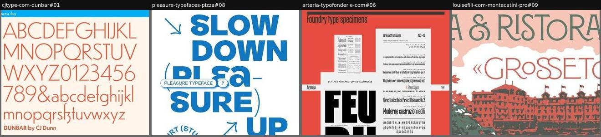
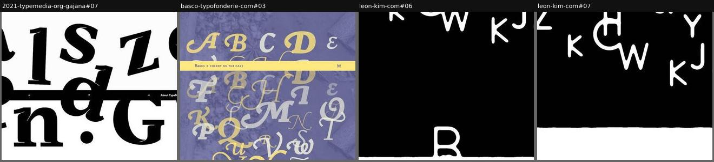
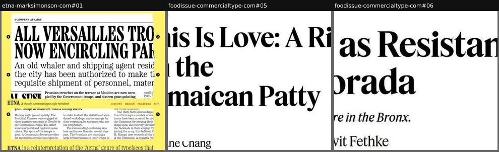
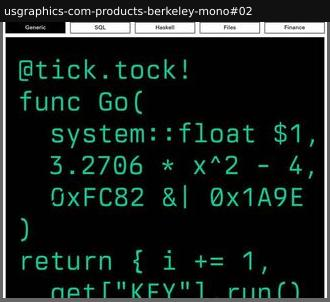
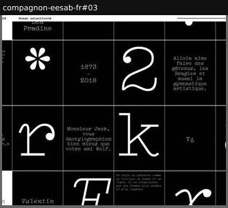
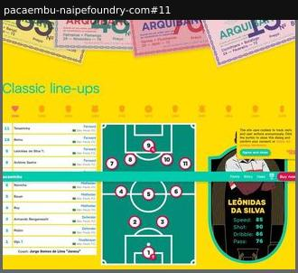

# specimen-showcase

The family shown in use or in display compositions.

Sample: 32 blocks from 25 sites.

| variant | n | definition | recognise by |
|---|---|---|---|
| [word-stack](#word-stack) | 7 | Display words or phrases stacked vertically, often cropped, for rhythm and character. | huge words, one per line |
| [in-use-mockups](#in-use-mockups) | 7 | Realistic applications (posters, books, screens, signage, client work) as a wall, carousel, shuffler or filmed object. | photographic mockups, credits |
| [prop-collage](#prop-collage) | 4 | Invented artefacts (UI windows, tickets, files, stickers) set in the font, collaged into a scene. | fictional brand objects, humour |
| [poster-series](#poster-series) | 4 | A sequence of self-contained poster or specimen-page compositions, often pastiching a period. | full-width graphic panels one after another |
| [kinetic-scenes](#kinetic-scenes) | 4 | Animated, generative or physics compositions (falling or scattered glyphs, liquid) after the hero. | canvas/WebGL, overlapping glyphs |
| [editorial-in-use](#editorial-in-use) | 3 | The font running a real or realistic publication (articles, magazine pages) with genuine content. | headlines, bylines, body copy |
| [use-case-samples](#use-case-samples) | 1 | Tabs or panels with realistic content samples per use case (code, data tables, UI). | tabs: SQL | finance | … |
| [modular-grid](#modular-grid) | 1 | A uniform grid of cells mixing large glyphs, sentences and notes, like a specimen sheet. | equal cells, mixed content |
| [themed-infographic](#themed-infographic) | 1 | An interactive infographic on the font's theme, set in the font so the numerals and labels do real work. | data, line-ups, timetables |

## Rubric

Recorded for every instance in Phase 3, in addition to the cross-cutting attributes in `rubric.json`:

- **medium**: type-only | photo-mockup | illustration | video | generative | ui
- **sequence**: single | series | grid | carousel

## word-stack

Display words or phrases stacked vertically, often cropped, for rhythm and character.

**Recognise by:** huge words, one per line

| example | look | feel | ux | learn |
|---|---|---|---|---|
| [2021-typemedia-org-gajana#06](../../archive/2021-typemedia-org-gajana/blocks/06.jpg) | Grey and white bands, large expressive serif words cropped at the edges, black nav bar | Dramatic, editorial | Arrow navigation between sections | Cropping display words at the viewport edge makes a static specimen feel in motion |
| [bigshoulders-me#14](../../archive/bigshoulders-me/blocks/14.jpg) | Grey, two lines of Sandburg's 'Chicago' in condensed caps and small caps, each line sized to fill the full width (blurry low-res capture) | Gritty, civic, poetic | static | Set lines from a poem tied to the font's city, each fitted to full width: the specimen gains a voice and a place |
| [gt-ultra-com#07](../../archive/gt-ultra-com/blocks/07.jpg) | White, huge black serif words (Grand, Flowing, Order, Raison, Feather) stepping up in weight, cropped right; narrow prose column left | Editorial, refined, assured | static (sticky Try/Buy links) | Pair a weight ramp of single words with a skinny design-rationale column: specimen and argument side by side |
| [pleasure-typefaces-pizza#07](../../archive/pleasure-typefaces-pizza/blocks/07.jpg) | White, blue bold phone numbers stacked between thick blue rules, floating site badge | Utilitarian, deadpan, poster-like | Each number is contenteditable | Use a single real-world content type (phone numbers) to show figures under realistic repetition |
| [bigshoulders-me#22](../../archive/bigshoulders-me/blocks/22.jpg) | Dark grey, huge white condensed caps 'BAREHEADED, SHOVELING, WRECKING,' | Muscular, civic (Sandburg's 'Chicago') | static | A poem from the font's city as the stacked text roots the design in place |
| [compressa-preusstype-com#14](../../archive/compressa-preusstype-com/blocks/14.jpg) | Light blue, green lead-in 'Compressa is the perfect typeface for:', use cases in dark condensed type at varied sizes, each justified to one measure | Salesy, energetic, poster-like | static (sticky nav bar repeats in capture) | List the use cases in the font itself, each fitted to the same width: the pitch is also the size range demo |
| [basco-typofonderie-com#06](../../archive/basco-typofonderie-com/blocks/06.jpg) | Violet food-photo backdrop, food phrases stacked full-width in mixed styles, yellow/green/white; sticky bar repeated by capture | Appetising, warm, generous | static scroll | A single theme (recipes) for every sample line makes style switches read as one menu, not a test page |

## in-use-mockups

Realistic applications (posters, books, screens, signage, client work) as a wall, carousel, shuffler or filmed object.

**Recognise by:** photographic mockups, credits

| example | look | feel | ux | learn |
|---|---|---|---|---|
| [input-djr-com#01](../../archive/input-djr-com/blocks/01.jpg) | Edge-to-edge mosaic of code snippets (Racket, HTML, Python, LaTeX, C++) in different editor themes, plus display words and a scoreboard table | Dense, technical, nerdy | static | For a coding font, show the face across many languages and syntax themes so every visitor spots their own stack |
| [pp-fragment-com#06](../../archive/pp-fragment-com/blocks/06.jpg) | Black, rounded grey architecture photo with a dark poster of outlined 'FRAGMENT' letters on top, small RANDOMIZE button | Moody, architectural, gallery-like | Click Randomize to swap poster and background; sticky section | A randomize button turns a fixed set of mockups into something the visitor plays with and keeps clicking |
| [halyard-dardenstudio-com#05](../../archive/halyard-dardenstudio-com/blocks/05.jpg) | Grey band with landscape images (map, 'African American Design Nexus', 'FUTURE NOW'), small captions, colourful outlined letters behind | Professional, proof-of-use | Slow autoplay marquee; zoom button enlarges each example | Credit real clients and years under each in-use image: social proof that the font ships in real work |
| [surt-font-eu#09](../../archive/surt-font-eu/blocks/09.jpg) | Black-and-white photographic mockups: brochures, event posters, record sleeve, website screenshot | Cultural-institutional, credible | static | Mockups in plausible cultural contexts (art centres, festivals) position the font's market |
| [betaniapatmos-huertatipografica-com#20](../../archive/betaniapatmos-huertatipografica-com/blocks/20.jpg) | Pale mint, photo of an open school notebook with green/blue handwriting script and ruled lines, binder clips, spec caption | Warm, educational, tactile | static | Caption the mockup with the real setting specs (12/14 pt, 45 characters per line) so it doubles as a usage guide |
| [grandgothik-com#15](../../archive/grandgothik-com/blocks/15.jpg) | Black frame, caption 'CINEMATOGRAPHY - 16:9 FLIPBOOK', video of hands holding a black flipbook with white type, play button | Tactile, crafted, cinematic | Play video of the flipbook being thumbed | A flipbook animates the type through print itself: motion and materiality in one object |
| [exat-hottype-co#09](../../archive/exat-hottype-co/blocks/09.jpg) | Two rows of bold Bauhaus-coloured cards: posters, airport wayfinding 'Exit A', '18 weights 200 languages', spiral of 9s | Energetic, modernist, colourful | Auto-scrolling marquee rows | A moving strip of flat applications (signage, posters, stats) shows breadth without asking the visitor to scroll |

## prop-collage

Invented artefacts (UI windows, tickets, files, stickers) set in the font, collaged into a scene.

**Recognise by:** fictional brand objects, humour

| example | look | feel | ux | learn |
|---|---|---|---|---|
| [daifoldes-com-eubiescript-sub#01](../../archive/daifoldes-com-eubiescript-sub/blocks/01.jpg) | Mustard field, grid of black and white stickers: speech bubbles, starbursts, arrows, hearts with 'Like', 'LOL', 'Skip Ad', 'Trending!' | Cheeky, internet, pop | static | Set internet slang on reaction stickers: shows a casual script exactly where it will live (social graphics) |
| [etunni-github-io-arapey-minisite#05](../../archive/etunni-github-io-arapey-minisite/blocks/05.jpg) | White, red-and-black branding for a fictional spa hotel: brochure, soap label, signs, kids menu, letterhead, open book | Warm, hospitality, upmarket | static; floating round 'Get Arapey' button | Invent one coherent client (a hotel) and brand its every touchpoint: range from signage to body text in one glance |
| [gt-flaire-com#04](../../archive/gt-flaire-com/blocks/04.jpg) | Sky-blue grid paper, design-tool windows with joke file names, flight ticket, stickers | Witty, contemporary, insider design humour | Draggable/animated windows; a slider in one window | Joke file names ('…-v8-FINAL-final') speak directly to the designer audience |
| [louisefili-com-montecatini-pro#10](../../archive/louisefili-com-montecatini-pro/blocks/10.jpg) | Overlapping vintage hotel/luggage labels ('Auberge Châtelet', 'La Parisienne Boutique', 'Palace Hotel & Resort') in teal, salmon, navy | Nostalgic, Belle Époque, travel | static | Faux-ephemera (luggage labels) lets one display face show many lockups, ornaments and colourways at once |

## poster-series

A sequence of self-contained poster or specimen-page compositions, often pastiching a period.

**Recognise by:** full-width graphic panels one after another

| example | look | feel | ux | learn |
|---|---|---|---|---|
| [cjtype-com-dunbar#01](../../archive/cjtype-com-dunbar/blocks/01.jpg) | Flat retro colour fields (orange, blue, brown), Bauhaus/Futura-era layouts, big alphabet up top | Nostalgic, confident, print-like | static; scroll through posters | Let each poster pastiche a period the design references; the posters tell the story without any prose |
| [pleasure-typefaces-pizza#08](../../archive/pleasure-typefaces-pizza/blocks/08.jpg) | White, blue heavy caps 'SLOW DOWN (PLEA-SURE) UP' with hand-drawn arrows, circular studio credits, vertical 2020–2021 | Playful, punning, poster-loud | static (floating site badge) | A pun broken across lines with arrows turns a word stack into a poster that reads in a set order |
| [arteria-typofonderie-com#06](../../archive/arteria-typofonderie-com/blocks/06.jpg) | Red field, overlapping grey specimen sheets in condensed styles with point sizes and prices, giant 'FEU', repeating sticky shop bar | Nostalgic, scholarly, printerly | static | Re-typeset a revival as its own period specimen pages: the form proves the lineage |
| [louisefili-com-montecatini-pro#09](../../archive/louisefili-com-montecatini-pro/blocks/09.jpg) | Full-width vintage travel-label illustration: 'VILLA & RISTORANTE «GROSSETO»' over a red hotel and pink sky | Nostalgic, Italian Art Nouveau, travel-poster | static | Period-correct illustration (hotel luggage labels) places a revival font back in its original habitat |

## kinetic-scenes

Animated, generative or physics compositions (falling or scattered glyphs, liquid) after the hero.

**Recognise by:** canvas/WebGL, overlapping glyphs

| example | look | feel | ux | learn |
|---|---|---|---|---|
| [2021-typemedia-org-gajana#07](../../archive/2021-typemedia-org-gajana/blocks/07.jpg) | White, huge black serif lowercase and caps tossed at angles and overlapping, cut by a black nav bar | Energetic, sculptural, playful | Static image that fades in; arrow navigation in the sticky bar | Treat letters as objects thrown onto a table: angles and overlaps reveal shapes that an aligned line hides |
| [basco-typofonderie-com#03](../../archive/basco-typofonderie-com/blocks/03.jpg) | Violet-tinted spice photo, swash capitals A-Z in yellow and white scattered and overlapping, yellow 'Cherry on the cake' sticky bar | Festive, decorative, culinary | static; sticky section bar with cart | Name the swash set 'Cherry on the cake' within the cooking metaphor: the alternates read as the finishing touch |
| [leon-kim-com#06](../../archive/leon-kim-com/blocks/06.jpg) | Black canvas, white rounded sans capitals scattered at the top, a 'B' dripping into a white fill at the bottom | Playful, experimental, code-art | Wheel/time advances canvas scenes; no controls | Build the font as code so letters can fall, melt and pile up: the type itself becomes the animation engine |
| [leon-kim-com#07](../../archive/leon-kim-com/blocks/07.jpg) | Black canvas, loose white capitals (K, H, C, W, Y, J, O) tumbling, white fill rising from the bottom | Playful, gravity-driven, lively | Wheel/time advances canvas scenes; no controls | Letters as physical bodies make a geometric sans feel soft and characterful |

## editorial-in-use

The font running a real or realistic publication (articles, magazine pages) with genuine content.

**Recognise by:** headlines, bylines, body copy

| example | look | feel | ux | learn |
|---|---|---|---|---|
| [etna-marksimonson-com#01](../../archive/etna-marksimonson-com/blocks/01.jpg) | Yellow field, white newspaper pages with condensed Etna headlines over serif body text, sticky 'ETNA' nav bar, large intro paragraph below | Historical, newsy, dramatic | Three carousels of front pages with prev/next arrows; 'Read more' link | Period-appropriate fake news (1871 Paris dispatches) gives a wood-type revival the context it was born in |
| [foodissue-commercialtype-com#05](../../archive/foodissue-commercialtype-com/blocks/05.jpg) | White, large serif headline 'This Is Love: A Riff on the Jamaican Patty', section label, byline | Magazine, authoritative | Read real articles; theme toggle | Commission real writing: the specimen becomes a publication people actually read |
| [foodissue-commercialtype-com#06](../../archive/foodissue-commercialtype-com/blocks/06.jpg) | White, 'NEWS' label, large black condensed serif headline 'Food as Resistance at La Morada', italic dek, byline | Newspaper, serious, humane | Article teaser linking to the full story | A real headline, dek and byline shows the hierarchy a family can carry in four lines |

## use-case-samples

Tabs or panels with realistic content samples per use case (code, data tables, UI).

**Recognise by:** tabs: SQL | finance | …

| example | look | feel | ux | learn |
|---|---|---|---|---|
| [usgraphics-com-products-berkeley-mono#02](../../archive/usgraphics-com-products-berkeley-mono/blocks/02.jpg) | Black panel, large green mono code ('@tick.tock! func Go(…'), five tabs above: Generic, SQL, Haskell, Files, Finance | Terminal, precise, retro-industrial | Tabs swap SVG code samples; not editable | Let the buyer pick their own context (SQL, Haskell, finance tables) instead of one generic code sample |

## modular-grid

A uniform grid of cells mixing large glyphs, sentences and notes, like a specimen sheet.

**Recognise by:** equal cells, mixed content

| example | look | feel | ux | learn |
|---|---|---|---|---|
| [compagnon-eesab-fr#03](../../archive/compagnon-eesab-fr/blocks/03.jpg) | Black cells with thin white rules: big typewriter glyphs (*, 2, r, k, 3), French pangrams, '1873-2018', small italic notes | Archival, typewriter, poetic | Header range slider sets the number of grid divisions (1-6); style menu (Light, Italic, Roman…); colour-mode toggle | Let the visitor set the grid density: the same content flips between glyph close-ups and a dense specimen sheet |

## themed-infographic

An interactive infographic on the font's theme, set in the font so the numerals and labels do real work.

**Recognise by:** data, line-ups, timetables

| example | look | feel | ux | learn |
|---|---|---|---|---|
| [pacaembu-naipefoundry-com#11](../../archive/pacaembu-naipefoundry-com/blocks/11.jpg) | Yellow field, teal 'Classic line-ups', year crests, player list, green pitch with numbered pins, player card with stats; cookie banner partly over it | Sporty, nostalgic, playful | Pick a year to load that team's line-up; players and stats update | Build a small data toy around the font's subject: numerals, tables and labels get shown in real UI without a 'feature' section |
