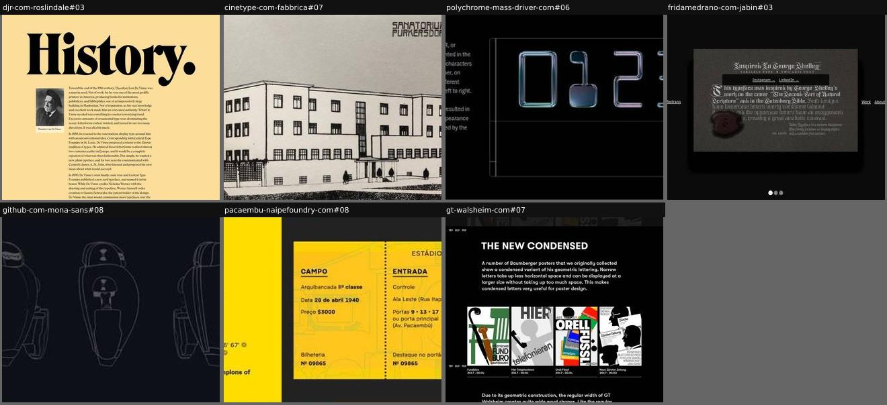
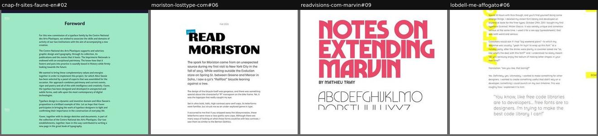
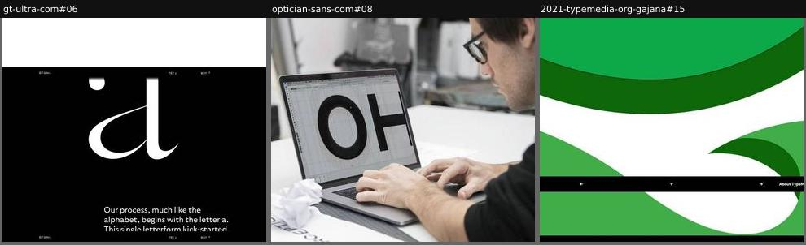
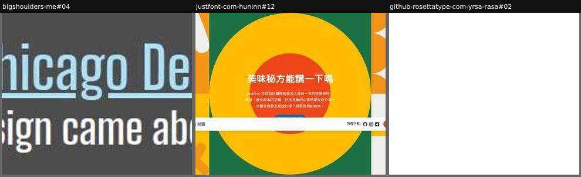
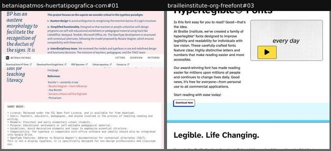
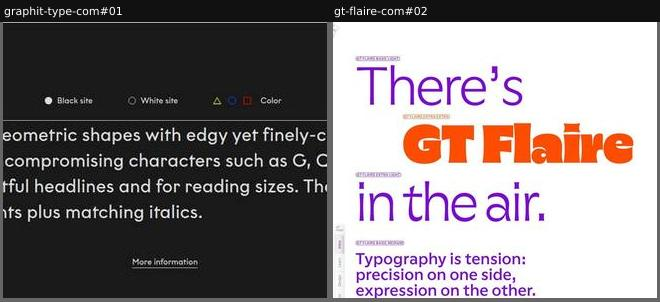
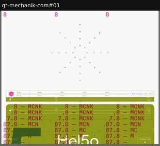
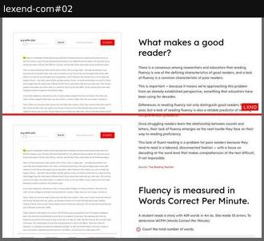
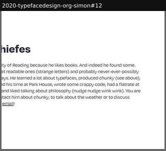

# story

_Section: Story_

Where the family comes from and why: brief, references, process, people.

Sample: 24 blocks from 24 sites.

| variant | n | definition | recognise by |
|---|---|---|---|
| [origin-reference](#origin-reference) | 7 | The source or inspiration (historical artefact, technology, place, genre history) explained in prose and shown visually. | archival images, 'inspired by', dates |
| [essay](#essay) | 4 | Long-form first-person or editorial text (designer essay, process chapters, commissioner's foreword), laid out like an article. | many paragraphs, pull quotes, signature |
| [making-of](#making-of) | 3 | The process shown visually: sketches, proofs, iterations, photos of the designer at work. | process images with little text, stages |
| [article-teaser](#article-teaser) | 3 | A short teaser and a link to an off-page article or interview about the making. | 'Read the story' button |
| [design-brief](#design-brief) | 2 | The problem the font solves (purpose, readers, constraints, principles) stated as a list or spec. | numbered principles, 'designed for' |
| [large-text-intro](#large-text-intro) | 2 | A short 'about' paragraph set large in the font, so the description doubles as a text specimen. | one big paragraph near the top |
| [scroll-narrative](#scroll-narrative) | 1 | A pinned, scroll-driven sequence telling a concept metaphor through animated type and diagrams. | sticky stage, scroll scrubbing |
| [self-test-evidence](#self-test-evidence) | 1 | The design rationale backed by a small test the visitor runs on themselves (reading speed, legibility). | a quiz or timer next to research prose |
| [designer-bio](#designer-bio) | 1 | A short, informal bio of the designer with contact links. | portrait or name, 'about me' |
| [info-popover](#info-popover) | 0 | Section copy hidden behind a small info button and shown as a popover beside the specimen; the page shows type first, text on demand. | (i) Info buttons |

## Rubric

Recorded for every instance in Phase 3, in addition to the cross-cutting attributes in `rubric.json`:

- **voice**: first-person | third-person | institutional | none
- **media**: any of archival, process, photo, illustration, diagram, none
- **length**: short | medium | long

## origin-reference

The source or inspiration (historical artefact, technology, place, genre history) explained in prose and shown visually.

**Recognise by:** archival images, 'inspired by', dates

| example | look | feel | ux | learn |
|---|---|---|---|---|
| [djr-com-roslindale#03](../../archive/djr-com-roslindale/blocks/03.jpg) | Butter yellow, giant black 'History.' headline, serif column with portrait, then 1896 bicycle ad, wood type, 1970s Pentel and ravioli ads | Scholarly, warm, wry | Read and scroll; a small editable sample near the end | Trace the style through period ads across a century so the revival feels like the next chapter |
| [cinetype-com-fabbrica#07](../../archive/cinetype-com-fabbrica/blocks/07.jpg) | One archival drawing of Hoffmann's Sanatorium Purkersdorf (1903) with its geometric lettering, no caption in the block | Historical, Wiener Werkstätte | static | Show the building lettering the revival comes from; the source image proves the lineage better than prose |
| [polychrome-mass-driver-com#06](../../archive/polychrome-mass-driver-com/blocks/06.jpg) | Black, glossy 3D-rendered MICR-style numerals, small prose column on the left | Technical, premium | static | Render the numerals as physical objects to make an abstract origin (magnetic ink) tangible |
| [fridamedrano-com-jabin#03](../../archive/fridamedrano-com-jabin/blocks/03.jpg) | Dark card with blackletter text about George Shelley and the Gutenberg Bible, wax seal photo, dot pagination | Historical, artisanal | Carousel of story cards | Telling the inspiration in the typeface itself (blackletter) doubles as a text specimen |
| [github-com-mona-sans#08](../../archive/github-com-mona-sans/blocks/08.jpg) | Near-black band, five thin white line sketches of the Hubot robot mascot from different angles, difference blend | Technical, character-driven, sketchbook | static image | Show the mascot sketches the companion font grew from: a brand character can be a typeface's origin story |
| [pacaembu-naipefoundry-com#08](../../archive/pacaembu-naipefoundry-com/blocks/08.jpg) | Yellow and charcoal split: match facts (Palestra Italia 06 × 02 Curityba, 1940) left, recreated stadium ticket set in the font right; cookie notice bottom right | Nostalgic, sporty, local pride | Carousel of historic matches with hand-icon prev/next buttons | Recreate period artefacts (match tickets) for each historic moment: the history lesson doubles as an in-use specimen |
| [gt-walsheim-com#07](../../archive/gt-walsheim-com/blocks/07.jpg) | Black, white caps heading, prose, four captioned historic posters (Fundbüro, Orell Füssli…), big 'Otto Baumberger' | Archival, respectful, informative | static | Show the original posters that justify a new width, so the extension reads as recovered history, not invention |

## essay

Long-form first-person or editorial text (designer essay, process chapters, commissioner's foreword), laid out like an article.

**Recognise by:** many paragraphs, pull quotes, signature

| example | look | feel | ux | learn |
|---|---|---|---|---|
| [cnap-fr-sites-faune-en#02](../../archive/cnap-fr-sites-faune-en/blocks/02.jpg) | Mint green, small centred 'Foreword' title, narrow column of small serif prose, two signatures (institution heads) | Institutional, cultural, formal | static | A commissioner's foreword frames a public typeface as cultural heritage, not a product |
| [moriston-losttype-com#06](../../archive/moriston-losttype-com/blocks/06.jpg) | White, bold 'READ MORISTON' title with 'Edit me' tag, prose column, photo of a Rollfast bicycle 'R' badge, outline interpolation masters, named subsections | Personal, warm, storytelling | Long read; title is editable | Let the designer tell the spark in first person and show the photo that started it: credibility and charm at once |
| [readvisions-com-marvin#09](../../archive/readvisions-com-marvin/blocks/09.jpg) | White, pink/orange display chapter titles ('Marvin Goes On A Diet'), body column, margin proofs of early weights with captions | Candid, nerdy, personal | Read; inline links | Show rejected and early masters in the margins: the false starts teach more than the finished weights |
| [lobdell-me-affogato#06](../../archive/lobdell-me-affogato/blocks/06.jpg) | White page, narrow body column, vertical yellow 'AFFOGATO' wordmark, large light pull quote, yellow download tab | Candid, humorous, personal | static; read; download button floats at the side | A frank personal backstory ('are you like, that boring?') makes a free font feel like a gift, not a product |

## making-of

The process shown visually: sketches, proofs, iterations, photos of the designer at work.

**Recognise by:** process images with little text, stages

| example | look | feel | ux | learn |
|---|---|---|---|---|
| [gt-ultra-com#06](../../archive/gt-ultra-com/blocks/06.jpg) | Black, white calligraphic 'a', large prose paragraph, 'Calligraphy' then 'Geometric Construction' with stage labels Starting point / Standard / Fine | Thoughtful, crafted, calm | Scroll story; sticky Try/Buy links | Show the journey from the first letter to the final system, so the two subfamilies read as two ends of one process |
| [optician-sans-com#08](../../archive/optician-sans-com/blocks/08.jpg) | Studio photo: designer in glasses typing on a laptop showing 'OH' in a font editor, crumpled proof in front | Authentic, behind-the-scenes | static | One candid studio photo of the font editor shows craft and a real person behind a free font |
| [2021-typemedia-org-gajana#15](../../archive/2021-typemedia-org-gajana/blocks/15.jpg) | Full-width extreme close-up of green outline curves (a magnified letterform), black nav bar across; one image of a process series | Abstract, organic, crafted | static; images fade in on scroll | Magnify a single curve until it becomes abstract art: shows care at the outline level |

## article-teaser

A short teaser and a link to an off-page article or interview about the making.

**Recognise by:** 'Read the story' button

| example | look | feel | ux | learn |
|---|---|---|---|---|
| [bigshoulders-me#04](../../archive/bigshoulders-me/blocks/04.jpg) | Charcoal band, two lines of condensed grey text with light-blue underlined links | Civic, matter-of-fact | Links to the design system and to the making-of article | Two sentences and two links can carry the context (part of a city design system) without a full story section |
| [justfont-com-huninn#12](../../archive/justfont-com-huninn/blocks/12.jpg) | Orange/green/yellow geometric tiles built from glyph shapes, big concentric circles, white CJK headline; sticky nav overlaps | Friendly, appetising, open-source warmth | Button links to the designers' process blog post | Frame the process write-up as a 'secret recipe' question to make a long read feel like a treat |
| [github-rosettatype-com-yrsa-rasa#02](../../archive/github-rosettatype-com-yrsa-rasa/blocks/02.jpg) | Unstyled default HTML: numbered bold headings ('Introducing Yrsa', 'Harmonizing Gujarati and Latin'), one-line blurbs, 'Read more' links | Plain, academic, documentation-like | Click 'Read more' to open each process article | A numbered series of process articles turns a font release into a readable design course |

## design-brief

The problem the font solves (purpose, readers, constraints, principles) stated as a list or spec.

**Recognise by:** numbered principles, 'designed for'

| example | look | feel | ux | learn |
|---|---|---|---|---|
| [betaniapatmos-huertatipografica-com#01](../../archive/betaniapatmos-huertatipografica-com/blocks/01.jpg) | Pink, large italic pull quote left, numbered principles and references right, monospace 'SHORT BRIEF' card; sticky nav overlaps | Pedagogical, sober, purposeful | static; sticky nav with download, PDF and GitHub links | Publish the brief as a spec (users, readers, purpose, compatibility) so a functional font is judged by its goals |
| [brailleinstitute-org-freefont#03](../../archive/brailleinstitute-org-freefont/blocks/03.jpg) | White, plain sans intro with yellow play button video, then pale-blue rules; bad cut merges intro, mission, feature cards (B8 O0, 1Il) and family versions | Accessible, earnest, institutional | Video, Download Now and Learn More buttons; otherwise static | Open with 'Is this font easy for you to read? Good—that's the idea': the reader tests the claim on that line |

## large-text-intro

A short 'about' paragraph set large in the font, so the description doubles as a text specimen.

**Recognise by:** one big paragraph near the top

| example | look | feel | ux | learn |
|---|---|---|---|---|
| [graphit-type-com#01](../../archive/graphit-type-com/blocks/01.jpg) | Charcoal, large light-grey geometric sans paragraph; sticky bar with theme options; cookie notice across the top | Clean, assured | 'More information' expands the history; bar switches Black site / White site / Color | Let visitors flip the whole site dark, light or colour: the same text shows how the font holds up on each |
| [gt-flaire-com#02](../../archive/gt-flaire-com/blocks/02.jpg) | White, purple and orange lines in different styles, each tagged with a tiny style-name pill; cut continues into an axes box and a styles list | Upbeat, expressive, UI-flavoured | Intro static; below, a box with Flaire, Weight and Italic sliders on its edges that animate | Tag each intro line with the style it is set in: the pitch quietly becomes a style guide |

## scroll-narrative

A pinned, scroll-driven sequence telling a concept metaphor through animated type and diagrams.

**Recognise by:** sticky stage, scroll scrubbing

| example | look | feel | ux | learn |
|---|---|---|---|---|
| [gt-mechanik-com#01](../../archive/gt-mechanik-com/blocks/01.jpg) | Olive panels, glitched radio message 'Hel5o. Is anybody there?', frequency dial bar (MONO 87.8, SEMI 91.2, POLY 95.6), diagrams, then 'Light' in three subfamilies | Cinematic, sci-fi, puzzle-like | Pinned scroll sequence; persistent dial bar with Type tester, Try and Buy buttons | A metaphor UI (tuning a radio between subfamilies) carried through the scroll makes a three-family system memorable |

## self-test-evidence

The design rationale backed by a small test the visitor runs on themselves (reading speed, legibility).

**Recognise by:** a quiz or timer next to research prose

| example | look | feel | ux | learn |
|---|---|---|---|---|
| [lexend-com#02](../../archive/lexend-com/blocks/02.jpg) | White, sticky reading-passage card with WPM slider and red START button beside prose and a step-by-step WCPM calculation | Research-driven, educational, earnest | Pace slider, passage picker and Start run a reading-speed test with live counters (time, words, errors, WCPM) | Turn the font's claim into an experiment: a reading test lets the visitor measure 'more readable' instead of trusting it |

## designer-bio

A short, informal bio of the designer with contact links.

**Recognise by:** portrait or name, 'about me'

| example | look | feel | ux | learn |
|---|---|---|---|---|
| [2020-typefacedesign-org-simon#12](../../archive/2020-typefacedesign-org-simon/blocks/12.jpg) | White, bold sans name heading, one paragraph of jokey bio, plain Website/Twitter links | Personal, humorous, approachable | Email, website and social links | A self-deprecating bio with a direct email invites conversation more than a formal CV |

## info-popover

Section copy hidden behind a small info button and shown as a popover beside the specimen; the page shows type first, text on demand.

**Recognise by:** (i) Info buttons

_No instance in the sample yet._
