# story

_Section: Story_

Where the family comes from and why: brief, references, process, people.

254 instances on 152 sites (the Phase 3 extraction of 181 sites).

| variant | sites | definition | recognise by |
|---|---|---|---|
| [origin-reference](#origin-reference) | 61 | The source or inspiration (historical artefact, technology, place, genre history) explained in prose and shown visually. | archival images, 'inspired by', dates |
| [large-text-intro](#large-text-intro) | 50 | A short 'about' paragraph set large in the font, so the description doubles as a text specimen. | one big paragraph near the top |
| [essay](#essay) | 34 | Long-form first-person or editorial text (designer essay, process chapters, commissioner's foreword), laid out like an article. | many paragraphs, pull quotes, signature |
| [design-brief](#design-brief) | 28 | The problem the font solves (purpose, readers, constraints, principles) stated as a list or spec. | numbered principles, 'designed for' |
| [article-teaser](#article-teaser) | 12 | A short teaser and a link to an off-page article or interview about the making. | 'Read the story' button |
| [designer-bio](#designer-bio) | 12 | A short, informal bio of the designer with contact links. | portrait or name, 'about me' |
| [making-of](#making-of) | 10 | The process shown visually: sketches, proofs, iterations, photos of the designer at work. | process images with little text, stages |
| [info-popover](#info-popover) | 4 | Section copy hidden behind a small info button and shown as a popover beside the specimen; the page shows type first, text on demand. | (i) Info buttons |
| [faq](#faq) | 4 | Practical questions and answers about the font, as a collapsed accordion (often grouped by tabs) or an open anchored list. | Q&A list, expand on click |
| [scroll-narrative](#scroll-narrative) | 3 | A pinned, scroll-driven sequence telling a concept metaphor through animated type and diagrams. | sticky stage, scroll scrubbing |
| [self-test-evidence](#self-test-evidence) | 2 | The design rationale backed by a small test the visitor runs on themselves (reading speed, legibility). | a quiz or timer next to research prose |
| [expandable-timeline](#expandable-timeline) | 1 | A dated timeline of rows that expand into text cards on hover or click, with the year and title switching from light to heavy weight. | years in a column, accordion rows |

## Rubric

Recorded for every instance in Phase 3, in addition to the cross-cutting attributes in `rubric.json`:

- **voice**: first-person | third-person | institutional | none
- **media**: any of archival, process, photo, illustration, diagram, none
- **length**: short | medium | long

## origin-reference

The source or inspiration (historical artefact, technology, place, genre history) explained in prose and shown visually.

**Recognise by:** archival images, 'inspired by', dates

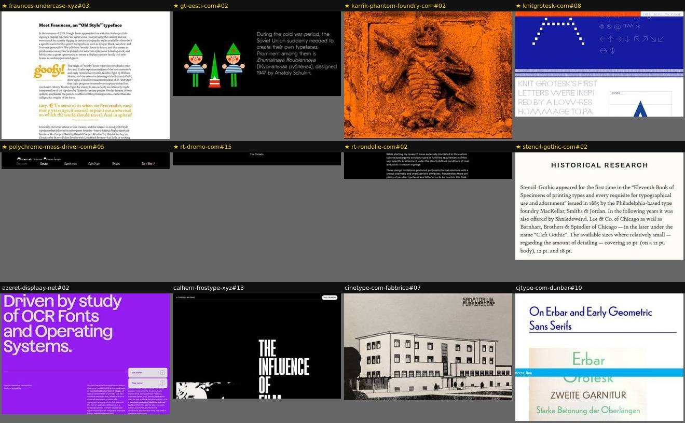

| example | look | feel | ux | learn |
|---|---|---|---|---|
| [★ fraunces-undercase-xyz#03](../../archive/fraunces-undercase-xyz/blocks/03.jpg) | 'Meet Fraunces, an “Old Style” typeface': a single book-like column of body text in Fraunces, interrupted by orange lettering samples of the genre's history (a 'goofy!' lettering floated left, a line of Morris's Golden Type, 'In Aid of Bart's Second Annual DANCE' in Richmond Oldstyle, Benguiat's 'Thank You for Shopping With us!' Bookman Swash), each with a small italic orange caption; signed by Phaedra Charles | Affectionate, well-read | static; one caption link to the image source | Redraw the historical samples in one accent colour instead of pasting scans: the genre's lineage reads as one consistent story beside the text |
| [★ gt-eesti-com#02](../../archive/gt-eesti-com/blocks/02.jpg) | Seven short chapters on black: a coloured all-caps heading ('ЭССР ЭСТОНСКАЯ СОВЕТСКАЯ СОЦИАЛИСТИЧЕСКАЯ РЕСПУБЛИКА' orange, 'THE ADVENTURE BEGINS' yellow, 'DESIGNING EESTI' green, 'DISCOVERING CYRILLICS' blue, 'VISITING TALLINN' purple, 'LAST TOUCHES' white) and one paragraph beside a looping flat illustration (Soviet pioneers, folk-costume dolls, flash cards, a GT Eesti Display book cover with a kite, a boat of faces, a red pencil) | A children's picture book about a typeface | Scroll to read; the illustrations loop. The text gets heavier chapter by chapter | Step the type weight up with each chapter (headings Display Ultra Light → Ultra Bold, paragraphs Text Ultra Light → Bold): the narrative itself becomes the weight waterfall |
| [★ karrik-phantom-foundry-com#02](../../archive/karrik-phantom-foundry-com/blocks/02.jpg) | Two side-by-side duotone photos in burnt orange and black of Ankou statues (a skeleton relief at Ploudiry's ossuary, a cloaked figure at Noyal-Pontivy), small orange captions, then a long violet bilingual paragraph on the Breton myth (the paragraph sits in a gap between blocks and was never cut; seen in the storyboard) | Gothic, local, folkloric | static | Tie the font's name to a folk legend (the Ankou's cart 'Karrik') and show the legend with duotone photos in the chapter colour |
| [★ knitgrotesk-com#08](../../archive/knitgrotesk-com/blocks/08.jpg) | Under a 'STORY' ticker band, a dotted-capitals text column set as a hard character grid (words break anywhere: 'INSPI / RED', 'PATT / ERN') beside three diagrams of the letter A: Futura, the Futur X pixel A on a square grid, and the striped Knit Grotesk A | Logical, transparent | Scroll the text past the three A diagrams; 'Futur X by Laucke Siebein ↗' links out | Tell the origin as three versions of one letter (source → pixel grid → knitted) placed beside the text that explains each step |
| [★ polychrome-mass-driver-com#05](../../archive/polychrome-mass-driver-com/blocks/05.jpg) | After the 'About the Design' heading in the font, two short grey paragraphs explaining MICR beside a framed diagram: chrome digits '01234' above a divider line, under which a black mask slides away left to right, uncovering the magnetic-signature waveform as if scanned | Clever, illuminating | Animation loops every 8s; no interaction | Animate the original technology (a magnetic scanner reading the digits) instead of describing it: the reason for the odd shapes becomes obvious |
| [★ rt-dromo-com#15](../../archive/rt-dromo-com/blocks/15.jpg) | 'The Tickets': scans of Ticketmaster and BASS stubs from the 80s, then a white-on-black reconstruction of the ticket's two type sizes on a vertical hairline pitch grid with letter pairs Ee Mm Oo Gg Rr Ss | Forensic and affectionate | Read the hunt, then see the specimen isolated from the scan | Follow a scan with the same letters extracted on a clean grid: readers see how the found evidence becomes a design rule |
| [★ rt-rondelle-com#02](../../archive/rt-rondelle-com/blocks/02.jpg) | Chapter 'ORIGIN' then three source studies, each a small centred label ('Polskie Pismo Drogowe', 'London Airport Lettering', 'SBB signage'), a wide archival image on black (a binder of yellow-highlighted construction drawings, an open Typographica spread of airport lettering, a b/w diptych of two 'Dietikon' station signs), a credited caption and a paragraph | Researched, generous with sources | static; captions credit photographers and the Letterform Archive | Give each reference its own mini-chapter (label, image, credit line, paragraph) so the lineage reads as evidence, not mood |
| [★ stencil-gothic-com#02](../../archive/stencil-gothic-com/blocks/02.jpg) | 'HISTORICAL RESEARCH' then a paragraph, opening on a full-bleed five-slide carousel of macro photographs of the original 1885 specimen book pages | Handling the real book | Dots below the photo and direction arrows move through five slides | Shoot the source specimen as an object, with its page curl and paper edge, not as a flat scan: it proves the history and makes the type feel physical |
| [azeret-displaay-net#02](../../archive/azeret-displaay-net/blocks/02.jpg) | 'Driven by study of OCR Fonts and Operating Systems.' in four big lines, a hairline rule, then a small 'Optical character recognition — Source: Wikipedia' label and two columns of quoted encyclopedia text with bold key phrases | Researchy, factual | Source link to Wikipedia | Quote the encyclopedia definition of the inspiration, credited, instead of writing your own history |
| [calhern-frostype-xyz#13](../../archive/calhern-frostype-xyz/blocks/13.jpg) | 'THE INFLUENCE OF FILM' in tall condensed caps beside a short paragraph, surrounded by staggered film posters re-set in Calhern (Rogue One in tan and black, Pulp Fiction in orange, a gun-toting Bruce Willis poster with billing block, Dune in tan); the background flips from black to white and back | Cinephile, punchy, poster-wall | Posters stagger and drift with scroll; background colour switches per section trigger | Explain the influence by re-setting famous film posters in the new typeface: the reference and the proof in one image |
| [cinetype-com-fabbrica#07](../../archive/cinetype-com-fabbrica/blocks/07.jpg) | The essay's reference figures, each with a monospace caption: Josef Hoffmann's 1903 Purkersdorf Sanatorium rendering with its lettering; a Gilbert Rohde tubular-steel beverage cart on black beside 'tubular steel design' with a magnifier circle on the l; a technical drawing with Rapidograph pens; an AutoCAD 2021 screenshot of a dimensioned rounded slot ('22,79'); a 4-slide slider of photos of orange Standardgraph lettering guides | Tactile, nostalgic for the drafting table | Static images, except the lettering-guide slider (Webflow slider, arrows and dots, 4 slides) | Trace each design detail back to a physical tool or object (steel tube, technical pen, stencil guide) and show the object: the 'warmth' claim becomes concrete |
| [cjtype-com-dunbar#10](../../archive/cjtype-com-dunbar/blocks/10.jpg) | 'On Erbar and Early Geometric Sans Serifs': a white panel with a long article by Indra Kupferschmid, illustrated with archival specimen scans (Erbar-Grotesk 'Zweite Garnitur' showing, Lichte Fette Grotesk 1923, Erbar's 1922 sketch alphabet, Swiss Büchler specimen 1941) with bold captions; numbered footnotes follow at the end of the page | Scholarly, museum-like | Inline links to sources; footnote references | Commission a real historian's essay and let the scans carry the argument: the revival's legitimacy is shown, not claimed |
| [djr-com-bungee#03](../../archive/djr-com-bungee/blocks/03.jpg) | On warm off-white, a vertical red 'STACKING' title beside three tall street photos of signs (G&G Hardware, Little City Selected Meats, the Tower theatre), with a short caption and paragraph; a later panel shows three odd signs (Drugs, Telephone, Do Not Enter) and asks design questions | A field notebook of signage | static | Rotate the chapter title 90° so the page's headings use the very feature being discussed, and let three cropped street photos carry the argument |
| [djr-com-bungee#09](../../archive/djr-com-bungee/blocks/09.jpg) | Vertical 'COLOR' title beside a large scan from Wm. H. Page & Co.'s 1874 chromatic type specimen, showing 'RIDE' in overprinted wood type, with a short history paragraph | Antique, ornamental | One link to a chromatic font resource | Open the feature chapter with the historical precedent so a modern colour-font technology reads as the return of a craft |
| [djr-com-gimlet#06](../../archive/djr-com-gimlet/blocks/06.jpg) | 'A Dialogue with Schadow' essay section, then 'FIGURE II. SCHADOW, AS PUBLISHED BY C. E. WEBER': a full-width scan of the original specimen pages (FORM UND TECHNIK, BESSER DER TOD, REDAKTION, MASCHINENFABRIK, KALENDER, WERKZEUG, POLITIK, CHEMIE, AFRIKA…), a follow-up on how Gimlet answers Schadow, and later 'FIGURE V. SCHADOW KURSIV': the original italic alphabet scan | Respectful, curious | static; links to the advisers | Show the source in its original specimen pages at full width, then say exactly what you kept and what you changed |

_…and 59 more in the gallery (`npm run app`)._

## large-text-intro

A short 'about' paragraph set large in the font, so the description doubles as a text specimen.

**Recognise by:** one big paragraph near the top

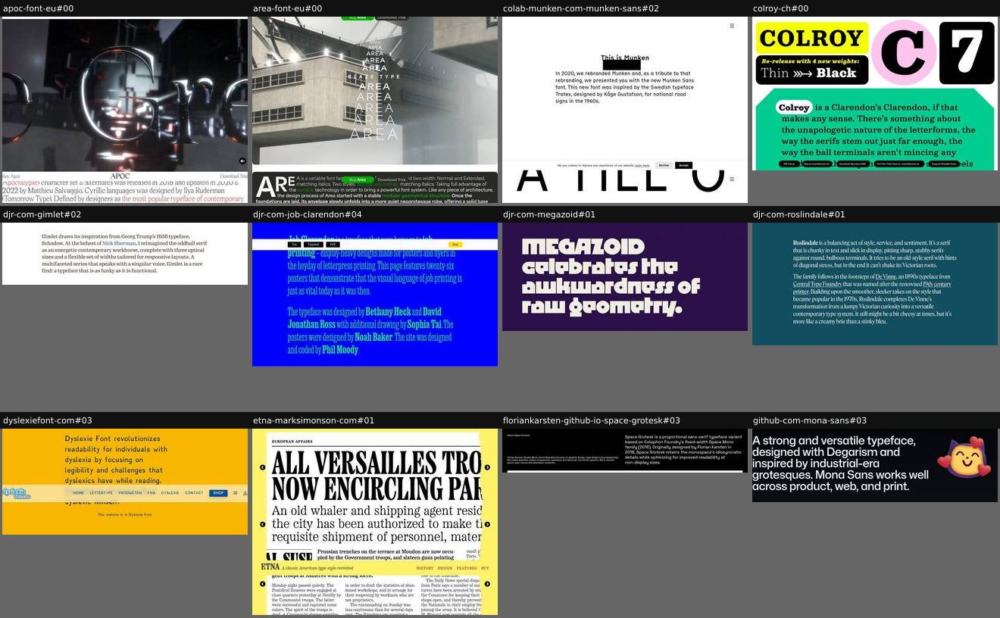

| example | look | feel | ux | learn |
|---|---|---|---|---|
| [apoc-font-eu#00](../../archive/apoc-font-eu/blocks/00.jpg) | Under the video, a four-line paragraph in black Apoc Revelations at ~39px across the full width, with 'Apoc(alypse)' and 'the most popular typeface of contemporary independant design' picked out in red | Assured, editorial | Red phrases are links or emphasis; static otherwise | Colour a few phrases of the intro red: the paragraph reads as a specimen and the accent colour becomes the site's highlight system |
| [area-font-eu#00](../../archive/area-font-eu/blocks/00.jpg) | Dark rounded card: a giant 'ARE' drop cap (~150px) eats into a ~26px paragraph whose key phrases are set in the style they describe and coloured green ('Normal and Inktrap', 'variable', 'modular geometrical structure', 'smooth grey', 'steady as well'); the second half switches to bold | Confident, crafted | static | Let the paragraph change weight and style exactly where it names them: the intro becomes a running specimen |
| [colab-munken-com-munken-sans#02](../../archive/colab-munken-com-munken-sans/blocks/02.jpg) | 'This is Munken' heading, three short paragraphs in large Regular on white, broken by a giant full-width line 'A TILL Ö'. The black rectangle over the heading and the cookie bars are capture artefacts | Calm, plainspoken | One e-mail link for licensing: service@lineto.com | Let one giant line ('A till Ö', Swedish for A to Z) interrupt the prose: it nods to the Swedish road-sign origin and shows the display size in one stroke |
| [colroy-ch#00](../../archive/colroy-ch/blocks/00.jpg) | A green octagon (clipped corners) holding a ~40px paragraph with 'Colroy' in a white pill: 'Colroy is a Clarendon's Clarendon, if that makes any sense. There's something about the unapologetic nature of the letterforms…', signed 'Lovely words by: Proof&Co' | Warm, peer-to-peer praise | static; the signature links to Proof&Co | Use a fellow foundry's description of the font as the intro, set large: praise and specimen in one |
| [djr-com-gimlet#02](../../archive/djr-com-gimlet/blocks/02.jpg) | One six-line paragraph in dark serif on white, a navy link on 'Nick Sherman': 'Gimlet draws its inspiration from Georg Trump's 1938 typeface, Schadow… a typeface that is as funky as it is functional.' | Inviting | static | Open with one larger paragraph in the text face: source, commissioner and promise in six lines |
| [djr-com-job-clarendon#04](../../archive/djr-com-job-clarendon/blocks/04.jpg) | On electric blue, two large paragraphs in mint green condensed light: what job printing is and that 'This page features twenty-six posters', then the credits with each name in a heavier weight (Bethany Heck, David Jonathan Ross, Sophia Tai, Noah Baker, Phil Moody) | Bright and generous with credit | static; 'job printing' is set heavier as a keyword | Set the people's names in a heavier weight inside the intro paragraph: the credits become a weight contrast specimen |
| [djr-com-megazoid#01](../../archive/djr-com-megazoid/blocks/01.jpg) | One sentence in cream on very dark purple, four lines, left-aligned: 'MEGAZOID celebrates the awkwardness of raw geometry.' | Punchy, self-aware | static | A one-sentence thesis set large right after the hero frames everything that follows |
| [djr-com-roslindale#01](../../archive/djr-com-roslindale/blocks/01.jpg) | Two white paragraphs at ~34px on dark teal: 'Roslindale is a balancing act of style, service, and sentiment…' ending '…more like a creamy brie than a stinky bleu', with underlined links to De Vinne and Central Type Foundry | Charming, self-aware | Reading; links to Fonts In Use and Wikipedia | Set the intro at a comfortable reading-display size in the Text cut and let one good metaphor (brie vs bleu) carry the positioning |
| [dyslexiefont-com#03](../../archive/dyslexiefont-com/blocks/03.jpg) | Dark 28px paragraph on the same yellow, ending with a small 'This website is in Dyslexie Font' | Sincere, direct | static | The line 'This website is in Dyslexie Font' turns every later paragraph into a live specimen |
| [etna-marksimonson-com#01](../../archive/etna-marksimonson-com/blocks/01.jpg) | Under the newspaper, a 4-line lede on yellow: bold 'ETNA' run-in, then 'is a reinterpretation of the ‘Aetna’ genre of typefaces that peaked in popularity as wood type in the 19th century…' ending in a red small-caps 'READ MORE ☞' | Calm, bookish | 'Read more ☞' (with a manicule) links to the History subpage | A manicule ☞ in small caps is a period-appropriate 'read more' link that also shows off the font's small caps and dingbats |
| [floriankarsten-github-io-space-grotesk#03](../../archive/floriankarsten-github-io-space-grotesk/blocks/03.jpg) | 'About Space Grotesk' label top-left with a tiny studio bio at bottom-left; on the right half a ~24px white paragraph: 'Space Grotesk is a proportional sans-serif typeface variant based on Colophon Foundry's fixed-width Space Mono family (2016)…' | Calm, informative | static | Split the about section: tiny credits on the left, one 24px paragraph on the right, so it reads as a specimen of the text size |
| [github-com-mona-sans#03](../../archive/github-com-mona-sans/blocks/03.jpg) | Two parallel family cards: a hairline-ruled header with the name in wide extrabold caps ('MONA SANS', 'HUBOT SANS') and a small mascot icon at the right; a 4–5 line description at ~64px ('A strong and versatile typeface, designed with Degarism and inspired by industrial-era grotesques…', 'Mona's robotic sidekick. More geometric accents…'), a looping animated emoji (Mona with hearts) or a 3D Hubot flying past a giant white '&', and two buttons | Warm, approachable, brand-polished | Each card ends with 'Download font' (outlined) and 'View on GitHub' (text) linking to that family's repository; the animated emoji videos play only in the viewport | When a site ships two sibling families, give each the same card (name bar, big description in that font, mascot, two buttons) so the pair reads as a set and the description is set in the family it describes |
| [graphit-type-com#01](../../archive/graphit-type-com/blocks/01.jpg) | Small tracked 'ABOUT GRAPHIT' caption above a 36px paragraph, then an underlined 'More information' link | Brief and matter-of-fact | The link expands more information | A one-paragraph about in Regular at 36px doubles as the first text-size specimen |
| [gt-alpina-com#01](../../archive/gt-alpina-com/blocks/01.jpg) | A centred 9-line paragraph in black at ~40px, then a red party-popper emoji and a second short paragraph about variable fonts | Book-like, friendly | The paragraph is contenteditable; clicking it opens the axis overlay (default axes Weight × Contrast) | Put a playful animated emoji between the 'about' text and the tech note: one tiny drawing breaks a wall of large text |
| [gt-america-com#01](../../archive/gt-america-com/blocks/01.jpg) | Blue family name at 108px, then a 7-line intro paragraph set at ~36px in blue on white, indented 132px | Calm, authoritative | static | Set the 'about' paragraph at a text-display size so the description doubles as a specimen of the text weights |

_…and 42 more in the gallery (`npm run app`)._

## essay

Long-form first-person or editorial text (designer essay, process chapters, commissioner's foreword), laid out like an article.

**Recognise by:** many paragraphs, pull quotes, signature

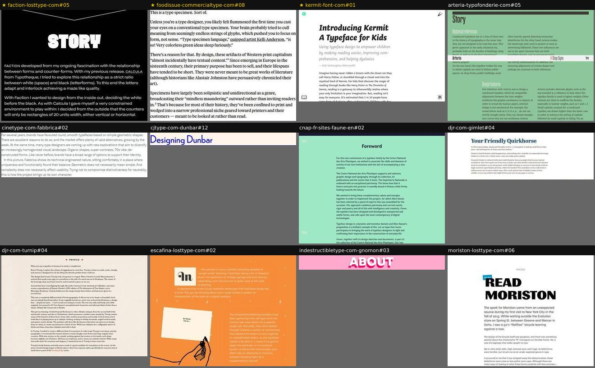

| example | look | feel | ux | learn |
|---|---|---|---|---|
| [★ faction-losttype-com#05](../../archive/faction-losttype-com/blocks/05.jpg) | 'STORY' heading in Faction Black, then a narrow column of first-person prose broken by full-width figures: counter-rectangle diagram over 'OHOSXV' / 'OECSXV', Jan van Krimpen's Open Kapitalen ('EPISTOLA BEATI PETRI…'), 'Filament' in Black, auto-outlined Black and Outline, and an 'Info@LT www.com #Pour¼!' specimen | Thoughtful, designer-to-designer | Long read; inline links to Calcula, Klimax, Neil Bold, Open Kapitalen and earlier Lost Type releases | Explain the one generative rule (counters are only 20-unit rectangles) with a single diagram that pulls the counters out above the letters |
| [★ foodissue-commercialtype-com#08](../../archive/foodissue-commercialtype-com/blocks/08.jpg) | 'From the Editor': a long single-column essay in text-size serif ('This is a type specimen. Sort of.'), with underlined links to past Commercial Type specimens, superscript note numbers and a 'Notes' list at the end, signed '—Caren Litherland' | Thoughtful, self-aware | Reading only; links out to earlier specimens (Graphik dry-transfer sheet, newspaper specimen, Marian storefront, wheat-paste, subway ads) and to sources | Explain the concept in an editor's letter that also traces the history of specimens: the brief, the context and the long-form text sample in one |
| [★ kermit-font-com#01](../../archive/kermit-font-com/blocks/01.jpg) | White reading screen with a book-like article: big bold italic title 'Introducing Kermit / A Typeface for Kids', grey italic standfirst, '— Rob McKaughan (Microsoft)', then an indented single column of body text set in Kermit with italic titles (Harry Potter, Narnia) | Like a well-set children's book essay | Three essays ('Introducing Kermit' by Rob McKaughan, 'Time to play' by Underware, 'Hints of paradigm shifts' by Gerry Leonidas) picked from an essay index; superscript footnote links jump to numbered notes; lazy-loaded figures (prosody captioning, variable typography, HOI vs linear interpolation) | Invite outside voices (client, critic) to write the story and set it as a proper essay with footnotes: the read view doubles as a long text specimen |
| [arteria-typofonderie-com#05](../../archive/arteria-typofonderie-com/blocks/05.jpg) | 'Story' on green: two subsections 'Historical references' and 'Design features' in white Arteria Light, each over two columns of charcoal serif body text, the second block shifted one column right, signed '— Jean François Porchez' | Bookish, calm | static | Pair the display face with a text serif for the essay, and stagger the text blocks across the grid to keep a long read airy |
| [cinetype-com-fabbrica#02](../../archive/cinetype-com-fabbrica/blocks/02.jpg) | A single white text column of short sections with bold small headings ('Architectural proportions', 'Technical shapes', 'Warmth and rationality', 'The font family', 'Why Fabbrica?'), letters under discussion bolded inline (C, G and S; A, V and W), each section followed by a dark figure image with a monospace caption | Thoughtful, like a design journal | Linear reading; inline links to sources (Signs of Italy, Tecnostyl) | Set the essay itself in the typeface at text size, bold the exact letters being discussed, and caption every figure in the mono companion: the page is a text specimen of three styles |
| [cjtype-com-dunbar#12](../../archive/cjtype-com-dunbar/blocks/12.jpg) | 'Designing Dunbar': six plain paragraphs in the designer's voice on cream, from the conversation with Indra Kupferschmid to the variable x-height designspace and the three sub-families, ending 'I can't wait to see how you use Dunbar.' | Honest, conversational | One underlined coral link to the alternates section | Follow the scholar's history with the designer's own decisions (which point size to base it on, why two x-height extremes): context first, then intent |
| [cnap-fr-sites-faune-en#02](../../archive/cnap-fr-sites-faune-en/blocks/02.jpg) | 'Foreword' centred in navy on a mint field, then five short paragraphs in a narrow centred column, signed by the directors of the CNAP and the Imprimerie Nationale | Formal, generous | static | Let the commissioners introduce a public commission in their own voice before the designer speaks |
| [djr-com-gimlet#04](../../archive/djr-com-gimlet/blocks/04.jpg) | Essay sections on white between the figure bands: navy display heads ('Your Friendly Quirkhorse', 'Widths for Text', 'An Irrationally Rational Italic') over 2–4 short paragraphs in the text face; 'Widths for Text' includes a photo of an iPad and iPhone showing this very page at different widths | Smart, relaxed, magazine-like | Reading; the widths section invites you to resize the window to see the text widths switch by media query | Let the page demonstrate its own claim: the responsive widths essay tells you to resize the window, and the text reflows into narrower Gimlet widths |
| [djr-com-turnip#04](../../archive/djr-com-turnip/blocks/04.jpg) | 'PROFILE' between two red floret glyphs, then nine short paragraphs in Turnip at book size: 'When you say a typeface is horsey, it is rarely a compliment.' through Lowell storefront signs, Lawson's Anatomy of a Typeface, the 1930 Pynson Printers Tom Sawyer in Monotype Bookman, Cheltenham, and the Reading Edge screen styles | Personal, workshop talk | One red link to the Reading Edge series | Open the essay with a self-deprecating hook ('horsey is rarely a compliment') and then argue the virtue: candour makes a quirky design persuasive |
| [escafina-losttype-com#02](../../archive/escafina-losttype-com/blocks/02.jpg) | Orange field with tiny white sparkles; first-person text in slightly lighter rounded boxes that zigzag left and right, opening with a black script 'In' drop cap on a cream square | Sunny, chatty, mid-century ad | Reading column alternates sides with the illustrated cards (see the tester instance on the same block) | Zigzag short paragraphs against illustrations so a medium-length essay reads like a sequence of ad panels |
| [indestructibletype-com-gnomon#03](../../archive/indestructibletype-com-gnomon/blocks/03.jpg) | Chapter 'ABOUT' as a two-layer shadowed heading (white over magenta), then three short sections under tracked magenta caps subheads ('GNOMON MEANING SHADOW', 'OPENTYPE VARIABLE FONTS', 'A LIMITLESS TECHNOLOGY') in plum Jost on pink | Excited maker explaining a new technology | static; inline links to Axis-Praxis and Typotheque's Wind; the heading's shadow follows the hero sliders | Set each chapter heading in the live variable font so even the essay's signposts keep demonstrating the axis |
| [moriston-losttype-com#06](../../archive/moriston-losttype-com/blocks/06.jpg) | 'Fall 2015' dateline and an editable 'READ MORISTON' title, a large lede paragraph, then a narrow article column with a full-width photo of the Rollfast bicycle 'R' badge on grey, an interpolation proof (outline 'Moriston' at five weights with point coordinates), subheads 'Glenmoriston' and 'At first, light', and two riso-poster photos | Intimate, like a long blog post from the designer | Long read; title and dateline editable; captions link to the shop | Tell the origin as a found object (a bicycle logotype seen in Soho) plus a family dedication: the name and the letterforms both get a story |
| [prospectus-losttype-com#05](../../archive/prospectus-losttype-com/blocks/05.jpg) | 'The Making of Prospectus' in heavy black display serif, then a book-like column with a small-caps lead-in, captioned archival images (Catich's Trajan rubbing and 'Origin of the Serif', a 12th-century Carolingian manuscript, three Oldřich Menhart italic alphabets), a red italic pull quote with giant quote marks, and a grid of 48 lowercase 'n's (four optical sizes × weights × roman/italic) | Thoughtful, scholarly, generous | static long read | Cite the actual sources (inscriptions, manuscripts, a calligrapher's alphabets) with captions: the essay credits the history and shows where each feature comes from |
| [readvisions-com-marvin#08](../../archive/readvisions-com-marvin/blocks/08.jpg) | White article: 'NOTES ON REVIVING MARVIN' huge in pink Bold, byline 'BY MATHIEU TRIAY', the full alphabet and figures in black Bold, then text sections with section heads in a colour progression pink → red → orange ('ANALYSING MARVIN', 'REDESIGNING MARVIN', 'THE A TEAM', 'THE COG IN THE NIGHT-TIME', 'THE PRYKX IS RIGHT', '26 SAILORS, 33 SOLDIERS'…), with margin figures (sci-fi paperback covers, a textured O and R from the original, Marvin vs Marvin Visions overlays) and grey captions | Thorough, personal, fun to read | Long scroll; inline links to references; crop truncated at ~2400px of a 12,600px essay | Give each design problem its own punny display head and a single margin figure: a long process essay stays skimmable and shows the type at the same time |
| [readvisions-com-marvin#09](../../archive/readvisions-com-marvin/blocks/09.jpg) | Second white article: 'NOTES ON EXTENDING MARVIN' in pink, byline, the alphabet in hairline Thin, then chapters 'MARVIN GOES ON A DIET', 'MARVIN GOES UNDER THE MICROSCOPE', 'MARVIN & THE SHAPE-CHANGERS FROM OUTER SPACE', 'MARVIN MEETS HIS MAKER', 'MARVIN GOES ON HOLIDAY', with margin proofs ('SHOPLIFTED PUBLISHED SOLITUDE', 'MARVIN REGULAR DECEMBER', 'MARVIN THIN V1'), animated GIFs, a looping video, and monospace boxes quoting e-mails with the original designer Michael Chave | Generous, behind-the-scenes | Long scroll; GIFs and a muted autoplay video loop in the margin; crop truncated at ~2400px of ~17,000px | Quote the original designer's feedback verbatim in a distinct (monospace) box: the revival gains authority and warmth |

_…and 24 more in the gallery (`npm run app`)._

## design-brief

The problem the font solves (purpose, readers, constraints, principles) stated as a list or spec.

**Recognise by:** numbered principles, 'designed for'

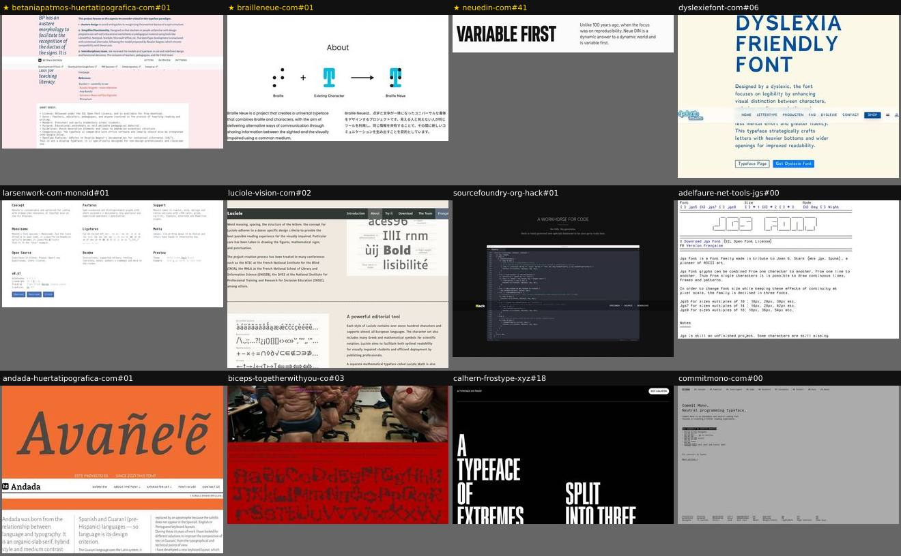

| example | look | feel | ux | learn |
|---|---|---|---|---|
| [★ betaniapatmos-huertatipografica-com#01](../../archive/betaniapatmos-huertatipografica-com/blocks/01.jpg) | Italic lead 'BP has an austere morphology… it is a tool for teaching literacy.' at left; four numbered principles (Austere design, Simplified functionality, Interdisciplinary team, Performance), a reference list with red links (Rosalie Wagner, Ana Ronchi, Scrivere a Mano nell'Era Digitale), then a white 'SHORT BRIEF:' box in monospace (Licence, Users, Readers, Purpose, Guidelines, Compatibility, OpenType Features); repeated in Spanish under a row of little figures and 'Español ↓' | Clear, responsible, written for teachers | static text; reference links open sources | State the brief as a spec sheet (users, readers, purpose, compatibility, OpenType approach) in mono: for a functional font the brief is the selling point |
| [★ brailleneue-com#01](../../archive/brailleneue-com/blocks/01.jpg) | 'About': an equation diagram, six black Braille dots '+' a blue letter 'T' (Existing Character) '→' the same T with the dots placed on its strokes (Braille Neue), labelled underneath; then the purpose in English and Japanese side by side | Simple, persuasive | Fades in on scroll (.reveal) | Explain a hybrid design as an equation (A + B → C) with one glyph: the construction rule and the inclusive aim are understood at once |
| [★ neuedin-com#41](../../archive/neuedin-com/blocks/41.jpg) | Nine white rows, each a heavy condensed caps headline on the left (VARIABLE FIRST, MADE IN BERLIN, MADE FOR TODAY, EXTREME WIDTHS, ITALIC & RETALIC, ELEGANCE, 504 LANGUAGES, AWARDS, FEATURES) and a 3–4-line paragraph on the right; some headlines are cropped at the left edge mid-animation | Fact-sheet with swagger | Headlines animate (slide or width change) as they enter; static text | One claim per row, headline left and proof right: nine selling points scan in seconds |
| [dyslexiefont-com#06](../../archive/dyslexiefont-com/blocks/06.jpg) | 'DYSLEXIA FRIENDLY FONT' in big blue caps, a paragraph on legibility, and two buttons (outlined Typeface Page, filled Get Dyslexie Font) | Calm, informative | Links to the typeface page and registration | State the design rationale in reader terms (mental effort, fluency) and put the buy button directly after the claim |
| [larsenwork-com-monoid#01](../../archive/larsenwork-com-monoid/blocks/01.jpg) | A three-column grid of eight short fact cards in small Monoid: Concept, Features, Support, Monoisome, Ligatures (with the ligature list inline: <!-- -> => <=> == != && :: ¯\_(ツ)_/¯ …), Media, Open Source, Readme; bold headings, one or two lines each, blue links | Like a README rendered as a page | Links to Font Awesome, Medium articles, GitHub issues, licence and readme | State a coding font's whole pitch as one-line specs (size it's hinted for, glyph count, ligatures listed in the font itself) in a grid instead of prose |
| [luciole-vision-com#02](../../archive/luciole-vision-com/blocks/02.jpg) | Three alternating text + image rows separated by dotted rules: 'A typeface for visual impairment', 'A powerful editorial tool', 'A typeface to advance research', the last listing three reading studies beside a font-editor screenshot | Clinical but warm | Static reading; links go to published studies, marked with an external-link icon | Cite reading studies with links next to the design criteria, so a legibility claim reads as evidence rather than marketing |
| [sourcefoundry-org-hack#01](../../archive/sourcefoundry-org-hack/blocks/01.jpg) | FEATURES: three dark cards with a green icon disc, title, one line and a ruled list of 5–8 properties (Metrics & Style, Type Traits, Free and Open Source). A three-column row of icon points ('A Family of Four Faces', 'Multilingual', 'Powerline Support') sits at y≈900–1146 between hero and block 01; it was never cut as a block and is attached here | Template-tidy, list-driven | Static; a link to the licence in the third card | Listing traits as a spec (large x-height, open counters, oval-filled zero) speaks developers' language: properties, not adjectives |
| [adelfaure-net-tools-jgs#00](../../archive/adelfaure-net-tools-jgs/blocks/00.jpg) | Short paragraphs in the pre: a tribute to Joan G. Stark (jgs, ASCII-art pioneer), how glyphs combine into continuous lines, and why there are three fonts (Jgs5/7/9 for size multiples of 10/14/18 px); then an underlined 'Notes' heading saying the project is unfinished, with a link to a character table | Honest, workshop-like | Link to jgs_table.html (character table and comparison between the fonts) | State the pixel-size rule (multiples of 10/14/18) up front: it is the one thing users must know to keep the joins intact |
| [andada-huertatipografica-com#01](../../archive/andada-huertatipografica-com/blocks/01.jpg) | 'Avañe'ẽ' (the Guaraní name of the language) in huge dark-brown italic on an orange band, then three columns: a large light lead ('Andada was born from the relationship between language and typography… Spanish and Guaraní (pre-Hispanic) languages — so language is its design criterion') and smaller text on the puso/saltillo problem and a new Guaraní keyboard layout | Purposeful, scholarly | Link to the github keyboard layout (huertatipografica/teclado-Guarani) | Open the story with the language's own name set huge, then state the design criterion in one sentence: 'language is its design criterion' |
| [biceps-togetherwithyou-co#03](../../archive/biceps-togetherwithyou-co/blocks/03.jpg) | Under the video, three short paragraphs in tiny maroon caps on red, almost camouflaged: how the letters are made (each from squares or triangles on an 810×810 frame with a 30px grid, inspired by a dumbbell), that the font is 100% free, and an invitation to share work | Low-key, honest | static | State the construction rule in numbers (810×810 frame, 30px grid, squares and triangles): it tells designers how the modular letters fit together |
| [calhern-frostype-xyz#18](../../archive/calhern-frostype-xyz/blocks/18.jpg) | Two headline-and-paragraph spreads in tall condensed caps: 'A TYPEFACE OF EXTREMES / SPLIT INTO THREE SUB FAMILIES' (78 styles, 3 widths × 26 styles, skeleton to black) on black then white, and 'A FLEXIBLE GROTESK SANS' beside a 'snatch' poster with a paragraph on what each sub-family is for | Bold, clear, poster-like | Headings slide in; background flips black/white with scroll | State each sub-family's job (Condensed fits text in tight areas, Wide fills space for logotypes, Standard is neutral) as a short brief beside a poster that uses it |
| [commitmono-com#00](../../archive/commitmono-com/blocks/00.jpg) | Section 02 'Concept', HTML only: 'The most effective font is the one you don't notice.' with a four-part list of what the font refuses to do | Dry, assured | Text with a tip: press I for italic | State the design by negation: listing what the font refuses to do is a stronger brief than listing its features |
| [font-subf-dev-en#01](../../archive/font-subf-dev-en/blocks/01.jpg) | 'Why Another One?' in mint, a paragraph and a bullet list naming what the author dislikes in other coding fonts (JetBrains Mono too rigid, Fira Code's synthetic italic angle, Victor Mono's exaggerated cursive, Sarasa Gothic too narrow, few rounded corners, little Nerd-Font/CJK support), then 'Therefore, I created this font with clean glyphs, a cursive-style italic, fine-grained configuration, built-in Nerd-Font, and a 2:1 ratio for Chinese and English' | Honest maker's note | static | Frame the brief as a list of honest complaints about named rivals: every complaint becomes a design requirement the page can then prove |
| [gt-ultra-com#03](../../archive/gt-ultra-com/blocks/03.jpg) | Three narrow columns of small white text: sans typefaces seen as contemporary by default, serifs as old-fashioned, and GT Ultra here to prove both wrong | Manifesto in small print | static | State the prejudice the typeface answers ('sans = now, serif = then') in plain words before showing the answer |
| [justfont-com-huninn#04](../../archive/justfont-com-huninn/blocks/04.jpg) | On an off-white field patterned with pale circles, a half-visible cup mascot at the left and three yellow-orange speech bubbles: the heading '古椎得人疼 ê 台灣口味' and two paragraphs about the gap (few open rounded Chinese fonts fit Taiwanese typesetting) and the work (~2,800 Taiwanese hanzi, zhuyin, Taiwanese romanisation, punctuation settings, even colour) | Conversational, like a mascot talking | Bubbles animate in on scroll | Put the brief in speech bubbles from the mascot: technical goals (character count, phonetic symbols, typesetting) become a friendly conversation |

_…and 14 more in the gallery (`npm run app`)._

## article-teaser

A short teaser and a link to an off-page article or interview about the making.

**Recognise by:** 'Read the story' button

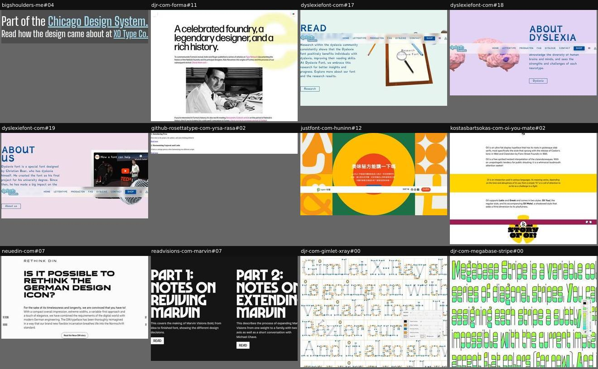

| example | look | feel | ux | learn |
|---|---|---|---|---|
| [bigshoulders-me#04](../../archive/bigshoulders-me/blocks/04.jpg) | Two fitted white lines with underlined blue links: 'Part of the Chicago Design System. Read how the design came about at XO Type Co.' | Matter-of-fact | Links to the Chicago Design System and to the making-of article | Two fitted lines can stand for the whole 'about' section when the page's real story is elsewhere |
| [djr-com-forma#11](../../archive/djr-com-forma/blocks/11.jpg) | 'A celebrated foundry, a legendary designer, and a rich history.' over a black-and-white photo of Aldo Novarese drawing letters, links to the Type Network article series and a further reading tip, then a 'Mille grazie' thank-you paragraph beside a PDF specimen cover thumbnail | Warm, respectful | Photo and links open the Type Network articles; the thumbnail downloads the PDF specimen | Link out to long-form history rather than reproducing it, and put the acknowledgements next to the PDF download |
| [dyslexiefont-com#17](../../archive/dyslexiefont-com/blocks/17.jpg) | 'READ RESEARCH' on pale mint, paragraph, outlined 'Research' button, and an illustration of a clipboard and magnifying glass | Serious, tidy | Button to the research page | Put a one-paragraph evidence claim on the sales page and the citations one click away |
| [dyslexiefont-com#18](../../archive/dyslexiefont-com/blocks/18.jpg) | 'ABOUT DYSLEXIA' on lavender with 3D brain renders, a paragraph on neurodiversity, and a 'Dyslexia' button | Warm, educational | Button to the Dyslexia page | Give the audience's condition its own teaser, not only the product |
| [dyslexiefont-com#19](../../archive/dyslexiefont-com/blocks/19.jpg) | 'ABOUT US' on pale pink: a short founder paragraph, 'About us' button, and an image of a TEDx talk 'How a font can help' with a microphone render | Credible, founder-led | Button to the About page | A thumbnail of a TEDx stage is a compact credential for the designer |
| [github-rosettatype-com-yrsa-rasa#02](../../archive/github-rosettatype-com-yrsa-rasa/blocks/02.jpg) | Grid of numbered article teasers in two columns (div.row > .span.six): '1. Introducing Yrsa', '2. Harmonizing Gujarati and Latin', '3. Yrsa & Rasa released', 'Language support', each a bold heading, one-line description and 'Read more' link | Blog-index, transparent process | Each 'Read more' opens a sub-page article on the same site | Number the process articles so the microsite reads as a short serial about the making |
| [justfont-com-huninn#12](../../archive/justfont-com-huninn/blocks/12.jpg) | The three-panel poster again: concentric yellow and red-orange circles on green in the centre, giant cropped glyphs and an ampersand on the sides; white heading '美味秘方能講一下嗎' ('can you share the secret recipe?'), three lines about a year of research, and a blue button '設計師的設計尬聊' (designers' chat) | Teasing, warm | Button opens the justfont blog post about the design (new tab) | Keep the process story off-page and tease it with the page's food metaphor ('secret recipe') |
| [kostasbartsokas-com-oi-you-mate#02](../../archive/kostasbartsokas-com-oi-you-mate/blocks/02.jpg) | A huge yellow asterisk with 'THE STORY OF OI!' overprinted in black caps, used as a round link at the end of the about text | A sticker | Links to a subpage with the long story | Use a glyph as the button shape: the asterisk is literally a footnote mark to the long version |
| [neuedin-com#07](../../archive/neuedin-com/blocks/07.jpg) | On white: 'RETHINK DIN' as a small tracked kicker, the question 'IS IT POSSIBLE TO RETHINK THE GERMAN DESIGN ICON?' in heavy XXWide caps, a bold answer line, a short paragraph and an outlined pill 'Read the Neue DIN story' | Confident, manifesto-like | The pill opens the long story subpage | Ask the brand's big question in the widest weight and answer it in one paragraph; the full essay is one click away |
| [readvisions-com-marvin#07](../../archive/readvisions-com-marvin/blocks/07.jpg) | Two columns on near-black: 'PART 1: NOTES ON REVIVING MARVIN' and 'PART 2: NOTES ON EXTENDING MARVIN' in white heavy caps (~115px), each with a two-line summary and a small white 'READ' button | Magazine contents page | READ buttons jump to the full essays further down the same page | Tease long essays with a two-part contents block, so the specimen stays scannable and the deep text is opt-in |
| [djr-com-gimlet-xray#00](../../archive/djr-com-gimlet-xray/blocks/00.jpg) | Under the demo, a pale grey rounded box with one small paragraph: 'Gimlet X-Ray is the January 2020 offering from Font of the Month Club. It is an experimental version of my typeface Gimlet… This online demo was made with the help of Chris Lewis.' | Behind-the-scenes footnote | Links to Font of the Month Club, the Gimlet page and Chris Lewis | Keep the context to one boxed paragraph after the toy, so the demo speaks first |
| [djr-com-megabase-stripe#00](../../archive/djr-com-megabase-stripe/blocks/00.jpg) | Under the demo, a pale grey rounded box with one small paragraph: an experimental version of 'my Megabase', bands of colour to simulate gradients in COLR/CPAL '(for now)', released with OpenType-SVG and monochrome versions as the October 2020 Font of the Month Club, demo made with Chris Lewis | Modest, behind-the-scenes | Links to the Megabase page, the OpenFontFormat GitHub issue, the Font of the Month notes post and Chris Lewis | Put the context (why stripes, which formats, which release) below the demo in one boxed paragraph so the toy comes first |
| [input-djr-com#02](../../archive/input-djr-com/blocks/02.jpg) | Centred green paragraph in Input Sans 'Input is a flexible system of fonts designed specifically for code by David Jonathan Ross…' with an underlined designer link, then a bold underlined link 'See what makes Input a different coding typeface.' | Matter-of-fact | The bold link opens the Info article subpage | One sentence on what is different (monospaced and proportional, many widths and weights) plus a link to the long argument is enough on a landing page |
| [karrik-phantom-foundry-com#08](../../archive/karrik-phantom-foundry-com/blocks/08.jpg) | 'KARRIK / THE GAME' in big white caps, an engraved incense burner (censer) illustration and 'Play an interactive fiction based on a typeface →' | Curious, a door to another world | The whole caption links to an external interactive fiction (karrik-game.velvetyne.fr) | Extend a themed font into a companion game hosted elsewhere and give it a full-screen teaser at the end |

## designer-bio

A short, informal bio of the designer with contact links.

**Recognise by:** portrait or name, 'about me'

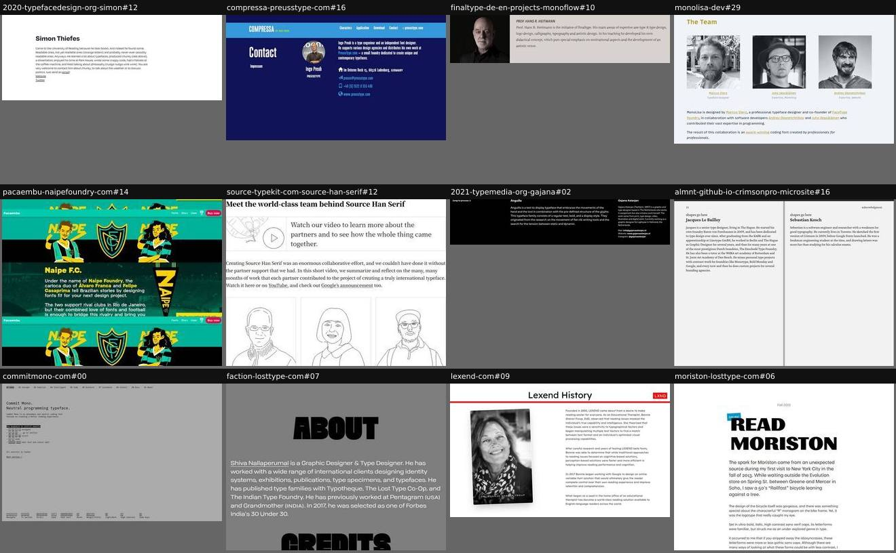

| example | look | feel | ux | learn |
|---|---|---|---|---|
| [2020-typefacedesign-org-simon#12](../../archive/2020-typefacedesign-org-simon/blocks/12.jpg) | 'Simon Thiefes' heading and one humorous paragraph (came to Reading because he likes books…), with Website and Twitter links | Informal, friendly | Links out | A jokey third-person bio with an invitation to talk ('about the weather or to discuss politics') makes a student page personal |
| [compressa-preusstype-com#16](../../archive/compressa-preusstype-com/blocks/16.jpg) | On midnight navy: 'Contact' heading and an 'Impressum' link at left, a round portrait of Ingo Preuß with his name, then a short bio and glyphicon rows for address, email, phone and website | Personal, approachable | mailto, tel and web links | Ending with the designer's face and direct contact makes a one-person foundry feel reachable |
| [finaltype-de-en-projects-monoflow#10](../../archive/finaltype-de-en-projects-monoflow/blocks/10.jpg) | Two cards, each a dark low-key portrait on the left and a pale grey panel with an italic caps name ('PROF. HANS R. HEITMANN', 'JOHANNES AMMON') and a short serif bio | Serious, personal | static | Low-key black portraits next to short bios give a small foundry faces without a big 'team' section |
| [monolisa-dev#29](../../archive/monolisa-dev/blocks/29.jpg) | 'The Team': three black-and-white square portraits (Marcus Sterz, Typeface Designer; Juho Vepsäläinen, Expertise, Marketing; Andrey Okonetchnikov, Expertise, Website) with gold name links, then two lines on the FaceType collaboration and the award | Human, trustworthy | Names link to personal sites | Credit the developer collaborators next to the type designer: for a coding font, their expertise is a selling point |
| [pacaembu-naipefoundry-com#14](../../archive/pacaembu-naipefoundry-com/blocks/14.jpg) | A banner of the two designers drawn as footballers in rival-club shirts flanking an 'NFC' crest, then 'Naipe F.C.' with a large white/yellow paragraph and a black-and-yellow 'Naipe' pennant; the banner is sticky and repeats twice in the stitched crop (capture artefact) | Friendly, club-like | Linked names to the designers' profiles | Present the foundry as a team (crest, pennant, player portraits) to carry the theme into the 'about us' |
| [source-typekit-com-source-han-serif#12](../../archive/source-typekit-com-source-han-serif/blocks/12.jpg) | 'Meet the world-class team behind Source Han Serif': a framed video row (hand-and-brush drawing, play button, 'Watch our video to learn more about the partners…'), a paragraph, then three line-drawn portraits in hairline frames (Dr. Ken Lunde, Ryoko Nishizuka, Frank Grießhammer) each over a bio with the name in bold | Humanising, respectful | Video plays inline or on YouTube; links to Google's announcement, an interview with Ryoko Nishizuka and Source Serif | Draw the team as line portraits in the same style as the page illustrations, so the people sit inside the design system rather than as stock headshots |
| [2021-typemedia-org-gajana#02](../../archive/2021-typemedia-org-gajana/blocks/02.jpg) | Three text columns: 'Jump to process ↓' at the left, the bold title 'Anguilla' and a six-line description in the middle, and 'Gajana Aslanjan' with a short bio plus mail, website and Instagram links at the right; white on black in the captured state | Calm, catalogue-like | The page background switches between white and black (body.color-white / color-black) as this panel scrolls into view; anchor link jumps to the Process panel | A three-column panel (anchor links, project blurb, designer bio) gives a student or small-foundry project page all its facts in one band |
| [almnt-github-io-crimsonpro-microsite#16](../../archive/almnt-github-io-crimsonpro-microsite/blocks/16.jpg) | 'acknowledgment' spread: two bios, 'Jacques Le Bailley' (senior type designer in The Hague, Baron von Fonthausen) and 'Sebastian Kosch' (engineer who sketched the first Crimson in 2009), each under a placeholder line 'shapes go here' | Personal, unfinished | static | Tell the origin through the people: the original student designer and the professional who extended it |
| [commitmono-com#00](../../archive/commitmono-com/blocks/00.jpg) | Section 10 'About', HTML only: a short third-person note on Eigil Nikolajsen, a support link, and social links | Student-project humble | Links to GitHub, X/Twitter, LinkedIn and buy me a coffee | A two-sentence bio is enough when the whole site already shows who made it |
| [faction-losttype-com#07](../../archive/faction-losttype-com/blocks/07.jpg) | On grey, black 'ABOUT' heading and a white paragraph on Shiva Nallaperumal, then a black 'CREDITS' heading and one sentence of credits | Modest, matter-of-fact | Name links to the designer's site; credits link to the mastering engineer, site developer and text face | Keep about and credits as short paragraphs under the same display headings as the rest of the page: the closing still reads as a specimen |
| [lexend-com#09](../../archive/lexend-com/blocks/09.jpg) | 'Lexend History' centred, a black-and-white portrait print of Dr. Bonnie Shaver-Troup tilted slightly with a drop shadow and her name on the photo, and four short dated paragraphs to its right | Personal, credible | static | Close the argument with the person behind the research: one portrait and four dated paragraphs |
| [moriston-losttype-com#06](../../archive/moriston-losttype-com/blocks/06.jpg) | At the end of the article, two black-and-white portrait cards side by side: 'Riley Cran @rileycran' with a short bio, and 'Glenn Morison Chronister' with the dedication line; the riso promo card repeats below | Heartfelt, family album | Twitter handle and Lost Type links | Give the dedicatee a portrait card next to the designer's: the page honours the person the font is named after |

## making-of

The process shown visually: sketches, proofs, iterations, photos of the designer at work.

**Recognise by:** process images with little text, stages

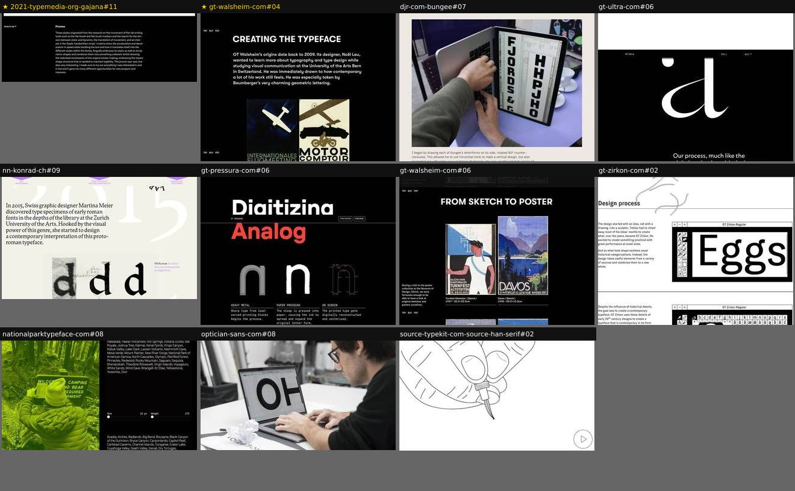

| example | look | feel | ux | learn |
|---|---|---|---|---|
| [★ 2021-typemedia-org-gajana#11](../../archive/2021-typemedia-org-gajana/blocks/11.jpg) | A black 'Process' panel with one first-person paragraph, then collage images of the research: Gaelic manuscript scans, flat-brush calligraphy, 'dyna mic' and 'eanbgsi' brush tests, Arabic letters, printed proofs with pencil marks and screenshots, ending on a photo of the desk covered in prints | Honest, workshop-like | 'Jump to top ↑' link; the page background flips to black at the panel; images fade in | Show the path from historical sources and brush experiments to printed proofs as dense collages after a short first-person paragraph |
| [★ gt-walsheim-com#04](../../archive/gt-walsheim-com/blocks/04.jpg) | 'CREATING THE TYPEFACE': two posters, a wide crop of 'DAS ALPENBUCH' lettering, a black strip of numerals collected from various posters ('ZURICH 1932', '4e MEETING', '22.–31. JULI 1932'), the 'Ro9a' construction figure and a 173px 'Baumberger' sample | A designer's notebook | Pointer across the Alpenbuch crop flips through 8 frames alternating 'Baumberger's lettering' and 'GT Walsheim' overlays; pointer across 'Baumberger' steps it through the 8 weights with a style-name label | Overlay the finished font on the source lettering frame by frame: the visitor sees exactly where the type designer followed and where he departed |
| [djr-com-bungee#07](../../archive/djr-com-bungee/blocks/07.jpg) | One big photo of the designer with a laptop turned on its side, typing to draw rotated letterforms, above a short paragraph | Funny, candid | Link to a tip on rotating the text box | A single absurd workshop photo says more about a process than a sequence of sketches |
| [gt-ultra-com#06](../../archive/gt-ultra-com/blocks/06.jpg) | Back on black: a calligraphic serif 'a' drawn stroke by stroke, a large paragraph ('Our process, much like the alphabet, begins with the letter a…'), 'Calligraphy' morphing under 'STARTING POINT · GT ULTRA STANDARD · GT ULTRA FINE', three columns of process text, then 'Geometric Construction' animated | Studio diary, deliberate | Animations play as the section enters the viewport; the Calligraphy word ping-pongs through three stages on a 4s loop | Tell the process as a morph from the first sketch to the final styles, so the history of the design is visible in one word |
| [nn-konrad-ch#09](../../archive/nn-konrad-ch/blocks/09.jpg) | A timeline of giant ghost years in white: '2015' (Martina Meier finds early roman specimens in the Zurich library; a 'd' shown as scan → pen sketch → digital), '2016' (a purple 'R' with Bézier points and handles; first weight finished) with a black badge 'End of section, now: deep dive into Konrad', '2023' on purple (release by Nouvelle Noire: 'Yay! Graphic designers around the world freak out about Konrad') | Light, celebratory | static | Compress years of work into three dated beats, each with one image of the letter at that stage |
| [gt-pressura-com#06](../../archive/gt-pressura-com/blocks/06.jpg) | Black section 'Digitizing Analog' (white/red heading) with three 'n's in a row: a grey 3D metal sort ('HEAVY METAL'), a ragged inked print ('PAPER PRESSURE') and a vector outline with point coordinates ('ON SCREEN') | Didactic, crafted | static | Show the concept as three states of one letter (metal → print → vector): the font's idea is a process, so draw the process |
| [gt-walsheim-com#06](../../archive/gt-walsheim-com/blocks/06.jpg) | 'FROM SKETCH TO POSTER': a 2×2 grid of small gridded gouache sketches (Turnfest Altstetten, Davos, Interlaken, Simplon) with captions giving their tiny sizes ('1932 • 20.2×13.2cm'), sticky note on the left | Behind the scenes in a museum archive | Moving the pointer across each sketch steps through 3–5 states (sketch → poster without type → final poster → 2017 animation) and the caption follows | A hover scrub across N equal zones is a cheap, satisfying way to show a sequence of stages without a slider |
| [gt-zirkon-com#02](../../archive/gt-zirkon-com/blocks/02.jpg) | 'Design process' head; two rows, each a short text column beside a mock 1980s paint-program window ('GT Zirkon Regular' title bar, × − + buttons, tool palette of pencils, brushes and shapes) showing 'Eggs' being typed and a glyph grid with a huge 'a' | Playful retro computing | Looping videos inside the fake windows | Frame process footage in a pastiche of an old drawing app: the window chrome says 'work in progress' without showing real sketches |
| [nationalparktypeface-com#08](../../archive/nationalparktypeface-com/blocks/08.jpg) | A lime-duotone photo of a researcher in a puffer jacket and beanie taking a rubbing of a 'WILDERNESS CAMPING AND BEAR … REQUIRED OVERNIGHT' sign in a fern forest | Fieldwork, earnest | static | One photo of field research (a sign rubbing) signals that the letterforms were measured from the real thing |
| [optician-sans-com#08](../../archive/optician-sans-com/blocks/08.jpg) | Full-width photo of the designer at a laptop showing a huge 'OH' in the glyph editor, a crumpled paper ball and an eye-chart print on the desk | Craft, behind the scenes | static | One studio photo of the letters on the designer's screen adds a human maker without any text |
| [source-typekit-com-source-han-serif#02](../../archive/source-typekit-com-source-han-serif/blocks/02.jpg) | A wide framed poster in black line art of a hand holding a fine brush (the moment before a stroke), with a round outlined play button at the bottom right | Hand-made, respectful | Play opens the partners' video about how the project came together (#story); repeated as a smaller video row in the team section | Use one line drawing (a hand with a brush) as the video poster: it ties a corporate collaboration film to the calligraphic origin of the forms |

## info-popover

Section copy hidden behind a small info button and shown as a popover beside the specimen; the page shows type first, text on demand.

**Recognise by:** (i) Info buttons

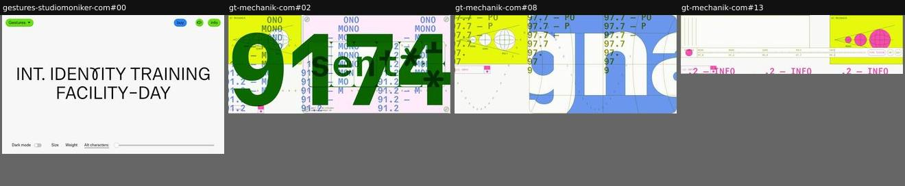

| example | look | feel | ux | learn |
|---|---|---|---|---|
| [gestures-studiomoniker-com#00](../../archive/gestures-studiomoniker-com/blocks/00.jpg) | Hidden panel (#info-text, off-canvas at -100vw, captured in HTML only) opened by the 'info' pill: the description with a few letters set as scribbly alternates, 'download a PDF specimen', the story of Moniker's first own typeface, a mailto for a free trial, a link to buy the hand video assets, and full credits | Chatty, self-aware | Slides in from the left over the tester; links to the PDF specimen, mailto trial request, shop page for video assets | Sprinkle the font's alternates into the about text itself (one per sentence) so even the copy demonstrates the feature |
| [gt-mechanik-com#02](../../archive/gt-mechanik-com/blocks/02.jpg) | MONO chapter header: the '91.2 — MONO' frequency overlay, a yellow tile with the tone cone (MONO sphere highlighted), and a pink device plate with screws showing 'sent*' in Mono cells, 'UNIT ID: RC-P73/NYC SERIAL: 004981-AX'; small '(i) INFO!' pill with a magenta indicator | Laconic, gadget-like | Clicking '(i) Info!' opens a yellow popover with the MONO description; the button label flips to '(x) Close' | Hide the prose behind an info toggle so each chapter opens on pure specimen, while the explanation is one click away |
| [gt-mechanik-com#08](../../archive/gt-mechanik-com/blocks/08.jpg) | POLY chapter header: yellow cone tile (POLY sphere highlighted), '(i) INFO!' pill, and a big blue panel with 'gna' cut out in white Poly over curved construction lines; letters 'POLY' scatter in a circle as the chapter starts | Open, round, confident | Info button opens the POLY description; channel overlay '97.7 — POLY' flashes on entry | Repeat the same header kit per chapter (cone diagram with the current subfamily highlighted + one big specimen + info button) so chapters read as stations on one dial |
| [gt-mechanik-com#13](../../archive/gt-mechanik-com/blocks/13.jpg) | INFO chapter header 'Family': an empty bordered tile with a progress-bar animation, the yellow cone tile (all three spheres magenta) and the info pill; '99.2 — INFO' overlay on entry | Quiet transition | Info popover: 'Across the three subfamilies, consistent concepts are expressed in varying intensity…' | The last chapter header highlights all three subfamilies at once in the same diagram used before |
| pleasure-typefaces-pizza#16 | Off-canvas half-screen panel (left of the viewport in the capture) with three sentences at ~39px: 'The Pleasure font is almost a running grotesque font… did not resist the urge to be led… to an extrapolation of the terminals by converting them into loops… a certain irony in the rolling of the eyes', then links to Typefaces.pizza and Flirt Studio | Brief, self-aware | Opened by the '?' pill next to 'PLEASURE TYPEFACE' in the fixed header; slides in over the left column | Keep the only real explanation behind a '?' so the posters can stay pure fiction |
| universalsans-com#01 | A small draggable 'INFO' window with a close × (HTML only), holding one of 30 tips: the option name as a header bar and a short explanation (e.g. Weight: '100: Thin … 900: Black'); letter x-ray diagrams exist in the markup but are commented out | Like a tool tip palette in design software | Each '?' button in the side panel opens the tip window on that option's text; the window can be dragged anywhere over the stage (jQuery UI draggable) | Put every design explanation behind a '?' next to the control it explains: the copy arrives exactly when the visitor is making that decision |
| universalsans-com#02 | An off-canvas information drawer (captured offscreen) opened from the vertical 'UNIVERSAL SANS' tab: ABOUT (five paragraphs on democratising custom type, Briton Smith for Family Type, built with twomuch.studio), a 'Winner of a D&AD Black Pencil' card with a looping video of the black pencil trophy and 'View more →' | Credible, low-key | Slides over the app; close button; on phones the same content becomes the static fallback page (hero text, award card, 'Universal Serif – coming soon' card) | In an app-style site, keep the story and the social proof in a drawer one click away, so the tool owns the screen |

## faq

Practical questions and answers about the font, as a collapsed accordion (often grouped by tabs) or an open anchored list.

**Recognise by:** Q&A list, expand on click

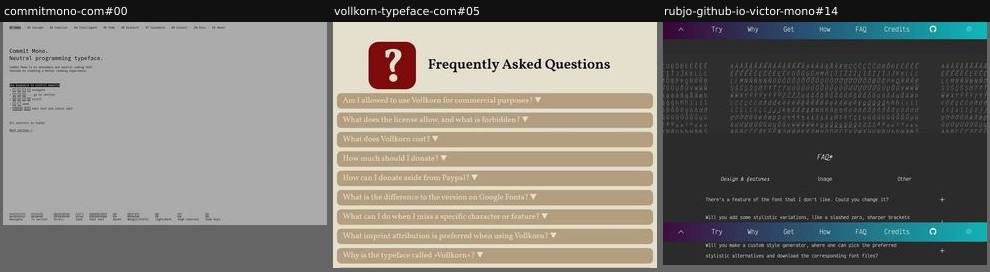

| example | look | feel | ux | learn |
|---|---|---|---|---|
| [commitmono-com#00](../../archive/commitmono-com/blocks/00.jpg) | Section 09 'Docs', HTML only: five topic tabs (FAQ, Features, Alternates, Character set, Languages); FAQ as native disclosure rows; intro with GitHub, e-mail and buy-me-a-coffee links | README, plain | Tabs by radio; rows open with 
; licence questions answered with one-word 'Yes.' | Short legal FAQs answered 'Yes.' say more than a licence summary |
| [vollkorn-typeface-com#05](../../archive/vollkorn-typeface-com/blocks/05.jpg) | Red '?' tile beside 'Frequently Asked Questions', then 13 tan rounded bars with a question and a ▼ | Approachable, handmade | Click a bar to expand its answer. Questions run from licensing and donation to 'How did you become a type designer?' and 'Why is the typeface called »Vollkorn«?' | Let the FAQ double as the story: the origin and designer bio sit behind questions, so only curious visitors read them |
| rsms-me-inter#13 | Beyond the capture limit (HTML only): 'Frequently Asked Questions' then 11 questions as small bold headings, each followed by a short answer with links (font-feature-settings, Figma's Advanced Type panel, pyftsubset, OpenType Feature Freezer, GitHub issues) | Generous support documentation | Each question has an id (#faq-using-features, #faq-cdn, #faq-subset …) for deep links; the nav's FAQ item jumps here | An open-source family's microsite doubles as its support desk: answer the five things people email about, with anchors you can paste in replies |
| [rubjo-github-io-victor-mono#14](../../archive/rubjo-github-io-victor-mono/blocks/14.jpg) | 'FAQ*' ('Frequently Anticipated Questions') in cursive italic, three tabs 'Design & features | Usage | Other', and a list of questions each with a '+' at the right ('There's a feature of the font that I don't like. Could you change it?', '…the worst idea in the world… BTW, I am really angry.') | Humorous, pre-emptive | Tabs switch the question group; clicking a question expands its answer (vue-faq-accordion) | Write the FAQ as the questions people will actually ask, angry ones included: it answers requests for alternates and sets expectations with humour |

## scroll-narrative

A pinned, scroll-driven sequence telling a concept metaphor through animated type and diagrams.

**Recognise by:** sticky stage, scroll scrubbing

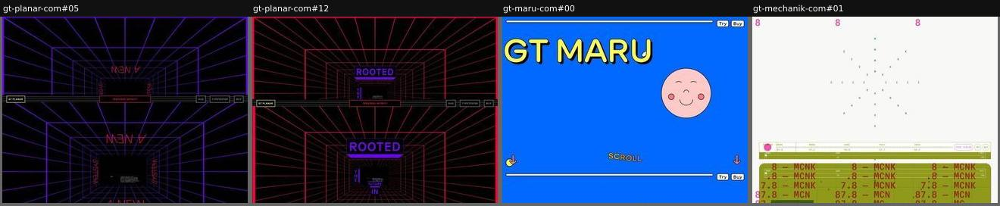

| example | look | feel | ux | learn |
|---|---|---|---|---|
| [gt-planar-com#05](../../archive/gt-planar-com/blocks/05.jpg) | A purple wireframe tunnel in one-point perspective with red slanted words 'A NEW' and 'SYSTEM' on its ceiling, floor and walls; at the end the 'DESIGN' paragraph | Flying through a vector grid, 80s sci-fi | Pinned for 450vh: scrolling moves the camera down the tunnel (translateZ), word planes pass by, and the DESIGN text arrives from the vanishing point; message centre reads 'Traverse infinity' | Use scroll as forward motion through a CSS 3D tunnel and place the copy at its end: the reader 'arrives' at the statement |
| [gt-planar-com#12](../../archive/gt-planar-com/blocks/12.jpg) | A second, longer tunnel in red wireframe with purple 3D blocks lettered 'THE', 'FUTURE', 'ROOTED', 'IN' sliding past, ending on 'FUTURE CLASSIC — Expressive rationalism. Vivid discipline. Playful determination.' | Grand finale of the story | Pinned for 750vh; scrolling flies through the tunnel, blocks pass on the floor and walls; text revealed at the end | Reuse the same scroll mechanism with a new colour and longer length for the closing statement: repetition becomes a chapter marker |
| [gt-maru-com#00](../../archive/gt-maru-com/blocks/00.jpg) | Two yellow rounded speech-bubble boxes appearing one per scroll step beside the sun: 'We're proud to present GT Maru, an ode to rounded English characters found on signage across Japan…' and 'The typeface is a result of Thierry Blancpain's trips to Japan…' | Like the mascot is being told the story | Each scroll-snap step reveals the next bubble while the sun's expression changes | Split the intro into two short bubbles tied to scroll steps, and give the mascot a reaction to each: the text gets read because something responds to it |
| [gt-mechanik-com#01](../../archive/gt-mechanik-com/blocks/01.jpg) | After the '87.8 — MCNK' channel flash and letters converging into a crosshair, a pinned olive monitor (rounded, magenta border) shows white text 'Hel5o. Is anybody there?' with glitched characters, a MONO 1 — SEMI 33 — POLY 100 tone strip on top, 'Incoming broadcast from' and 'Signal clarity' marquees in side boxes; then '#!' with a cone diagram and a MONO→SEMI→POLY cycle diagram and the '(i) Info!' button holding the intro paragraph | Mysterious, playful sci-fi | The monitor pins while you scroll ~1450px: the message scrolls up, the tone indicator moves along the strip and corrupted characters ('Sign9l detect9d', 'connecti>%') resolve; the intro copy appears only when '(i) Info!' is clicked | Tell the family concept as a signal coming into focus: corrupted characters that resolve while the tone axis moves make 'tuning in' literal |

## self-test-evidence

The design rationale backed by a small test the visitor runs on themselves (reading speed, legibility).

**Recognise by:** a quiz or timer next to research prose

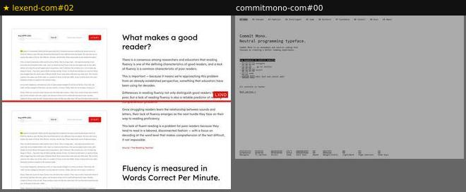

| example | look | feel | ux | learn |
|---|---|---|---|---|
| [★ lexend-com#02](../../archive/lexend-com/blocks/02.jpg) | Left: a sticky card with 'Avg WPM (100)' slider, 'Text #0' select, a font select (Times New Roman, later Lexend), a red START button, a passage ('My name is Commander Smith…') with the current word highlighted yellow, and counters TIME TO READ / WORDS READ / ERRORS / WORDS CORRECT PER MINUTE; right: 'What makes a good reader?' prose and 'Fluency is measured in Words Correct Per Minute.' with six numbered steps and grey code boxes ('409 words - 55 mistakes = 354 correct words'); later the same card in Lexend beside a red-and-grey bar chart of each student's WCPM in Times vs Lexend | Clinical but engaging, like an interactive paper | Pick a passage and a pacing speed, press START: a highlighter moves word by word at the set WPM while the visitor reads aloud; counters fill in; the font select switches between Times New Roman and Lexend as the page argues its case | Make the visitor run the study's own measurement on themselves, first in the control font, then in yours: the evidence becomes personal |
| [commitmono-com#00](../../archive/commitmono-com/blocks/00.jpg) | Section 06 'Distinct', HTML only: the game 'Guess the Character' with Easy, Medium, Hard and Expert radios, pairs of answers such as 'uppercase o' / 'zero' under a confusable glyph, a 'Score: 0/5' and 'Play again?' | A quick quiz that flatters the font | Pick a difficulty, then choose which of two labels matches the shown glyph; the score builds; presumably harder levels shrink the glyphs | Turn a legibility claim into a game: if visitors can tell 0 from O at speed, they have proved the claim themselves |

## expandable-timeline

A dated timeline of rows that expand into text cards on hover or click, with the year and title switching from light to heavy weight.

**Recognise by:** years in a column, accordion rows

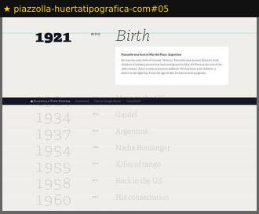

| example | look | feel | ux | learn |
|---|---|---|---|---|
| [★ piazzolla-huertatipografica-com#05](../../archive/piazzolla-huertatipografica-com/blocks/05.jpg) | Eleven hairline-ruled rows of Piazzolla's life (1921 MDQ Birth, 1924 NYC Move to the US, 1934 Gardel … 1992 BUE Death): years as huge pale Thin old-style figures, a tiny place code, a light title; the active row turns the year Black and dark, the title italic, and opens a white card with the story | Calm, archival, quietly interactive | Hover previews a row (year to wght 900, dark); click makes it active and slides in its card; the first row is open by default | Let the interaction itself show the type: the year jumping from Thin to Black on hover demonstrates the weight range while the visitor browses the story |
