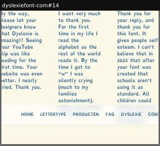
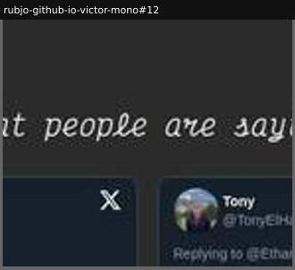

# testimonials

Social proof from users.

Sample: 2 blocks from 2 sites.

| variant | n | definition | recognise by |
|---|---|---|---|
| [quote-columns](#quote-columns) | 1 | User quotes set in the font, in plain columns. | quotes with names |
| [embedded-social-posts](#embedded-social-posts) | 1 | Embedded posts from users, with avatars and handles. | tweet or toot cards |

## quote-columns

User quotes set in the font, in plain columns.

**Recognise by:** quotes with names

| example | look | feel | ux | learn |
|---|---|---|---|---|
| [dyslexiefont-com#14](../../archive/dyslexiefont-com/blocks/14.jpg) | Cream field, blue-grey text in the font, five narrow columns of heartfelt reader quotes, nav bar over the bottom | Earnest, emotional, human | static | Set testimonials in the font: for an accessibility face, the readers' own words prove the claim as they are read |

## embedded-social-posts

Embedded posts from users, with avatars and handles.

**Recognise by:** tweet or toot cards

| example | look | feel | ux | learn |
|---|---|---|---|---|
| [rubjo-github-io-victor-mono#12](../../archive/rubjo-github-io-victor-mono/blocks/12.jpg) | Dark charcoal, italic cursive heading 'What people are saying', row of embedded X/Twitter cards | Community-driven, informal | Embedded posts link to the originals | For a free developer font, real public posts by known devs are the strongest proof of adoption |
