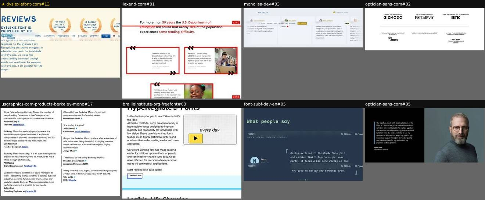
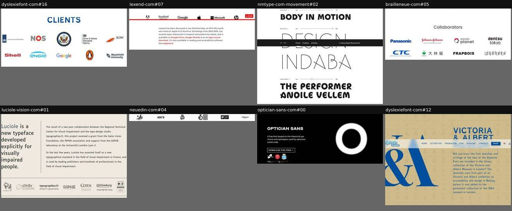
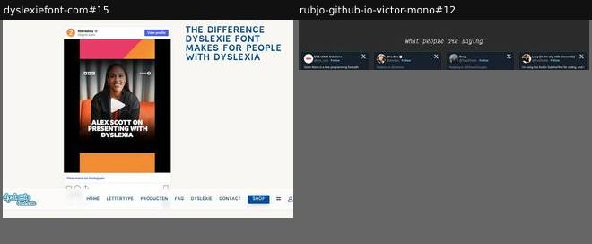
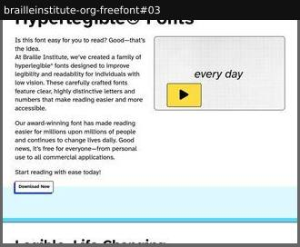
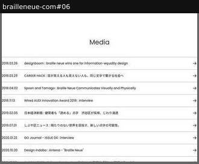
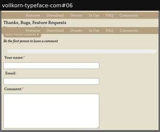

# testimonials

_Section: Checkout (discovered type, alongside checkout)_

Social proof from users.

21 instances on 13 sites (the Phase 3 extraction of 181 sites).

| variant | sites | definition | recognise by |
|---|---|---|---|
| [quote-columns](#quote-columns) | 7 | User quotes set in the font, in plain columns. | quotes with names |
| [award-logo-strip](#award-logo-strip) | 7 | A single row of award, prize or press logos as social proof, no quotes. | logo row, often under the hero |
| [embedded-social-posts](#embedded-social-posts) | 2 | Embedded posts from users, with avatars and handles. | tweet or toot cards |
| [usage-stats](#usage-stats) | 1 | Adoption figures (downloads, websites using the font, impressions, users) set as huge numerals with short captions, as social proof of reach rather than of family size | huge adoption numbers with captions |
| [press-link-list](#press-link-list) | 1 | A dated list of press coverage, one ruled row per article ('date · outlet : headline' with an arrow), each linking to the article; the coverage itself is the social proof, with no quotes or logos. | dated rows of press links |
| [comment-board](#comment-board) | 1 | An open comment form at the end of the page where visitors post thanks, bug reports and feature requests in public, often with a tally of the most requested features; visitors' voices rather than curated quotes | public comment form, requested-features tally |

## quote-columns

User quotes set in the font, in plain columns.

**Recognise by:** quotes with names

| example | look | feel | ux | learn |
|---|---|---|---|---|
| [★ dyslexiefont-com#13](../../archive/dyslexiefont-com/blocks/13.jpg) | 'REVIEWS' with a horizontal row of gold laurel wreaths around short quotes and five stars, then five columns of long user e-mails in small blue text | Moving, human | The wreath row runs off the right edge and appears to scroll sideways; the emails below are static | Quote complete personal emails rather than one-liners: 'I was silently crying' does more than any star rating, and the laurels supply the skim layer |
| [lexend-com#01](../../archive/lexend-com/blocks/01.jpg) | A stat sentence with red highlights ('For more than 50 years the U.S. Department of Education has found that nearly 70% of the population experiences some reading difficulty.'), then three red-outlined quote cards in a staggered 2+1 layout with huge black “ ” marks overlapping the corners; two cards have a photo half (a tutor with a teenager, a smiling girl) | Warm, testimonial-ad | Numbers in the stat sentence count up when scrolled into view | Pair a hard statistic with three readers of different ages (adult, teen, teacher about a child): the font's audience is shown, not described |
| [monolisa-dev#03](../../archive/monolisa-dev/blocks/03.jpg) | 'What Users Say' with a 'Use script variant' toggle at right; a horizontally drifting row of white cards, each an avatar (40px), linked name, role ('CIO at Infinite Red', 'Software developer at Microsoft') and a quote set in the script italic; repeated five times between chapters | Friendly social proof from known developers | Cards scroll continuously (90s CSS marquee); the toggle switches the quotes between the script variant and the regular italic | Let a testimonial toggle double as a feature demo: the same quotes flip between the regular and script italic |
| [optician-sans-com#02](../../archive/optician-sans-com/blocks/02.jpg) | Two rows of three press quotes on white, each a tiny italic tracked caps headline ('"WEIRD AND WONDERFUL"', '"EN ELEGANT TYPEFACE"', '"LET`S EVERYONE ACT AS A OPTICIAN"', '"COMPLETES THE EYE TEST CHART ALPHABET"'…) above the outlet's logo (Gizmodo, Fast Company, NRK, Dezeen, designmodo, Khoi Vinh / Adobe), rows split by a grey rule | Understated, credible | static | Quote only the headline each outlet ran, in small caps above its logo: press proof in one glance |
| [usgraphics-com-products-berkeley-mono#17](../../archive/usgraphics-com-products-berkeley-mono/blocks/17.jpg) | 'Testimonials': two columns of italic quotes, each with a grey left rule, the name in bold with a tiny Twitter bird, and role + linked company (Serenity OS, Axiom, Perplexity, Cartesia, Stack Overflow, NYU, Shopify) | Credible, insider | Company names link out | Quote recognisable engineers with role and company; one-liners like 'It's boring, it's good.' echo the page's own voice |
| [brailleinstitute-org-freefont#03](../../archive/brailleinstitute-org-freefont/blocks/03.jpg) | A single full-width yellow card with a dark border and rounded corners: bold label 'Atkinson Hyperlegible Font User' over a two-line quote ('I've been using this font as my browser default since it was released… improved my life…') | Heartfelt | static | One anonymous user quote about a real-life benefit (no migraines) is stronger proof for an accessibility font than designer praise |
| [font-subf-dev-en#05](../../archive/font-subf-dev-en/blocks/05.jpg) | 'What people say' carousel: one quote at a time in Maple Mono italic between big corner brackets (┏ … ┛), with a round initial avatar (N), the author's name in peach and the platform (Twitter, Discord, ZhiHu, Reddit) in grey, and five pagination dots | Grassroots enthusiasm | Auto-rotating slides; dots to jump | Cite the platform (Reddit, ZhiHu, Discord) instead of a job title: for an indie font, community voice is the proof |
| [optician-sans-com#05](../../archive/optician-sans-com/blocks/05.jpg) | Split band: left black half with a blue vertical rule and a white quote ('The typeface, made with Sloan optotypes as the basis of construction, is the most effective letter selection…') signed Øyvind Krogh, Optometrist at Optiker-A; right half a portrait photo of the bearded optometrist in glasses on blue-grey | Trustworthy, human | static | Get the endorsement from the profession the font imitates (an optometrist), with his portrait: domain authority beats design press |

## award-logo-strip

A single row of award, prize or press logos as social proof, no quotes.

**Recognise by:** logo row, often under the hero

| example | look | feel | ux | learn |
|---|---|---|---|---|
| [dyslexiefont-com#16](../../archive/dyslexiefont-com/blocks/16.jpg) | 'CLIENTS' heading above two rows of logos: Government of the Netherlands, NOS, US State Department, DVSA, RDW, Shell, Engie, Google, Penguin, Maastricht University | Trustworthy, established | static | Lead with government and education logos, which say the font is approved, before commercial ones |
| [lexend-com#07](../../archive/lexend-com/blocks/07.jpg) | A row of six grey-black logos (Adobe, Stanford University, Google, Apple, Microsoft, HP), then a centred paragraph listing where Lexend has been discussed and is available, with red links (Google Fonts, Google Chrome, open-source download, Helperbird) | Authoritative | Text links to Google Fonts, Chrome and the GitHub repo | A logo row plus one sentence explaining each association is more credible than logos alone |
| [nmtype-com-movement#02](../../archive/nmtype-com-movement/blocks/02.jpg) | 'Awards' label and three black circular/hexagonal badges (European Design Awards 2020, ADC-style monogram, D&AD) in a row | Credible | static | Three badges without captions are enough social proof for a free font |
| [brailleneue-com#05](../../archive/brailleneue-com/blocks/05.jpg) | 'Collaborators': two rows of four partner logos in their own colours (Panasonic, Johnson & Johnson, Woven Planet, dentsu tokyo, CTC, Obayashi, Frapbois, Modanech) | Trustworthy | static | Partner logos from big companies tell visitors the inclusive idea has been adopted, not just proposed |
| [luciole-vision-com#01](../../archive/luciole-vision-com/blocks/01.jpg) | A row of seven grey partner and label logos (Les PEP, ctrdv, typographies.fr, DIPHE, Ceres Foundation, GUTenberg, Marianne label) between dotted horizontal rules, shown under the hero and again above the Impressum | Accredited, reassuring | Static; the logos stand for the institutions behind the claim, not for customers. Repeated at page end | For a typeface with a medical purpose, institutional partner logos do what customer quotes do elsewhere: they back the claim |
| [neuedin-com#04](../../archive/neuedin-com/blocks/04.jpg) | A thin white strip right after the hero with six small black award logos evenly spaced: ADC, ADC*E, Communication Arts, German Design Award 2024, iF Design Award, Hiiibrand | Quietly authoritative | static | Put the award logos straight under the hero as a one-line credential before any copy |
| [optician-sans-com#00](../../archive/optician-sans-com/blocks/00.jpg) | Under the hero's download button, a small cluster of award badges: The One Show, TDC Certificate of Excellence, Communication Arts Award of Excellence, then ED Awards and Gullblyanten 2015 logos | Proud but compact | static | Tuck award badges right under the free-download button: social proof at the moment of decision |
| [dyslexiefont-com#12](../../archive/dyslexiefont-com/blocks/12.jpg) | Huge blue V&A logo on a tan wall of pale letters, with 'VICTORIA & ALBERT MUSEUM' and a paragraph on the first sketches entering the museum's collection | Institutional pride | static | A single museum credit is worth more than a row of badges: give it a whole screen |

## embedded-social-posts

Embedded posts from users, with avatars and handles.

**Recognise by:** tweet or toot cards

| example | look | feel | ux | learn |
|---|---|---|---|---|
| [dyslexiefont-com#15](../../archive/dyslexiefont-com/blocks/15.jpg) | An embedded Instagram reel (BBC Radio 2, Alex Scott on presenting with dyslexia) beside the heading 'THE DIFFERENCE DYSLEXIE FONT MAKES FOR PEOPLE WITH DYSLEXIA' | Mainstream validation | Play on the embed; link to Instagram | Embed a recognisable public figure's post, not a quote: the platform's chrome is part of the proof |
| [rubjo-github-io-victor-mono#12](../../archive/rubjo-github-io-victor-mono/blocks/12.jpg) | 'What people are saying' in cursive italic over a row of four embedded dark-mode X/Twitter cards (EOS UI/UX, Wes Bos with a VS Code screenshot, Tony, Lucy) with likes and 'Read more on X' | Grassroots, credible | Real embedded tweets (iframes): follow, reply and copy-link work | Pick tweets that include screenshots of the font in an editor: they add in-use proof to the praise |

## usage-stats

Adoption figures (downloads, websites using the font, impressions, users) set as huge numerals with short captions, as social proof of reach rather than of family size

**Recognise by:** huge adoption numbers with captions

| example | look | feel | ux | learn |
|---|---|---|---|---|
| [brailleinstitute-org-freefont#03](../../archive/brailleinstitute-org-freefont/blocks/03.jpg) | 'A Font Created for Everyone': '2025 marks 6 years…', then a 2×2 grid of huge figures '153K+' (downloads), '10K+' (websites), '40M+' (impressions via Google Fonts), 'Free' (to download and use. Always.) with ruled captions, and a 'Download Now' button | Proud, momentum | static; button scrolls back to the form | Reuse the big-number grid for adoption metrics: the same component that described the family now proves its reach |

## press-link-list

A dated list of press coverage, one ruled row per article ('date · outlet : headline' with an arrow), each linking to the article; the coverage itself is the social proof, with no quotes or logos.

**Recognise by:** dated rows of press links

| example | look | feel | ux | learn |
|---|---|---|---|---|
| [brailleneue-com#06](../../archive/brailleneue-com/blocks/06.jpg) | 'Media': a hairline-ruled list of ~10 rows, each a date (2018.03.26 …), the outlet and headline in English or Japanese (designboom, CAREER HACK, Spoon & Tamago, Wired Audi Innovation Award, Nikkei, GQ Journal, Design Indaba…) and a → at the right | Orderly, quietly proud | Each row links out to the article in a new tab | A chronological press list shows how the project spread over years and across languages without needing quotes |

## comment-board

An open comment form at the end of the page where visitors post thanks, bug reports and feature requests in public, often with a tally of the most requested features; visitors' voices rather than curated quotes

**Recognise by:** public comment form, requested-features tally

| example | look | feel | ux | learn |
|---|---|---|---|---|
| [vollkorn-typeface-com#06](../../archive/vollkorn-typeface-com/blocks/06.jpg) | 'Thanks, Bugs, Feature Requests' with a 'Discuss here or on Github' line, a 'Most wanted features ▼' pill, the empty-state line 'Be the first person to leave a comment' and a plain form (name, email, comment, Submit) powered by EasyComment | Personal, a guestbook | The pill reveals a tally of requests with counts (Polytonic Greek [12], Phonetic Alphabet IPA [5] / UPA [1], Pinyin [4]…). The captured page shows no comments | A public 'most wanted features' tally with counts shows visitors the type family is still being worked on, and tells the designer what to draw next |
