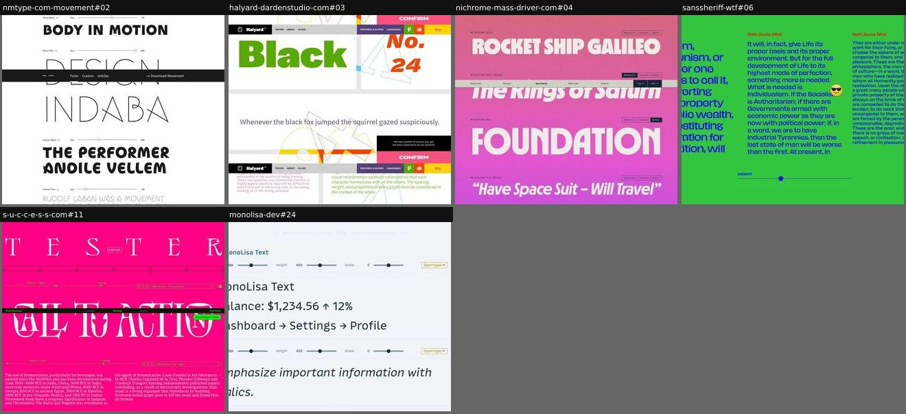
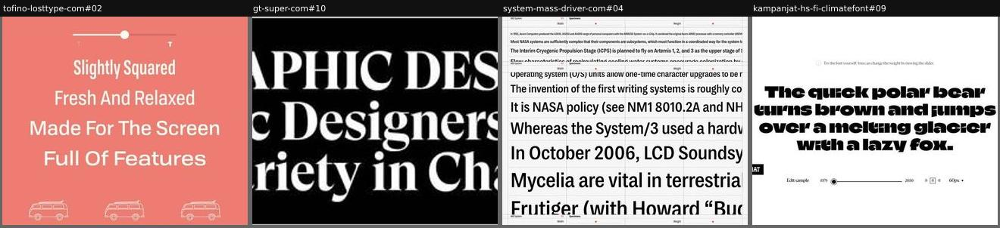
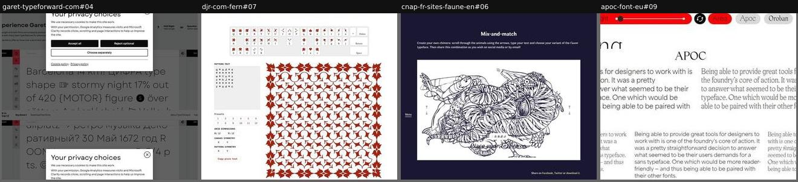
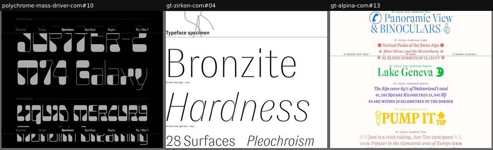
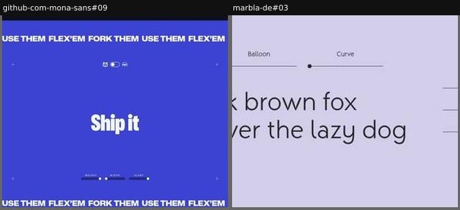
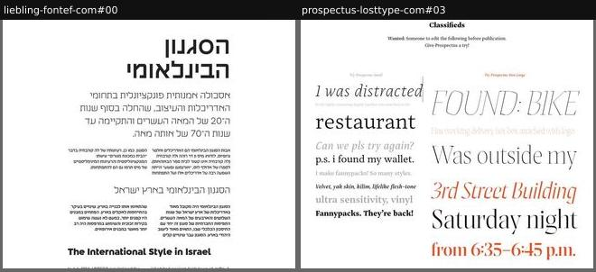
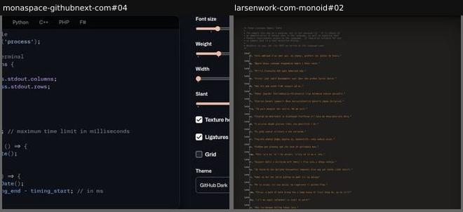
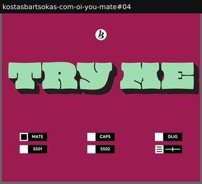

# type-tester

Interactive: the visitor types and/or drives size, axes and features.

Sample: 24 blocks from 24 sites.

| variant | n | definition | recognise by |
|---|---|---|---|
| [per-row-controls](#per-row-controls) | 6 | Several sample rows, each with its own style, size and leading controls. | a control strip on every row |
| [global-toolbar](#global-toolbar) | 4 | One persistent toolbar restyles all editable samples on the page. | sticky bar of selects and sliders |
| [creative-toy](#creative-toy) | 4 | A playful maker that turns the font into a composition: patterns, shareable images, style pairings, word-by-word styling. | share or download buttons, presets, unusual gestures |
| [labelled-editable-lines](#labelled-editable-lines) | 3 | Each style gets a small label and editable lines at a fitting size; click to type, no toolbar. | contenteditable lines, style labels, no controls |
| [slider-sandbox](#slider-sandbox) | 2 | One editable sample with a few axis and size sliders around it. | one big sample, 2–4 sliders |
| [in-context-editable](#in-context-editable) | 2 | A realistic layout (classifieds, menu, poster) whose text is editable. | editable text inside a designed artefact |
| [code-playground](#code-playground) | 2 | A mock code editor with language tabs and themes, set in the (coding) font, with font controls. | syntax highlighting, editor chrome |
| [feature-toggle-board](#feature-toggle-board) | 1 | One big sample line plus a panel of OpenType feature toggles labelled with their tags. | ss01, dlig, case toggles |

## Rubric

Recorded for every instance in Phase 3, in addition to the cross-cutting attributes in `rubric.json`:

- **controls**: any of text, size, leading, tracking, weight, axes, features, style-select, color, alignment, presets, language
- **scope**: single | per-row | global | in-layout
- **defaultText**: pangram | meaningful | prompt | code | user-empty
- **export**: true | false (share, download image or copy CSS)

## per-row-controls

Several sample rows, each with its own style, size and leading controls.

**Recognise by:** a control strip on every row

| example | look | feel | ux | learn |
|---|---|---|---|---|
| [nmtype-com-movement#02](../../archive/nmtype-com-movement/blocks/02.jpg) | White, rows in Direct/Indirect Black and Thin ('BODY IN MOTION', 'DESIGN INDABA'), each with a style dropdown and size slider; cut runs on into 'DANCE!', story, video and poster | Kinetic, theatrical, clean | Per-row style picker and size slider; variable row adds weight and space sliders | Fill the tester rows with words from the font's own story (the dancer, the event) so testing also tells it |
| [halyard-dardenstudio-com#03](../../archive/halyard-dardenstudio-com/blocks/03.jpg) | White cards in a grey grid: green 'Black', orange italic 'No. 24', pangram line, pink and green paragraphs, outline wayfinding shapes behind; cookie bar and sticky nav repeat | Colourful, systematic, signage-like | Each card is editable with its own optical-size/style selects and size, leading and tracking sliders | Give each card a different job (headline, number, pangram, paragraph) so one tester covers every use size |
| [nichrome-mass-driver-com#04](../../archive/nichrome-mass-driver-com/blocks/04.jpg) | Pink-to-violet gradient, one editable sci-fi title per style ('Rocket Ship Galileo', 'Fahrenheit 451'), tiny mono style label left, three-way toggle right | Retro-futurist, pulp sci-fi, playful | Each row is editable and has its own Geometric/Rounded/Gothic alternate-set toggle; sticky section nav with Try/Buy | Seed each row with a themed title (sci-fi novels) so the default text tells the font's story before anyone types |
| [sanssheriff-wtf#06](../../archive/sanssheriff-wtf/blocks/06.jpg) | Bright green, three columns of blue editable text (Maxi, Midi, Mini) at decreasing sizes, red style labels, a weight slider, sunglasses emoji | Cheeky, political, loud | Each column is editable and has its own weight/display sliders | Show the display cuts side by side on one long political text: each size cut is judged at its intended size |
| [s-u-c-c-e-s-s-com#11](../../archive/s-u-c-c-e-s-s-com/blocks/11.jpg) | Hot pink, letterspaced 'T E S T E R' heading, rows of huge display text with thin control rails | Bold, editorial, graphic | Each row: font size, leading, style select; editable text; Download Trials | Different defaults per row (titling vs text) show the family's range before anyone touches a control |
| [monolisa-dev#24](../../archive/monolisa-dev/blocks/24.jpg) | Pale blue-grey UI, two sample panels (UI strings, italic sentence), each with its own Size/Weight/Grade sliders, OpenType menu, Reset | Calm, developer-tool, practical | Per-row sliders for size, weight, grade; OpenType dropdown; reset; editable text | Seed a coding font's tester with real UI strings (balances, breadcrumbs, arrows), not pangrams |

## global-toolbar

One persistent toolbar restyles all editable samples on the page.

**Recognise by:** sticky bar of selects and sliders

| example | look | feel | ux | learn |
|---|---|---|---|---|
| [tofino-losttype-com#02](../../archive/tofino-losttype-com/blocks/02.jpg) | Coral, white lines stepping from condensed to wide ('Slightly Squared' … 'Full Of Features'), one slider on top, row of VW-bus dingbats | Breezy, surf-van, relaxed | One weight slider drives all four lines; each line is editable | Make each tester line a selling point set in a different width, so the copy and the range arrive together |
| [gt-super-com#10](../../archive/gt-super-com/blocks/10.jpg) | Black band, three centred lines of white bold display serif 'GRAPHIC DESIGN / Graphic Designers need a wide Variety in Characters' | Confident, editorial, quotable | contenteditable line; a site-wide style bar (about 20 editable blocks) changes subfamily, weight, size, alignment, alts | Make every specimen line in the story editable and drive them from one toolbar: reading and testing become the same act |
| [system-mass-driver-com#04](../../archive/system-mass-driver-com/blocks/04.jpg) | White graph-paper grid, sticky Width and Weight sliders with red dots, editable waterfall of tech-history sentences cut at the edge | Technical, archival, engineered | Width and Weight sliders change the whole waterfall; every line is editable | Two global axis sliders over a size waterfall show how width and weight hold up from caption to display at once |
| [kampanjat-hs-fi-climatefont#09](../../archive/kampanjat-hs-fi-climatefont/blocks/09.jpg) | White, huge black ultra-heavy paragraph, thin toolbar: Edit sample, 1979-2050 slider, alignment, 60px menu | Sober, campaigning, stark | Editable text; slider scrubs years (weight = sea-ice extent); alignment radios; size select | Label the weight axis with what it encodes (years of ice melt): the slider becomes the message |

## creative-toy

A playful maker that turns the font into a composition: patterns, shareable images, style pairings, word-by-word styling.

**Recognise by:** share or download buttons, presets, unusual gestures

| example | look | feel | ux | learn |
|---|---|---|---|---|
| [garet-typeforward-com#04](../../archive/garet-typeforward-com/blocks/04.jpg) | Grey, large multilingual paragraph (Latin, Cyrillic, dingbats), left rail of feature icons, Reset/Set buttons; privacy modal covers the top in the capture | Exploratory, hands-on, product-like | Hover a word, move mouse for weight, hold right for italic angle, spacebar for letter-spacing; feature toggles; type-your-own field | Style per word instead of per block: a single paragraph can show many styles at once, like a designer's mix |
| [djr-com-fern#07](../../archive/djr-com-fern/blocks/07.jpg) | White, on-screen keyboard of red leaf ornaments, monospace 'Pattern text' box, presets 1-12, and a large red tiled border pattern | Crafty, generous, toy-like | Type or click keys to compose pattern text; set grid X/Y, canvas and pattern symmetry; copy plain text | For an ornament font, ship a pattern maker: it shows the glyphs tile and hands users the exact text to paste |
| [cnap-fr-sites-faune-en#06](../../archive/cnap-fr-sites-faune-en/blocks/06.jpg) | Navy page, white card with a dense line-drawn animal chimera, up/down arrows each side, style picker 'a a a a', 'Place your text here' | Whimsical, crafted, inviting | Arrows swap animal halves, type up to 35 characters, pick a style, share or download | Give the tester an output worth sharing: a personalised artwork spreads the typeface further than a sample line |
| [apoc-font-eu#09](../../archive/apoc-font-eu/blocks/09.jpg) | White, red pill toolbar (style dropdown, weight slider, shuffle), font chips (Area, Apoc, Oroban, Joly), 'APOC' title over body columns | Practical, tool-like, editorial | Choose style and weight, swap pairing font, shuffle | Recommend pairings from your own catalogue as a live tool: it sells a second family while helping the user |

## labelled-editable-lines

Each style gets a small label and editable lines at a fitting size; click to type, no toolbar.

**Recognise by:** contenteditable lines, style labels, no controls

| example | look | feel | ux | learn |
|---|---|---|---|---|
| [polychrome-mass-driver-com#10](../../archive/polychrome-mass-driver-com/blocks/10.jpg) | Black, grey stencil-like display lines ('JUPITER-2', 'LIQUID MERCURY') shrinking from Giga to Nano, hairline dividers with style names | Retro-futurist, space-age, confident | Every line is contenteditable; each set at its own opsz value | Set each optical size at the size it was drawn for, so the ramp itself explains the optical-size system |
| [gt-zirkon-com#04](../../archive/gt-zirkon-com/blocks/04.jpg) | White, mineral-themed words in every style (Bronzite, Hardness…Colorless) with tiny 'style — size' captions, paragraph pair, then a family overview list | Scientific, calm, catalogue-like | All sample lines are contenteditable; sizes stated in vw | Caption every sample with style name and size, like a print specimen, so the page doubles as a spec sheet |
| [gt-alpina-com#13](../../archive/gt-alpina-com/blocks/13.jpg) | Off-white, each style in its own colour (blue, red, green, yellow…) with Swiss-themed lines, pictogram glyphs inline, tiny style captions | Joyful, touristic, eclectic | Every sample is contenteditable; sticky trial/licensing bar | Give each style its own colour and themed copy: a long style list reads like a travel brochure, not a catalogue |

## slider-sandbox

One editable sample with a few axis and size sliders around it.

**Recognise by:** one big sample, 2–4 sliders

| example | look | feel | ux | learn |
|---|---|---|---|---|
| [github-com-mona-sans#09](../../archive/github-com-mona-sans/blocks/09.jpg) | Saturated blue, centred white 'Ship it', three thin sliders (weight, width, slant), cat/robot toggle, marquee 'USE THEM FLEX'EM FORK THEM' top and bottom | Upbeat, developer-brand, punchy | Editable word; weight/width/slant sliders; toggle swaps Mona Sans and Hubot Sans | A two-icon toggle between sibling fonts (cat vs robot) compares families with zero UI text |
| [marbla-de#03](../../archive/marbla-de/blocks/03.jpg) | Lavender, editable pangram in light sans, three axis sliders (Inktrap, Balloon, Curve) above, size/spacing/leading sliders right | Soft, minimal, calm | Six sliders restyle the editable pangram live | Name custom axes by their visual effect (Balloon, Inktrap) so the sliders explain themselves |

## in-context-editable

A realistic layout (classifieds, menu, poster) whose text is editable.

**Recognise by:** editable text inside a designed artefact

| example | look | feel | ux | learn |
|---|---|---|---|---|
| [liebling-fontef-com#00](../../archive/liebling-fontef-com/blocks/00.jpg) | White, Hebrew magazine article on the International Style: big headline, deck, two-column text, English section, huge light pull quote | Architectural, editorial, bilingual | 11 editable text blocks; sizes labelled in points (72, 36…) | Pick an article topic that rhymes with the font (Bauhaus Tel Aviv for a modernist Hebrew sans) |
| [prospectus-losttype-com#03](../../archive/prospectus-losttype-com/blocks/03.jpg) | Newspaper 'Classifieds' page, mixed Prospectus sizes and italics, red accent | Witty, editorial | Editable classified ads ('Wanted: someone to edit the following') | Give the tester a premise: 'edit these classifieds' invites play more than an empty field |

## code-playground

A mock code editor with language tabs and themes, set in the (coding) font, with font controls.

**Recognise by:** syntax highlighting, editor chrome

| example | look | feel | ux | learn |
|---|---|---|---|---|
| [monaspace-githubnext-com#04](../../archive/monaspace-githubnext-com/blocks/04.jpg) | Dark editor with line numbers and syntax colours, tabs (JavaScript … F#), sidebar with pink sliders, checkboxes and a theme dropdown | Developer, polished, GitHub-native | Switch language, size, weight, width, slant; toggle texture healing, ligatures, grid; pick theme | Let developers swap editor theme and language: a code font is judged in their own setup, not on white |
| [larsenwork-com-monoid#02](../../archive/larsenwork-com-monoid/blocks/02.jpg) | Dark editor theme, orange strings, a multilingual pangram table (lang(af, …)) formatted as source code | Hacker, authentic, no-frills | Editable code area; Theme (white/light/dark/black) and Example (c, py, swift, js, less, html) switched from the controls above | Test a coding font where it will live: real code, real highlighting, the visitor's own theme |

## feature-toggle-board

One big sample line plus a panel of OpenType feature toggles labelled with their tags.

**Recognise by:** ss01, dlig, case toggles

| example | look | feel | ux | learn |
|---|---|---|---|---|
| [kostasbartsokas-com-oi-you-mate#04](../../archive/kostasbartsokas-com-oi-you-mate/blocks/04.jpg) | Magenta field, mint 3D-extruded 'TRY ME', black-and-white toggle switches with feature tags | Cheeky, loud, hands-on | Toggle MATE, CAPS, DLIG, SS01, SS02; slider; editable text | Label toggles with the real feature tags (DLIG, SS01): teaches OpenType vocabulary while playing |
