# type-tester

_Section: Type tester_

Interactive: the visitor types and/or drives size, axes and features.

150 instances on 115 sites (the Phase 3 extraction of 181 sites).

| variant | sites | definition | recognise by |
|---|---|---|---|
| [slider-sandbox](#slider-sandbox) | 54 | One editable sample with a few axis and size sliders around it. | one big sample, 2–4 sliders |
| [labelled-editable-lines](#labelled-editable-lines) | 14 | Each style gets a small label and editable lines at a fitting size; click to type, no toolbar. | contenteditable lines, style labels, no controls |
| [in-context-editable](#in-context-editable) | 12 | A realistic layout (classifieds, menu, poster) whose text is editable. | editable text inside a designed artefact |
| [per-row-controls](#per-row-controls) | 11 | Several sample rows, each with its own style, size and leading controls. | a control strip on every row |
| [creative-toy](#creative-toy) | 10 | A playful maker that turns the font into a composition: patterns, shareable images, style pairings, word-by-word styling. | share or download buttons, presets, unusual gestures |
| [global-toolbar](#global-toolbar) | 9 | One persistent toolbar restyles all editable samples on the page. | sticky bar of selects and sliders |
| [pointer-xy-axes](#pointer-xy-axes) | 8 | The pointer's x and y position (or device tilt) each drive one variable axis, with edge tracks or labels showing live values; no sliders to grab. | axis labels at the edges, moves with the cursor |
| [auto-fit-editable-lines](#auto-fit-editable-lines) | 7 | Editable display lines that rescale to fill the column width as you type; no size or axis controls, at most a style switch for the stack. | full-width editable lines, no sliders |
| [code-playground](#code-playground) | 6 | A mock code editor with language tabs and themes, set in the (coding) font, with font controls. | syntax highlighting, editor chrome |
| [palette-editor](#palette-editor) | 4 | One editable sample in a colour font with a colour picker per palette layer (outline, fill, gradient stops, randomise) that rewrites the palette live. | colour swatches beside a colour-font sample |
| [feature-toggle-board](#feature-toggle-board) | 3 | One big sample line plus a panel of OpenType feature toggles labelled with their tags. | ss01, dlig, case toggles |
| [xy-pad](#xy-pad) | 2 | One editable sample beside a 2D pad: dragging one handle sets two axes at once (e.g. weight × optical size). | square pad with a crosshair handle |
| [mockup-generator](#mockup-generator) | 1 | A short text field (with style and colour pickers) whose input is rendered into a wall of realistic scenes (billboards, gadgets, screens), so visitors see their words in use. | input field above a grid of mockups |
| [write-on-playback](#write-on-playback) | 1 | Editable samples in a font with a time (write-on) axis: a play button draws the text stroke by stroke and a timeline slider scrubs it. | play button, timeline scrubber |
| [outline-editor](#outline-editor) | 1 | The visitor drags a glyph's outline points and Bézier handles, with undo/redo, reset and image download. | points and handles on a big glyph |
| [sound-reactive-axis](#sound-reactive-axis) | 1 | The microphone level drives an axis (e.g. weight) of a large word, letter by letter. | microphone permission, letters pulsing with sound |

## Rubric

Recorded for every instance in Phase 3, in addition to the cross-cutting attributes in `rubric.json`:

- **controls**: any of text, size, leading, tracking, weight, axes, features, style-select, color, alignment, presets, language
- **scope**: single | per-row | global | in-layout
- **defaultText**: pangram | meaningful | prompt | code | user-empty
- **export**: true | false (share, download image or copy CSS)

## slider-sandbox

One editable sample with a few axis and size sliders around it.

**Recognise by:** one big sample, 2–4 sliders

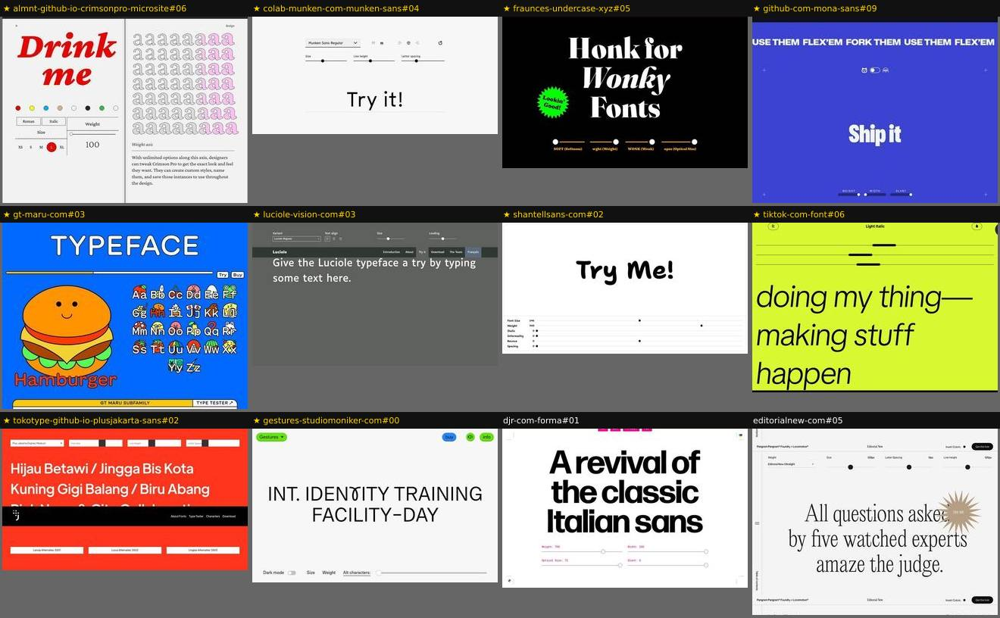

| example | look | feel | ux | learn |
|---|---|---|---|---|
| [★ almnt-github-io-crimsonpro-microsite#06](../../archive/almnt-github-io-crimsonpro-microsite/blocks/06.jpg) | Left page: an editable 'Drink me' in big red bold italic, a row of eight colour dots (red, yellow, blue, tan, white, black, green, white), boxed 'Roman' / 'Italic' buttons, a 'Size' row XS–XL (L active in red) and, in a dotted-ruled column, a 'Weight' slider with a large '100' readout | Playful, potion-label | Type over 'Drink me'; click a dot to recolour; switch Roman/Italic; pick a size; drag weight 100–900 (the readout is set in the current weight) | Theme the tester's default text on the story ('Drink me' changes size like Alice): the controls become the plot |
| [★ colab-munken-com-munken-sans#04](../../archive/colab-munken-com-munken-sans/blocks/04.jpg) | Pale grey band with one compact control group: weight dropdown, case and alignment icons, reset, then three thin sliders, above a single centred 'Try it!' on a hairline | Polite, Swiss-tidy | Click and type (placeholder 'Try it!'); select weight; toggle uppercase/lowercase; align; drag size 8–280, line height 80–180%, spacing −0.1–0.2em; reset | Store all settings as CSS variables on the editable element: a clear state model that keeps a tester down to a few dozen lines |
| [★ fraunces-undercase-xyz#05](../../archive/fraunces-undercase-xyz/blocks/05.jpg) | On black, the editable slogan 'Honk for / Wonky / Fonts' in white (middle line italic) with a green 'Lookin' Good!' starburst sticker, and a row of four orange sliders with white knobs labelled SOFT (Softness), wght (Weight), WONK (Wonk), opsz (Optical Size) | Cheeky, hands-on | Drag any of the four axes; click the text to type | Label each slider with both the axis tag and its plain name ('SOFT (Softness)') so the tester also teaches the registered/custom axis vocabulary |
| [★ github-com-mona-sans#09](../../archive/github-com-mona-sans/blocks/09.jpg) | A full-bleed electric-blue panel framed top and bottom by marquee bands 'USE THEM FLEX'EM FORK THEM' in wide heavy caps; in the middle, a Mona-icon / switch / Hubot-icon toggle, a white 'Ship it' at 140px (heavy, condensed, italic) and three small sliders labelled WEIGHT, WIDTH, SLANT; plus-sign registration marks at the corners | Energetic, tool-like, on-brand | Type into 'Ship it'; drag weight 200–900, width 75–125 and slant 0–10 (stepped); the toggle swaps the sample between Mona Sans and Hubot Sans | Default the sliders to an extreme corner (900 / 75 / slant 10) so the sample opens loud, and use a family switch instead of a dropdown when there are only two families |
| ★ gt-flaire-com#06 | Full-screen overlay (offscreen in the capture) with 'PER MY LAST EMAIL' fitted to the viewport (~235px) in green Extra Black, a Flaire slider window on the top edge, Weight on the left edge and Italic on the right edge, a Settings window (Shuffle mixer icon, Autoplay disco ball, Alternates shoe), a Close window (knives icon) and a Color window with 9 numbered swatches incl. a gradient | Party mode | Opened from 'Test' in the nav; type over the text (auto-fit); drag sliders; Shuffle randomises axes, Autoplay animates them ('Disco' on mobile), Alternates toggles alternate forms, swatches recolour | Frame the editable text with one slider per edge and give it a randomiser and autoplay: testing becomes play |
| [★ gt-maru-com#03](../../archive/gt-maru-com/blocks/03.jpg) | At the end of the Typeface, Mono and Mega chapters, a white rounded card with a coloured header strip ('GT MARU SUBFAMILY', 'GT MARU MONO SUBFAMILY', 'GT MARU MEGA SUBFAMILY') and a 'TYPE TESTER ↗' tab, one big editable sample (Tokyo place names 'Setagaya', 'Nakameguro'; 'Megalomania Gargantuan Enourmously' for Mega) and a footer row of controls | Tidy widget, like a sticker | Type over the sample; drag the round knobs for Weight and Oblique (Mega: Optical Size plus Outline / Shaded / Glow style toggles); 'TYPE TESTER ↗' opens the full tester | Put a small tester card at the end of each subfamily chapter with only that subfamily's controls, and link it to the full tester |
| ★ gt-planar-com#17 | A full-screen blue-on-black cockpit console (HTML only): one auto-fitted editable line ('MAY THE FORCE BE WITH YOU'); top bar with AUTO PILOT play/stop, PRESETS DEF · STA · DOM · BOU · IMP · ENE · R_0, a message centre and HUD / TEST / BUY switches plus EXIT; bottom bar with POWER STEERING, FEATURES toggles (Flat Shapes Alts ss04, Curved Numbers ss03, Single Story Alts ss01+ss02), an ANGLE speedometer with readout (+27) and buttons 0°, ±15°, ±30°, ±45°, and a WEIGHT selector (Thin…Black) with readout (423) and notched slider | Flight deck, gamified | Opened from 'TYPETESTER' in the fixed bar; type to replace the text (auto-fit); presets apply choreographed per-letter animations of slant and weight (e.g. bounce, domino, impulse); Auto Pilot loops through settings; Power Steering likely hands the axes to pointer/tilt; on mobile a vertical weight slider and a slant slider | Give a tester named presets that animate letter by letter: one click shows what the axes can do in motion, then the visitor takes the controls |
| ★ gt-pressura-com#11 | A full-screen black overlay (HTML only) where one editable sample ('Intermodal Container') is auto-fitted to fill the screen in white, with a top bar ('NEW SAMPLE TEXT', 'ANIMATION ON/OFF', 'TYPE PROPORTIONAL/MONOSPACE', 'CLOSE') and a bottom bar of Width, Weight and Italic sliders plus 'Purchase Licensing' and 'Download Trials' | Immersive, poster-making | Opened from 'TYPETESTER' in the fixed top bar; type to replace the text (it refits to the viewport); drag wdth 100–150, wght 300–900, ital 0–1 (step 0.01); 'New Sample Text' swaps in another phrase; Animation On runs an autopilot sweep of the axes; Proportional/Monospace swaps between two sample layers | Let the tester take over the whole screen and auto-fit the text: every slider move becomes a full-bleed poster, and an autopilot keeps it alive when idle |
| [★ luciole-vision-com#03](../../archive/luciole-vision-com/blocks/03.jpg) | Full-bleed grey band with one row of minimal controls on top (style select, three align icons, size and leading sliders) and a 60px white editable line below | Uncluttered, accessible | The default text is an invitation to type. Native select and radios are labelled and keyboard reachable; sliders update live | The prompt sentence is both instruction and sample. Text-align and leading are useful controls here because the visitor is testing readability, not style |
| [★ shantellsans-com#02](../../archive/shantellsans-com/blocks/02.jpg) | A white rounded card with 'Try Me!' huge and centred, and below a hairline-ruled panel of six thin slider rows (Font Size 146, Weight 700, Italic 0, Informality 0, Bounce 0, Spacing 0), each a label, a number and a black dot on a long line | Minimal, playful, inviting | Type directly into the headline (blinking custom cursor); drag any dot or type a number to set size 4–288, wght 300–800, ital 0–1, INFM 0–100, BNCE -100–100, SPAC 0–100; changes apply live | Give every axis the same minimal row (label, number field, dot on a hairline): six controls read as one calm panel under one big word |
| [★ tiktok-com-font#06](../../archive/tiktok-com-font/blocks/06.jpg) | Full-screen neon yellow-green panel: an outlined alignment button top-left, the current style name 'Light Italic' top-centre, a colour (droplet) button top-right, three hairline sliders with black pill thumbs, and a huge editable sample 'doing my thing—making stuff happen' in black Light Italic | Fresh, inviting | Slider 1 (0–35) scrubs through the styles and updates the label; slider 2 (-12–10) sets tracking; slider 3 (88–250) sets size; buttons cycle alignment and background colour; click the text to type; selection highlights in TikTok red | Draw the sliders as hairlines with pill thumbs and drop all numeric labels: a tester can feel like part of the brand, not a form |
| [★ tokotype-github-io-plusjakarta-sans#02](../../archive/tokotype-github-io-plusjakarta-sans/blocks/02.jpg) | A full-width red-orange panel: a row of four white controls (style dropdown 'Plus Jakarta Display Medium', and Font Size, Line Height, Letter Spacing sliders drawn as white bars with a dark square thumb and the label inside), a big white editable sample 'Hijau Betawi / Jingga Bis Kota / Kuning Gigi Balang / Biru Abang / Pink None & City Collaboration.', and three white feature buttons 'Lancip Alternates: SS01', 'Lurus Alternates: SS02', 'Lingkar Alternates: SS03' | Energetic, civic, hands-on | Pick any of 14 styles (Display and Text, roman and italic); drag size 10–120 (default 80), line height 30–300% (150), letter spacing −10…20 (0); type over the sample; toggle the three named stylistic sets (all on by default) | Use the client's brand vocabulary as default text (the city's named colours: Betawi green, city-bus orange, Abang blue) and give stylistic sets local names (Lancip = pointed, Lurus = straight, Lingkar = round) |
| [★ gestures-studiomoniker-com#00](../../archive/gestures-studiomoniker-com/blocks/00.jpg) | A light-grey screen with 'INT. IDENTITY TRAINING FACILITY–DAY' (a screenplay scene heading, with one scribbly 'T' alternate) centred in two lines of thin black Gestures; along the bottom 'Dark mode' with a toggle, then the words 'Size', 'Weight', 'Alt characters:' (the active one underlined) and one long grey slider with a white round thumb | Quiet stage set waiting for a performance | Pick Size, Weight or Alt characters, then drag the single slider: Alt characters swaps a growing share of letters for their scribbly siblings (0–1); the dropdown picks the weight; dark mode inverts the page; the designer's filmed hands (canvas video, with spoken voices) come in and drag the values back, and the mute button silences them | One slider whose target is chosen by plain-word radio labels keeps the screen almost empty; a percentage slider for alternates shows a feature as a dose, not an on/off switch |
| ★ nationalparktypeface-com#15 | A fixed right half of the viewport (block 15, an iframe): on black, a paragraph listing all US national parks ('Acadia, Arches, Badlands, Big Bend, Biscayne, Black Canyon of the Gunnison … Yellowstone, Yosemite, Zion') in white at 24px, with two thin sliders at the bottom: 'Size 24 px' and 'Weight 275' | A ranger's checklist that is always at hand | The tester stays put while the left column scrolls, so visitors can adjust size and weight at any point; it is hidden on mobile (exclude_mobile). Whether the text is editable could not be checked (cross-origin iframe) | Pin the tester to half the screen and fill it with a themed list (every park's name) that uses capitals, commas and long words: the story column and the tester never compete for the scroll |
| [djr-com-forma#01](../../archive/djr-com-forma/blocks/01.jpg) | White panel with print crop marks in the corners: 'A revival of / the classic / Italian sans' in black Bold at ~180px, centred, above four thin magenta sliders in a 2×2 grid (Weight: 700, Width: 100, Optical Size: 72, Slant: 0) with mono labels | Crisp, inviting | Click the sentence to type; each slider sets one axis live (wght 1–900, wdth 50–100, opsz 8–72, slnt −13–0) and its label shows the value | Put the four-axis tester straight after the logo, with the tagline as its default text: the pitch is something you can drag |

_…and 40 more in the gallery (`npm run app`)._

## labelled-editable-lines

Each style gets a small label and editable lines at a fitting size; click to type, no toolbar.

**Recognise by:** contenteditable lines, style labels, no controls

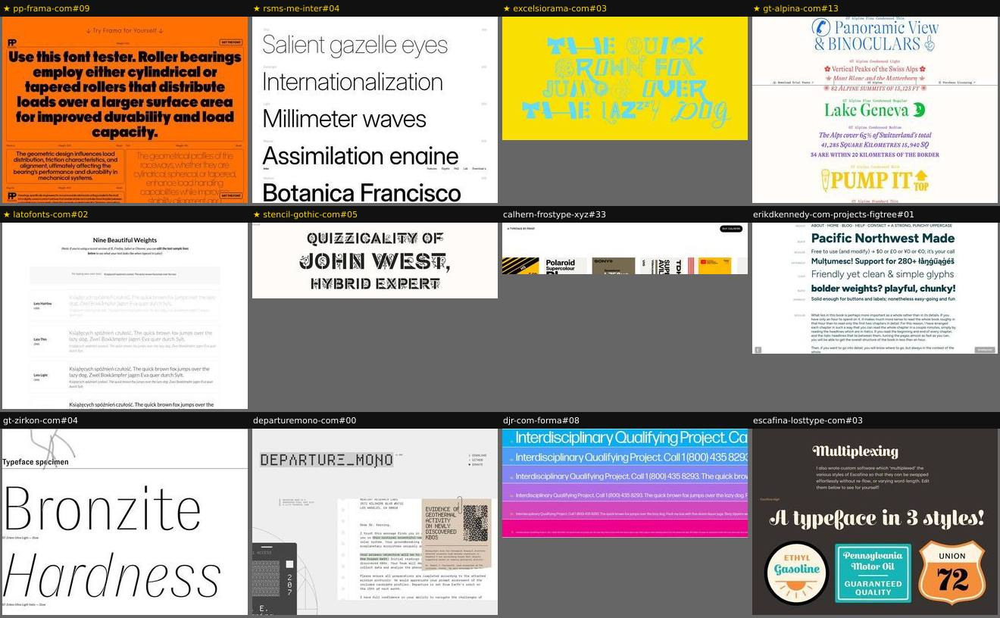

| example | look | feel | ux | learn |
|---|---|---|---|---|
| [★ pp-frama-com#09](../../archive/pp-frama-com/blocks/09.jpg) | On flat orange, '↓ Try Frama for Yourself ↓' then four outlined boxes: a full-width Black 900 headline 'Use this font tester. Roller bearings employ either cylindrical or tapered rollers…', and below it Medium 500, Regular 400 (small paragraph) and Thin 100 boxes, each with a tiny style / 'Weight: N' / Reset header | Loud, industrious, fun | Click into any box to type (contenteditable); Reset restores that box's text; no sliders | Write the tester copy in the font's theme (bearings and load capacity) and open it with an instruction ('Use this font tester.'): the default text both explains and sells |
| [★ rsms-me-inter#04](../../archive/rsms-me-inter/blocks/04.jpg) | Every weight from Thin 100 to Black 900 as one editable line at ~144px ('Salient gazelle eyes', 'Internationalization', 'Botanica Francisco', 'Hamburgefonstiv'), each with a tiny grey style name left and weight number right; then the same for the italics ('Inorganic compound', '3 hours till midnight', 'United Martians'); then each weight again as a 2–3 line sentence at ~86px ('Chemistry is a physical science…', 'The Sicilian Defense is a chess opening that begins with 1.e4 c5') | Systematic, quietly humorous | Click any line to type; no toolbar. Three passes (roman lines, italic lines, multi-line sentences) show each weight at display and at paragraph-ish size | Give every weight its own phrase rather than one repeated pangram: the list reads like a stream of small facts, and the labels (name + number) teach the weight scale |
| [★ excelsiorama-com#03](../../archive/excelsiorama-com/blocks/03.jpg) | Three full-bleed colour bands, each with one centred editable pangram: cyan on yellow, black on sky blue ('hamburgefonstiv'), yellow on pink, then a bordered dark 'TYPE SOMETHING' box | Screen-printed bands | Click and type on any band; the last field empties itself on focus. No controls, no labels | One colour pair per editable band: with no toolbar, each field shows a different mood and a different test string |
| [★ gt-alpina-com#13](../../archive/gt-alpina-com/blocks/13.jpg) | A ~5300px centred stack of 20 multicolour samples about Switzerland ('Panoramic View & Binoculars', 'Lake Geneva', 'PUMP IT', Jass card game, 'Mount Pilatus 2093 Rigibahn 50km/h', 'Glacier', 'MOUNTAIN FLIGHT', typewriter history), each labelled with its style ('GT Alpina Fine Condensed Thin') and studded with the family's icons | Souvenir-shop, exuberant | Every sample is contenteditable (and opens the axis overlay); labels name the style; samples step through all subfamilies and weights in order | Write each style's sample around one theme and mix in small caps, italics, figures and dingbats inside the lines: a style list becomes a travel poster |
| [★ latofonts-com#02](../../archive/latofonts-com/blocks/02.jpg) | One small text input in a grey band above nine bordered cards, each with the style name and numeric weight at left and the same sample at right in roman (large) and italic (small) | Calm, list-like, complete | Typing in the single input rewrites all 18 samples (every .specimen-text) at once; cards are not themselves editable despite the copy, and they lift with a shadow on hover | One input bound to a whole style list lets a visitor compare weights on their own text with no per-row controls; pairing roman and italic in each row covers two axes of the family in one list |
| [★ stencil-gothic-com#05](../../archive/stencil-gothic-com/blocks/05.jpg) | Two centred three-line lockups interrupting the essay ('Quizzicality of / John West, / Hybrid Expert' and 'South Brooklyn / 123 Test / Flower Market'), middle line larger, with no visible controls | Letterpress poster; a hidden affordance | Click anywhere and type (the whole section is contenteditable); the 'Test' in the second lockup is the only hint | Plant the word 'Test' in an editable lockup: the sample is its own instruction, and the three-size hierarchy keeps anything typed looking composed |
| [calhern-frostype-xyz#33](../../archive/calhern-frostype-xyz/blocks/33.jpg) | Beyond the capture: ruled boxes of film-poster copy, each labelled with its style and a 'Reset' link: 'ROGUE ONE: A STAR WARS STORY…' (Wide Semibold), 'VHS' (Wide Thin), 'PEELE' (Wide Black), 'Once Upon A Time In Hollywood' (Semibold), 'WINNER BEST DIRECTOR…' (Bold), 'Anderson' (Bold), 'MIRAMAX FILMS PRESENTS…' (Condensed Light), 'TARANTINO' (Condensed Regular), 'SuperAvilyn' (Condensed Bold Italic) | Clean, film-buff | Click to type in any box; text auto-fits the box width; Reset restores the sample | Use director and film names as the default text per style: themed samples that read as a credit sequence |
| [erikdkennedy-com-projects-figtree#01](../../archive/erikdkennedy-com-projects-figtree/blocks/01.jpg) | Weight names in tiny grey caps in a left column (MEDIUM, BLACK, REGULAR, EXTRABOLD, LIGHT, BLACK, SEMIBOLD, REGULAR) beside editable lines in dark teal: a nav string 'ABOUT · HOME · BLOG · HELP · CONTACT → …', 'Pacific Northwest Made', 'Free to use (and modify) → $0 or £0 or ¥0 or €0', 'Mulțumesc! Support for 280+ łåŋģűąġéš', a paragraph of body text | Product-like, reassuring | Every line is contenteditable; mobile swaps in a separate set of single words per weight (Engineering, Association, Malagueñas…) | Write the sample lines as the font's own sales points (free, 280+ languages, bold for buttons): each line is specimen and pitch at once |
| [gt-zirkon-com#04](../../archive/gt-zirkon-com/blocks/04.jpg) | 'Typeface specimen': mineral-themed words in every style, each with a tiny label of style and size ('GT Zirkon Ultra Light — 21vw'): 'Bronzite' and 'Hardness' full-width at 21vw, pairs like '28 Surfaces / Pleochroism', 'Mariposites / Transparency' at 7.5vw, two paragraphs on X-ray diffraction at 38–48px, then 'Pattern 5' and 'Colorless' at 21vw in Black; followed by a two-column ruled 'Family overview' list (Ultra Light Italic … Black Italic) | Museum label, confident | Each sample (18) is contenteditable; no controls | Label every sample with its size in vw as well as its style: the specimen documents the responsive scale it is built on |
| [departuremono-com#00](../../archive/departuremono-com/blocks/00.jpg) | Four editable lines at falling sizes, each under a tiny label row 'DEPARTURE MONO · 121PX · -11PX TRACK': 'ATTN: PASSENGERS QUIET IN THE CABIN', 'FLIGHT ATTENDANTS, PREPARE FOR TAKEOFF', then the font description in caps at 22px and in sentence case at 16.5px | Direct, poster-like | Click any line and type; no controls; labels state the exact size and negative tracking used | Label each sample with its px size and tracking: the specimen documents the settings that make a pixel font crisp (multiples of 11px) |
| [djr-com-forma#08](../../archive/djr-com-forma/blocks/08.jpg) | Six full-width bands shading from cyan to magenta, each one editable line of 'Interdisciplinary Qualifying Project. Call 1 (800) 435 8293. The quick brown fox…' in white at 72, 48, 36, 24, 15 and 8px, the size in small yellow figures at the left | Smooth, technical | Click any line to type; each line runs off the right edge | Colour-step the bands with the size so the optical-size waterfall reads as one continuous scale |
| [escafina-losttype-com#03](../../archive/escafina-losttype-com/blocks/03.jpg) | On dark brown, script heading 'Multiplexing', a short paragraph, then a small orange label 'Escafina High' over a huge cream line 'A typeface in 3 styles!' | Proud engineering note | One Draft.js editor feeds three overlaid output rows labelled Escafina High, Medium and Low (font-weight 200/400/600); because the styles are multiplexed (same advance widths), the rows stay identical in length as you type | Prove that styles share metrics by mirroring one input into each style: the visitor sees no reflow when the contrast changes |
| [indestructibletype-com-gnomon#11](../../archive/indestructibletype-com-gnomon/blocks/11.jpg) | A borderless full-width text input whose placeholder 'TRY ME!' is set ~240px in pale pink Gnomon* across the column, nothing else | Casual dare | Click and type: the input renders in the two-layer Gnomon* (foreground over the variable shadow layer in a sibling div); no size or axis controls of its own | A placeholder set at display size in a faded tint reads as part of the layout until the visitor realises it is a field |
| [wix-com-typeface-madefor#02](../../archive/wix-com-typeface-madefor/blocks/02.jpg) | A full-width 3-line text area on faint horizontal rules, with the blinking cursor shown: 'Type something here to play with the font.'; a 'Try it out: tap here' prompt above | A sheet of ruled paper | Click and type up to 45 characters; no toolbar | Ruled lines give an empty tester the feel of writing paper and show the font on a baseline |

## in-context-editable

A realistic layout (classifieds, menu, poster) whose text is editable.

**Recognise by:** editable text inside a designed artefact

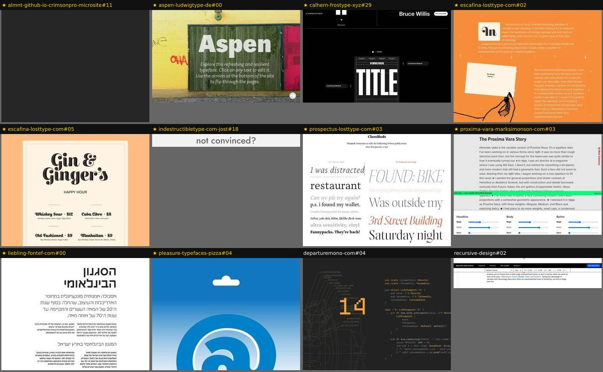

| example | look | feel | ux | learn |
|---|---|---|---|---|
| [★ almnt-github-io-crimsonpro-microsite#11](../../archive/almnt-github-io-crimsonpro-microsite/blocks/11.jpg) | Three editable artefacts on the dark desk: a pale-blue dictionary card 'write (ˈrīt) verb' with four numbered definitions (blank in the desktop capture), a newspaper front 'THE CRIMSON PRO DAILY' (No.53210, Thursday January 18 2020, $3.00) with italic headlines 'Genius, Genocide Denier Or Both', 'Up for Sale: Pop Culture Mementos' and 'MAD TEA', and a manuscript 'Write a book' with a random prompt, 'Give Me a New Prompt', title, overview, characters, Chapter One and a 'New message from agent' notification | Literary, humorous, real-world | Every artefact is contenteditable; 'Give Me a New Prompt' generates a new book idea | Offer several genres of text (dictionary, newspaper, manuscript) as editable layouts so writers test the face in the form they actually use |
| [★ aspen-ludwigtype-de#00](../../archive/aspen-ludwigtype-de/blocks/00.jpg) | Each text box on the photo darkens on hover with a white 'Click to Edit' pill; clicking opens a font menu for that box (hidden select dropdowns, not in the capture) | Editing a poster in a mock-up, not filling a form | Hover box, click, type; the menu has font family (18 styles), size 100-800, alignment, line height, text colour, reset, alternates and figure feature checkboxes, plus share buttons | Put the tester inside a real picture: with per-box controls the visitor makes a shareable poster from the specimen |
| [★ calhern-frostype-xyz#29](../../archive/calhern-frostype-xyz/blocks/29.jpg) | A dark movie-poster template (star ratings row, 'IN CINEMAS 00.00.00', a huge 'TITLE', 'SUB TITLE', a billing block) inside guide lines, with a dark pill style picker beside each text element ('Condensed Medium', 'Wide Heavy'), a 'Publish' toggle above and 'Colour', 'Background', 'Upload Image' controls below | Playful, design-tool | Click any line to type; each pill selects one of 78 styles for its element and can be dragged; Colour and Background pickers recolour the poster; Upload Image adds a photo behind; 'Publish' hides the guides and controls for a clean preview | A fill-in poster template with a style picker per element turns testing into making something worth screenshotting |
| [★ escafina-losttype-com#02](../../archive/escafina-losttype-com/blocks/02.jpg) | Three cream index cards held up by line-drawn hands with painted nails, tilted a few degrees: 'Go ahead, try me…', 'Appropriate / Believable / Compatible / Dealing / Editing…', and stacked fractions '2/3 5/8 5/24' | Hand-made, flirtatious, tactile | The text on each card is editable; the hand's fingers overlap the card edge so the card looks gripped | Sandwich an editable card between a back and a front layer of a hand illustration: the sample feels like a physical object being offered to you |
| [★ escafina-losttype-com#05](../../archive/escafina-losttype-com/blocks/05.jpg) | A tall cream bar menu on peach: inline-shaded 'Gin & Ginger's' logo, 'HAPPY HOUR' in small sans caps, then two columns of twelve cocktails 'Whiskey Sour · $12' in script with ingredient lines in sans, separated by short hairlines | Classy, warm, mid-century lounge | Every drink name, price and ingredient line is editable (25 editors); the logo is an image | A menu is the ideal in-context tester for a script: short names, prices and figures, and a sans for the small print show the pairing at once |
| [★ indestructibletype-com-jost#18](../../archive/indestructibletype-com-jost/blocks/18.jpg) | 'not convinced?' heading and a paragraph saying most of the website is editable, then a borderless centred text field 'Try me out!' | Confident, disarming | Click any heading or paragraph on the page and type; the input below is an explicit prompt for those who need one | Skip tester UI entirely: contenteditable on the page's own prose lets a visitor retype anything at real text sizes |
| [★ prospectus-losttype-com#03](../../archive/prospectus-losttype-com/blocks/03.jpg) | 'Classifieds / Wanted: Someone to edit the following before publication. Give Prospectus a try!' over four comic classified ads in a two-by-two grid, each headed 'Try Prospectus Small / Xtra Large / Large / Medium' in coloured italic, every line in its own weight, italic and colour (black, grey, red, orange, olive): a lost-wallet note, 'FOUND: BIKE', 'Offer: Two vintage barrel chairs … $7,000.00 USD; free if you can trap/kill the large spider…', 'For rent June-July: … Pac Heights' | Funny, lively, newspaper-real | Every line is a separate editable field (60 contenteditable); click anywhere and type, no controls | Give the tester a premise ('edit these classifieds') and write absurd small ads: each optical size gets the job it's designed for and people play longer |
| [★ proxima-vara-marksimonson-com#03](../../archive/proxima-vara-marksimonson-com/blocks/03.jpg) | A grey article panel 'The Proxima Vara Story' with a bold headline, a long run-on body paragraph using small caps, oldstyle figures and ◆ ▶ ★ ● as paragraph markers, and a red byline 'By Mark Simonson' rotated vertically at the right edge; below, three slider groups labelled Headline, Body and Byline (Weight, Width, Slant each) | Like adjusting a magazine page | Headline, byline and body are contenteditable; each group of sliders restyles only its role, so visitors tune a typographic hierarchy, not a single line; the body scrolls inside the fixed-height panel | Give each text role (headline, body, byline) its own axes in one realistic article: the tester teaches pairing styles within one family |
| [★ liebling-fontef-com#00](../../archive/liebling-fontef-com/blocks/00.jpg) | A long right-to-left article 'הסגנון הבינלאומי' (The International Style) in black on white: a bold two-line headline, a large light lead, two-column body, a subhead 'The International Style in Israel', an English section on UNESCO and the White City of Tel Aviv, a medium paragraph, a huge thin pull quote about thousands of buildings in the 1930s–40s, small three-column notes and a bold closing paragraph | Calm, magazine-like, rooted in place | Every element is editable; hovering shows a tiny controller beside it: a size number (72, 36, 16 pt…), a 'פ' set in the current weight and an 'א' in the current alternate, each clicked to cycle size, weight (1–7) or alternate (1–3) | Turn a real article into the tester: each paragraph keeps its role in the layout but gets one-click cyclers for size, weight and alternate, labelled with a glyph shown in that very setting |
| [★ pleasure-typefaces-pizza#04](../../archive/pleasure-typefaces-pizza/blocks/04.jpg) | The flyers' own copy is editable ('Ple@sure in @ny W@y', 'Double your pleasure, double your fun', the seven phone numbers, the description paragraph), and the right column has a blue phone-keypad picture (OK, CLEAR, 1–9, *, 0, #) whose keys type into the phone screen above | Toy-like, nostalgic | Click any flyer headline to retype it; on the keypad, tap a key repeatedly to cycle through its letters (multi-tap: '2abc', '7pqrs'…) and the text appears on the phone's screen | Make the input device part of the fiction: a multi-tap keypad on a phone-shop site makes typing a sample feel like sending an old SMS |
| [departuremono-com#04](../../archive/departuremono-com/blocks/04.jpg) | A sheet of grey tractor-feed printer paper with punched sprocket holes on both edges, holding a Markdown-style '# MISSION REPORT 75X9389 1/17' with subject, earth date, director E. KERNING, '## OVERVIEW', '### OBSERVATIONS' and a box-drawn table of compounds (Methane CH₄ 1450 ppm, Ethane, Water Ice…) | Analog-computer nostalgia | The whole report is an editable <pre>: click and type into the document | Make the realistic document itself editable: the visitor tests the font inside its intended use (technical docs) rather than in a blank box |
| [recursive-design#02](../../archive/recursive-design/blocks/02.jpg) | Every chapter's copy is a markdown document in a code editor: grey line numbers in a left gutter, '## ' and '### ' markers before heavy casual headings, *emphasis* in blue italic with the asterisks visible, `axis tags` in grey pills | Like reading a README in your editor | Click anywhere in the prose and type: it is a live CodeMirror editor; its styling follows the global toolbar | Write the page copy as editable markdown in a code editor: for a coding font, the documentation itself is the most realistic specimen |
| [djr-com-megazoid#08](../../archive/djr-com-megazoid/blocks/08.jpg) | A skeuomorphic beige 'DJR' desk calculator over the letter field and rainbow stripes, its LCD reading '1985' in cyan Megazoid figures, with rounded number keys and coloured operator keys | Tactile, charming | The keypad works like a calculator; results appear in the LCD set in Megazoid's figures | Make a gadget whose display is the font and let visitors press real buttons: the figures get tested without a type tester |

## per-row-controls

Several sample rows, each with its own style, size and leading controls.

**Recognise by:** a control strip on every row

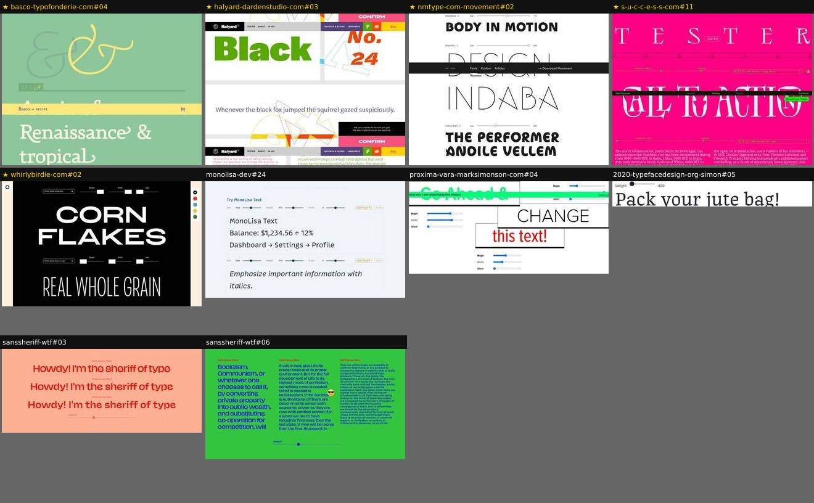

| example | look | feel | ux | learn |
|---|---|---|---|---|
| [★ basco-typofonderie-com#04](../../archive/basco-typofonderie-com/blocks/04.jpg) | 'Recipe' article on flat mint: four text blocks at 144, ~48, 28 and 36px, the first with a small 'TT / I / A' tab on a rule for caps, italic and swash; ampersands in SVG open the section | The article waits for a click | Each paragraph is contenteditable and has its own caps, italic and swash toggles, shown when active; the rest of the page stays intact | Turn the About copy into the tester: three style toggles per paragraph make the swash system discoverable without a separate tool |
| ★ gt-america-com#26 | A full-screen drawer (hidden off-canvas, captured in HTML only) with ~16 sample rows, each with a script select, a style select and width/weight sliders with numeric readouts above editable text at large, medium or small size | Thorough, professional | Opened from the fixed '↓ Type Tester' link; per row: pick script and named instance or 'Variable', drag wdth 50–150 and wght 100–900, type over the sample; RTL rows for Arabic and Hebrew | Keep the tester in a drawer reachable from every screen: the long story page stays clean, and testing is one click away anywhere |
| [★ halyard-dardenstudio-com#03](../../archive/halyard-dardenstudio-com/blocks/03.jpg) | A masonry of five white tester cards on light grey, each in its own colour: 'Black' at 260px in green Display Black, 'No. 24' in orange Micro Black Italic, the sentence 'Whenever the black fox jumped the squirrel gazed suspiciously.' in purple Text, a pink paragraph on legibility vs readability, a green italic paragraph on visual relationships; small dropdowns (optical size, style) top-left of each card, reset and add-to-cart icons at the bottom | Lively, hands-on, like swatch cards | Per card: pick Micro/Text/Display and one of 16 styles, switch the sample between Word / Sentence / Pangram / Paragraph, drag size (12–260px), tracking (-0.1–0.3em) and leading (0.8–2); type over the text; ↻ resets and the cart icon adds that style to the cart | Give each tester card a content-length preset (word → paragraph) and an add-to-cart button: the tester becomes the first step of buying the style you just tried |
| [★ nmtype-com-movement#02](../../archive/nmtype-com-movement/blocks/02.jpg) | Five editable black samples on white, each under a thin control line (style dropdown at left, 'Size' hairline slider with value): BODY IN MOTION (Direct Black, 92), DESIGN INDABA (Direct Thin, 240), THE PERFORMER ANDILE VELLEM (Indirect Black, 100), a Rudolf Laban sentence (Indirect Thin, 50), and DANCE! (Variable, 232) with extra Weight and Space sliders | Spare, gallery-like | Pick one of the four extremes or 'Variable' per row (Variable reveals Weight 100–900 and Space 100–120 sliders), drag size, type over the text | Seed the rows with the project's own story (event, performer, theorist) and give each row one design extreme, ending with a free 'Variable' row |
| [★ s-u-c-c-e-s-s-com#11](../../archive/s-u-c-c-e-s-s-com/blocks/11.jpg) | Hot-pink section under the spaced 'T E S T E R' title: six testers alternating display lines and two-column paragraphs in white ('CALL TO ACTION' Titling Narrow 288px, 'CHASING' Sans Black 360px, '«Romantisme»' Text Black 144px, fermentation paragraphs in Text Light/Regular, one in Ukrainian), each with a hairline neon-green control row above | Generous, workshop-like | Per row: Fontsize slider with px readout, Leading slider, three alignment buttons, a font dropdown of all 18 styles and a small cat button; click the sample to type | Alternate display rows and paragraph rows in one tester stack, so the family's titling and reading cuts are tested at their natural sizes |
| ★ scenik-frostype-xyz#04 | 'Styles' chapter: eight editable specimens from display to mono, each labelled with its style ('FT Scenik Condensed Super' → 'SCOOP' fitted to the full width; 'Condensed Heavy' → 'NEW AT TURNER CONTEMPORARY'; 'Medium' → 'Dreamland ® A one stop ↘ of local culture…'; Text Bold, Regular, Medium paragraphs about Margate's Old Town; 'Mono Light' paragraph), each with a tool row | Editorial, confident, local | Per row: Tracking and Leading sliders, a colour picker (#000000), style-set toggles (Alt a, Internal Dots, Square Dots, Scenders) and Reset; display lines are contenteditable and auto-fit to the width | Give every row its own typographic controls (tracking, leading, colour, sets) with tuned defaults per size: big rows start tight, text rows loose |
| [★ whirlybirdie-com#02](../../archive/whirlybirdie-com/blocks/02.jpg) | A black panel inset on off-white with five editable ad slogans ('CORN FLAKES', 'REAL WHOLE GRAIN', 'STRAWBERRY GOODNESS', 'CAFÉ AROUND BACK →', 'ENHANCED WITH CHOCOLATE BITS'), each under a thin control bar: preset select + Weight, Width, Italic sliders with white rectangular thumbs; a sticky white card of five colour dots on the right edge | Bold, packaging-like, hands-on | Pick a named preset or drag the three axis sliders per row (select switches to 'Custom'); type over any line; the colour dots recolour the panel (black, red, blue, yellow, green themes) | Seed each row with a different extreme of the design space (wide bold, narrow light, narrow italic) and a cereal-box slogan, so the default state is already a specimen |
| [monolisa-dev#24](../../archive/monolisa-dev/blocks/24.jpg) | 'Try MonoLisa Text': two framed rows, each with its own Size 48px / Weight 400 / Grade 0 sliders, OpenType ▼ and Reset above an editable sample: 'MonoLisa Text / Balance: $1,234.56 ↑ 12% / Dashboard → Settings → Profile' and 'Emphasize important information with italics.' | App-UI realistic | Edit each sample; each row's sliders and OpenType menu affect only that row | Seed a UI-font tester with interface strings (balances, arrows, breadcrumbs) instead of pangrams |
| [proxima-vara-marksimonson-com#04](../../archive/proxima-vara-marksimonson-com/blocks/04.jpg) | Three white label boxes with thick black bottom edges, staggered and overlapping like stickers: 'Go Ahead &' in heavy neon green, 'CHANGE' in thin wide black caps, 'this text!' in red condensed; each with its own Weight/Width/Slant sliders beside it | Loud, inviting | Click any line to type; its three sliders restyle only that line; the defaults already show three very different styles | Start each editable line at a different extreme (bold green, thin wide, condensed red) so the range is visible before anyone touches a slider |
| [2020-typefacedesign-org-simon#05](../../archive/2020-typefacedesign-org-simon/blocks/05.jpg) | Four short samples scattered down the page between illustrations, each topped by a tiny 'Weight ●—— 400' slider: 'Pack your jute bag!', 'Grab a chunkyset! / !תפוס ערכת שמנמן', '* innen? / innen!', 'chunky! / !שמנמן' | Light-touch, conversational | Drag a sample's slider to change its weight from 400 to 700 with a live numeric readout; the text is not editable | Pair each themed sample with its own single weight slider and let the samples double as captions for the illustrations around them |
| [sanssheriff-wtf#03](../../archive/sanssheriff-wtf/blocks/03.jpg) | On salmon, 'Howdy! I'm the sheriff of type' three times in red, each under a tiny label (NaN Jaune Maxi, Midi, Mini), with one thin WEIGHT slider below | Playful, comparative | Each line is its own Fontsampler with its optical size locked (dspl 1000 / 550 / 100) and its own weight slider; only one slider shows at a time on desktop, all of them on mobile | Set the same sentence in each optical size at the same point size: the differences in spacing and apertures become the lesson |
| [sanssheriff-wtf#06](../../archive/sanssheriff-wtf/blocks/06.jpg) | On green, three blue editable columns from Oscar Wilde's 'The Soul of Man under Socialism', each labelled in red (Maxi, Midi, Mini) and set at a smaller size from left to right, with a WEIGHT slider under the middle column | Manifesto-like, dense | Each column is a Fontsampler with its optical size locked and its own weight slider (one visible at a time on desktop, all on mobile) | Use one long real text cut into three columns, each optical size at the size it was drawn for |

## creative-toy

A playful maker that turns the font into a composition: patterns, shareable images, style pairings, word-by-word styling.

**Recognise by:** share or download buttons, presets, unusual gestures

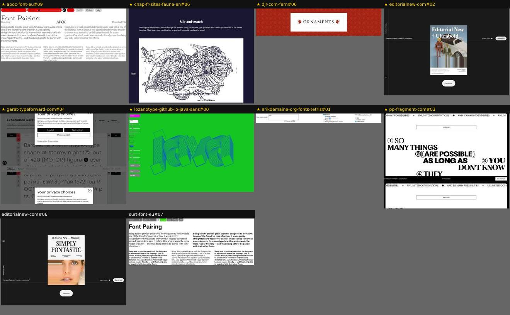

| example | look | feel | ux | learn |
|---|---|---|---|---|
| [★ apoc-font-eu#09](../../archive/apoc-font-eu/blocks/09.jpg) | A red pill toolbar (style dropdown 'Apoc Normal ⌄', Weight slider, a black circular swap icon, then companion chips: red 'Area' selected, grey 'Apoc', 'Oroban', 'Joly', each label in its own font) over an editable 'Font Pairing' headline and paragraphs alternating Apoc and the companion in a 2-up then 3-up grid | Editorial, a layout preview | Choose the Apoc subfamily and weight (100–900); pick a companion Blaze font; the swap button exchanges roles; the headline is contenteditable | Normalise the companion fonts' size and baseline (per-font size factor and top offset) so the pairing compares fairly |
| [★ cnap-fr-sites-faune-en#06](../../archive/cnap-fr-sites-faune-en/blocks/06.jpg) | 'Mix-and-match' on navy: a white card holding a black-line engraving of an animal (top and bottom halves from different animals), up/down arrows at the left and right edges, a row of five 'a' style pickers and the editable line 'Place your text here.' in italic over the drawing; 'Share on Facebook, Twitter or download it.' below. In the capture all engravings render stacked, as the carousel did not initialise | Delightful, crafty | Arrows scroll through animals for each half (mammal, bird, reptile), shuffle randomises, the 'a' buttons pick Thin/Regular/Italic/Bold/Bold Italic/Black, type up to 35 characters, then share or download the combination | Turn the family's concept (hybrid parents) into a toy: visitors breed their own chimera and caption it in the style of their choice, then share it |
| [★ djr-com-fern#06](../../archive/djr-com-fern/blocks/06.jpg) | Under a red 'ORNAMENTS' band (06): an on-screen keyboard whose keys show each Fern Ornaments glyph in red above its letter (Q–P, A–L, Z–B, lowercase too, plus *, Delete, Return, Space), then a left control column (PATTERN TEXT textarea, Presets 1–12, Grid dimensions X/Y, Canvas symmetry X/Y, Pattern symmetry X/Y, 'Copy plain text') beside a large square tiling of red leaves with a distinct border and corners | A Victorian pattern book turned into a toy | Click keys (or type) to edit a tiny 9-slice template: corners, edges and '*' repeat markers; the generator tiles it to the X×Y grid with optional mirror symmetry; presets load ready-made templates; 'Copy plain text' copies the result to paste as live text | Expose the ornament font through a 9-slice template (corner, edge and fill glyphs plus repeat markers) so a few keystrokes produce a full framed border pattern: it teaches how the ornaments are designed to interlock |
| [★ editorialnew-com#02](../../archive/editorialnew-com/blocks/02.jpg) | A portrait poster centred on near-black: an 80s toy photo (action figures beside a white car) under a white serif title 'Editorial New † Ultrabold', a strip of small print and the site URL at the foot; a white 'Randomize' pill below | Fun, vintage-ad, art-directed | Hover a line of the poster (weight, text, background) to reveal a 'Change' pill; click cycles that layer only. 'Randomize' shuffles all three at once | Split a poster into change-able layers (weight, word, photo) with one button each: visitors art-direct a composition without any type controls |
| [★ garet-typeforward-com#04](../../archive/garet-typeforward-com/blocks/04.jpg) | 'Experience Garet' with a gesture legend (Scroll = Font Size, Hold Left = Font Weight, Hold Right = Italic Angle, Spacebar = Letter-spacing); below, a framed editor: black Reset and Set buttons around a 'Type here…' field and a theme toggle, a narrow left column of OpenType samples (fi, ty, aa, вв, 1a, [], 11, A₂, A², ½, 0, ligature X; active one in red), and a large paragraph of mixed Latin/Cyrillic words, numerals, symbols and dingbats (☞ ❺ ⚐ →) at ~58px light weight, each word styleable on its own | Curious, game-like | Hover a word, then scroll to resize it, hold the left button to sweep its weight, hold the right button to slant it, press space to track it out; click a feature cell to apply that OpenType feature; type a new text and press Set (resets all styling); Reset restores the sample; mobile swaps gestures for Weight 50–950, Italic 0–100 and Size 57–384 sliders on the selected word | Map axes to mouse gestures on individual words: visitors style a paragraph word by word and discover the range without a single slider |
| [★ lozanotype-github-io-java-sans#00](../../archive/lozanotype-github-io-java-sans/blocks/00.jpg) | The word 'java' drawn as twisting extruded ribbons of hundreds of thin blue square outlines on a flat acid-green canvas, with a narrow column of unstyled controls at the left: magenta 'random' button, a text box, sliders, three colour swatches, two grey selects and 'save jpg' | Raw, hacky, mesmerising | Type in the box to change the word; sliders set size, spacing, point density, brush scale, stroke weight and rotation speed; selects swap the brush (square, circle, uploaded image) and pick which parameter animates per letter; 'random' rolls colours and settings; 'save jpg' exports the frame. On mobile the menu hides behind 'menu' and 'save' tabs | Sample the font outline into points and stamp a rotating shape along them: one small rule turns any typeface into an animated poster generator, and a save button makes visitors' results shareable |
| [★ erikdemaine-org-fonts-tetris#01](../../archive/erikdemaine-org-fonts-tetris/blocks/01.jpg) | A row of default HTML form controls (textarea 'Enter text to render', checkboxes, a Speed range, a Font select) above a wide white stage where coloured Tetris pieces with black outlines fall onto a grey floor bar and stack into the letters of the typed text | Playful maths demo, game-like | Type in the textarea and the SVG re-renders; Animate replays the drop sequence (Include rotations, Speed 0–10); toggles for Puzzle font (pieces placed at drop height so you decode the letter), Black pieces (dissection puzzle), Grid, Rotation center, Bottom floor; Font select picks the 7-piece font or a one-piece-type font (I light/bold, J, L, S, T, Z); below the stage: GIF width field, Download Animated GIF, Download SVG and 'Hide all but font rendering' (not cut as a block, attached here); 'Obscure in URL' rot13s the text in the shareable query string | When the font is a system of parts, render the text by assembling it from those parts in time: the animation explains the construction rule better than any diagram, and an export button turns it into a toy |
| ★ gt-mechanik-com#22 | Off-canvas powder-pink 'postcard generator' (HTML only): a control column with TONE, WGHT, SLNT and SIZE sliders each above preset buttons (Mono/Semi/Poly; Thin…Black; Uprt/Oblq), Shape / Color / Reset buttons, and a postcard preview with editable 'Coming in loud & clear' and the Grilli Type Brooklyn address | Delightful, tangible | Opened from 'Type Tester' in the tuner bar. Style the message, click 'Create Postcard', slide (stepped 8-frame transition) to an address form, accept terms and 'Send Postcard': Grilli Type mails the printed card | Give the tester a real-world payoff: turning a typed sample into a physical postcard makes testing a gift and a lead |
| [★ pp-fragment-com#03](../../archive/pp-fragment-com/blocks/03.jpg) | 'From Sans to Serif': a white rounded card on black with a marquee 'UNLIMITED COMBINATIONS ● AND SO MANY POSSIBILITIES ✳', a RANDOMIZE button, and a sentence broken into numbered phrases '① SO MANY THINGS ②〖ARE POSSIBLE〗 AS LONG AS ③ YOU DON'T KNOW ④ THEY ARE IMPOSSIBLE', each phrase in a different cut and weight, staggered across the card | Witty, magazine-like | Each click on RANDOMIZE re-assigns cut (Sans/Glare/Serif/Text) and weight to every phrase; the marquee scrolls with the page | A fixed sentence plus a Randomize button proves the cuts mix well without asking the visitor to configure anything |
| [editorialnew-com#06](../../archive/editorialnew-com/blocks/06.jpg) | Second poster on near-black: white top panel with '(Editorial New — Medium)', a two-line capitals headline 'SIMPLY FONTASTIC' and a three-column credit strip, over an 80s beauty close-up of a woman's face; 'Randomize' pill below | Glossy, magazine-cover | Same three hover zones as the first poster (weight, headline text, photo) plus Randomize | Repeat the toy with a different layout (headline-over-photo cover instead of title-on-photo) so the second visit shows another use of the face |
| [surt-font-eu#07](../../archive/surt-font-eu/blocks/07.jpg) | A toolbar of WEIGHT and SLANT slider pills, a reset icon and four font chips (Armag selected in green, Apoc, Oroban, Joly, each label in its own font), over an editable 'Font Pairing' headline and paragraphs alternating Surt Bold and the chosen serif in a 2-up and 3-up grid | Editorial, a layout preview | Pick a companion Blaze font; drag Surt's weight (100–900) and slant (0 to -10); edit the headline; reset restores defaults | Recommend pairings from the foundry's own catalogue as a live layout: the tester also cross-sells |

## global-toolbar

One persistent toolbar restyles all editable samples on the page.

**Recognise by:** sticky bar of selects and sliders

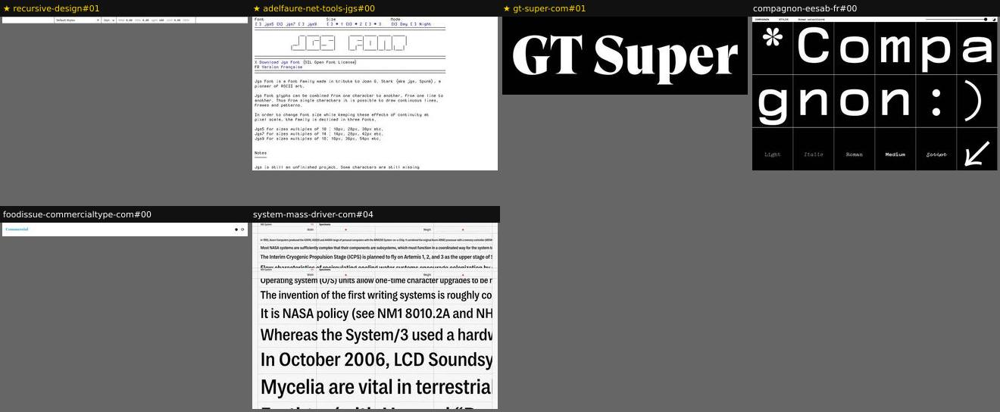

| example | look | feel | ux | learn |
|---|---|---|---|---|
| [★ recursive-design#01](../../archive/recursive-design/blocks/01.jpg) | A 40px white toolbar pinned under the fixed nav: a 'Default Styles' dropdown, a '15pt' size dropdown and a readout 'MONO 0.00 CASL 0.00 wght 400 slnt 0.00 CRSV 0' that expands into sliders, plus an invert-colours toggle | Like an app's font panel | Choose one of 66 named instances (Mono Casual Light … Sans Linear ExtraBlack Italic) or [Custom Styles]; open the size panel (6–60pt) or the variability panel (MONO 0–1, CASL 0–1, wght 300–1000, slnt −15–0, CRSV off/auto/on radios); everything set here restyles the editable prose of every chapter; one control inverts the page | One sticky toolbar that drives all the page's body copy lets visitors read the whole story in the style they are evaluating |
| [★ adelfaure-net-tools-jgs#00](../../archive/adelfaure-net-tools-jgs/blocks/00.jpg) | First line of the page, written as text: 'Font [ ] jgs5 [X] jgs7 [ ] jgs9 · Size [ ] * 1 [X] * 2 [ ] * 3 · Mode [X] Day [ ] Night', blue link labels with a ===== rule beneath | Terminal-like, self-consistent | Each '[ ]' is a link that sets a class on <body> (jgs5|jgs7|jgs9, x1|x2|x3, day|night): the whole page, art included, re-renders in that font, pixel multiple or colour scheme; the X moves to the chosen option | Build the switches out of the font's own characters ('[X]' radio buttons) and let them restyle every figure on the page: the specimen tests itself |
| [★ gt-super-com#01](../../archive/gt-super-com/blocks/01.jpg) | A single hidden style bar (HTML only) of labelled button groups: Subfamily Text/Display, Weight Book–Black or Light–Super, Italic, Size XS–XL, Align Left/Center, Case Normal/All Caps/Small Caps, Alternates, Figures Oldstyle/Lining, Reset, Exit Editor | Like a word processor's ribbon set in the font | Every heading and paragraph on the page (20 contenteditable blocks) is a .stylebar-editable; focusing one moves the one style bar onto it and the buttons toggle sb-* classes on that block; choosing a weight disables the block's weight-gradient 'rainbow' styling | Make the long read itself the tester: one bar that jumps to whichever paragraph you click turns every story paragraph into a sample, with no separate tester section |
| gt-standard-com#10 | Bottom drawer opened by 'try' (fixed, white): a control column with weight 700, width 100, optical 30 and slant 0 sliders with live values and a proportional / monospace toggle, beside a waterfall of five editable rows labelled 200px, 100px, 50px, 25px and 18px ('simple geometry', 'simple geometry is the backbone of typography', paragraphs) | Calm, utility | Every slider restyles all five rows at once; type into any row; sizes are fixed per row and labelled in red | Label each row with its pixel size in the brand red so the waterfall reads as a size scale |
| [compagnon-eesab-fr#00](../../archive/compagnon-eesab-fr/blocks/00.jpg) | Sticky white header bar over the grid: 'COMPAGNON', 'STYLES' (hover menu), 'Roman selectionné', and at the right a long black slider with a round knob plus a half-filled circle colour-mode icon | Quiet, utilitarian | The slider (1–6, default 6) sets the number of cells per row, which rescales every sample on the page; the circle icon switches the colour mode of all cells; any cell can be clicked and retyped | Make the grid density the size control: fewer columns means bigger samples everywhere, with no per-sample settings |
| [foodissue-commercialtype-com#00](../../archive/foodissue-commercialtype-com/blocks/00.jpg) | Two 19px icon buttons in the sticky header: a filled dot (theme toggle) and a circular arrow (randomize type pairing) | Discreet, playful once found | The ↻ button picks a new display/text family pairing from Commercial Type's catalogue (Feature, Action Condensed, Frame, Algebra, Review…) and re-sets the whole issue in it, rotating the icon each time; the dot flips light/dark. Per the editor's note, the article subpages add leading and point-size controls | One 'shuffle the pairing' button turns a static magazine into a pairing explorer: every click shows the same real content in another headline/text combination |
| gt-maru-com#14 | A full-screen overlay (captured in HTML only) titled 'TYPE TESTER' with 'Download Trial Fonts ↗ / Buy Licensing ↗' at the top and ~18 editable rows grouped by subfamily and style, each with meta labels (subfamily, style, px size): 'Futomaki 😃', 'THICK SUSHI ROLL with colorful fillings', 'Omurice 🥚', 'Takoyaki 🐙', 'Hambāgu 🍔', 'Kanpai 🍻', Mega 'Hassaku 🍋', 'MADE IN JAPAN Buy Worldwide'; a fixed toolbar at the bottom with '↑ SELECT STYLE' picker, font-size slider, family radios (GT Maru / Mono / Mega), Weight and Oblique sliders, or Optical Size plus Outline / Shaded / Glow checkboxes for Mega | A Japanese menu you can rewrite | Opened from 'Try' or any 'TYPE TESTER ↗'; click a row to select it, then the shared toolbar restyles that row (family, style, size, axes, Mega styles); every row is editable and includes emoji | Use one shared toolbar that edits whichever row is selected: many rows stay clean, and every row can still be tuned |
| overpassfont-org#03 | Hidden views (HTML only, never shown in the capture) opened by the 'TRY IT' / 'TRY MONO' tabs: a row of weight radios labelled '2 00' … '9 00', an 'italic' checkbox and one 'Type Here' text field above tabbed sample panels | Bare-bones, CSS-trick tester | Typing in the single field rewrites every sample (.tr) on both views; weight radios and the italic checkbox restyle all samples; sub-tabs switch 'waterfall | glyphs | variants' (proportional) or 'glyphs | syntax | display' (mono) | A whole tester can run on radio inputs and :checked sibling selectors, with only one line of JS to copy the typed text into every sample |
| [system-mass-driver-com#04](../../archive/system-mass-driver-com/blocks/04.jpg) | Under a control row with Width and Weight sliders (dashed tracks with orange-red dots), a waterfall of 12 editable single lines growing from ~14px to ~136px, each a factual sentence containing 'system' (Acorn System-on-a-Chip, NASA subsystems, International System of Units, System/3, LCD Soundsystem, ecosystems, the Space Launch System), clipped at the right edge | Dense, encyclopedic, witty | Two sliders restyle every line at once (wdth 50–100, wght 400–800); click any line to edit | Fill a waterfall with true sentences that all contain the family's name word: the sample text becomes a running joke and still reads as real copy |

## pointer-xy-axes

The pointer's x and y position (or device tilt) each drive one variable axis, with edge tracks or labels showing live values; no sliders to grab.

**Recognise by:** axis labels at the edges, moves with the cursor

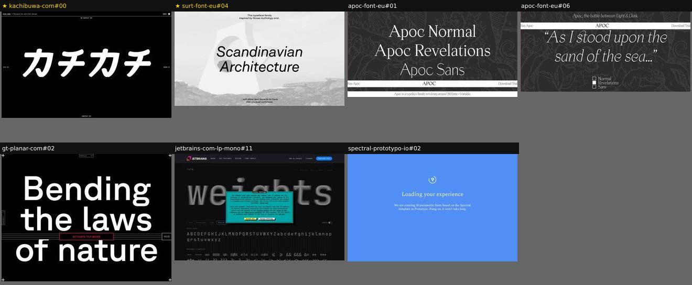

| example | look | feel | ux | learn |
|---|---|---|---|---|
| [★ kachibuwa-com#00](../../archive/kachibuwa-com/blocks/00.jpg) | The whole site and its hero: 'カチカチ' (kachi-kachi, 'click-clack') in white, ~250px tall, centred on black, with four small edge labels: 'NO CONTRAST 50%' top centre, 'CONTRAST 50%' bottom centre, 'KIKI 0%' left middle, 'BOUBA 0%' right middle. Screen 01 shows a second state (KIKI/BOUBA 50%) where the strokes turn sharp and the horizontal strokes thin into long hairlines that run past the letters | Experimental, tactile, witty (the kiki/bouba sound-shape effect as a font axis) | No handles to grab: moving the pointer left↔right blends the stroke ends from spiky 'kiki' to round 'bouba' (axis KIKI), up↔down blends from no contrast to high contrast (axis CONT); the edge labels count the percentages live. The heading carries data-reset and a 'contenteditable' class, so the word can apparently be retyped and reset. The capture is a wheel capture: the second screen is the same component in another axis state | Name the four edges of the screen after the extremes of two axes and print their live percentages there: the viewport itself becomes the 2D slider and its legend |
| [★ surt-font-eu#04](../../archive/surt-font-eu/blocks/04.jpg) | Washed-out grey photo of a white monolith ampersand sculpture on rocks, with 'Scandinavian / Architecture' at ~74px in italic centred and small italic lines above ('This typeface family, inspired by Norse mythology and…') and below ('…will allow text layouts to have this unusual corkiness.') | Airy, sculptural | Moving the pointer over the panel drives width horizontally (wdth 100–200) and weight vertically (wght 100–900) at a fixed slant -10; a small HUD shows the live values ('+ wdth : 114, slnt : -3') | Frame the phrase as a sentence fragment with lead-in and follow-on lines: the morphing words stay readable as copy |
| [apoc-font-eu#01](../../archive/apoc-font-eu/blocks/01.jpg) | A dark charcoal panel textured with a faint engraved apocalypse woodcut, the three subfamily names 'Apoc Normal / Apoc Revelations / Apoc Sans' centred in white at ~122px, each in its own subfamily; caption below 'Apoc is a typeface family revolving around 26 fonts + Variable.' | Solemn, rich, engraved | Moving the pointer horizontally across the panel drives the weight of all three lines (wght 100–900, default 400); no visible slider | A pointer-driven weight panel needs no UI: the three subfamily names set in themselves become both overview and tester |
| [apoc-font-eu#06](../../archive/apoc-font-eu/blocks/06.jpg) | The same dark engraved panel with a small italic title 'Apoc, the battle between Light & Dark.' and a two-line italic quote '“As I stood upon the sand of the sea…”' in white at ~110px, over three square radio buttons 'Normal / Revelations / Sans' | Biblical, theatrical | Pointer x drives weight 100–900 (starts at Thin 100, the 'light'); radio squares switch the subfamily | Starting the pointer tester at the thinnest weight under the line 'battle between Light & Dark' makes the gesture itself the metaphor |
| [gt-planar-com#02](../../archive/gt-planar-com/blocks/02.jpg) | 'Bending / the laws / of nature' huge in white inside a frame with corner crosses, an 'ANGLE: 0°' puck on a top track and a vertical 'WEIGHT: 0' puck on the left track | Direct, gravity-defying | Moving the pointer left–right bends the text from −45° to +45° and up–down changes weight, the pucks sliding along their tracks with live values; on touch devices a red 'Pilot needs to activate tilt mode' button requests device-motion permission so tilting the phone drives the axes; the fixed bar says 'move mouse' | Map slant to horizontal pointer movement: the gesture literally leans the text, so the axis is understood by the body |
| gt-alpina-com#17 | A hidden overlay (HTML only): an x-axis bar and a y-axis bar along the viewport edges, each labelled None/Size/Weight/Width/Contrast with a position dot, plus round buttons ✕, ▶, I, M, ↺ and 'Select Style ↑' opening a 7-column picker (Condensed, Standard, Extended, Fine Condensed, Fine Standard, Fine Extended, Typewriter × Thin–Bold Italic) | Instrument-like, exploratory | Focus a paragraph → overlay appears with that paragraph's default axes (data-default-axes, e.g. '2,1' = Width on x, Weight on y); moving the pointer sweeps the two axes; click an edge label to change its axis; I and M toggle italic and Typewriter; ▶ plays an automatic 'disco' sweep; ↺ resets; ✕ closes | Turn the whole viewport into a 2-axis pad for whatever text the visitor is reading: no sliders to find, and every paragraph is a tester |
| gt-pantheon-com#10 | Beyond the capture (HTML only): Act III 'The Epilogue or, the Family Affairs' with a paragraph, then an inscription composition ('BC Roma', '{ritus} quantus', 'NON BENE PRO Alis Grave Nil ❺ Venditur Auro!', 'OCULUS SINISTER (O.S.)', '· M · AGRIPPA · L · F · COS · TERTIUM · FECIT ·') framed by a gold horizontal slider on top and a vertical rule at the left; caption 'Fig. 3. Optical & Weight Axes of GT Pantheon · Optical Size: • Weight:' | Epigraphic, hands-on | A 2D pad with no handles to grab: pointer x sets optical size 10–32, y sets weight 300–900 (cursor nesw-resize); the gold edge tracks and the Fig. 3 readouts follow | Use a real inscription (the Pantheon's own 'M·AGRIPPA…FECIT') as the sample for the final 2D axis pad: the story closes on its origin |
| [jetbrains-com-lp-mono#11](../../archive/jetbrains-com-lp-mono/blocks/11.jpg) | 'JetBrains Mono font family': the word 'weights' at ~250px across the full width, with a motion-blur ghost while it changes, a weight label ('THIN') at top-left and a hint '<<<<< Move mouse over the word to change' at top-right | Tactile, quick | Moving the pointer horizontally across the word steps it through the eight weights (Thin → ExtraBold) and updates the label | Let the pointer's x-position scrub through a static family's weights: no slider, and the word itself names what changes |
| [spectral-prototypo-io#02](../../archive/spectral-prototypo-io/blocks/02.jpg) | From HTML only (loader covered the capture): a bento of glyph tiles, 'S' (~576px) with three parameters, 'a' for Thickness, 'xyz' with serif height and bracket curve, 'Oo' for curviness and 'ec' at ~800px for contrast | A lab bench of dials with no dials | Each tile is its own pad. Horizontal pointer movement changes one parameter and vertical movement another (arrows along the edges mark each direction, top and bottom edges can drive different parameters); on touch, slide a finger in the box. A legend names the parameter | Pick the letters that show a parameter best and give each its own pad: 'S' for serifs, 'Oo' for curviness, 'ec' for contrast. The choice of glyph teaches what the axis does |

## auto-fit-editable-lines

Editable display lines that rescale to fill the column width as you type; no size or axis controls, at most a style switch for the stack.

**Recognise by:** full-width editable lines, no sliders

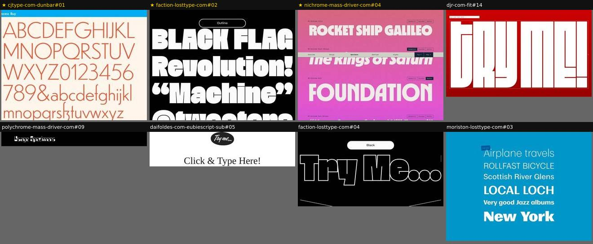

| example | look | feel | ux | learn |
|---|---|---|---|---|
| [★ cjtype-com-dunbar#01](../../archive/cjtype-com-dunbar/blocks/01.jpg) | Twelve pastry names from many languages (MELONPAN, Blåbärssoppa, Franzbrötchen, BAUMKUCHEN, Garrapiñadas, Nußecken, Baba-de-Moça, Berliner, KEŞKÜL-Ü FUKARA, Pfeffernüsse, Vanillekipferl, Crème anglaise) in bright blue, each filling the column width in a different style, with a tiny highlighted style label below ('Dunbar Low Regular', 'Dunbar Tall Light' …) | Tasty, lively, global | Click any word to type; size-to-width.js rescales the line to the column width; each label links to the shop entry | Pick words with the diacritics and special letters (å, ß, ñ, ç, ş) the family covers, so the fit-to-width editable list doubles as a language-coverage check |
| [★ faction-losttype-com#02](../../archive/faction-losttype-com/blocks/02.jpg) | Seven white lines each filling the column at ~190px ('BLACK FLAG', 'Revolution!', '“Machine”', '@tweeters', 'ÆSKUÁR 23', '₹2,93,8415', '©Copyright') under an outlined pill button labelled 'Outline' | Wall-of-slogans, protest poster | Click any line to retype it; it re-fits to the full width as it grows or shrinks. The pill button swaps the whole stack between Black and Outline (its label names the other style) | Auto-fitting each editable line to the measure keeps a display tester looking like a poster whatever the visitor types; choose default words that smuggle in the awkward glyphs (Æ, Á, ₹, ©, @, curly quotes) |
| [★ nichrome-mass-driver-com#04](../../archive/nichrome-mass-driver-com/blocks/04.jpg) | Eight full-width cream lines on a pink → magenta → violet → cobalt gradient, each a sci-fi title ('ROCKET SHIP GALILEO', 'The Rings of Saturn', 'FOUNDATION', 'Have Space Suit – Will Travel', 'Fahrenheit 451', 'THE LEFT HAND OF DARKNESS', 'Roadside Picnic', 'EQUATOR') in another weight/oblique, with a mono style label at left and a Geometric | Rounded | Gothic toggle group at right | Evocative, bookshelf-like | Click a line to type; the font size recomputes so the line always spans the column; the three toggles switch stylistic sets SS01–SS03 for that row (one highlighted dark when on) | Use real titles from the genre the font comes from: each line reads like a paperback cover, and fit-to-width keeps every edit looking composed |
| [djr-com-fit#14](../../archive/djr-com-fit/blocks/14.jpg) | On red, a small white input 'Type your text here...' above a thin-framed box holding 'TRY ME!' in white Fit, filling the box edge to edge | Toy-like, immediate | Type in the input and the box text updates and refits; drag the frame's handles (n/s/e/w) to change the box and watch the width change | Pair an input with a resizable box: the visitor tests both their text and the space it has to fill |
| [polychrome-mass-driver-com#09](../../archive/polychrome-mass-driver-com/blocks/09.jpg) | Under 'Usage Specimens', four groups each introduced by a small grey style label on a hairline (MD Polychrome Giga, Mega, Kilo, Nano), with two grey editable lines filling the column: 'JUPITER-2 / M74 Galaxy', 'LIQUID MERCURY / Monolith Dreaming', 'SUPER-CONDUCTIVE MATERIALS / June 3, 1965: First U.S. Spacewalk', a Le Guin quote and 'MICR Technology Demo' | Retro space-program, dramatic | Click any line to type; the size recalculates to fill the width; text selection uses a pink or blue highlight per size | Group fitted lines by optical size so the visitor sees the thin strokes thicken as the sizes shrink |
| [daifoldes-com-eubiescript-sub#05](../../archive/daifoldes-com-eubiescript-sub/blocks/05.jpg) | A black oval sticker 'Try me…' above one centred editable line 'Click & Type Here!' at ~96px (fallback serif in the capture; meant to be Eubie Script) | Inviting, toy-like | Click the line and type; the container id 'bigtext' points to a fit-to-width script (BigText) that rescales the line to the column as you type; no other controls | For a single-style script, one big auto-fitting editable line is enough of a tester: the only question the buyer has is how their own word looks |
| [faction-losttype-com#04](../../archive/faction-losttype-com/blocks/04.jpg) | One huge outlined line 'Try Me...' with a blinking caret at its end, under a white-filled pill button 'Black'; a thin white chevron line below points down into the story | Direct invitation | The line is editable and re-fits to the column as you type; the pill toggles the line between Outline and Black | Put a single 'Try Me...' line with a visible caret after the showcase: the prompt is the instruction, no label needed |
| [moriston-losttype-com#03](../../archive/moriston-losttype-com/blocks/03.jpg) | On saturated blue, six white lines stepping from Light to Black, all justified to the same width: 'Airplane travels', 'ROLLFAST BICYCLE', 'Scottish River Glens', 'LOCAL LOCH', 'Very good Jazz albums', 'New York' | Crisp, travel-poster | One editable block; every line is re-fitted to the column, so typed text always forms a justified weight ramp | Fit every line of a weight ramp to the same measure: the weights read as a clean block, and the default words retell the origin story (bicycle, Scotland, New York) |

## code-playground

A mock code editor with language tabs and themes, set in the (coding) font, with font controls.

**Recognise by:** syntax highlighting, editor chrome

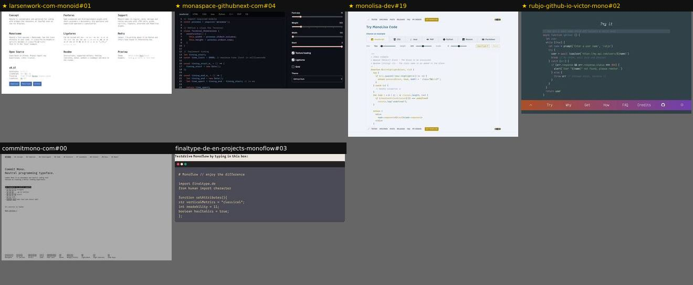

| example | look | feel | ux | learn |
|---|---|---|---|---|
| [★ larsenwork-com-monoid#01](../../archive/larsenwork-com-monoid/blocks/01.jpg) | Under the fact grid, a 'Preview' card (Theme: White Light Dark Black; Example: test c py swift js less html) and the 'v0.61' settings form (Alternates $ 0 1 l, LineHeight XS S M L XL, Tracking Tight ½Tight Normal ½Loose Loose, Ligatures On Off) drive a full-width ~3000px dark code view: the Pango language sample table in C with orange strings and grey italic comments, ending in a 'Jump back up' link | An editor you already know | Click a theme to recolour the code view; click an example to swap the file (Swift, Python, JS, LESS, HTML, C); 'test' is an empty contenteditable editor ('Type or paste your own code here… characters with alternates: $ * 0 1 3 l'); alternate checkboxes, line-height and tracking radios and the ligature switch restyle the preview live and persist (garlic.js); a pink fixed alert warns that alternates and ligature-off previews fail in Safari/iOS; 'Jump back up' returns to #settings | Wire the download options and the preview to the same controls: the visitor sees their exact build (alternates, spacing, ligatures) in real code before downloading it |
| [★ monaspace-githubnext-com#04](../../archive/monaspace-githubnext-com/blocks/04.jpg) | A real code editor (line numbers, syntax colours) with language tabs JavaScript / HTML / CSS / Java / Python / C++ / PHP / F#, beside a sidebar of four sliders with live values, three checkboxes and a Theme select | Like trying the font inside your own editor | Pick the family with the cards above, a language tab swaps the sample program, the editor is fully editable; sliders for Font size 10–48 (16), Weight 200–800 (300, ticks per named weight), Width 100–125 (ticks Normal/SemiWide/Wide), Slant -11–0 (ticks Italic/Upright); checkboxes Texture healing (calt), Ligatures, Grid overlay; Theme select with 8 editor themes | For a coding font, test inside a real editor (CodeMirror) with editor themes and feature switches named by what they do (Texture healing, Ligatures) rather than by tag |
| [★ monolisa-dev#19](../../archive/monolisa-dev/blocks/19.jpg) | 'Try MonoLisa Code': a segmented row of language tabs with logos (JavaScript, CSS, Java, PHP, Python, Reason, Markdown), a control row (Size 15px, Weight 400, Grade 0 sliders, an 'OpenType ▼' dropdown and a Reset button), then an editable, syntax-highlighted code pane (JSDoc comment in grey italic, keywords in gold, strings in teal) | Like your own editor, nicer | Pick a language to load its sample; edit the code directly; Size 10–96px, Weight 1–900, Grade -50…50; the OpenType dropdown toggles features; Reset restores defaults | Keep the playground's chrome minimal (tabs + three sliders + one feature menu) and make the code itself editable, highlighted live |
| [★ rubjo-github-io-victor-mono#02](../../archive/rubjo-github-io-victor-mono/blocks/02.jpg) | 'Try it' heading in cursive italic above a slate-teal CodeMirror editor showing a ~20-line async JavaScript function with Oceanic Next syntax colours; comments and keywords like 'true' render in the cursive italic | Like opening your own editor | Click into the code and type: a real CodeMirror instance with highlighting, active-line background and ligatures live; no font controls; a caption links to the matching VS Code/Sublime theme | For a coding font the most convincing tester is a real editor with a real theme, where the syntax highlighter decides where the italic appears |
| [commitmono-com#00](../../archive/commitmono-com/blocks/00.jpg) | Section 07 'Customize', HTML only: tabs for 8 rival fonts ('Compare different fonts': Commit Mono, Fira Code, JetBrains Mono, Source Code Pro, Cascadia Code, Consolas, Menlo/Meslo, Google Sans Code) and 12 language samples above a code example, with radio ladders for weight, spacing and line height | An honest comparison in the visitor's own language | Pick a language sample or 'Code Tests'; switch to a rival to compare the same code; the weight, spacing and line-height ladders restyle it at once; ENTER edits | Keep rivals one keypress from your own font in the same code sample: confidence is persuasive, and the comparison happens where the choice is made |
| [finaltype-de-en-projects-monoflow#03](../../archive/finaltype-de-en-projects-monoflow/blocks/03.jpg) | 'Testdrive Monoflow by typing in this box:' above a mock editor window: a black title bar with red, yellow and teal dots and a slate-grey body with ten lines of cream code ('# Monoflow // enjoy the difference', 'function setAttributes(){', 'int readability = 11;') | Cosy, developer-friendly | The code body is contenteditable; no syntax highlighting, themes or font controls | A plain editor chrome (three dots and a dark body) is enough context to make an editable box read as 'your IDE' |

## palette-editor

One editable sample in a colour font with a colour picker per palette layer (outline, fill, gradient stops, randomise) that rewrites the palette live.

**Recognise by:** colour swatches beside a colour-font sample

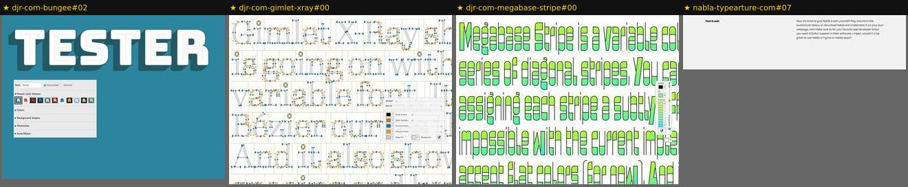

| example | look | feel | ux | learn |
|---|---|---|---|---|
| [★ djr-com-bungee#02](../../archive/djr-com-bungee/blocks/02.jpg) | A huge layered 'TESTER' fills the top of a teal panel, with a small grey form below: text field, Horizontal/Vertical radios, preset colour theme chips drawn as an R, then collapsible Colors, Background shapes, Alternates and Save/Share | A sign shop's order form | Type to change the sign; flip orientation; click one of 11 themes or set a colour per layer; add banner start, end and block shapes; tick alternates; then copy a permalink or download SVG, PNG or PDF | Make the tester produce a finished artefact: per-layer colours, sign shapes and a server-rendered SVG, PNG or PDF export turn it into a free sign maker, and the URL holds the whole state so any result can be shared |
| [★ djr-com-gimlet-xray#00](../../archive/djr-com-gimlet-xray/blocks/00.jpg) | The whole first screen and beyond: ten lines of 'Gimlet X-Ray showcases the mechanics of what is going on with the guts inside of an OpenType variable font…' in a light Gimlet whose glyphs are drawn as thin black outlines on a translucent grey fill, studded with blue square on-curve points and orange round off-curve points on handles, each glyph inside a thin orange advance-width box, small orange-framed squares marking kerning pairs; a two-part floating panel at the right (Weight/Width sliders; Glyph Outline, Other Outlines, Oncurve Points, Offcurve Points sliders each with a colour swatch; Glyph Fill and Background swatches; ↺) | Like looking at a font in a font editor, made friendly | Type into the text; Weight (200–900) and Width (80–100) reshape the letters and move every point with them; the four anatomy sliders thicken the outlines (LINE, PTLN 2–10) or enlarge the points (ONCR, OFFC 4–36); each swatch opens a Spectrum colour picker that rewrites that palette layer; ↺ randomises all colours; the panel stays fixed while scrolling | Expose the drawing itself as variable axes (point size, outline weight) of a colour font: the specimen becomes an explanation of how type is built, and visitors learn Bézier anatomy by playing |
| [★ djr-com-megabase-stripe#00](../../archive/djr-com-megabase-stripe/blocks/00.jpg) | The first screen is the tester: eight lines of 'Megabase Stripe is a variable color font that divides each glyph into a series of diagonal stripes…' in tall, narrow, black-outlined capsule letters filled with lime-to-cyan diagonal stripes, running off the right edge; a narrow floating panel at the right edge holds swatches labelled Outline, Fill and Gradient (ten stops), a vertical SLANT slider, an 'Auto gradient' checkbox, a ↺ button, and a separate background swatch below | Electric, toy-like, slightly psychedelic | Click into the text to type; pick any swatch to recolour that layer across the whole text; with Auto gradient on only the two end stops are editable and the eight between interpolate; ↺ randomises all colours; the slider slants the letters (slnt -15 to 15); the panel stays fixed while you scroll | Give each colour layer of a COLR font its own swatch and interpolate the stops between two ends: visitors understand a 'fake gradient made of flat stripes' by making one |
| [★ nabla-typearture-com#07](../../archive/nabla-typearture-com/blocks/07.jpg) | After a grey 'Test it out!' prose band, a white control panel (Size, Line height, Background gradient swatches, Depth, Highlight, Color palette select, a row of ten 'Custom colors' swatches) above a blue-to-navy gradient field with 'Give Nabla a go yourself!' in 200px Nabla | Generous, toy-box | Click to type in the sample; sliders change size, leading and the two axes live; the palette select picks one of 7 built-in palettes; each colour swatch overrides one palette layer; two swatches set the background gradient | For a colour font, expose the palette itself: one colour input per layer rewrites the font's colours live, next to the built-in palette presets |

## feature-toggle-board

One big sample line plus a panel of OpenType feature toggles labelled with their tags.

**Recognise by:** ss01, dlig, case toggles

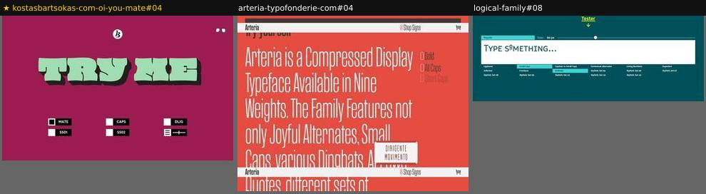

| example | look | feel | ux | learn |
|---|---|---|---|---|
| [★ kostasbartsokas-com-oi-you-mate#04](../../archive/kostasbartsokas-com-oi-you-mate/blocks/04.jpg) | Full-screen colour panels with one giant editable sample ('TRY ME' mint on maroon; '¿¡12.609 tweets only!?' violet on coral; Greek 'Άυλες αυλές…' olive on off-white) above a row of black-and-white chip checkboxes labelled MATE, CAPS, DLIG, SS01, SS02 or ZERO and a small slider chip | A chunky game menu | Click to edit the text. Each chip flips an OpenType feature; MATE shows or hides the shadow layer; the first panel's slider sets size or leading (range 0–100, value 50) | Tailor the toggle set and the sample to each panel: ZERO only appears with numerals, Greek with CAPS and SS02, so every panel tests what it shows |
| [arteria-typofonderie-com#04](../../archive/arteria-typofonderie-com/blocks/04.jpg) | 'Try yourself' on red: one huge editable white paragraph in Arteria Light describing the family, and on the right a column of checkbox labels: Bold, All Caps, Short Caps, Closed CJc, Narrow Jr, Italian A, Single-story a, Long Q | Inviting, spacious | Click the paragraph to type; each checkbox applies a style or OpenType feature to the whole paragraph; options cascade in as the section scrolls into view | Name feature toggles after what they do to letters ('Italian A', 'Long Q'), not after tags |
| [logical-family#08](../../archive/logical-family/blocks/08.jpg) | 'Tester ↓' on dark teal: a turquoise style select ('Regular'), 'Size: 60 px' with a thin slider, a white editable box reading 'TYPE SºMETHING…' (small caps and ordinals on), and a grid of feature toggles (Ligatures, Small Caps, Capitals to Small Caps, Contextual alternates, Lining Numbers, Superiors, Inferiors, Fractions, Ordinals, Stylistic Sets 05–20) with active ones highlighted in turquoise | Tool-like, tidy | Type in the box; pick a style; drag size 8–200px; click feature names to toggle them | Pre-activate a couple of features in the default prompt so the visitor sees toggles do something before touching them |

## xy-pad

One editable sample beside a 2D pad: dragging one handle sets two axes at once (e.g. weight × optical size).

**Recognise by:** square pad with a crosshair handle

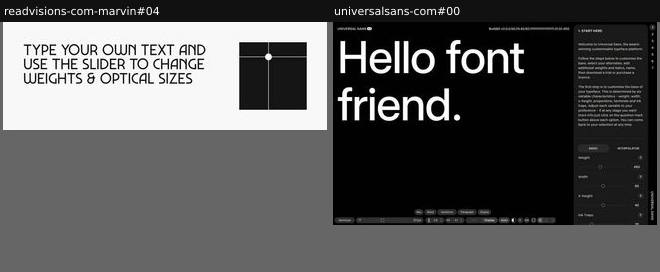

| example | look | feel | ux | learn |
|---|---|---|---|---|
| [readvisions-com-marvin#04](../../archive/readvisions-com-marvin/blocks/04.jpg) | On off-white, three lines of editable caps 'TYPE YOUR OWN TEXT AND USE THE SLIDER TO CHANGE WEIGHTS & OPTICAL SIZES' at left, and at right a black ~300px square with thin white crosshair lines meeting at a white dot | Clean, instrument-like | Click the text to type; drag the dot inside the square: one direction changes font-weight, the other changes optical size (opsz 80–99), and the text size scales along with it | When two axes are coupled in practice (weight and optical size), give them one 2D handle instead of two sliders |
| [universalsans-com#00](../../archive/universalsans-com/blocks/00.jpg) | Behind the INTERPOLATOR tab of step 1 (HTML only, not visible in the capture): a square 10×10 grid pad with a crosshair (x line labelled 'rnds 50', y line 'wght 450') and a dot at the current value, above two dropdowns choosing which axis drives X and which drives Y | Exploratory, instrument-like | Drag the dot to set two axes at once; the dropdowns assign any of Weight, Width, Proportions, X-height, Terminals, Ink Traps or None to each direction | Let visitors choose which two axes the pad maps, so one small control explores every pair in a six-axis design space |

## mockup-generator

A short text field (with style and colour pickers) whose input is rendered into a wall of realistic scenes (billboards, gadgets, screens), so visitors see their words in use.

**Recognise by:** input field above a grid of mockups

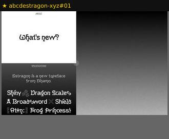

| example | look | feel | ux | learn |
|---|---|---|---|---|
| [★ abcdestragon-xyz#01](../../archive/abcdestragon-xyz/blocks/01.jpg) | Split screen: on the left a white panel with the editable line 'What's new?' over three grey pill buttons (Aa · Generate · colour), above a black-gradient panel; on the right a grey-gradient wall where tilted, irregular frames fly in and settle into six looping clips that each show the same words: a Tamagotchi screen, a 'NEXT EXIT' highway billboard, a cassette label, a MacPaint window, a typewriter page and a chrome skull | Nostalgic, uncanny, gift-like | Type up to 22 characters, cycle the style (Aa: stylistic sets Wildstyle / Arrow / Bubble) and colour, press Generate; the frames re-render with your text; a round handle on the split lets you resize the panels | Render the visitor's own words into many familiar objects at once: a 22-character input becomes a whole in-use campaign |

## write-on-playback

Editable samples in a font with a time (write-on) axis: a play button draws the text stroke by stroke and a timeline slider scrubs it.

**Recognise by:** play button, timeline scrubber

| example | look | feel | ux | learn |
|---|---|---|---|---|
| kermit-font-com#05 | Not captured (the Write screen came out black). From the HTML: six stacked editable samples in Kermit Roman and Italic at weights 100–800 ('I can write.', 'I am Kermit.', 'That's right!', 'Read & enjoy.', 'Panta Rhei', 'Right to read.'), each with a '▶write' button and a thin timeline slider; top bar 'get license' and '▶write all' | Magic-slate: the computer writes your words like a hand would | Type in any sample; ▶write animates it being written stroke by stroke; drag the 'write frame' slider (0–1000) to scrub; '▶write all' plays every row at once; two writestyle modes per row | When the font has a time axis, the tester's main control is a play button and a timeline, not size or weight |

## outline-editor

The visitor drags a glyph's outline points and Bézier handles, with undo/redo, reset and image download.

**Recognise by:** points and handles on a big glyph

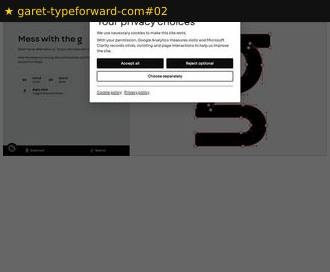

| example | look | feel | ux | learn |
|---|---|---|---|---|
| [★ garet-typeforward-com#02](../../archive/garet-typeforward-com/blocks/02.jpg) | 'Mess with the g' at left with two lines of copy and a keyboard legend (Ctrl+Z Undo, Ctrl+Y Redo, Right Click Toggle Shape Outlines); at right a huge black alternate double-storey 'g' on a canvas, its outline traced in red with square on-curve points and round handles; Download and ↻ Rewind buttons in a black strip under the text | Hands-on, a bit irreverent | Select any point and drag it or its handles to deform the g; Ctrl+Z / Ctrl+Y undo and redo; right-click toggles the outline view; Rewind animates back to the original; Download exports the result as an image with a transparent or solid background (desktop); mobile gets a simpler 'Hide outlines' toggle | Let visitors grab the real Bézier points of the most characterful glyph: they feel how carefully the original is drawn when they break it, and they leave with an image |

## sound-reactive-axis

The microphone level drives an axis (e.g. weight) of a large word, letter by letter.

**Recognise by:** microphone permission, letters pulsing with sound

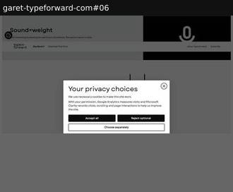

| example | look | feel | ux | learn |
|---|---|---|---|---|
| [garet-typeforward-com#06](../../archive/garet-typeforward-com/blocks/06.jpg) | 'Sound=weight' with a line asking for microphone access and an orange 'We are not recording or storing any data.'; a black panel with a big white microphone button at top right; below, the word 'talk' set huge (~360px) in a hairline weight | Surprising, physical | Press the mic button and allow the microphone; speaking or making noise thickens the letters of 'talk' (per character), silence thins them back | Use the visitor's voice as the axis controller: the word 'talk' invites the action, and loudness → weight is instantly understood |
